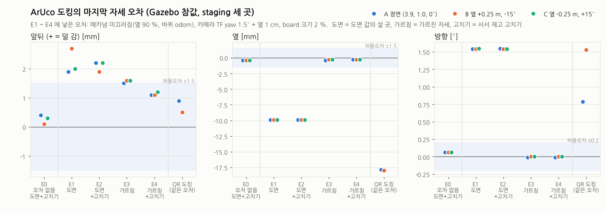
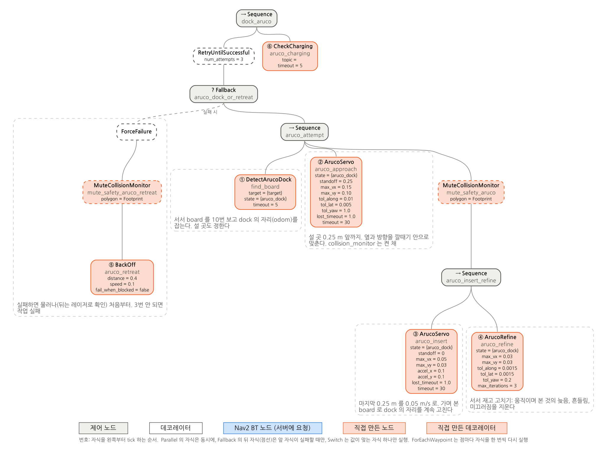
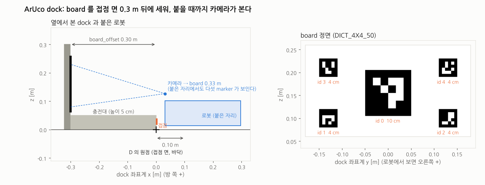
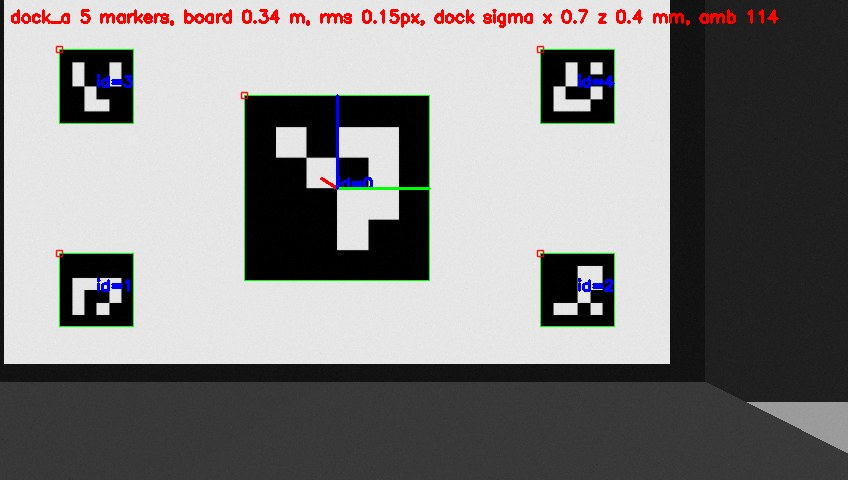

# ArUco 도킹: 메카넘 AMR 을 mm 단위로 붙이기, 그리고 실제 로봇으로 옮길 때

QR 도킹([DOCKING.md](DOCKING.md))과 따로 ArUco board 를 보고 dock 에 붙는 작업 `dock_aruco` 를 만들었다. 목표는 높은 정밀도(옆 ±2 mm, 앞뒤 ±3 mm, 방향 ±0.3° 안)다. 시뮬레이션에서 끝나지 않고 실제 메카넘 로봇에서도 그만큼 나오도록, 시뮬레이션과 실제의 차이(sim-to-real gap)를 일부러 넣고 그것을 지우는 방법까지 확인했다.

```
task> dock_aruco:dock_a 3.9,1.0,0     # (3.9,1.0) 에서 dock 을 보고 선 뒤, board 'dock_a' 의 dock 에 붙는다
task> undock
```



Gazebo 참값으로 잰 마지막 자세 오차 (staging 세 곳, 7장):

- **오차를 넣지 않은 시뮬레이션 (E0)**: 앞뒤 0.1 ~ 0.4 mm, 옆 0.4 mm, 방향 0.06°.
- **실제 로봇에서 생길 차이를 넣으면 (E1 ~ E4)**: 메카넘 미끄러짐, 카메라 TF 1.5° + 1 cm, board 크기 2 % 를 넣었다.
  - 도면 값으로 계산한 설 곳은 몇 번을 다시 재도 옆 9.9 mm, 방향 1.5° 틀린다 (E1, E2).
  - 로봇 스스로는 이 오차를 보지 못한다. 서서 잰 오차는 0.4 mm 로 나왔다.
  - **가르친 자세**를 쓰면 앞뒤 1.1 ~ 1.6 mm, 옆 0.3 ~ 0.4 mm, 방향 0.01° 안이다 (E3, E4).
- 같은 오차에서 QR 도킹은 옆 18 mm 였고, 세 번 중 한 번은 QR 을 찾지 못했다.

목차

- [1. 해 보기 (시뮬레이션)](#1-해-보기-시뮬레이션)
- [2. 정밀도는 어디서 깎이나: 오차 예산](#2-정밀도는-어디서-깎이나-오차-예산)
- [3. 알고리즘](#3-알고리즘)
- [4. 메카넘이라서 한 것](#4-메카넘이라서-한-것)
- [5. 가르친 자세: 도면 값 대신 "그때 본 것"](#5-가르친-자세-도면-값-대신-그때-본-것)
- [6. sim-to-real: 실제 로봇에서 생기는 차이와 줄이는 법](#6-sim-to-real-실제-로봇에서-생기는-차이와-줄이는-법)
- [7. 시뮬레이션에 차이를 넣어 본 실험](#7-시뮬레이션에-차이를-넣어-본-실험)
- [8. 파라미터](#8-파라미터)
- [9. QR 도킹과 무엇이 다른가](#9-qr-도킹과-무엇이-다른가)
- [10. 파일](#10-파일)

---

## 1. 해 보기 (시뮬레이션)

```bash
# 터미널 1: 창고 + 옆으로도 가는 로봇(컬러/깊이 카메라) + 동쪽 벽의 ArUco dock (접점 면 x = 4.55, y = 1.0)
ros2 launch simple_line_bringup simple_line.launch.py world:=warehouse robot:=holonomic dock:=aruco
# 터미널 2
ros2 run bt_mission task_server
# 터미널 3: board 검출 (dock/aruco)
ros2 launch bt_mission aruco_detector.launch.py use_sim_time:=True
# 터미널 4
ros2 run bt_mission task_client.py
task> dock_aruco:dock_a 3.9,-2.5 3.9,1.0,0
task> undock
task> dock_aruco:dock_a 3.9,1.25,-15       # 옆 0.25 m, 비스듬히 15 도에서
```

실제 로봇과의 차이를 넣어 보려면 (7장):

```bash
ros2 launch simple_line_bringup simple_line.launch.py world:=warehouse robot:=holonomic dock:=aruco \
    mecanum_slip:=True camera_tf_error:=1.5,0.0,0.01
ros2 launch bt_mission aruco_detector.launch.py use_sim_time:=True board_scale:=1.02
```

가르친 자세 만들기 (5장): 로봇을 dock 에 제대로 붙여 두고

```bash
ros2 run bt_mission aruco_teach.py --ros-args -p board:=dock_a     # ~/.ros/aruco_taught/dock_a.yaml
```

RViz: `/dock/aruco_debug` (Image, 찾은 marker 와 D 의 축, 예상 오차), `/dock/aruco_estimate` (PoseStamped, 필터가 잡은 dock 자리).

## 2. 정밀도는 어디서 깎이나: 오차 예산

마지막 자세 오차는 아래가 쌓인 것이다. 알고리즘을 고르기 전에 무엇이 크고 무엇이 작은지부터 본다.

| 오차의 근원 | 크기 (이 구성) | 성질 | 다루는 곳 |
|---|---|---|---|
| marker 모서리 위치 잡음 | 0.1 ~ 0.5 px | 무작위 | 여러 marker 의 점을 한 번에 PnP (3-2), 여러 번 합치기 (3-3) |
| 판의 방향(yaw) 추정 | 판 전체: 붙은 자리에서 0.03°, 1 m 에서 0.7°. marker 하나: 정면에서 몇 도 | 무작위 + 뒤집힘 | 넓게 퍼진 board, 공분산으로 무게 (3-2, 3-3) |
| 카메라가 달린 자리 (TF) | 1° 틀리면 붙은 자리에서 옆 6 mm (판까지 0.33 m) | **고정 오차** | 가르친 자세 (5장) |
| 판의 크기, 인쇄, 붙인 자리 | 1 % 틀리면 앞뒤 3 mm | **고정 오차** | 자로 재기, 가르친 자세 |
| 메카넘 미끄러짐 | 옆으로 10 % 안팎, 옆으로 가면 돈다 | 바닥, 하중마다 다름 | 끝까지 영상으로 닫힌 제어 (3-1), 서서 재고 고치기 (3-5) |
| 데드밴드 (아주 느린 명령은 안 움직임) | 수 mm/s | 고정 | 축마다 최소 속도 (4장) |
| 늦음 (영상 → 명령 → 바퀴) | 50 ~ 150 ms | 고정 | 영상 시각의 TF, 느린 마지막 접근, 서서 재기 |
| odom 이 흐름 | 접근 몇 초 동안 mm 단위 | 천천히 | 필터의 random walk (3-3) |

무작위 오차는 많이 보고 평균하면 줄지만, **고정 오차(TF, 판 치수)는 아무리 많이 봐도 그대로 남는다**. 실제 로봇에서 mm 를 못 맞추는 가장 큰 이유가 이것이라서 5장(가르친 자세)을 따로 두었다.

## 3. 알고리즘



### 3-1. board: 접점 면보다 0.3 m 뒤에, 큰 것 하나와 작은 것 넷



- **붙을 때까지 보이게.** board 를 충전 접점 면에 붙이면, 붙기 직전 카메라가 board 에 몇 cm 까지 다가가서 board 가 화면을 넘치거나 초점이 맞지 않는다. QR 도킹은 그래서 마지막 0.27 m 를 odom 으로만 갔다. 메카넘의 odom 은 옆으로 갈 때 몇 % 씩 틀리므로 그 구간이 정밀도를 깎는다. 여기서는 board 를 접점 면보다 0.3 m 뒤 판에 세웠다(충전대는 높이 5 cm 로 낮게). 붙은 자리에서도 카메라와 board 는 0.33 m 떨어져 다섯 marker 가 모두 보인다. **마지막 1 mm 까지 영상으로 닫힌 제어**가 된다.
- **큰 marker (0.10 m)**: 멀리서(약 3 m) 찾는다. **작은 marker 넷 (0.04 m)**: 판 네 귀퉁이에 넓게 퍼져서 방향이 정확하다. 붙은 자리에서도 화면 안에 있게 크기와 자리를 골랐다 (카메라 화각 69° x 42°).
- dock 좌표계 D: 원점 = 바닥에서 충전 접점 면의 가운데, x = 방 쪽, z = 위. 로봇이 설 곳은 D 에서 (0.10, 0, 180°) 다. marker 자리는 `config/aruco_boards.yaml` 에 이 좌표계로 적는다. board 를 옮기거나 바꿔도 "설 곳" 은 그대로다.
- `tools/make_aruco_dock.py` 가 yaml 로 인쇄용 PNG 와 Gazebo dock 모델을 만든다.

### 3-2. 검출: marker 여러 개의 모서리를 한 번에 풀기 (`aruco_detector.py`)

1. OpenCV `ArucoDetector` (DICT_4X4_50), 모서리 서브픽셀 정제. 영상 끝 6 px 안에 걸린 marker 는 버린다 (모서리를 믿을 수 없고, QR 에서는 이것으로 노드가 죽었다).
2. 한 board 의 보이는 marker 모서리를 모두 모아(다섯이면 20점) **PnP 를 한 번에** 푼다. 한 평면이라 `SOLVEPNP_IPPE` 로 두 해를 구해 재투영 오차가 작은 것을 고르고 `solvePnPRefineLM` 으로 다듬는다. 두 해의 오차 비(ambiguity)도 낸다.
3. **공분산**: 모서리 잡음 σ(0.5 px, 재투영 오차가 더 크면 그것)를 PnP 의 Jacobian 으로 자세로 옮긴다. Σ = σ² (JᵀJ)⁻¹ 를 D 의 [위치, 작은 회전] 으로 바꿔 `PoseWithCovariance` 로 낸다.

합성 영상(848 x 480, 잡음, 블러)으로 잰 dock 원점의 오차 (20장, `test/test_aruco_detector.py` 와 같은 방법):

| 카메라 자리 | marker | 앞뒤 [mm] | 옆 [mm] | 방향 [°] | 예상 σ 앞뒤/옆 [mm], 방향 [°] |
|---|---|---|---|---|---|
| 붙은 자리 (board 0.33 m) | 5 | 0.03 | 0.10 | 0.03 | 0.4 / 0.7, 0.11 |
| 0.58 m 앞 | 5 | 0.9 | 1.2 | 0.17 | 1.4 / 1.9, 0.33 |
| 1.0 m, 옆 0.25 m, 15° | 5 | 1.5 | 3.5 | 0.75 | 3.5 / 3.2, 0.68 |
| 1.3 m, -10° | 5 | 1.2 | 4.2 | 0.79 | 6.0 / 6.2, 1.2 |
| 2.5 m | 5 | 7.2 | 3.7 | 0.65 | 23 / 30, 5.6 |
| 0.4 m, marker 하나(0 번)만 | 1 | 8 | **38** | 수 ° | 공분산도 그만큼 크다 |

- 옆 오차는 거의 방향 오차에서 온다. D 의 원점은 board 에서 0.3 m 앞이라 방향이 0.75° 틀리면 원점이 옆으로 4 mm 간다. 그래서 board 의 방향을 정확히 보는 것(넓게 퍼진 marker)이 옆 정밀도를 정한다.
- marker 하나만 보이면 QR 처럼 방향이 몇 도 틀린다. 공분산이 그것을 말해 주므로 필터가 거의 믿지 않는다 (시험 `test_single_marker_is_honest_about_its_yaw`).
- 깊이로 판의 기울기를 구하는 방법(QR 과 같다)도 넣어 두었지만(`use_depth:=True`), board 가 넓으면 PnP 만으로 충분해서 기본은 끈다.

### 3-3. dock 의 자리: 움직이지 않는 물체 하나의 Kalman 필터 (`DockFilter`)

- 상태: D 의 odom 자세 (x, y, yaw). dock 은 움직이지 않으므로 예측은 "그대로" 이고, odom 이 조금씩 흐르는 만큼만 불확실도를 키운다 (random walk, 기본 2 mm/√s, 2 mrad/√s).
- 측정: 영상을 **찍은 시각**의 TF 로 odom 에 옮긴 D, 공분산은 카메라 frame 에서 odom 으로 돌려 (x, y, yaw) 만.
- 갱신: Kalman. 측정마다 공분산이 다르므로 멀리서 본 것(σ 6 mm)보다 가까이서 본 것(σ 0.4 mm)이 수백 배 크게 반영된다. 다가갈수록 저절로 정확해진다.
- 거름: Mahalanobis 거리² > 16.3 (자유도 3, 99.9 %) 이면 버린다. **8번 연달아 버리면 그 측정으로 다시 잡는다.** QR 도킹에서 처음 방향이 18° 틀린 채로 바른 측정을 계속 버리다 실패한 일이 있어서 넣었다.
- 서서 볼 때(`DetectArucoDock`, `ArucoRefine`)는 여러 장을 정보 가중 평균한다 (`fuse`: 중앙값 둘레만, Σ = (Σ Rᵢ⁻¹)⁻¹).

### 3-4. 제어: dock 좌표계에서, 깔때기를 따라 (`mecanumStep`)

로봇 자세를 D 에서 보고, 설 곳과의 오차를 dock 의 축으로 나눈다: along (법선 방향으로 남은 거리), lat (옆), yaw.

```
dock 좌표계의 속도:  v_along = -k_along · along · gate      (dock 쪽으로 갈 때만 gate)
                    v_lat   = -k_lat · lat
                    ω       = -k_yaw · yaw
gate (깔때기): 옆 오차가 폭 w(d) = 4 mm + 0.15 · d 안이면 1, 그 두 배 밖이면 0 (방향도 같은 식, 0.6° + 14°/m · d)
               d = 남은 거리. 멀리서는 넉넉하고, 붙기 직전에는 옆 4 mm, 방향 0.6° 안이어야 들어간다
로봇 좌표계로 돌려서 축마다 최대 속도 (방향은 유지), 최소 속도, 명령 배율, 가속도 제한
```

- 메카넘이라 세 축을 동시에 줄이고, 길은 dock 좌표계에서 곧다. 로봇이 도는 동안에도 매 주기 다시 계산하므로 몸체는 곧게 미끄러져 간다.
- **깔때기**: 옆과 방향이 남은 거리에 비해 크게 틀려 있으면 앞으로 가지 않고 옆과 방향만 고친다. 접점 근처에서 비스듬히 들어가 모서리가 먼저 닿는 일을 막는다. 차동 구동이라면 이때 물러나서 다시 들어와야 하지만 메카넘은 그 자리에서 옆으로 고친다.
- 두 단계: `aruco_approach` (설 곳 0.25 m 앞까지, 0.15 m/s, collision_monitor 켠 채), `aruco_insert` (마지막 0.25 m, 0.05 m/s, collision_monitor 끔).

### 3-5. 서서 재고 고치기 (`ArucoRefine`)

움직이며 본 영상에는 늦음(영상 → 명령 → 바퀴 50 ~ 150 ms), 흔들림(메카넘 롤러의 진동), odom 시각 맞춤 오차가 섞인다. 서서 본 영상에는 없다.

```
반복 (최대 3번):
  서기 0.5 s (진동이 가라앉고, 늦게 오는 영상을 버린다)
  1 s 동안 board 를 보고 합친다 → dock 의 자리를 다시 잡는다
  남은 오차가 1.5 mm, 1.5 mm, 0.2° 안이면 끝
  아니면 odom 으로 그만큼 고친다 (0.03 m/s, 최소 속도로)
```

미끄러져 덜 가면 다음 측정이 잡아서 다시 고친다. 마지막 몇 mm 를 odom 의 정확도와 상관없이 맞추는 방법이다. 메카넘은 옆으로 바로 고칠 수 있어서 물러날 필요가 없다.

## 4. 메카넘이라서 한 것

| 메카넘의 성질 | 문제 | 한 것 |
|---|---|---|
| 옆으로 갈 때 롤러가 미끄러진다 (명령의 80 ~ 95 %) | 명령한 만큼 안 간다, 바퀴 odom 이 틀린다 | 끝까지 영상으로 닫힌 제어. 옆 최대 속도를 앞보다 낮게 (0.10 vs 0.15 m/s), 옆 가속도도 낮게. 실제 로봇에서 잰 배율 `scale_vy` 로 미리 보정 |
| 옆으로 가면 조금씩 돈다 (바닥, 하중 치우침) | 옆을 맞추는 동안 방향이 틀어진다 | 세 축을 동시에 제어 (방향도 매 주기 고친다) |
| 아주 느린 명령은 롤러 마찰 때문에 안 움직인다 (특히 옆) | 마지막 몇 mm 에서 서 버린다 | 축마다 최소 속도 (`min_vy` 0.015 > `min_vx` 0.010). 허용오차 밖에서는 그 밑으로 내리지 않는다 |
| 롤러가 바뀔 때의 진동 | 움직이는 동안 영상이 흔들린다 | 마지막 판단은 서서 본 영상으로 (3-5) |
| 옆으로 바로 갈 수 있다 | 장점 | 깔때기를 벗어나면 그 자리에서 옆으로 고친다. 물러났다 들어오지 않는다 |
| 바퀴 odom 이 옆 움직임에 약하다 | 영상이 끊긴 구간이 위험 | board 를 접점 면 뒤에 두어 끊긴 구간을 없앴다 (3-1) |

## 5. 가르친 자세: 도면 값 대신 "그때 본 것"

도면 값으로 "접점 면 앞 0.10 m" 를 계산하면 이것들이 모두 들어간다: 카메라가 로봇 어디에 어떻게 달렸나(TF), board 의 크기와 붙인 자리, 카메라 내부값. 각각 mm 와 0.x° 단위로 틀리기 쉽고, 몇 번을 봐도 그대로 남는 고정 오차다.

**가르친 자세**: 로봇을 한 번 손으로 제대로 붙여 두고 `aruco_teach.py` 로 그때 카메라가 본 D 의 자세 M* (카메라 frame)를 남긴다. 도킹할 때 설 곳은 지금의 TF Ê(틀려도 된다)로 계산한다.

```
dock 의 자리 (odom)   = 로봇 · Ê · M          (M: 지금 본 것)
설 곳 (D 에서)        = (Ê · M*)⁻¹
설 곳에 섰을 때      ⇔ Ê · M = Ê · M*   ⇔   M = M*  (카메라가 가르칠 때와 같은 것을 본다)
```

Ê 가 틀려도 양쪽에 같이 들어가서 지워진다. board 크기가 1 % 틀리면 M 의 거리가 1 % 틀리지만 M* 도 똑같이 틀렸으므로 지워진다. 남는 것은 가르칠 때 로봇을 얼마나 잘 붙였는지와, 측정의 무작위 오차뿐이다.

- `DetectArucoDock` 는 `~/.ros/aruco_taught/<board>.yaml` 이 있으면 그것을 설 곳으로 쓴다 (없으면 도면 값 `docked_distance`). 로그의 `target (taught ...)` 로 확인한다.
- 카메라를 다시 달거나 board 를 다시 붙이면 다시 가르친다. 여러 dock 이면 dock 마다 가르친다.
- `aruco_teach.py` 는 그때의 TF 로 계산한 로봇 자리(`robot_in_dock_by_tf`)도 적는다. 도면 값(0.10 m, 0, 180°)과 다르면 그 차이가 TF 와 도면의 오차다. 크면 TF 를 다시 재는 계기가 된다.

## 6. sim-to-real: 실제 로봇에서 생기는 차이와 줄이는 법

시뮬레이션은 몇 가지가 실제보다 좋다: 카메라 TF 가 정확하고, board 가 정확한 자리에 정확한 크기로 있고, 바퀴가 미끄러지지 않고(planar_move), 조명이 일정하고, 영상이 흔들리지 않는다. 실제 로봇에서 생기는 차이를 무엇으로 줄이는지, 실제로 어떻게 재는지 정리한다.

| 차이 | 마지막 자세에 주는 영향 | 줄이는 법 | 실제 로봇에서 재는 법 |
|---|---|---|---|
| 카메라 TF (extrinsic) | yaw 1° → 옆 6 mm, 방향 1°. 옆 1 cm → 옆 1 cm | **가르친 자세** (5장). URDF 도 줄자/각도기로 맞춘다 | 로봇을 board 정면에 두고 `aruco_teach.py` 의 `robot_in_dock_by_tf` 와 실제(줄자)를 비교 |
| 카메라 내부값, 왜곡 | 가장자리에서 각 오차 | RealSense 공장 보정값(camera_info)을 쓴다. 의심되면 `camera_calibration` 으로 다시 | 체커보드 재투영 오차 < 0.3 px. `/dock/aruco_debug` 의 rms 가 0.5 px 넘게 오르면 의심 |
| board 의 크기, 인쇄, 평평함 | 1 % → 앞뒤 3 mm | 인쇄 후 자로 재서 yaml 의 size 를 고친다 (또는 `board_scale`). 폼보드/아크릴에 붙인다. **가르친 자세**가 남은 것을 지운다 | marker 한 변을 캘리퍼로 |
| 메카넘 미끄러짐, 데드밴드 | 명령한 만큼 안 감. 바퀴 odom 오차 | 끝까지 영상으로 닫힌 제어, 서서 재고 고치기, 축마다 최소 속도와 명령 배율 | 아래 "배율과 데드밴드 재기" |
| odom 이 흐름 | 접근 중 dock 자리가 밀림 | 필터의 random walk 를 실제 값으로 (`odom_drift`). 가능하면 IMU 와 섞은 odom (robot_localization) | 로봇을 세워 두고 1 분 동안 odom 이 얼마나 흐르나 |
| 늦음 (영상, 명령) | 움직이며 본 자리가 늦게 반영 | 영상의 찍은 시각으로 TF 를 찾는다. 마지막은 느리게(0.05 m/s), 서서 잰다 | 영상 header 의 stamp 와 수신 시각의 차이. realsense-ros 는 `enable_sync`, 하드웨어 시각을 쓴다 |
| 흔들림, 노출 | 모서리가 흐려진다 | 노출 시간을 짧게 고정(자동 노출 끄기), 접근 속도 제한, 서서 잰다 | 움직이는 중과 서 있을 때의 `/dock/aruco` σ 비교 |
| 조명, 반사 | 못 찾거나 모서리가 밀린다 | 무광 인쇄, 역광(창) 피하기. 필요하면 IR 조명 + IR 카메라 | 여러 시간대에 검출률 |
| 바닥, 하중 | 미끄러짐과 데드밴드가 바뀐다 | 배율을 실제 하중에서 잰다. 서서 고치기가 남은 것을 잡는다 | 짐을 싣고 다시 잰다 |
| 접점의 기계 | mm 오차가 접촉 불량이 된다 | 스프링 접점(수 mm 눌림), 충전대 앞에 V 자 가이드(기계적으로 옆을 맞춤). 충전 신호(`CheckCharging`)로 확인 | 20번 붙여서 충전 성공률 |

**배율과 데드밴드 재기** (메카넘, 짐을 실은 상태로)

1. 로봇을 board 정면 0.5 m 에 두고 `/dock/aruco` 를 기록하면서, 옆으로 0.05 m/s 로 정확히 4 초 명령한다 (0.2 m).
2. 영상으로 잰 실제 이동 / 명령한 이동 = 옆 효율. `scale_vy` = 1 / 효율 (예: 0.88 이면 1.14). 앞(`scale_vx`), 회전(`scale_wz`)도 같은 방법.
3. 명령을 0.005 m/s 부터 올려 가며 실제로 움직이기 시작하는 속도 = 데드밴드. `min_vy` 는 그보다 조금 크게.
4. 옆으로 1 m 갈 때 방향이 얼마나 도는지도 본다. 크면 바퀴 마모, 하중 치우침, 롤러 상태를 점검한다.

**실제 로봇에서의 확인 순서**

1. 카메라만: `aruco_detector` 를 띄우고 로봇을 손으로 board 앞 여러 자리에 둔다. `/dock/aruco_debug` 의 rms (< 0.5 px), marker 수, 예상 σ 를 본다.
2. TF 점검: 정면 0.5 m 에 두고 `aruco_teach.py` 의 `robot_in_dock_by_tf` 를 줄자로 잰 값과 비교한다.
3. 배율과 데드밴드를 잰다 (위).
4. 가르친다: 로봇을 손으로 dock 에 제대로 붙이고(충전 신호가 들어오는 자리) `aruco_teach.py`.
5. 반복 시험: `dock_aruco` → `undock` 을 20번. 매번 로봇이 선 자리를 **영상이 아닌 기준**(바닥에 붙인 눈금, 다이얼 게이지, 접점 전압)으로 잰다. 영상으로 잰 오차는 영상 자신의 고정 오차를 보지 못하기 때문이다.
6. 평균(치우침)이 크면 다시 가르치거나 TF 를 고친다. 흩어짐(표준편차)이 크면 허용오차, 최소 속도, 배율, 노출을 본다.

## 7. 시뮬레이션에 차이를 넣어 본 실험

실제 로봇에서 생길 차이 셋을 시뮬레이션에 일부러 넣고, 그것을 무엇이 지우는지 보았다.

| 넣은 차이 | 방법 | 값 |
|---|---|---|
| 메카넘 미끄러짐, 바퀴 odom | `mecanum_slip:=True` (`scripts/mecanum_slip_sim.py`). 몸체는 명령의 일부만 가고, odom 은 바퀴처럼 명령을 적분한다 | 앞 98 %, 옆 90 %, 회전 96 %, 옆 1 m 에 0.04 rad 돎, 속도 잡음 2 % |
| 카메라 TF | `camera_tf_error:=1.5,0.0,0.01`. TF(URDF)의 카메라 자리만 바꾼다. Gazebo 의 카메라는 그대로 | yaw 1.5°, 옆 1 cm |
| board 치수 | `board_scale:=1.02`. 검출기가 board 를 실제보다 2 % 크다고 믿는다 | 2 % |

방법:

- 로봇을 dock 에 제대로 붙은 자리(접점 면 앞 0.10 m)에 놓고 시작한다.
- 가르친 자세(E3, E4)는 이 자리에서 `aruco_teach.py` 로 3초 가르쳤다.
- staging 세 곳마다 `undock` → `dock_aruco:dock_a <staging>` 을 하고, 끝난 자리를 Gazebo 참값으로 잰다.
- "고치기 없음"(E1, E3)은 `ArucoRefine` 의 `max_iterations="0"` 인 트리로 돌렸다 (task_server 의 `bt_xml`).

| | 조건 | 앞뒤 [mm] (+ 덜 감) | 옆 [mm] | 방향 [°] | 로봇이 서서 잰 자기 오차 |
|---|---|---|---|---|---|
| E0 | 차이 없음, 도면 값, 고치기 | +0.1 ~ +0.4 | -0.4 | +0.06 | 0.2 ~ 0.5 mm (고치기 1번) |
| E1 | 차이 넣음, 도면 값 | +1.9 ~ +2.7 | **-9.9** | **+1.54** | 1.0 ~ 1.6 mm, 옆 0.5 mm, 0.01° |
| E2 | 차이 넣음, 도면 값, 고치기 | +1.9 ~ +2.2 | **-9.9** | **+1.54** | 1.1 ~ 1.2 mm, 옆 0.5 mm (고칠 것이 없다고 봄) |
| E3 | 차이 넣음, 가르친 자세 | +1.5 ~ +1.6 | -0.3 ~ -0.4 | 0.00 | 1.6 mm, 옆 0.2 mm |
| E4 | 차이 넣음, 가르친 자세, 고치기 | +1.1 ~ +1.2 | -0.3 | 0.00 | 1.1 mm, 옆 0.2 mm |
| QR | 같은 차이, QR 도킹 (`dock`) | +0.5 ~ +0.9 | **-18** | +0.8 ~ +1.5 | (세 번째는 QR 을 못 찾음) |

읽는 법:

1. **미끄러짐은 거의 영향이 없다.** 바퀴 odom 이 옆으로 10 % 틀려도 board 를 끝까지 보며 닫힌 제어를 하므로 앞뒤 2 mm 안에 선다. 같은 미끄러짐에서 QR 도킹은 마지막 0.27 m 를 odom 으로 간다. QR 의 옆 18 mm 는 카메라 TF 오차와 그 구간이 합쳐진 것이다.
2. **고정 오차는 로봇이 스스로 보지 못한다.** E2 에서 로봇은 서서 재고 "옆 0.5 mm, 0.01°" 라고 판단해 고치지 않았다. 참값은 옆 9.9 mm, 1.5° 였다. 같은 틀린 TF 로 재기 때문이다. 다시 재기와 고치기는 무작위 오차와 실행 오차(미끄러짐, 데드밴드, 늦음)를 지울 뿐, 보정 오차는 지우지 못한다. 그래서 실제 로봇의 정밀도는 반드시 **영상이 아닌 기준**으로 재야 한다 (6장).
3. **가르친 자세는 고정 오차를 지운다** (E3, E4: 옆 0.3 mm, 방향 0.01°). 넣은 TF 오차와 board 크기 오차가 그대로 있는데도 그렇다.
4. **가르칠 때 TF 의 오차도 드러난다.** E3, E4 의 `aruco_teach.py` 가 지금의 TF 로 계산한 로봇 자리는 "x 99.2 mm, y +9.8 mm, yaw 178.45°" 였다. 도면 값 (100 mm, 0, 180°) 과의 차이가 넣은 오차(1 cm, 1.5°)와 맞는다. 실제 로봇에서 TF 를 점검하는 데 쓸 수 있다.
5. **서서 고치기의 몫.** E0 에서는 매번 한 번 고쳐 0.5 mm 안으로 들어갔다. E4 에서는 서서 잰 오차가 이미 1.5 mm 안이라 고치지 않았다. 시뮬레이션에는 영상의 흔들림과 큰 늦음이 없으므로 여기서는 몫이 작다. 실제 로봇(롤러 진동, 50 ~ 150 ms 늦음, 데드밴드)에서는 더 크게 일할 것으로 본다. 확인은 실제 로봇에서 해야 한다.
6. 앞뒤 1 ~ 2 mm 가 남는 것은 다가가기의 허용오차(3 mm)에서 서고, 서서 잰 값이 고치기의 허용오차(1.5 mm) 안이었기 때문이다. 더 줄이려면 `ArucoRefine` 의 `tol_along` 을 줄인다 (그만큼 고치기를 더 한다).



붙은 자리에서 본 `/dock/aruco_debug`. board 까지 0.34 m 이고 다섯 marker 가 모두 보인다. 재투영 오차 0.15 px, 예상 σ 는 옆 0.7 mm, 앞뒤 0.4 mm 이다. ambiguity 114 는 틀린 해의 재투영 오차가 114 배 크다는 뜻이라 방향이 뒤집힐 일이 없다. 축은 D 의 방향이다 (빨강 x = 방 쪽, 초록 y, 파랑 z).

시뮬레이션이 보여 주지 못한 것:

- 영상의 흔들림, 모션 블러, 노출 변화, 조명.
- 카메라와 odom 의 시각 어긋남.
- 접점의 기계적 접촉 (시뮬레이션은 2.7 cm 앞에 선다).
- 바닥 상태에 따라 바뀌는 미끄러짐.

이것들은 6장의 순서로 실제 로봇에서 재고 맞춘다.

## 8. 파라미터

`task.xml` 의 DockAruco 트리에 적힌 값이 시뮬레이션의 waffle 기준이다.

| 노드 | 포트 | 기본값 | 트리 | 뜻 |
|---|---|---|---|---|
| DetectArucoDock | `target` | "" | `{target}` | board 이름 |
| | `min_detections`, `timeout` | 10, 5 s | | 서서 합칠 측정 수 |
| | `docked_distance` | 0.10 m | | 도면 값의 설 곳 (접점 면 앞) |
| | `taught_file`, `taught_dir`, `use_taught` | "", ~/.ros/aruco_taught, true | | 가르친 자세 |
| ArucoServo | `standoff` | 0 | 0.25 / 0 | 설 곳보다 이만큼 앞에서 선다 |
| | `max_vx`, `max_vy`, `max_wz` | 0.15, 0.10 m/s, 0.4 rad/s | approach 0.15/0.10, insert 0.05/0.03 | |
| | `min_vx`, `min_vy`, `min_wz` | 0.010, 0.015 m/s, 0.03 rad/s | | 데드밴드 |
| | `accel_x`, `accel_y`, `accel_wz` | 0.3, 0.2 m/s², 1.0 rad/s² | insert 0.1, 0.1 | |
| | `scale_vx`, `scale_vy`, `scale_wz` | 1, 1, 1 | | 명령 / 실제 (실제 로봇에서 잰다) |
| | `k_along`, `k_lat`, `k_yaw` | 0.8, 1.2, 1.5 /s | | |
| | `tol_along`, `tol_lat`, `tol_yaw` | 3 mm, 2 mm, 0.29° | approach 10 mm, 5 mm, 1° | |
| | `funnel_lat0`, `funnel_lat_slope` | 4 mm, 0.15 | | 깔때기 폭 = lat0 + slope · 남은 거리 |
| | `funnel_yaw0`, `funnel_yaw_slope` | 0.57°, 14.3°/m | | |
| | `odom_drift` | 0.002 | | 필터의 random walk [m/√s, rad/√s] |
| | `lost_timeout` | 1 s | | |
| ArucoRefine | `settle_time`, `measure_time` | 0.5 s, 1 s | | |
| | `max_iterations` | 3 | | |
| | `tol_*` | 위와 같음 | 1.5 mm, 1.5 mm, 0.2° | 서서 잰 오차가 이 안이면 끝 |
| | `accept_along`, `accept_lat`, `accept_yaw` | 5 mm, 4 mm, 1° | | 마지막에도 tol 밖이면, 이 안이면 성공 |

aruco_detector.py (`launch/aruco_detector.launch.py`): `boards_file`, `board_scale` (1.0), `pixel_sigma` (0.5 px), `use_depth` (False), `min_marker_px` (12), `camera` (/camera).

## 9. QR 도킹과 무엇이 다른가

| | QR (`dock`) | ArUco (`dock_aruco`) |
|---|---|---|
| 자세 | QR 하나, 네 모서리 (넷째는 추정). 방향은 깊이로 | marker 다섯의 20점을 한 번에. 깊이는 선택 |
| 보이는 거리 | 0.145 m QR 이 1 m 안팎 | 0.10 m marker 가 약 3 m |
| 마지막 구간 | 카메라 0.3 m 안은 odom 만 (약 0.27 m) | board 를 접점 면 뒤에 두어 끝까지 영상 |
| dock 자리 추정 | 최근 10개의 중앙값 평균 | 공분산을 쓰는 Kalman, 거르고 다시 잡기 |
| 제어 | 로봇 좌표계 P 제어 | dock 좌표계, 깔때기, 축마다 최소 속도와 배율 |
| 마무리 | 허용오차 5 mm 에서 선다 | 서서 재고 고치기 (1.5 mm) |
| 고정 오차 | 도면 값 | 가르친 자세로 지움 |
| 시뮬레이션 결과 | ±5 mm, 0.6°. 같은 차이를 넣으면 옆 18 mm | 0.4 mm, 0.06°. 같은 차이에서 가르친 자세로 옆 0.4 mm, 0.01° |

## 10. 파일

```
bt_navigator/
├── ARUCO_DOCKING.md                              이 문서
├── docs/aruco_*.png                              그림 (실험, board, 카메라 화면)
├── bt_mission_msgs/msg/ArucoDetection.msg        board 하나: 자세 + 공분산, 쓴 marker, 재투영 오차, ambiguity
└── bt_mission/
    ├── config/aruco_boards.yaml                  board: dock 좌표계의 marker 자리와 크기
    ├── scripts/aruco_detector.py                 검출, board PnP, 공분산, (깊이 평면)
    ├── scripts/aruco_teach.py                    가르친 자세 남기기
    ├── launch/aruco_detector.launch.py
    ├── tools/make_aruco_dock.py                  인쇄용 PNG, Gazebo dock 모델
    ├── include/bt_mission/aruco_dock_control.hpp ROS 없는 계산: 2D 자세, DockFilter, fuse, mecanumStep, 깔때기
    ├── include/bt_mission/aruco_dock_nodes.hpp   DetectArucoDock, ArucoServo, ArucoRefine
    ├── src/aruco_dock_nodes.cpp
    ├── behavior_trees/task.xml                   DockAruco 트리 (Task 트리의 dock_aruco 가지)
    ├── test/test_aruco_dock_control.cpp          필터, 깔때기, 축 제한, 미끄러짐 + 늦음 속 폐루프
    ├── test/test_aruco_detector.py               합성 영상: board 좌표계, 붙은 자리 정밀도, 공분산, marker 하나
    └── doc/dock_aruco.png                        BT 그림

simple_line/simple_line_bringup/
├── models/aruco_dock/                            접점 면 0.3 m 뒤에 board 를 세운 충전대 (make_aruco_dock.py)
├── scripts/mecanum_slip_sim.py                   메카넘 미끄러짐과 바퀴 odom 흉내 (mecanum_slip:=True)
└── launch/simple_line.launch.py                  dock:=aruco|both, mecanum_slip, camera_tf_error
```
