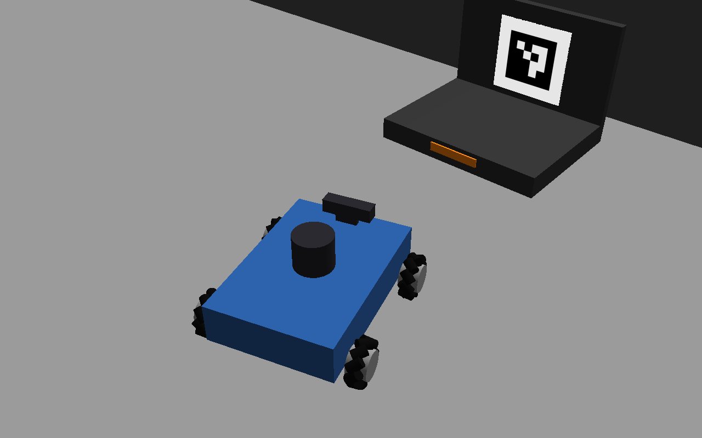
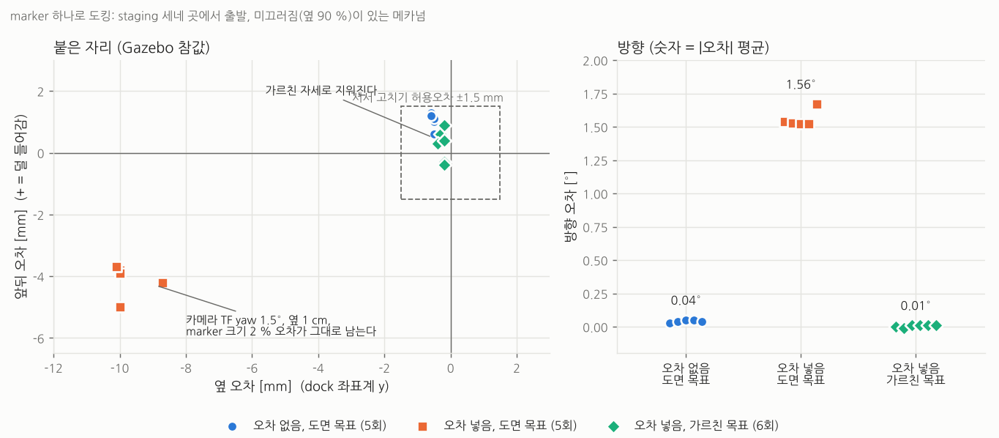
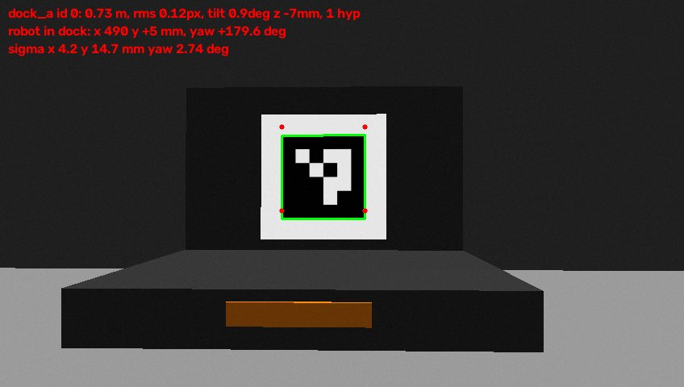
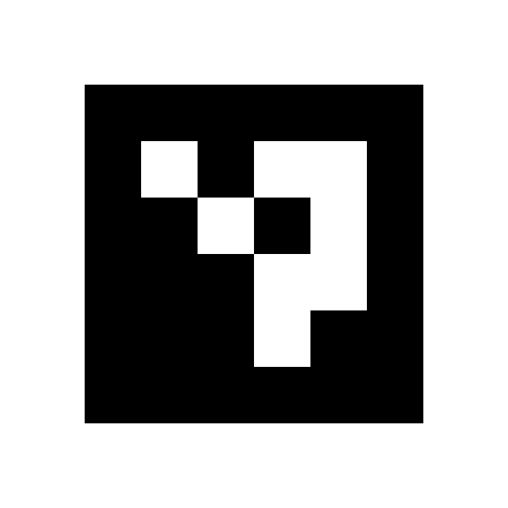
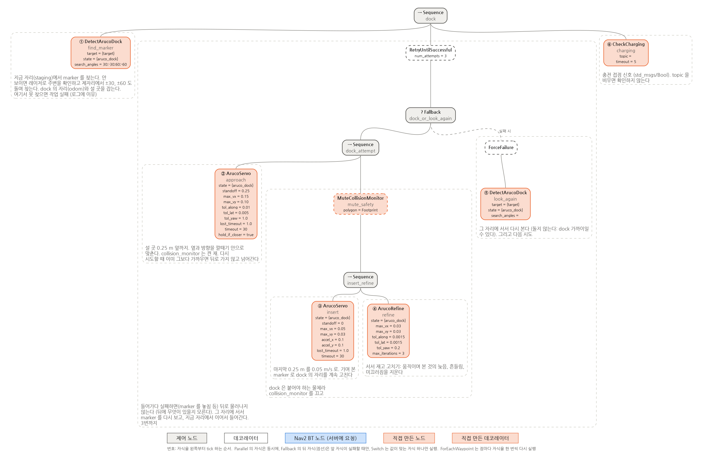

# ArUco marker 하나로 정밀 도킹 (메카넘)

dock(충전대) 뒤판에 붙인 **ArUco marker 하나**를 RealSense 컬러 카메라로 보고, 4바퀴 메카넘 로봇을 충전 접점에 mm 단위로 붙인다. 작업은 `task_client.py` 의 `dock:<dock 이름> <staging 자리>` 로 보낸다. 미션 BT 의 다른 부분은 [README.md](README.md).



시뮬레이션 로봇 (`simple_line.launch.py robot:=mecanum`, `simple_line_bringup/robots/make_mecanum.py`): 몸체 0.32 x 0.22 m, 45° 롤러 바퀴 넷 (X 배치, 반지름 0.04 m, 폭까지 0.30 m), 앞쪽 가운데 RealSense (높이 0.13 m), 위 라이다. base_footprint = 네 바퀴의 가운데, 바닥. 앞면이 중심에서 0.16 m 라서 접점 면 0.17 m 앞에 선다.

Gazebo 결과 (참값, 10회 모두 성공):

| 조건 | 앞뒤 [mm] | 옆 [mm] | 방향 [°] |
|---|---|---|---|
| 실제와의 차이 없음, 도면 값 목표 | -0.8 ~ +0.7 | -0.5 ~ -0.6 | 0.00 |
| 차이 넣음 (메카넘 미끄러짐 + 카메라 TF yaw 1.5°, 옆 1 cm + marker 크기 2 %), 도면 값 목표 | -5.5 ~ -7.0 | **-5.5 ~ -7.0** | **+1.47 ~ +1.52** |
| 같은 차이, **가르친 자세** 목표 | +0.8 ~ +1.3 | -0.5 | -0.02 ~ -0.03 |



목차

- [1. 해 보기 (시뮬레이션)](#1-해-보기-시뮬레이션)
- [2. 정밀도는 어디서 깎이나: 오차 예산](#2-정밀도는-어디서-깎이나-오차-예산)
- [3. 자세 추정: marker 하나에서 dock 의 자세까지](#3-자세-추정-marker-하나에서-dock-의-자세까지)
- [4. dock 의 자리: 후보 고르기와 Kalman 필터](#4-dock-의-자리-후보-고르기와-kalman-필터)
- [5. 제어: dock 좌표계, 깔때기, 서서 재고 고치기](#5-제어-dock-좌표계-깔때기-서서-재고-고치기)
  - [5-4. 안 보일 때, 놓쳤을 때: 뒤로 가지 않고 그 자리에서](#5-4-안-보일-때-놓쳤을-때-뒤로-가지-않고-그-자리에서)
  - [5-5. find_marker 가 실패할 때](#5-5-find_marker-가-실패할-때)
- [6. 가르친 자세: 고정 오차 지우기](#6-가르친-자세-고정-오차-지우기)
- [7. 시뮬레이션 실험](#7-시뮬레이션-실험)
- [8. 실제 로봇에서 정밀도 높이기 (sim-to-real)](#8-실제-로봇에서-정밀도-높이기-sim-to-real)
- [9. 파라미터](#9-파라미터)
- [10. 파일](#10-파일)
- [참고 자료](#참고-자료)

---

## 1. 해 보기 (시뮬레이션)

```bash
# 터미널 1: 창고 + 4바퀴 메카넘 로봇(컬러 카메라) + 동쪽 벽의 ArUco dock (접점 면 x = 4.55, y = 1.0)
#          + marker 검출 노드 (aruco_detector.launch.py 를 같이 띄운다. 따로 띄우려면 aruco_detector:=False)
ros2 launch simple_line_bringup simple_line.launch.py world:=warehouse robot:=mecanum dock:=True
# 터미널 2
ros2 run bt_mission task_server
# 터미널 3
ros2 run bt_mission task_client.py
task> dock:dock_a 3.85,-2.5 3.85,1.0,0    # 마지막 점 = dock 앞 staging 자리 (planner 가 직선이라 한 점을 거친다)
task> undock
task> dock:dock_a 3.85,1.25,-15           # 옆 0.25 m, 비스듬히 15 도에서
```

실제 로봇과의 차이를 넣어 보려면 (7장):

```bash
ros2 launch simple_line_bringup simple_line.launch.py world:=warehouse robot:=mecanum dock:=True \
    mecanum_slip:=True camera_tf_error:=1.5,0.0,0.01 aruco_detector:=False
ros2 launch bt_mission aruco_detector.launch.py use_sim_time:=True marker_scale:=1.02
```

가르친 자세 만들기 (6장): 로봇을 dock 에 제대로 붙여 두고 (시뮬레이션에서는 `x_pose:=4.38 y_pose:=1.0 yaw:=0.0` 으로 그 자리에 띄운다)

```bash
ros2 run bt_mission aruco_teach.py --ros-args -p dock:=dock_a     # ~/.ros/aruco_taught/dock_a.yaml
```

RViz: `/dock/aruco_debug` (Image: 찾은 marker, 바닥 위 자세로 다시 그린 모서리, 예상 오차), `/dock/aruco_estimate` (PoseStamped: 필터가 잡은 dock 자리).



marker 0.71 m 앞에서 본 `/dock/aruco_debug`. 초록 = 검출한 모서리, 빨간 점 = 추정한 바닥 위 자세 (x, y, yaw) 로 다시 그린 모서리. 둘이 겹치고 진단 값이 `tilt 0.1deg z +1mm` 이면 카메라 TF 와 config 가 맞다 (3-4). 둘이 어긋나고 tilt, z 가 크면 카메라 TF(높이, pitch)나 marker 높이가 틀렸다.

## 2. 정밀도는 어디서 깎이나: 오차 예산

dock 좌표계 D: 원점 = 바닥에서 충전 접점 면의 가운데, x = 방 쪽, z = 위. 로봇은 D 에서 (0.17 m, 0, 180°) 에 선다 (시뮬레이션의 메카넘). marker 는 접점 면보다 0.3 m 뒤에 있다 (3-1).

| 오차의 근원 | 크기 (이 구성) | 성질 | 다루는 곳 |
|---|---|---|---|
| 모서리 위치 잡음 | 0.1 ~ 0.3 px | 무작위 | 공분산으로 무게 (3-3), 여러 장 합치기 (4장), 서서 재기 (5-3) |
| **marker 의 방향(yaw)** | 정면에서 원근(사다리꼴)으로만 보인다. 0.32 m 에서 0.02°, 1.45 m 에서 수 ° | 무작위 + 뒤집힘 | 바닥 사전분포 MAP (3-2), 필터 (4장) |
| 지렛대 | marker → 붙은 자리 0.47 m. 방향 1° = 옆 8 mm | 기하 | marker 를 크게, 가까이 (8-3) |
| 카메라 TF (extrinsic) | yaw 1.5°, 옆 1 cm → 옆 10 mm, 방향 1.5° (7장) | **고정 오차** | 가르친 자세 (6장) |
| marker 크기, 인쇄, 붙인 자리 | 2 % → 앞뒤 5 mm | **고정 오차** | 자로 재기, 가르친 자세 |
| 서브픽셀 모서리의 편향 | 안쪽으로 0.1 ~ 0.3 px (블러에 따라) → 거리 수 mm | **고정 오차** | 가르친 자세 |
| 메카넘 미끄러짐 | 옆으로 10 % 안팎, 옆으로 가면 돈다 | 바닥, 하중마다 다름 | 끝까지 영상으로 닫힌 제어, 서서 재고 고치기 (5장) |
| 데드밴드 | 수 mm/s 아래의 명령은 안 움직인다 | 고정 | 축마다 최소 속도 (5-2) |
| 늦음 (영상 → 명령 → 바퀴) | 50 ~ 150 ms | 고정 | 영상 시각의 TF (4-1), 느린 마지막 접근, 서서 재기 |
| odom 이 흐름 | 간 거리의 수 % | 움직임에 비례 | 필터의 예측 (4-2) |

무작위 오차는 많이 보고 평균하면 줄지만, **고정 오차(TF, marker 치수, 모서리 편향)는 아무리 많이 봐도 그대로 남는다.** 로봇이 서서 다시 재도 같은 틀린 값으로 재므로 스스로 알아채지 못한다 (7장 E1). 그래서 6장(가르친 자세)이 있다.

## 3. 자세 추정: marker 하나에서 dock 의 자세까지

`scripts/aruco_detector.py`. 영상 한 장마다 로봇(base_footprint)에서 본 dock 의 바닥 위 자세 (x, y, yaw) 후보 1 ~ 2 개와 각각의 공분산을 `dock/aruco` 로 낸다 (`bt_mission_msgs/ArucoDetection`, 영상을 찍은 시각).

### 3-1. marker: 접점 면 0.3 m 뒤, 0.12 m



- **붙을 때까지 보이게.** marker 를 접점 면에 붙이면 붙기 직전 카메라가 몇 cm 까지 다가가 화면을 넘치고 초점이 맞지 않는다. 그러면 마지막 구간을 바퀴 odom 으로만 가야 하고, 메카넘의 odom 은 옆으로 갈 때 몇 % 씩 틀린다. 그래서 marker 를 접점 면보다 0.3 m 뒤 판에 세웠다 (충전대는 높이 5 cm 로 낮게). 붙은 자리에서도 카메라와 marker 는 0.32 m 떨어져 약 230 px 로 보인다. **마지막 mm 까지 영상으로 닫힌 제어**가 된다.
- 크기 0.12 m (DICT_4X4_50 의 0 번): 붙은 자리에서 화면 안에 들어가는 가장 큰 크기 (화각 69° x 42°, 카메라 높이 0.13 m, marker 중심 높이 0.155 m). 약 3 m 에서도 찾는다. 흰 여백(quiet zone)은 한 변의 1/4.
- `config/aruco_docks.yaml` 에 dock 마다 marker 번호, 크기, 뒤로 물린 거리(offset), 높이, 옆 위치를 적는다. `tools/make_aruco_dock.py` 가 이것으로 인쇄용 PNG 와 Gazebo dock 모델을 만든다.

### 3-2. 왜 그냥 PnP 가 아닌가: 평면 정사각형의 두 해와 기울기-방향 섞임

정사각형 하나(점 4개)의 PnP 는 IPPE(Infinitesimal Plane-based Pose Estimation, Collins & Bartoli)로 풀면 **해가 둘** 나온다. 정면에 가깝거나 멀어서 원근이 약하면 두 해의 재투영 오차가 거의 같다. 두 해는 marker 면의 법선이 시선 둘레로 반대쪽에 기운 것이라, 오차가 작은 쪽을 고르면 가끔 몇 ~ 십몇 도 뒤집힌 방향을 고른다 (QR 하나로 도킹할 때 생긴 문제와 같다).

뒤집히지 않아도, 모서리 넷으로는 marker 의 **방향(yaw)과 기울기(pitch, roll)가 잘 갈리지 않는다.** 정면에서 yaw 가 바뀌면 왼쪽과 오른쪽 변의 길이가 조금 달라질 뿐이고(0.33 m 에서 1° 에 0.7 px 남짓), 모서리 잡음 0.2 px 도 그만큼 흔든다. marker 에서 붙은 자리까지 0.4 m 지렛대가 있으므로 방향 1° 는 옆 7 mm 가 된다.

### 3-3. 바닥 사전분포를 둔 6자유도 MAP (핵심)

dock 은 바닥에 서 있다. 카메라가 로봇 어디에 달렸는지(TF), marker 의 높이도 안다. 그러면 모를 것은 바닥 위의 x, y, yaw 셋뿐이다. 그런데 이것을 **못박으면(3자유도) 안 된다.** 카메라 TF 의 높이가 1 cm, pitch 가 1° 만 틀려도, 풀이가 기울기 0 과 높이 0 을 맞추려고 방향을 비틀어 옆으로 수 cm 틀린다 (아래 표). 실제 로봇의 TF 는 그 정도는 틀리고, 로봇은 가감속 때 앞뒤로 기운다.

그래서 base 에서 본 D 의 6자유도 p = (x, y, yaw, z, roll, pitch) 를 풀되, "바닥에 서 있다" 를 **사전분포**로 둔다:

```
p* = argmin_p   Σᵢ ‖ π(K, T_cam←base · T_base←D(p) · cᵢ) − uᵢ ‖² / σ_px²      (모서리 4개 = 식 8개)
             +  z² / σ_z²  +  roll² / σ_tilt²  +  pitch² / σ_tilt²             (사전분포: σ_z 1 cm, σ_tilt 1.5°)

cᵢ: D 에서 marker 모서리 (config 의 offset, 높이, 크기),  uᵢ: 검출한 모서리,  π: 카메라 투영 (왜곡 포함)
풀이: Levenberg-Marquardt. 시작점은 IPPE 의 두 해 (각각 base 로 옮긴 것)
```

- 가까이서 영상이 기울기를 잘 말해 주면 영상이 이긴다 (TF 가 틀려도 따라간다). 멀거나 정면이라 말해 주지 못하면 사전분포가 이긴다 (뒤집힌 해, 기울기-방향 섞임을 막는다). 식 8개 + 사전 3개로 6개를 푸니 늘 과결정이다.
- 두 시작점이 같은 자리로 모이면(5 mm, 0.5° 안) 후보 하나, 다른 자리로 모이면 둘 다 비용 순으로 낸다. 고르는 것은 BT 가 한다 (4장).
- 이것은 사전 지식을 확률로 넣은 최대 사후 확률(MAP) 추정이다. 정보 행렬 `JᵀJ` 에서 공분산이 바로 나온다 (3-4).

합성 영상(848 x 480, 블러, 잡음 σ 2)으로 비교했다. "붙은 자리의 옆 오차" = 추정한 dock 으로 붙었을 때 로봇이 옆으로 어긋날 거리 [mm] / 방향 오차 [°], 6장의 평균:

| 로봇 자리 (D 에서, 카메라 ↔ marker) | 카메라 TF | 3자유도 못박기 | **MAP (이것)** | 6자유도 PnP |
|---|---|---|---|---|
| 붙은 자리 0.17 m (0.32 m) | 맞음 | 0.2 / 0.02 | **0.1 / 0.02** | 0.4 / 0.05 |
| | 높이 1 cm 틀림 | 0.1 / 0.01 | **0.1 / 0.02** | 0.4 / 0.05 |
| | pitch 1° 틀림 | 0.3 / 0.04 | **0.1 / 0.02** | 0.4 / 0.05 |
| 0.70 m 앞, 옆 5 cm (0.85 m) | 맞음 | 1.4 / 0.15 | **0.6 / 0.05** | 1.2 / 0.14 |
| | 높이 1 cm 틀림 | 21.7 / 2.91 | **0.4 / 0.04** | 1.2 / 0.14 |
| | pitch 1° 틀림 | 147.4 / 18.6 | **0.7 / 0.07** | 1.2 / 0.14 |
| 1.0 m 정면 (1.15 m) | 맞음 | 0.9 / 0.11 | **0.9 / 0.11** | 0.9 / 0.11 |
| 1.3 m 정면 (1.45 m) | 맞음 | 40.9 / 4.96 | **39.7 / 4.81** | 55.4 / 6.74 |
| 1.6 m 정면 (1.75 m) | 맞음 | 4.2 / 0.51 | **1.8 / 0.22** | 2.0 / 0.24 |
| 2.5 m 정면 (2.65 m) | 맞음 | 14.8 / 1.76 | **10.8 / 1.42** | 13.1 / 1.69 |

- 못박기는 TF 가 틀리면 비스듬한 자리에서 무너진다 (0.7 m, 옆 5 cm 에서 2 cm, 15 cm). 정면 가운데서는 높이 오차가 거리로만 가서 버틴다. 실제 로봇은 비스듬히 다가가므로 이 표가 MAP 을 고른 이유다 (`test_wrong_camera_extrinsics_do_not_break_it`).
- MAP 은 어디서나 PnP 와 같거나 낫고, 두 해가 비슷해지는 자리(1.3 m 정면)에서 차이가 크다 (`test_floor_prior_stops_the_flip_far_away`).
- **1 m 넘게 정면에서 본 한 장은 방향이 몇 ° 틀릴 수 있다** (어느 거리에서 크게 틀리는지는 모서리가 화소에 걸리는 모양에 따라 다르다). 0.12 m marker 하나의 물리적 한계다. 그래서 dock 자리를 한 장으로 정하지 않고, 다가가며 정확해지는 측정을 필터로 합친다 (4장). 붙은 자리(0.32 m)에서는 0.02° 다.

### 3-4. 공분산과 진단

- **공분산**: 영상 행은 σ_px = max(`pixel_sigma` 0.5 px, 재투영 RMS) 로, 사전 행은 σ_z, σ_tilt 로 나눈 Jacobian J (11 x 6) 의 정보 행렬 JᵀJ 를 뒤집어 (x, y, yaw) 부분을 꺼낸다. 이것이 z, roll, pitch 를 marginalize 한 공분산이다. 멀거나 비스듬하면 크고 가까우면 작다. 필터가 측정마다 무게를 다르게 주는 근거다.
- **진단**: MAP 이 추정한 dock 의 기울기(`tilt_deg`)와 바닥 높이(`height_offset`). 가까이서(0.8 m 안) 늘 3°, 1.5 cm 를 넘으면 경고한다: 카메라 TF(pitch, 높이), config 의 marker 높이, base frame 의 높이 중 무엇이 틀렸다. 실제 로봇에서 TF 를 점검하는 값으로 쓴다 (8-1).
- 영상 끝 6 px 안에 걸린 marker, 한 변 16 px 보다 작은 marker 는 버린다. OpenCV 의 `minDistanceToBorder` 는 0 으로 둔다: 기본값 3 이면 붙은 자리에서 크게 보이는 marker 를 후보에서 빼 버리는 일이 Gazebo 에서 있었다 (`test/data/gazebo_docked.jpg` 로 회귀 시험).
- OpenCV 4.5 (Ubuntu 22.04 의 `python3-opencv`, `cv2.aruco.detectMarkers`) 와 4.7 이상(`ArucoDetector`) 을 모두 쓴다.

## 4. dock 의 자리: 후보 고르기와 Kalman 필터

`include/bt_mission/aruco_dock_control.hpp` (ROS 없는 계산), `src/aruco_dock_nodes.cpp`.

### 4-1. 측정: 영상을 찍은 시각의 로봇 자리로

detector 는 base 에서 본 자세를 낸다. BT 는 영상을 **찍은 시각**의 TF (odom ← base_footprint) 로 그것을 odom 에 옮긴다: z = T_odom←base(t_영상) ∘ q. 움직이며 찍은 영상이 50 ~ 150 ms 늦게 와도 그만큼 틀리지 않는다. 공분산은 base 의 yaw 만큼 돌린다 (R Σ Rᵀ).

### 4-2. 필터: 움직이지 않는 물체 하나 (`DockFilter`)

- 상태: D 의 odom 자세 (x, y, yaw). dock 은 움직이지 않으므로 예측은 "그대로" 이고, odom 이 흐르는 만큼만 불확실도를 키운다:
  - 시간에 비례 (random walk, `odom_drift` 2 mm/√s),
  - **움직인 거리에 비례** (`odom_slip` 10 %, `odom_yaw_per_m` 0.05 rad/m, `odom_turn_slip` 5 %). 바퀴 odom 의 오차는 시간보다 간 거리에 비례하고, 메카넘은 옆으로 갈 때 특히 크다.
- 갱신: Kalman (관측 = 상태). 측정마다 공분산이 다르므로 멀리서 본 것(σ 수 mm, 수 °)보다 가까이서 본 것(σ 0.5 mm, 0.1°)이 수백 배 크게 반영된다. 다가갈수록 저절로 정확해진다.
- **후보 고르기** (`closestHypothesis`): 후보가 둘이면 필터에 Mahalanobis 거리(필터 + 측정 공분산)로 가까운 쪽을 쓴다. 뒤집힌 해가 비용이 조금 더 작아 첫 후보로 와도 버려진다.
- 거름: Mahalanobis 거리² > 16.3 (자유도 3, 99.9 %) 이면 버린다. **8번 연달아 버리면 그 측정으로 다시 잡는다.** 처음 값이 틀렸을 때 바른 측정을 계속 버리는 것을 막는다. 카메라 TF 가 틀리면 그 오차가 거리마다 달라서 접근 초반에 한 번쯤 다시 잡는다 (로그의 `re-initialized`, 7장).

### 4-3. 서서 여러 장 합치기 (`fuseDetections`)

`DetectArucoDock` (처음), `ArucoRefine` (마지막) 은 서서 본 여러 장을 합친다.

1. 장마다 첫 후보로 robust fuse: 중앙값 둘레(Mahalanobis gate)만 정보 가중 평균 (Σ = (Σ Rᵢ⁻¹)⁻¹, x = Σ Σ Rᵢ⁻¹ zᵢ). 뒤집힌 장이 절반 아래면 다수결로 버려진다.
2. 그 결과에 가장 가까운 후보를 장마다 다시 골라 한 번 더 fuse. 첫 후보가 뒤집힌 쪽이던 장도 바른 후보로 쓴다.

## 5. 제어: dock 좌표계, 깔때기, 서서 재고 고치기



```
find_marker   DetectArucoDock: 그 자리에서 보고, 안 보이면 제자리에서 돌며 찾는다 (5-4). 못 찾으면 작업 실패
3번까지:
  approach    ArucoServo: 설 곳 0.25 m 앞까지, 0.15 m/s, collision_monitor 켠 채. 이미 더 가까우면 건너뛴다
  insert      [collision_monitor 끔] ArucoServo: 마지막 0.25 m, 0.05 m/s
  refine      ArucoRefine: 서서 재고 고치기
  실패하면    look_again: 그 자리에 서서 다시 본다 (돌지 않는다, 뒤로 가지 않는다) → 지금 자리에서 다음 시도
CheckCharging (충전 신호, 선택)
```

### 5-1. dock 좌표계의 오차와 깔때기 (`mecanumStep`)

로봇 자세를 D 에서 보고, 설 곳과의 오차를 dock 의 축으로 나눈다: along (법선 방향으로 남은 거리), lat (옆), yaw.

```
dock 좌표계의 속도:  v_along = -k_along · along · gate      (dock 쪽으로 갈 때만 gate)
                    v_lat   = -k_lat · lat
                    ω       = -k_yaw · yaw
gate (깔때기): 옆 오차가 폭 w(d) = 4 mm + 0.15 · d 안이면 1, 그 두 배 밖이면 0 (방향도 같은 식, 0.6° + 14°/m · d)
               d = 남은 거리. 멀리서는 넉넉하고, 붙기 직전에는 옆 4 mm, 방향 0.6° 안이어야 들어간다
로봇 좌표계로 돌려서 축마다 최대 속도 (방향은 유지), 최소 속도, 명령 배율, 가속도 제한
```

- 메카넘이라 세 축을 동시에 줄이고, 길은 dock 좌표계에서 곧다. 매 주기 다시 계산하므로 몸체는 곧게 미끄러져 간다.
- **깔때기**: 옆과 방향이 남은 거리에 비해 크게 틀리면 앞으로 가지 않고 옆과 방향만 고친다. 접점 근처에서 비스듬히 들어가 모서리가 먼저 닿는 일을 막는다. 차동 구동이면 물러났다 다시 들어와야 하지만 메카넘은 그 자리에서 옆으로 고친다.

### 5-2. 메카넘이라서 한 것

| 메카넘의 성질 | 문제 | 한 것 |
|---|---|---|
| 옆으로 갈 때 롤러가 미끄러진다 (명령의 80 ~ 95 %) | 명령한 만큼 안 간다, 바퀴 odom 이 틀린다 | 끝까지 영상으로 닫힌 제어. 옆 최대 속도와 가속도를 앞보다 낮게. 실제 로봇에서 잰 배율 `scale_vy` 로 미리 보정. 필터의 예측 불확실도를 간 거리에 비례 |
| 옆으로 가면 조금씩 돈다 | 옆을 맞추는 동안 방향이 틀어진다 | 세 축을 동시에 제어 (방향도 매 주기 고친다) |
| 아주 느린 명령은 롤러 마찰 때문에 안 움직인다 (특히 옆) | 마지막 몇 mm 에서 서 버린다 | 축마다 최소 속도 (`min_vy` 0.015 > `min_vx` 0.010 m/s) |
| 롤러가 바뀔 때의 진동 | 움직이는 동안 영상이 흔들린다 | 마지막 판단은 서서 본 영상으로 (5-3) |
| 옆으로 바로 갈 수 있다 | 장점 | 깔때기를 벗어나면 그 자리에서 옆으로 고친다 |

### 5-3. 서서 재고 고치기 (`ArucoRefine`)

움직이며 본 영상에는 늦음, 흔들림, 시각 맞춤 오차가 섞인다. 서서 본 영상에는 없다.

```
반복 (최대 3번):
  서기 0.5 s (진동이 가라앉고, 늦게 오는 영상을 버린다)
  1 s 동안 marker 를 보고 합친다 (fuseDetections) → dock 의 자리를 다시 잡는다
  남은 오차가 1.5 mm, 1.5 mm, 0.2° 안이면 끝
  아니면 odom 으로 그만큼 고친다 (0.03 m/s, 최소 속도로)
```

미끄러져 덜 가면 다음 측정이 잡아서 다시 고친다. odom 의 정확도와 상관없이 마지막 몇 mm 를 맞춘다. 한 장의 σ 는 붙은 자리에서 옆 1 ~ 5 mm (보수적인 0.5 px 기준) 이지만 15장을 합치면 1/4 쯤이 된다.

### 5-4. 안 보일 때, 놓쳤을 때: 뒤로 가지 않고 그 자리에서

예전 트리는 실패하면 `BackOff` 로 0.4 m 물러나서 처음부터 다시 했다. 뒤를 레이저로 보긴 하지만, 레이저(높이 0.16 m)보다 낮은 물건이나 사람의 발은 못 본다. 그리고 물러나도 더 잘 보이는 것이 아니다: 못 찾는 이유는 대개 **방향**(staging 에 섰을 때 AMCL 방향 오차로 marker 가 화면 밖)이거나 **잠깐 가려짐**이다. 그래서 물러나지 않고 그 자리에서 해결한다.

**처음 찾기 (`find_marker`, DetectArucoDock)**

```
서기 0.5 s → 3 s 동안 본다 → 8장 보면 끝 (3 s 가 지나도 3장 이상이면 끝)
안 보이면: detector 가 아예 없으면(토픽에 publisher 없음) 바로 실패. 돌아 봐야 소용없다
           있으면 처음 방향에서 +30°, -30°, +60°, -60° 로 차례로 제자리 회전 → 서서 다시 본다
           (카메라 화각 69° 라 처음 방향 ±95° 를 덮는다)
           도는 중에 marker 가 보이면 그 자리에 서서 본다
돌기 전과 도는 동안 매 주기: 레이저로 몸이 쓸고 갈 원 (turn_radius 0.22 m + 여유 0.05 m) 안을 본다
           점이 3개 넘게 있으면 돌지 않는다 (이미 돌던 중이면 그 자리에 선다)
```

- 메카넘은 제자리에서 돌므로(중심 = 네 바퀴 가운데) 쓸고 가는 곳이 반지름 0.22 m 원 하나뿐이다. 그 안만 비어 있으면 안전하다.
- dock 이 원 가까이 있으면 돌지 않는다. 충전대는 높이 5 cm 라 레이저에 안 보이기 때문이다 (앞선 시도가 잡은 dock 자리로 판단).
- 실패하면 로그에 이유를 남긴다 (5-5).

**들어가다 놓쳤을 때 (`look_again`, 다시 시도)**

- `ArucoServo` 가 1 초 동안 marker 를 못 보면(가려짐, 흔들림) 멈춘다. 그 자리에 서서 다시 본다. 돌지 않는다: dock 가까이일 수 있다.
- 다음 시도의 `approach` 는 `hold_if_closer="true"` 다. 이미 그 단계의 목표(설 곳 0.25 m 앞)보다 가까우면 뒤로 가지 않고 넘어간다. 또 움직이는 동안에도 dock 에서 멀어지는 쪽 명령은 내지 않는다. `insert` 는 그 자리에서 이어서 들어간다.
- 뒤로 가는 것은 `insert`, `refine` 이 목표를 mm 넘었을 때 그만큼 되돌리는 것뿐이다.
- 물러나는 것은 `undock`(일부러 dock 에서 나올 때)만 남았다. 그것도 레이저로 뒤를 확인하고, 막혀 있으면 그 자리에 선다.

Gazebo 에서 확인한 것 (4바퀴 메카넘, 참값):

| 경우 | 결과 |
|---|---|
| detector 를 안 띄우고 dock 작업 | 3.5 s 만에 실패: "aruco_detector is not running ..." 돌지 않음, 움직임 0 |
| staging 에서 dock 을 70° 비껴 봄 (marker 가 화면 밖) | +30, -30, +60, -60° 로 찾다가 도는 중에 보여 섰다 → 도킹. 앞뒤 +0.6 mm, 옆 -0.6 mm |
| insert 중에 detector 를 2.5 s 끊음 (marker 놓침) | insert 실패 → 그 자리에서 다시 봄(1.8 s) → approach 건너뜀("already 240 mm closer") → insert, refine → 앞뒤 +0.3 mm, 옆 -0.5 mm. **dock 에서 멀어진 거리 0.0 mm** |
| 로봇 옆 0.3 m 에 상자, marker 는 화면 밖 | "not turning to search: 20 laser points within 0.27 m" 돌지 않고 실패. 움직임 0 |

### 5-5. find_marker 가 실패할 때

`find_marker failed` 이면 task_server 로그의 `[aruco] dock '...' not found (...)` 줄이 이유를 말한다.

| 로그 | 원인 | 할 일 |
|---|---|---|
| `aruco_detector is not running` | 검출 노드가 없다. 또는 띄웠지만 죽었다 | `simple_line.launch.py robot:=mecanum dock:=True` 는 같이 띄운다. 따로 띄웠다면 그 터미널의 에러를 본다: `bt_mission_msgs` 를 새로 빌드하지 않았거나(`colcon build --packages-select bt_mission_msgs bt_mission simple_line_bringup` 후 `source install/setup.bash`), OpenCV 에 aruco 가 없다(`pip` 의 `opencv-python` 이 apt 의 것을 가림. `pip uninstall opencv-python` 또는 `opencv-contrib-python`) |
| `running but saw no marker` | 화면에 marker 가 없다 | `robot:=mecanum` 인가 (waffle 은 이 카메라가 없다). `ros2 topic hz /camera/color/image_raw`. staging 이 dock 앞 0.5 ~ 1.5 m 이고 dock 을 보는가. `/dock/aruco_debug` 를 RViz 로 |
| `saw only other docks: 'dock_a'` | 작업의 dock 이름이 다르다 | `dock:dock_a` (예전 QR 예시의 `dock:DOCK_A` 가 아니다) |
| `detections dropped: no TF odom <- base_footprint` | 영상 시각의 로봇 자리를 모른다 | TF 가 끊기지 않았는지, 시계가 섞이지 않았는지 (detector 는 `use_sim_time:=True`) |
| `only N usable detections` | 너무 느리다 (느린 PC 의 Gazebo 카메라) | `ros2 topic hz /dock/aruco`. `look_time` 을 늘리거나 `min_found` 를 줄인다 |
| `Did not turn to search: ...` | 옆에 무엇이 있어 돌지 않았다 | 그 이유를 치우거나 staging 자리를 옮긴다 |

## 6. 가르친 자세: 고정 오차 지우기

도면 값으로 "접점 면 앞 0.17 m" 를 계산하면 카메라 TF, marker 의 크기와 붙인 자리, 카메라 내부값, 서브픽셀 모서리의 편향이 모두 들어간다. 각각 mm 와 0.x° 단위로 틀리기 쉽고, 몇 번을 봐도 그대로 남는다.

**가르친 자세**: 로봇을 한 번 손으로 제대로 붙여 두고(충전 신호가 들어오는 자리) `aruco_teach.py` 로 그때 detector 가 본 dock 의 자세 q* (base 에서 x, y, yaw) 를 남긴다. 설 곳 = (q*)⁻¹.

```
detector 가 보는 것      q = f(로봇 자세; TF, marker 치수, 내부값, 편향)     (f 는 틀렸지만 매번 같다)
설 곳에 섰을 때          q = q*  ⇔  f(지금) = f(가르칠 때)  ⇔  지금 = 가르칠 때
```

f 가 틀려도 양쪽에 같이 들어가서 지워진다 (PBVS 의 목표를 "그때 본 것" 으로 두면 수렴점에서는 IBVS 처럼 보정 오차에 둔감해진다). 남는 것은 가르칠 때 로봇을 얼마나 잘 붙였는지와 측정의 무작위 오차다.

- `DetectArucoDock` 는 `~/.ros/aruco_taught/<dock>.yaml` 이 있으면 그것을 설 곳으로 쓴다 (없으면 도면 값 `docked_distance`). 로그의 `target (taught ...)` 로 확인한다.
- 카메라를 다시 달거나 marker 를 다시 붙이면 다시 가르친다. dock 마다 가르친다.
- `aruco_teach.py` 가 적는 `robot_in_dock` (detector 가 본 로봇 자리) 과 도면 값 (0.17 m, 0, 180°) 의 차이가 TF 와 치수의 오차다. 7장에서는 "176.6 mm, +6.6 mm, 178.50°" 로, 넣은 오차(크기 2 %, 옆 1 cm, yaw 1.5°)가 그대로 드러났다.

## 7. 시뮬레이션 실험

실제 로봇에서 생길 차이 셋을 Gazebo 에 일부러 넣고, 무엇이 그것을 지우는지 보았다.

| 넣은 차이 | 방법 | 값 |
|---|---|---|
| 메카넘 미끄러짐, 바퀴 odom | `mecanum_slip:=True` (`scripts/mecanum_slip_sim.py`). 몸체는 명령의 일부만 가고, odom 은 바퀴처럼 명령을 적분한다 | 앞 98 %, 옆 90 %, 회전 96 %, 옆 1 m 에 0.04 rad 돎, 속도 잡음 2 % |
| 카메라 TF | `camera_tf_error:=1.5,0.0,0.01`. TF(URDF)의 카메라 자리만 바꾼다. Gazebo 의 카메라는 그대로 | yaw 1.5°, 옆 1 cm |
| marker 크기 | `marker_scale:=1.02`. detector 가 marker 를 실제보다 2 % 크다고 믿는다 | 2 % |

staging 서너 곳(로봇 중심이 접점 면 0.65 ~ 0.8 m 앞, 옆 ±0.3 m, ±20°)에서 `dock:dock_a` → 끝난 자리를 Gazebo 참값(planar_move 의 odom)으로 잼 → `undock` 을 되풀이했다.

| | 조건 | 횟수 | 앞뒤 [mm] (+ 덜 감) | 옆 [mm] | 방향 [°] |
|---|---|---|---|---|---|
| E0 | 차이 없음, 도면 값 | 4 | -0.8 ~ +0.7 | -0.5 ~ -0.6 | 0.00 |
| E1 | 차이 넣음, 도면 값 | 3 | -5.5 ~ -7.0 | **-5.5 ~ -7.0** | **+1.47 ~ +1.52** |
| E2 | 차이 넣음, 가르친 자세 | 3 | +0.8 ~ +1.3 | -0.5 | -0.02 ~ -0.03 |

읽는 법:

1. **미끄러짐은 거의 영향이 없다.** 바퀴 odom 이 옆으로 10 % 틀려도 marker 를 끝까지 보며 닫힌 제어를 하므로 앞뒤 1 mm 안팎에 선다.
2. **고정 오차는 로봇이 스스로 보지 못한다.** E1 에서 로봇은 서서 재고 "앞뒤 1 mm, 옆 0.5 mm 안" 이라고 판단했지만 참값은 옆 7 mm, 1.5° 였다. 같은 틀린 TF 로 재기 때문이다. 다시 재기와 고치기는 무작위 오차와 실행 오차(미끄러짐, 데드밴드, 늦음)를 지울 뿐, 보정 오차는 지우지 못한다. 실제 로봇의 정밀도는 반드시 **영상이 아닌 기준**으로 재야 한다 (8-4).
3. **가르친 자세가 고정 오차를 지운다** (E2: 옆 0.5 mm, 방향 0.03° 안). 넣은 TF 오차와 크기 오차가 그대로 있는데도 그렇다.
4. E0 의 옆 -0.5 mm 도 고정 오차다 (서브픽셀 모서리 편향). 가르치면 지워진다. E2 의 앞뒤 +1 mm 는 서서 고치기의 허용오차(1.5 mm) 안에서 멈춘 것이다.
5. E1, E2 에서 접근 초반에 필터가 한 번씩 다시 잡았다(`re-initialized`). 틀린 TF 의 오차가 거리마다 달라 멀리서 잡은 자리와 가까이서 본 자리가 공분산보다 크게 다르기 때문이다. 다시 잡은 뒤에는 그대로 들어갔다.

시뮬레이션이 보여 주지 못한 것: 영상의 흔들림과 모션 블러, 노출과 조명, 카메라와 odom 의 시각 어긋남, 접점의 기계적 접촉, 바닥에 따라 바뀌는 미끄러짐. 8장의 순서로 실제 로봇에서 재고 맞춘다.

## 8. 실제 로봇에서 정밀도 높이기 (sim-to-real)

### 8-1. 차이마다 줄이는 법과 재는 법

| 차이 | 마지막 자세에 주는 영향 | 줄이는 법 | 실제 로봇에서 재는 법 |
|---|---|---|---|
| 카메라 TF (extrinsic) | yaw 1° → 옆 8 mm. 높이, pitch 는 MAP 이 견딘다 (3-3) | **가르친 자세**. URDF 도 줄자/각도기로 맞춘다 | dock 가까이서 `/dock/aruco` 의 `tilt_deg`, `height_offset` 이 늘 0 근처인가. `aruco_teach.py` 의 `robot_in_dock` 과 줄자 비교 |
| 카메라 내부값, 왜곡 | 가장자리에서 각 오차 | RealSense 공장 보정값(camera_info). 의심되면 체커보드로 다시 | 재투영 오차 < 0.3 px. 디버그 영상의 rms 가 0.5 px 넘게 오르면 의심 |
| marker 크기, 인쇄, 평평함 | 1 % → 앞뒤 2.5 mm | 인쇄 후 캘리퍼로 재서 yaml 의 size 를 고친다. 폼보드/아크릴에 붙인다. 무광 인쇄. 남은 것은 가르친 자세가 지운다 | marker 한 변을 캘리퍼로 |
| 메카넘 미끄러짐, 데드밴드 | 명령한 만큼 안 감. 바퀴 odom 오차 | 끝까지 영상, 서서 고치기, 축마다 최소 속도와 명령 배율, 필터의 `odom_slip` | 8-2 |
| 늦음 | 움직이며 본 자리가 늦게 반영 | 영상의 찍은 시각으로 TF 를 찾는다. 마지막은 느리게, 서서 잰다. realsense-ros 는 `enable_sync`, 하드웨어 시각 | 영상 stamp 와 수신 시각의 차이 |
| 흔들림, 노출 | 모서리가 흐려지고 편향이 바뀐다 | 노출을 짧게 고정(자동 노출 끄기), 접근 속도 제한, 서서 잰다 | 움직일 때와 서 있을 때 `/dock/aruco` 의 흩어짐 비교 |
| 조명, 반사 | 못 찾거나 모서리가 밀린다 | 무광 인쇄, 역광 피하기. 필요하면 IR 조명 + IR 카메라 (RealSense 의 IR 영상) | 여러 시간대에 검출률 |
| 로봇이 기운다 (가감속, 바닥) | 카메라 pitch 가 순간 바뀐다 | MAP 의 기울기 사전분포가 견디고, 마지막은 서서 잰다 | 서서 잰 `tilt_deg` 와 움직일 때의 차이 |
| 접점의 기계 | mm 오차가 접촉 불량이 된다 | 스프링 접점(수 mm 눌림), 충전대 앞 V 자 가이드. 충전 신호(`CheckCharging`)로 확인 | 20번 붙여 충전 성공률 |

### 8-2. 배율과 데드밴드 재기 (짐을 실은 상태로)

1. 로봇을 marker 정면 0.5 m 에 두고 `/dock/aruco` 를 기록하면서 옆으로 0.05 m/s 로 정확히 4 초 명령한다 (0.2 m).
2. 영상으로 잰 실제 이동 / 명령한 이동 = 옆 효율. `scale_vy` = 1 / 효율 (예: 0.88 이면 1.14). 앞(`scale_vx`), 회전(`scale_wz`)도 같다. 필터의 `odom_slip` 은 1 - 효율 정도로 둔다.
3. 명령을 0.005 m/s 부터 올리며 실제로 움직이기 시작하는 속도 = 데드밴드. `min_vy` 는 그보다 조금 크게.
4. 옆으로 1 m 갈 때 방향이 얼마나 도는지도 본다 (`odom_yaw_per_m`). 크면 바퀴 마모, 하중 치우침, 롤러를 점검한다.

### 8-3. 더 높이려면 (하드웨어, 알고리즘)

효과가 큰 순서로:

1. **가르친 자세** (이미 있음). 실제 로봇에서 가장 큰 고정 오차를 지운다. 카메라를 건드리면 다시 가르친다.
2. **지렛대 줄이기**: marker → 붙은 자리 거리가 짧을수록, marker 가 클수록 방향 오차가 옆 오차로 덜 커진다. 카메라가 허락하는 한 offset 을 줄이고 marker 를 키운다 (붙은 자리에서 화면 안에 있어야 한다). 방향 정보는 marker 의 가로 폭에서 나오므로 **가로로 넓게 떨어진 점**이 가장 좋다: marker 를 하나 더 옆에 두거나(board), marker 하나를 유지하려면 크게.
3. **깊이와 섞기 (RGB-D)**: D435 의 aligned depth 로 marker 둘레 판에 평면을 맞추면 판의 법선(방향)을 모서리 넷보다 훨씬 많은 점으로 잰다. 0.33 m 에서 깊이 잡음은 1 mm 안팎이고 판 0.2 m 폭에 수천 점이라 방향이 0.1° 아래로 나온다. MAP 의 비용에 평면 잔차를 더하거나, 법선만 따로 재서 필터에 넣는다. 깊이의 고정 편향이 있으므로 가르친 자세와 같이 쓴다.
4. **레이저로 뒤판 보기**: 뒤판(폭 0.4 m)을 레이저로 보고 직선을 맞추면 영상과 독립인 방향 측정이 된다. 필터에 다른 공분산으로 넣는다 (Nav2 opennav_docking 이 레이저/영상 어느 쪽이든 "외부 검출 자세" 로 받는 것과 같은 구조).
5. **노출과 셔터**: 자동 노출을 끄고 짧은 노출 + 밝은 조명으로 모션 블러와 서브픽셀 편향을 일정하게 만든다. 가능하면 global shutter 카메라 (D435 의 IR 영상은 global shutter).
6. **시각 맞추기**: 카메라 하드웨어 시각, odom 과 같은 시계. 남은 늦음은 재서 보정한다.
7. **IMU 와 섞은 odom** (robot_localization): 메카넘의 방향 흐름을 줄여 접근 중의 필터 예측을 좁힌다.
8. **기계적 마무리**: V 자 가이드와 스프링 접점이 남은 1 ~ 2 mm 를 받아 준다. 시각 서보가 가이드 입구(수 mm)까지만 정확하면 된다. 실제 충전대가 거의 다 이렇게 한다.
9. **반복 정밀도 기록**: 매번 서서 잰 오차, `tilt_deg`, `height_offset`, 다시 잡은 횟수를 남긴다. 늘어나면 카메라가 움직였거나 marker 가 손상된 것이다.

### 8-4. 실제 로봇에서의 확인 순서

1. 카메라만: detector 를 띄우고 로봇을 손으로 dock 앞 여러 자리에 둔다. 디버그 영상의 rms (< 0.5 px), 빨간 점과 초록 모서리가 겹치는지, `tilt_deg`, `height_offset` 을 본다.
2. TF 점검: 정면 가까이(0.5 m 안)에서 `tilt_deg` < 1°, `height_offset` < 5 mm 가 되도록 URDF 를 고친다.
3. 배율과 데드밴드를 잰다 (8-2).
4. 가르친다: 로봇을 손으로 dock 에 제대로 붙이고(충전 신호) `aruco_teach.py`.
5. 반복 시험: `dock` → `undock` 을 20번. 매번 로봇이 선 자리를 **영상이 아닌 기준**(바닥 눈금, 다이얼 게이지, 접점 전압)으로 잰다. 영상으로 잰 오차는 영상 자신의 고정 오차를 보지 못한다 (7장 E1).
6. 평균(치우침)이 크면 다시 가르치거나 TF 를 고친다. 흩어짐(표준편차)이 크면 허용오차, 최소 속도, 배율, 노출을 본다.

## 9. 파라미터

`task.xml` 의 Dock 트리에 적힌 값이 시뮬레이션의 4바퀴 메카넘 기준이다.

| 노드 | 포트 | 기본값 | 트리 | 뜻 |
|---|---|---|---|---|
| DetectArucoDock | `target` | "" | `{target}` | dock 이름 (`aruco_docks.yaml`) |
| | `settle_time`, `look_time` | 0.5 s, 3 s | | 서서 기다리기, 한 방향에서 보는 시간 |
| | `min_detections`, `min_found` | 8, 3 | | 이만큼 보면 끝 / look_time 이 지나도 이만큼이면 끝 |
| | `search_angles` | "30;-30;60;-60" | find_marker 같음, look_again "" | 안 보이면 돌아 볼 방향 [°] (처음 방향에서). 비우면 돌지 않는다 |
| | `search_wz`, `turn_radius`, `clearance`, `scan_topic` | 0.5 rad/s, 0.22 m, 0.05 m, scan | | 제자리 회전과 그 원 안의 레이저 확인 |
| | `timeout` | 40 s | | |
| | `docked_distance` | 0.17 m | | 도면 값의 설 곳 (접점 면 앞) |
| | `taught_file`, `taught_dir`, `use_taught` | "", ~/.ros/aruco_taught, true | | 가르친 자세 |
| ArucoServo | `standoff` | 0 | 0.25 / 0 | 설 곳보다 이만큼 앞에서 선다 |
| | `hold_if_closer` | false | approach true | dock 에서 멀어지는 쪽으로 가지 않는다. 이미 더 가까우면 바로 성공 |
| | `max_vx`, `max_vy`, `max_wz` | 0.15, 0.10 m/s, 0.4 rad/s | approach 0.15/0.10, insert 0.05/0.03 | |
| | `min_vx`, `min_vy`, `min_wz` | 0.010, 0.015 m/s, 0.03 rad/s | | 데드밴드 |
| | `accel_x`, `accel_y`, `accel_wz` | 0.3, 0.2 m/s², 1.0 rad/s² | insert 0.1, 0.1 | |
| | `scale_vx`, `scale_vy`, `scale_wz` | 1, 1, 1 | | 명령 / 실제 (실제 로봇에서 잰다) |
| | `k_along`, `k_lat`, `k_yaw` | 0.8, 1.2, 1.5 /s | | |
| | `tol_along`, `tol_lat`, `tol_yaw` | 3 mm, 2 mm, 0.29° | approach 10 mm, 5 mm, 1° | |
| | `funnel_lat0`, `funnel_lat_slope` | 4 mm, 0.15 | | 깔때기 폭 = lat0 + slope · 남은 거리 |
| | `funnel_yaw0`, `funnel_yaw_slope` | 0.57°, 14.3°/m | | |
| | `odom_drift` | 0.002 | | 필터: 시간에 비례하는 흐름 [m/√s, rad/√s] |
| | `odom_slip`, `odom_yaw_per_m`, `odom_turn_slip` | 0.10, 0.05 rad/m, 0.05 | | 필터: 움직인 만큼의 흐름 |
| | `lost_timeout` | 1 s | | |
| ArucoRefine | `settle_time`, `measure_time` | 0.5 s, 1 s | | |
| | `max_iterations` | 3 | | |
| | `tol_*` | 위와 같음 | 1.5 mm, 1.5 mm, 0.2° | 서서 잰 오차가 이 안이면 끝 |
| | `accept_along`, `accept_lat`, `accept_yaw` | 5 mm, 4 mm, 1° | | 마지막에도 tol 밖이면, 이 안이면 성공 |

`aruco_detector.py` (`launch/aruco_detector.launch.py`): `docks_file`, `base_frame` (base_footprint), `marker_scale` (1.0), `pixel_sigma` (0.5 px), `prior_height_sigma` (0.01 m), `prior_tilt_sigma_deg` (1.5), `tilt_warn_deg` (3), `height_warn` (0.015 m), `min_marker_px` (16), `camera` (/camera).

## 10. 파일

```
bt_navigator/
├── DOCKING.md                                    이 문서
├── docs/aruco_*.png, aruco_camera_debug.jpg      결과, 인쇄용 marker, 카메라 화면
├── bt_mission_msgs/msg/ArucoDetection.msg        marker 하나: 후보(DockHypothesis) 1 ~ 2 개, 진단
├── bt_mission_msgs/msg/DockHypothesis.msg        base 에서 본 dock 의 (x, y, yaw), 공분산, 재투영 오차
└── bt_mission/
    ├── config/aruco_docks.yaml                   dock 마다 marker 번호, 크기, offset, 높이
    ├── scripts/aruco_detector.py                 검출, IPPE, 바닥 사전분포 MAP, 공분산, 진단
    ├── scripts/aruco_teach.py                    가르친 자세 남기기
    ├── launch/aruco_detector.launch.py
    ├── tools/make_aruco_dock.py                  인쇄용 PNG, Gazebo dock 모델
    ├── include/bt_mission/aruco_dock_control.hpp ROS 없는 계산: 2D 자세, DockFilter, 후보 고르기, fuse, mecanumStep
    ├── include/bt_mission/aruco_dock_nodes.hpp   DetectArucoDock, ArucoServo, ArucoRefine
    ├── include/bt_mission/dock_nodes.hpp         BackOff, MuteCollisionMonitor, CheckCharging (도킹 공통)
    ├── behavior_trees/task.xml                   Dock, Undock 트리 (Task 트리의 dock, undock 가지)
    ├── test/test_aruco_dock_control.cpp          필터, 후보 고르기, 깔때기, 축 제한, 미끄러짐 + 늦음 속 폐루프
    ├── test/test_aruco_detector.py               합성 영상: 붙은 자리 정밀도, MAP vs PnP, TF 오차, 공분산, Gazebo 영상
    └── doc/dock.png                              BT 그림

simple_line/simple_line_bringup/
├── robots/make_mecanum.py, mecanum.urdf, mecanum.model   4바퀴 메카넘 로봇 (치수 하나에서 URDF 와 Gazebo 모델)
├── scripts/wheel_joint_publisher.py              odom 의 속도로 바퀴 넷의 각 (RViz 의 바퀴)
├── models/aruco_dock/                            접점 면 0.3 m 뒤에 marker 를 세운 충전대 (make_aruco_dock.py)
├── scripts/mecanum_slip_sim.py                   메카넘 미끄러짐과 바퀴 odom 흉내 (mecanum_slip:=True)
└── launch/simple_line.launch.py                  robot:=mecanum, dock:=True, mecanum_slip, camera_tf_error
```

## 참고 자료

- Nav2 docking 서버 (opennav_docking): staging 자세 → 외부 검출 자세 → 필터 → 제어의 구조, 설정. [index.ros.org/r/opennav_docking](https://index.ros.org/r/opennav_docking/), [docs.nav2.org: Docking Server](https://docs.nav2.org/configuration/packages/configuring-docking-server.html)
- OpenCV ArUco 검출 (파라미터, 서브픽셀 정제): [docs.opencv.org: Detection of ArUco Markers](https://docs.opencv.org/4.x/d5/dae/tutorial_aruco_detection.html)
- IPPE: T. Collins, A. Bartoli, "Infinitesimal Plane-Based Pose Estimation", IJCV 2014. [doi:10.1007/s11263-014-0725-5](https://doi.org/10.1007/s11263-014-0725-5)
- marker 자세의 뒤집힘(ambiguity)과 그 해소: [arXiv:1909.11888](https://arxiv.org/abs/1909.11888)
- marker 하나로 로봇 자세 추정/내비게이션: [arXiv:2104.12954](https://arxiv.org/abs/2104.12954)
- 평면 운동 제약을 둔 PnP: [arXiv:2312.08488](https://arxiv.org/abs/2312.08488)
- 도킹의 hybrid 시각 서보 (PBVS 와 IBVS 를 섞기): [arXiv:2509.07413](https://arxiv.org/abs/2509.07413)
