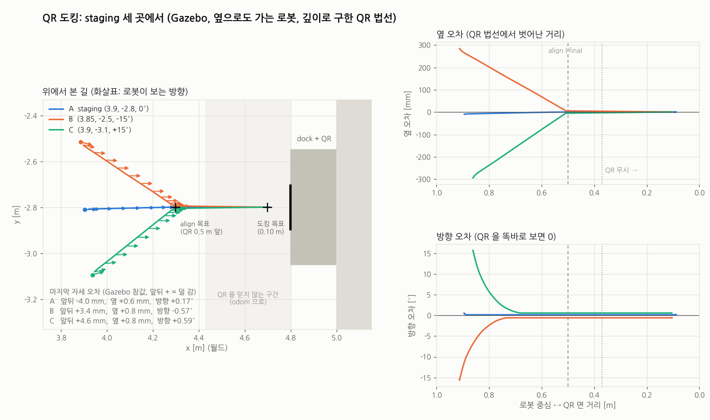
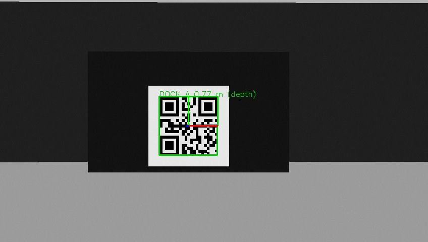

# QR 도킹: RealSense 로 QR 을 보고 dock 에 붙기 (메카넘 AMR)

충전 dock 에 QR 을 붙여 두고, 로봇이 RealSense 카메라로 QR 을 보며 dock 에 붙는 작업 `dock` 와 빠져나오는 작업 `undock` 을 미션 BT 에 더했다. 로봇은 바퀴 4개가 메카넘이라 앞뒤(vx), 옆(vy), 회전(wz)을 한꺼번에 낸다.



Gazebo 에서 dock 앞 세 자리(staging)에서 도킹한 결과다. A 는 정면, B 와 C 는 0.3 m 옆에서 15° 비스듬히 시작했다. 셋 다 "QR 0.5 m 앞" 에 오기 전에 옆 오차와 방향 오차가 0 이 되고, 거기서부터는 곧게 들어간다. 마지막 자세 오차는 Gazebo 참값으로 앞뒤 ±5 mm (final 의 허용오차) 안, 옆 1 mm, 방향 0.6° 안이다.

```
task> dock:DOCK_A 3.9,-2.8,0        # (3.9,-2.8) 에 가서 +x 를 보고 선 뒤, 'DOCK_A' QR 이 붙은 dock 에 붙는다
task> undock                        # 그 자리에서 0.4 m 곧게 물러난다 (점 없음)
```

목차

- [1. 해 보기 (시뮬레이션)](#1-해-보기-시뮬레이션)
- [2. 구성: 카메라에서 바퀴까지](#2-구성-카메라에서-바퀴까지)
- [3. BT (Dock, Undock 트리)](#3-bt-dock-undock-트리)
- [4. 비전: QR 의 자리와 방향](#4-비전-qr-의-자리와-방향)
- [5. dock 의 자리 추정 (DetectDock, ApproachDock)](#5-dock-의-자리-추정-detectdock-approachdock)
- [6. 제어: 세 축을 한꺼번에](#6-제어-세-축을-한꺼번에)
- [7. 안전: collision_monitor 를 끄는 곳과 대신 하는 것](#7-안전-collision_monitor-를-끄는-곳과-대신-하는-것)
- [8. 파라미터](#8-파라미터)
- [9. 실제 Pmbot 에 올릴 때](#9-실제-pmbot-에-올릴-때)
- [10. 확인한 것과 찾은 문제](#10-확인한-것과-찾은-문제)
- [11. 파일](#11-파일)

---

## 1. 해 보기 (시뮬레이션)

```bash
# 터미널 1: 창고 월드 + 옆으로도 가는 로봇(카메라 포함) + 동쪽 벽의 QR dock + Nav2
ros2 launch simple_line_bringup simple_line.launch.py world:=warehouse robot:=holonomic dock:=True
# 터미널 2: 작업 서버
ros2 run bt_mission task_server
# 터미널 3: QR 검출 (컬러 + 깊이)
ros2 launch bt_mission qr_detector.launch.py use_sim_time:=True
# 터미널 4
ros2 run bt_mission task_client.py
task> dock:DOCK_A 3.9,-2.8,0
task> undock
task> dock:DOCK_A 3.85,-2.5,-15     # 옆에서 비스듬히
```

| launch 인자 | 뜻 |
|---|---|
| `robot:=holonomic` | `simple_line_bringup/robots/waffle_holonomic.model`. waffle 과 같은 모양, 같은 센서 자리를 link 하나에 담고(무게중심은 회전 중심 위) `gazebo_ros_planar_move`(vx, vy, wz 를 그대로 몸체 속도로)와 RealSense 같은 컬러 + 깊이 카메라를 붙였다. 내비게이션에 `params/holonomic.yaml` 을 덮는다 (velocity_smoother 가 vy 를 0 으로 자르지 않게, AMCL `OmniMotionModel`) |
| `dock:=True` | `models/qr_dock` 를 월드마다 정한 곳에 놓는다. 창고: QR 면 (4.8, -2.8), 서쪽(방 안)을 본다. 지도에는 없는 물체다 |

메카넘 바퀴의 미끄러짐은 흉내 내지 않는다. 시뮬레이션의 odom 은 참값이다 (9장에서 다시 말한다).

RViz 에서 `/dock/qr_debug` (Image) 를 열면 검출한 QR 과 축이 보인다.



staging (QR 에서 0.77 m) 에서 본 영상. 초록 테두리가 찾은 QR, 빨강 = QR 의 x(오른쪽), 초록 = y(위). `(depth)` 는 방향을 깊이에서 구했다는 뜻이다 (4장).

## 2. 구성: 카메라에서 바퀴까지

```
RealSense ──color──▶ qr_detector.py ──dock/qr (QrCode)──▶ task_server (BT: Dock 트리)
          ──aligned depth──▶   QR 찾기, PnP,                 DetectDock      QR 여러 번 보고 dock 자리 (odom)
                               깊이 평면으로 법선            ApproachDock    다가가며 dock 자리를 고치고, vx vy wz
                                                             BackOff         곧게 물러나기 (레이저로 뒤 확인)
                                                             MuteCollisionMonitor  붙는 동안만 안전 구역 끄기
                                                                  │
                                                             cmd_vel_nav
                                                                  ▼
                          collision_monitor ──cmd_vel_safe──▶ velocity_smoother ──cmd_vel──▶ 메카넘 드라이버
```

- 도킹 노드도 Nav2 의 controller 와 같은 `cmd_vel_nav` 로 낸다. 그래서 collision_monitor(비상 감속)와 velocity_smoother(가감속 한계)를 똑같이 거친다.
- dock 의 자리는 **odom** 에 둔다. map(AMCL)은 위치를 고칠 때 수 cm 씩 뛰지만, odom 은 짧은 거리에서 매끄럽다. 붙기 직전 1 m 안에서는 odom 이 맞다.
- Nav2 Humble 에는 도킹 서버(`opennav_docking`, Jazzy 부터)가 없다. 흐름(staging 에 가기 → 인식 → 제어 → 실패하면 물러나 다시)은 그것을 따랐고, 미션 BT 의 노드로 만들었다.

## 3. BT (Dock, Undock 트리)


`task.xml` 안에 `Task` 트리 다음으로 들어 있다 (따로 파일로 include 하면 `task_server_lifecycle` 의 Nav2 `BtActionServer` 가 상대 경로를 찾지 못한다). `dock` 작업은 점들을 차례로 들른 뒤(`ForEachWaypoint` → `NavigateToPose`, 마지막 점이 staging) `SubTree Dock` 을, `undock` 작업은 `SubTree Undock` 만 돈다. 두 SubTree 는 작업의 blackboard(`{target}` 등)를 같이 쓴다 (`__shared_blackboard="true"`).

| 단계 | 노드 | 하는 일 | 끝 |
|---|---|---|---|
| 1 | `DetectDock` find_qr | staging 에 선 채로 QR 을 8번 보고 dock 의 자리를 잡는다 | 5초 안에 못 보면 FAILURE |
| 2 | `ApproachDock` align | QR 0.5 m 앞까지, 최대 0.15 m/s. 옆으로 어긋난 것과 비스듬한 것을 여기서 다 맞춘다. collision_monitor 는 켠 채 | QR 을 2초 못 보면, 20초 넘으면 FAILURE |
| 3 | `MuteCollisionMonitor` + `ApproachDock` final | collision_monitor 를 끄고 0.10 m 까지 0.05 m/s 로 곧게. 카메라가 QR 0.3 m 안에 들어가면 QR 을 믿지 않고 odom 으로 | 오차가 5 mm, 1° 안에 0.3초 머물면 SUCCESS |
| 실패 | `BackOff` retreat | 0.4 m 물러나 1단계부터 다시. 세 번 해서 안 되면 작업 실패 | 뒤가 막혀 있으면 그 자리에서 다음 시도 |
| 4 | `CheckCharging` | 충전 신호(std_msgs/Bool)를 기다린다. `topic` 을 비우면 건너뛴다 | 5초 안에 true 가 오면 SUCCESS |
| undock | `MuteCollisionMonitor` + `BackOff` | 0.4 m 를 0.05 m/s 로 곧게 물러난다 | 뒤가 막혀 있으면 서서 FAILURE |

왜 두 번에 나눠 다가가나:

- **align (0.5 m)**: QR 이 화면 가운데 크게 보이는 거리까지 가면서 옆, 방향을 다 맞춘다. 가는 동안 QR 을 계속 보며 dock 의 자리를 고친다. 여기까지는 dock 이 collision_monitor 의 원(반지름 0.3 m)에 들어오지 않으므로 켜 둔다.
- **final (0.10 m)**: 곧게 앞으로만 간다. dock 은 붙어야 하는 물체라 collision_monitor 를 켜 두면 원에 들어오는 순간 선다. 그래서 끄고, 대신 아주 느리게(0.05 m/s) 간다.
- 결과 메시지는 마지막으로 실패한 노드다. 예) QR 을 못 찾으면 `find_qr failed`, 물러나다 막히면 `undock failed`.

## 4. 비전: QR 의 자리와 방향

`scripts/qr_detector.py` (Python, OpenCV 4). 컬러 영상마다:

1. `cv2.QRCodeDetector.detectAndDecodeMulti` 로 QR 의 바깥 모서리 4개와 내용을 찾는다. 읽지 못한 것(내용이 빈 것)과 너무 작은 것(한 변 20 px 아래)은 버린다.
2. 모서리를 `cornerSubPix` 로 다듬고, QR 의 실제 한 변(`qr_size`)과 카메라 내부값(`camera_info`)으로 `solvePnP(SOLVEPNP_IPPE_SQUARE)` 를 푼다. 네 점이 한 평면의 정사각형일 때 쓰는 풀이다. 재투영 오차도 같이 낸다.
3. 깊이 영상이 있으면 QR 안쪽(모서리를 중심 쪽으로 80 % 줄인 사각형)의 깊이 점 수천 개에 평면을 맞춰 **법선만** 바꾼다. 위치는 PnP 그대로다.
   - 평면 n·p = d 위의 점은 1/z = (n_x x' + n_y y' + n_z)/d 이다 (x' = x/z, y' = y/z 는 픽셀에서 정해져 잡음이 없다). 그래서 1/z 를 x', y' 의 일차식으로 맞춘다 (최소제곱). 점들에 그냥 평면을 맞추면(SVD) 깊이 잡음이 시선 방향으로만 생기는 탓에 기운 평면의 기울기가 치우친다 (10 mm 잡음에서 +1°).
   - 크게 벗어난 점(가장자리에 걸린 배경)은 빼고 한 번 더 맞춘다.
   - 영상 끝에 걸린 QR(모서리가 끝에서 6 px 안)은 버린다. 모서리를 믿을 수 없고, `cornerSubPix` 가 영상 밖을 읽으려다 예외를 낸다 (처음에 이것으로 노드가 죽었다).
4. `dock/qr` 로 발행한다: 카메라 optical frame 에서 본 QR 중심과 방향, 영상 시각.

QR 좌표계 (`QrCode.msg`, OpenCV ArUco 마커와 같다): x = 인쇄된 QR 을 바로 봤을 때 오른쪽, y = 위, z = QR 면에서 카메라 쪽으로 나오는 법선. `IPPE_SQUARE` 는 모서리를 이 순서(왼위, 오른위, 오른아래, 왼아래, y 가 위)로만 받는다. 순서를 틀리면 재투영 오차가 수천 px 이 된다.

**왜 깊이로 법선을 구하나.** 네 모서리만으로도 위치는 mm 까지 맞는다. 그런데 방향은 약하다.

- QR 이 작게 보이면(멀리서) 기울기는 왼쪽 변과 오른쪽 변 길이의 차이로만 드러난다. 0.85 m 에서 0.145 m QR 이 18° 기울어도 그 차이는 약 3 px 이다.
- 평면 정사각형의 PnP 는 답이 둘이다 (시선을 축으로 뒤집은 것). 모서리 잡음 때문에 가끔 틀린 쪽을 고른다.
- Gazebo 에서 0.75 m, 120 px 일 때 깊이 없이 구한 법선은 대개 -4° 근처였고, 가끔 +16° 로 뛰었다. 처음 시도에서는 8번 모두 +18° 쪽이 나와서, dock 의 자리를 비스듬히 잡고 그쪽으로 가다가 실패했다.
- dock 의 자리(로봇이 설 곳)는 QR 중심에서 법선 방향으로 정한다. 법선이 θ 틀리면 0.5 m 앞 align 자리는 0.5 sin θ 만큼 옆으로 간다 (4° 면 3.5 cm, 18° 면 15 cm).
- RealSense 의 깊이는 QR 판 위 수천 점이다. 점 하나하나는 잡음이 커도(D435 는 1 m 에서 1 % 안팎) 평면의 기울기는 정확하다. 합성 영상(424 x 240 깊이, QR 0.145 m, 거리 0.5 / 0.8 m, 영상 30장씩)에서 영상 한 장의 방향 오차는:

  | 깊이 잡음 | 평균 | 표준편차 | 최대 |
  |---|---|---|---|
  | 3 mm | 0.0° | 0.1° | 0.3° |
  | 6 mm | 0.0° | 0.2° | 0.5° |
  | 10 mm | -0.1° | 0.4° | 0.8° |
  | 20 mm | -0.1° | 0.8° | 1.7° |

  여기에 5장의 평균(8 ~ 10장)이 더해진다. Gazebo 에서도 -4° 치우침과 +16° 튐이 없어졌다 (0.0 ± 0.9°, 깊이가 늦게 와 PnP 로 낸 한 번만 +7°).

깊이 없이(`use_depth:=False`) 써도 도킹은 된다. 5장의 중앙값이 튀는 방향을 거르고, 가까이 갈수록 PnP 의 방향도 좋아진다. Gazebo 에서 처음 방향이 4.5° 틀렸지만 마지막 오차는 옆 1 mm, 방향 0.2° 였다. 다만 처음 자리를 크게 틀리게 잡을 수 있으니 RealSense 라면 깊이를 쓴다.

`QrCode.msg`:

```
std_msgs/Header header       # stamp: 영상을 찍은 시각, frame_id: 카메라 optical frame
string text                  # QR 내용 (dock 작업의 target 과 비교)
geometry_msgs/Pose pose      # optical frame 에서 본 QR 중심과 방향 (위의 QR 좌표계)
float32 size                 # 계산에 쓴 qr_size [m]
float32 pixel_size           # 영상에서 QR 한 변 [px]
float32 reprojection_error   # PnP 재투영 오차 [px]
uint8 normal_source          # NORMAL_PNP (0) | NORMAL_DEPTH (1)
float32 plane_rms            # 깊이 평면 맞춤의 잔차 RMS [m]
```

**QR 만들기**: `tools/make_qr.py DOCK_A dock_a.png --print-size 0.20`. 둘레에 4칸 흰 여백(quiet zone)을 붙인다 (여백이 없으면 잘 못 읽는다). `qr_size` 는 여백을 뺀 한 변이다. 도구가 계산해서 알려 주지만(0.20 m 로 뽑으면 21칸 QR 은 0.1448 m), 인쇄하면 크기가 조금 달라지므로 자로 재서 넣는다. 거리는 `qr_size` 에 비례해서 1 % 틀리면 거리도 1 % 틀린다. `--gazebo-model DIR` 을 주면 이 그림을 붙인 Gazebo dock 모델도 만든다 (`models/qr_dock` 가 그렇게 만든 것).

QR 크기와 보이는 거리: 848 x 480 컬러(화각 69°)에서 0.145 m QR 은 0.8 m 에서 약 110 px 이다. 0.116 m QR 은 640 px 폭에서 0.7 m 쯤이 읽히는 끝이었다. staging 을 QR 에서 1 m 안에 둘 것이면 15 cm 안팎이 알맞다.

## 5. dock 의 자리 추정 (DetectDock, ApproachDock)

QR 하나를 TF 로 odom 에 옮긴다 (영상을 찍은 시각의 TF). 그 법선을 바닥에 눕힌 방향이 dock 의 yaw 다. 법선이 위아래로 많이 기운 것(|z| > 0.5)은 dock 이 아니므로 버린다.

```
dock 자리 = (QR 중심 x, y, 법선 yaw)                  frame: odom
로봇이 설 곳 = QR 중심 + distance · (cos yaw, sin yaw),  로봇 방향 = yaw + π (QR 을 본다)
```

**여러 번 본 것을 하나로: `dock::robustAverage`** (`dock_control.hpp`)

- 위치는 x, y 각각의 중앙값에서 3 cm 안, 방향은 중앙값에서 5° 안에 드는 것(inlier)만 평균한다.
- 그냥 평균하면 튀는 값 쪽으로 끌려간다.
- 처음 값에서 먼 것을 버리는 방식(처음에 썼던 것)은 처음 값이 틀리면 바른 측정을 다 버린다. 실제로 처음 방향이 18° 틀린 채 잠겨서, 바른 측정을 계속 버리다 "QR 을 잃었다" 로 실패했다.
- 중앙값은 절반이 안 되는 튀는 값에 흔들리지 않는다.

| 노드 | 쓰는 측정 | dock 자리 |
|---|---|---|
| `DetectDock` | staging 에서 8번 (보통 1초 안) | inlier 가 8개 이상이면 그 평균 → `{dock_pose}` |
| `ApproachDock` | 다가가며 최근 10번 (위치가 지금 추정에서 15 cm 넘게 먼 것은 다른 물체로 보고 버림. 재투영 오차 2 px 넘는 것도) | inlier 가 절반 넘으면 그 평균으로 바꾼다. 끝나면 `{dock_pose}` 로 다시 낸다 (다음 단계가 이어 씀) |

**가까이서는 QR 을 믿지 않는다 (`blind_distance`).** 카메라가 QR 0.3 m 안에 들어가면 QR 이 화면 높이의 절반을 넘고, 더 가까우면 화면을 넘치거나 깊이의 최소 거리(D435 는 해상도에 따라 약 0.2 m) 안에 든다. 그 뒤의 측정은 버리고, 그때까지 고친 dock 자리와 odom 으로 마저 간다. 남은 거리는 약 0.27 m 이고, 메카넘의 odom 이 이 거리에서 1 % 미끄러지면 3 mm 다.

## 6. 제어: 세 축을 한꺼번에

`dock::holonomicStep` (`dock_control.hpp`, 20 Hz). 목표 자세까지의 오차를 로봇 좌표계로 나타내고 (ex 앞 +, ey 왼쪽 +, eyaw), 세 축을 동시에 줄인다. 차동 구동처럼 "돌고 → 가고 → 돌기" 를 하지 않는다.

```
(vx, vy) = k_lin · (ex, ey)    크기가 max_speed 를 넘으면 방향은 그대로 두고 크기만 줄인다 (대각선을 지킨다)
wz       = k_ang · eyaw        max_angular 까지
허용오차 밖에서는 min_lin (0.01 m/s), min_ang 밑으로 줄이지 않는다 (모터 데드밴드)
축마다 직전 명령에서 accel 로 가속도를 제한한다
```

- P 제어라 가까울수록 느려진다. k_lin = 1 이면 남은 거리 [m] 가 속도 [m/s] 다. final(최대 0.05 m/s)은 마지막 5 cm 부터 줄어 5 mm 앞에서 min_lin 으로 선다. 한 주기 늦게 따라와도 3 mm 넘게 지나치지 않는다 (시험 `DoesNotOvershootTheDock`).
- 오차가 허용오차(final 5 mm) 안에 들면 선다. 명령이 바퀴에 닿기까지 늦음(제어 20 Hz, odom TF 30 Hz, velocity_smoother 20 Hz)이 있어 Gazebo 에서는 4 mm 덜 가기도, 4 mm 더 가기도 했다. dock 을 밀면 안 되므로 `distance` 는 접점이 닿는 거리보다 허용오차만큼 크게 두고, 충전 접점은 그만큼 눌리는 스프링 접점을 쓴다.
- 그림의 B, C 는 처음 0.2 m 사이에 방향(15°)을 맞추고 옆(0.3 m)은 align 자리까지 곧은 대각선으로 줄인다. 방향은 P 제어 그대로 지수적으로 준다 (시간 상수 1/k_ang ≈ 0.7 초, 0.26 rad × 1.5 = 0.39 rad/s 로 max_angular 아래). 위치는 속도 상한 0.15 m/s 에 걸려 대각선을 따라 일정한 빠르기로 줄어서, 방향이 먼저 끝난다.

## 7. 안전: collision_monitor 를 끄는 곳과 대신 하는 것

- **끄는 곳은 셋뿐이다**: final(마지막 0.4 m), 실패 후 물러나기, undock. 모두 dock 이 collision_monitor 의 원(반지름 0.3 m) 안에 있어서, 켜 두면 원 안의 점 때문에 회전과 후진까지 0 이 되는 구간이다. align 과 staging 까지의 주행은 켜 둔다.
- **`MuteCollisionMonitor`**: 자식이 도는 동안만 `collision_monitor` 의 `<polygon>.enabled` 파라미터를 false 로 둔다 (Humble 이 실행 중에 바꿀 수 있는 파라미터). 자식이 SUCCESS, FAILURE 로 끝나거나 halt(취소, 선점)되면 다시 켠다.
  - Gazebo 에서 다시 켜는 응답이 500 ms 안에 오지 않은 적이 있다. 지금은 1초씩 세 번까지 다시 보낸다.
  - 그래도 못 켜면 ERROR 를 남기고 FAILURE 를 돌려준다 (자식이 성공했어도). 안전 구역이 꺼진 채 다음 일을 하지 않게.
- **꺼져 있는 동안은 느리게**: final 0.05 m/s, undock 0.05 m/s, 물러나기 0.1 m/s.
- **`BackOff` 는 뒤를 스스로 본다**: 남은 거리만큼 몸이 쓸고 갈 사각형(로봇 뒤 끝에서 남은 거리 + 5 cm, 폭 ±(0.16 + 0.05) m) 안에 레이저 점이 3개 넘게 있으면 선다. 레이저가 1초 넘게 안 오면 움직이지 않는다.
  - 이것은 시뮬레이션에서 실제로 부딪힌 뒤에 넣었다. QR 이 화면 끝에 걸치는 staging 에서 QR 을 못 찾아 물러나다가, 끈 collision_monitor 대신 아무도 보지 않는 뒤의 선반에 박혔다.
- **카메라는 장애물을 보지 않는다.** final 중에 사람이 dock 과 로봇 사이에 들어오면 멈추지 않는다. 실제 로봇은 9장의 하드웨어 안전 영역을 둔다.

## 8. 파라미터

`task.xml` 의 Dock 트리에 적힌 값이 시뮬레이션의 waffle 기준이다. 거리는 모두 "로봇 중심(base_footprint) ↔ QR 면".

| 노드 | 포트 | 기본값 | Dock 트리 | 뜻 |
|---|---|---|---|---|
| DetectDock | `target` | "" | `{target}` | 찾을 QR 내용. 비우면 처음 보인 QR |
| | `timeout` | 5 s | 5 | |
| | `min_detections` | 8 | | 평균할 측정 수 |
| | `max_spread`, `max_yaw_spread` | 0.03 m, 5° | | 중앙값에서 이 안의 것만 |
| ApproachDock | `distance` | 0.5 m | 0.5 / 0.10 | 설 곳 |
| | `max_speed`, `max_angular`, `accel` | 0.15, 0.5 rad/s, 0.3 m/s² | final: 0.05, accel 0.1 | |
| | `xy_tolerance`, `yaw_tolerance` | 0.01 m, 1° | final: 0.005 m | 이 안에 0.3초 있으면 SUCCESS |
| | `blind_distance` | 0.3 m | 0.3 | 카메라 ↔ QR 이 이보다 가까우면 QR 무시 |
| | `lost_timeout` | 2 s | final: 0 | QR 을 이만큼 못 보면 FAILURE (0: 안 봄) |
| | `window` | 10 | | dock 자리를 다시 잡을 때 쓰는 최근 측정 수 |
| | `timeout` | 40 s | 20 / 30 | |
| BackOff | `distance`, `speed` | 0.4 m, 0.05 m/s | retreat 0.1 m/s | |
| | `scan_topic` | scan | | 뒤를 볼 레이저. 비우면 안 봄 |
| | `robot_rear`, `robot_half_width`, `clearance` | 0.20, 0.16, 0.05 m | | 로봇 중심 ↔ 뒤 끝, 반폭, 여유 |
| | `fail_when_blocked` | true | retreat: false | false 면 막힌 자리에서 SUCCESS |
| MuteCollisionMonitor | `monitor`, `polygon` | collision_monitor, Footprint | | 끌 구역 |
| CheckCharging | `topic` | "" | "" | std_msgs/Bool. 비우면 건너뜀 |

qr_detector.py (`launch/qr_detector.launch.py`):

| 파라미터 | 기본값 | 뜻 |
|---|---|---|
| `qr_size` | 0.1448 (launch) | QR 한 변(여백 제외) [m]. 자로 잰 값 |
| `image_topic`, `camera_info_topic` | `<camera>/color/image_raw`, `.../camera_info` | launch 의 `camera` (기본 `/camera`) 아래 |
| `depth_topic` | `<camera>/aligned_depth_to_color/image_raw` | 컬러에 맞춘 깊이. `use_depth:=False` 면 안 씀 |
| `depth_scale` | 0.001 | 16UC1 깊이의 단위 [m] (RealSense mm). 32FC1 (Gazebo) 은 m 그대로 |
| `min_depth_points` | 200 | 평면을 맞출 깊이 점이 이보다 적으면 PnP 의 법선 |
| `optical_frame` | "" | 영상의 frame_id 가 optical frame 이 아닐 때 |
| `min_pixel_size` | 20 px | 이보다 작게 보이는 QR 은 버림 |

## 9. 실제 Pmbot 에 올릴 때

**카메라 (RealSense)**

- `ros2 launch realsense2_camera rs_launch.py align_depth.enable:=true` (컬러 848x480 권장). realsense-ros 4.x 의 토픽은 `/camera/camera/...` 이므로 `qr_detector.launch.py camera:=/camera/camera`.
- 카메라가 로봇 어디에 어떻게 달렸는지(`base_footprint → camera_color_optical_frame` TF)가 dock 자리의 정확도를 정한다. URDF 의 카메라 yaw 가 1° 틀리면 0.8 m 앞 QR 의 자리가 옆으로 1.4 cm 틀린다. 줄자와 각도기로 맞추고, 로봇을 QR 정면에 두고 `dock/qr` 를 odom 으로 옮긴 법선이 로봇 방향과 맞는지 본다.
- 컬러 영상의 frame_id 가 optical frame 인지 확인한다 (realsense-ros 는 `camera_color_optical_frame`).
- 노출: 반사가 심한 코팅지보다 무광 종이. 역광(뒤에 창문)을 피한다.

**QR 과 dock**

- QR 을 인쇄해서 한 변(여백 제외)을 자로 재고 `qr_size` 에 넣는다.
- QR 중심을 카메라 높이에 맞춘다 (위아래로 보면 법선이 덜 정확하다). 판은 휘지 않게 단단한 판에.
- `distance` (final 의 설 곳) = 로봇 중심에서 충전 접점까지 + 접점이 눌리는 만큼. 처음에는 크게 두고 줄여 간다.

**로봇 (메카넘)**

- 드라이버가 `cmd_vel` 의 `linear.y` 를 받는지 확인한다. velocity_smoother 의 vy 한계(`params/holonomic.yaml`)를 실제 값으로.
- odom 의 미끄러짐: 메카넘은 옆으로 갈 때 바퀴 odom 이 많이 틀린다 (롤러 미끄러짐 수 %). 도킹은 마지막 약 0.27 m 를 odom 으로 가므로, 그 구간을 줄자로 재서 오차를 본다. 크면 IMU 와 섞은 odom(robot_localization)을 쓰거나 `blind_distance` 를 줄인다.
- `min_lin` 0.01 m/s 로 로봇이 실제로 움직이는지 본다. 안 움직이면 마지막 몇 mm 에서 settle 하지 못하고 timeout 이 난다 (`ControlParams::min_lin`).
- `BackOff` 의 `robot_rear`, `robot_half_width` 를 로봇 크기로. 뒤를 보는 레이저가 없으면 물러나는 거리를 짧게.

**안전**

- collision_monitor 를 끄는 동안(마지막 0.4 m, 물러나기)은 소프트웨어만으로는 사람을 못 본다. 레이저 스캐너의 하드웨어 안전 영역(safety PLC 의 field set)을 도킹용으로 작게 바꾸는 신호를 함께 쓰는 것이 일반적이다.
- 충전 접점 신호가 있으면 `CheckCharging topic="..."` 를 켠다. 붙었다고 하고 실제로는 접점이 닿지 않은 경우를 잡는다.

## 10. 확인한 것과 찾은 문제

시험 (`colcon test`):

| 시험 | 확인하는 것 |
|---|---|
| `test_dock_control` (11개) | 로봇 좌표계 오차, 설 곳, 속도 크기 제한에서 대각선 유지, 축마다 가속도 제한, 최소 속도와 허용오차, 중앙값 평균이 튀는 방향(10번 중 4번)을 거르는지, ±π 넘김, 먼 측정 버리기, 뒤 사각형 안의 점 세기, 옆+방향 오차에서 수렴, dock 을 지나치지 않음 |
| `test_task_server` `UndockNeedsNoWaypointsAndSwitchesTheSafetyFieldBackOn` | 점 없는 undock 을 받는다. 가짜 collision_monitor 의 `Footprint.enabled` 가 false → true 로 (BackOff 가 실패해도 다시 켬) |
| `test_task_server` `CancelDuringUndockSwitchesTheSafetyFieldBackOn` | 물러나는 중에 취소하면 halt 에서 다시 켠다 |

Gazebo (창고, `robot:=holonomic dock:=True`):

| 시나리오 | 결과 |
|---|---|
| 출발점(-4,-2.5) 에서 `dock:DOCK_A 3.9,-2.5 3.9,-2.8,0` | 두 점을 Nav2 로 (둘째 점에서 제자리 회전), 도킹 SUCCEEDED. 앞뒤 4.6 mm 덜 감, 옆 0.7 mm, 0.9° |
| staging A (3.9,-2.8,0°), B (3.85,-2.5,-15°), C (3.9,-3.1,+15°) | 셋 다 SUCCEEDED, 오차는 위 그림 (앞뒤 ±5 mm, 옆 1 mm 안, 방향 0.6° 안) |
| `undock` | 0.4 m 물러남 (9.8 s) |
| `dock:DOCK_B` (없는 QR) | QR 을 5초씩 세 번 못 찾고 ABORTED `find_qr failed` |
| 선반 앞에서 QR 을 못 찾아 물러나기 (dock 을 선반 옆에 두었을 때) | `retreat: something is behind the robot, stopped` 로 서고 다음 시도 |
| 깊이 없이 (`use_depth:=False`) | 처음 방향 4.5° 틀림, SUCCEEDED (옆 1 mm, 0.2°) |
| 기본 robot(waffle) 의 4개 작업 | 그대로 SUCCEEDED (회귀 없음) |

만들면서 찾은 문제:

| 문제 | 원인 | 고친 것 |
|---|---|---|
| PnP 의 재투영 오차가 수천 px | `IPPE_SQUARE` 는 모서리 순서가 정해져 있다 (y 가 위) | QR 좌표계를 ArUco 와 같게 |
| 홀로노믹 로봇이 움직이지 않음 | 레이저에 로봇 뒤 0.2 m 의 가짜 점(제 몸)이 생겨 collision_monitor 가 세웠다. waffle.model 의 `imu_link` 에 joint 가 없는 것을 고친 뒤에도, 제자리 회전을 여러 번 하면 다시 생겼다. planar_move 가 모든 link 에 같은 속도를 덮어써서 link 사이 joint 가 벌어진다 | 몸체를 link 하나로 (센서가 TF 와 어긋나지도 않는다). 그러면 레이저가 같은 link 의 상자를 보므로 레이저 최소 거리 0.12 → 0.20 m (몸 끝은 레이저에서 0.19 m 안) |
| 홀로노믹 로봇이 점에서 제자리 회전을 못 끝냄 (Nav2 "Failed to make progress" 반복) | planar_move 는 무게중심의 속도를 정한다. waffle 의 무게중심은 base_footprint 에서 0.064 m 뒤라, 돌면 base_footprint 가 그 둘레를 돌며 자리가 바뀌고 controller 가 그것을 바로잡으려 좌우로 흔들었다 | 무게중심을 base_footprint 위로 (1 rad/s 로 3초 돌아도 자리 그대로). 그러자 무게중심이 바퀴 축 위라 몸이 12° 까지 뒤로 기울어 카메라가 QR 을 놓쳤다 → 앞쪽에 마찰 0 의 받침을 더했다 |
| `qr_detector` 가 죽음 | 영상 끝에 걸린 QR 의 모서리로 `cornerSubPix` 가 영상 밖을 읽음 (예외) | 끝에서 6 px 안의 QR 은 버리고, 영상 하나의 예외로 노드가 죽지 않게 |
| 처음 방향 18° 틀림 → "QR 을 잃음" | PnP 법선의 뒤집힘 + 처음 값에서 먼 측정을 버리는 거름 | 깊이 평면으로 법선, 중앙값 평균 (4, 5장) |
| 깊이 평면의 기울기가 치우침 (합성 영상, 10 mm 잡음에 +1°) | 시선 방향 잡음에 SVD 평면 맞춤 | 1/z 를 x', y' 의 일차식으로 (4장) |
| 물러나다 선반에 박힘 | collision_monitor 를 끈 채 뒤를 아무도 안 봄 | BackOff 의 레이저 확인 (7장) |
| "안전 구역 다시 켜기" 응답 없음 (한 번) | 500 ms 안에 응답이 안 옴 | 1초씩 세 번, 그래도 못 켜면 FAILURE |
| `task_server_lifecycle` 이 `task.xml` 을 못 읽음 (`colcon test` 의 lifecycle 테스트 8개 실패) | Dock 트리를 `dock.xml` 로 따로 두고 `<include>` 했다. Nav2 `BtActionServer` 는 XML 을 글자로 읽어 만들어서 상대 경로를 찾지 못한다 | Dock, Undock 트리를 `task.xml` 안에 |
| 도킹 메시지가 `retreat failed` | 마지막으로 실패한 노드가 물러나기였다 | 물러나기는 막혀도 SUCCESS (`fail_when_blocked="false"`) → `find_qr failed` |

시뮬레이션이 보여 주지 못하는 것: odom 이 참값이고(미끄러짐 없음), 깊이에 잡음이 없다 (Gazebo depth 카메라의 `<noise>` 가 적용되지 않았다. 깊이 잡음에 대한 확인은 합성 영상으로 했다, 4장). 조명과 반사, 모션 블러도 없다.

## 11. 파일

```
bt_navigator/
├── DOCKING.md                                   이 문서
├── docs/dock_runs.png, dock_camera_debug.jpg    위의 그림
├── bt_mission_msgs/msg/
│   ├── Task.msg                                 ACTION_DOCK, ACTION_UNDOCK, target
│   └── QrCode.msg                               QR 하나 (qr_detector → BT)
└── bt_mission/
    ├── behavior_trees/task.xml                  Task 트리 다음에 Dock, Undock 트리
    ├── include/bt_mission/dock_control.hpp      ROS 없는 계산: 오차, 설 곳, holonomicStep, robustAverage, pointsBehind
    ├── include/bt_mission/dock_nodes.hpp        DetectDock, ApproachDock, BackOff, MuteCollisionMonitor, CheckCharging
    ├── src/dock_nodes.cpp
    ├── scripts/qr_detector.py                   QR 찾기, PnP, 깊이 평면
    ├── launch/qr_detector.launch.py
    ├── tools/make_qr.py                         QR 그림과 Gazebo dock 모델 만들기
    ├── test/test_dock_control.cpp
    └── doc/dock.png                             BT 그림 (tools/draw_bt.py)

simple_line/simple_line_bringup/
├── robots/waffle_holonomic.model                link 하나의 waffle + planar_move + 컬러/깊이 카메라
├── models/qr_dock/                              QR 판이 붙은 dock (make_qr.py 가 만듦)
├── params/holonomic.yaml                        vy 한계, AMCL OmniMotionModel
└── launch/simple_line.launch.py                 robot:=holonomic, dock:=True
```
