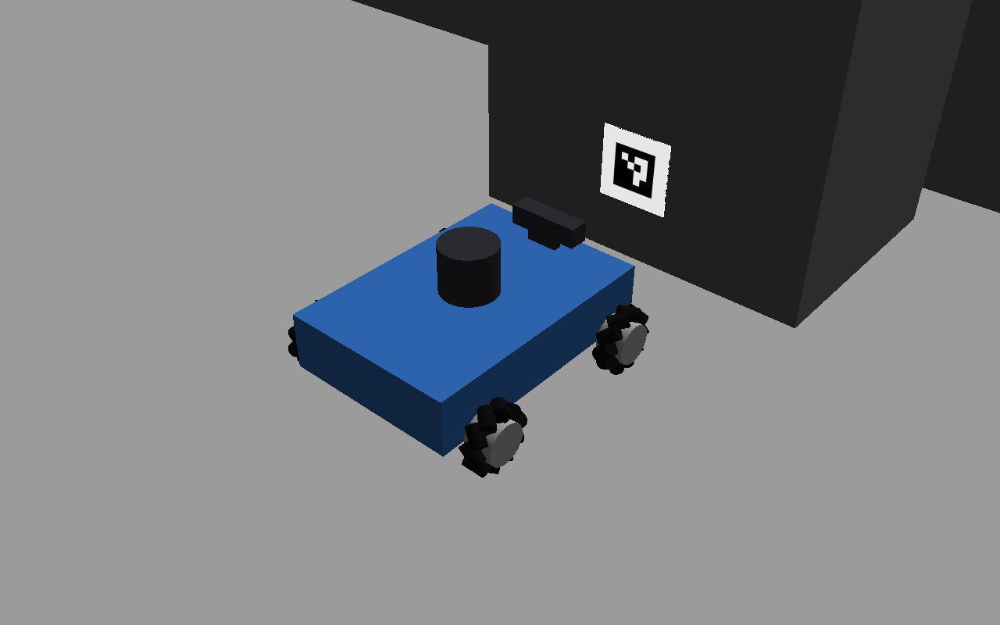
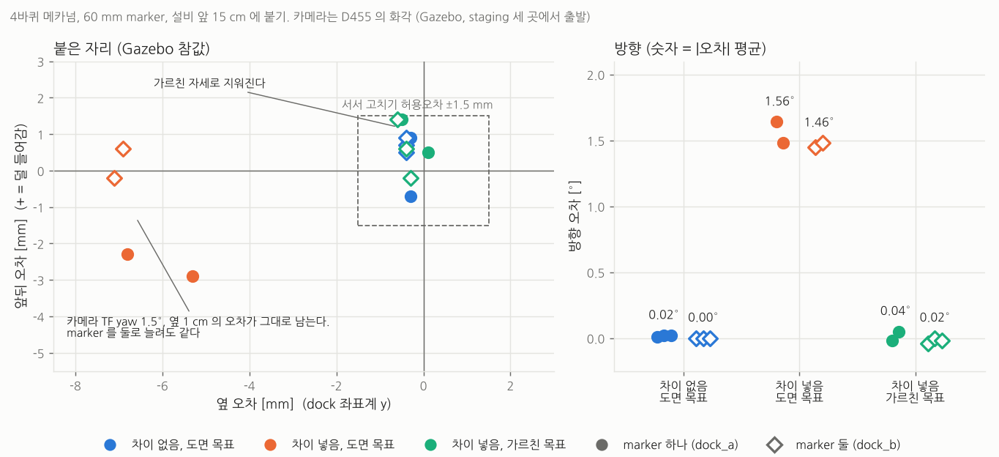
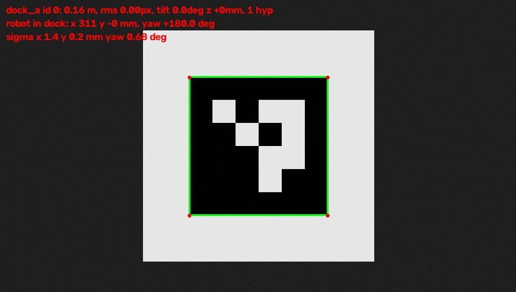
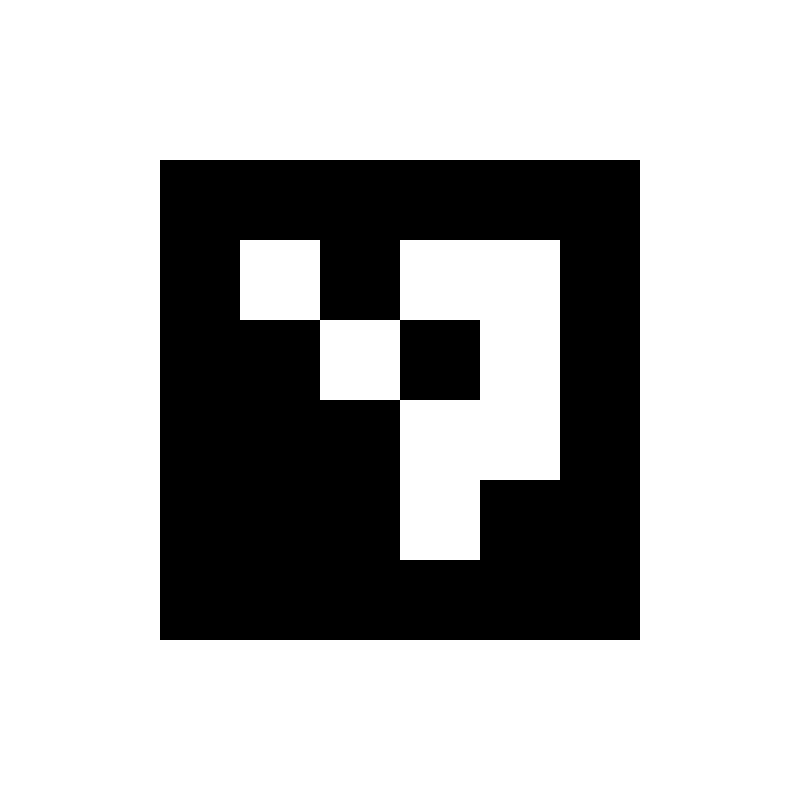
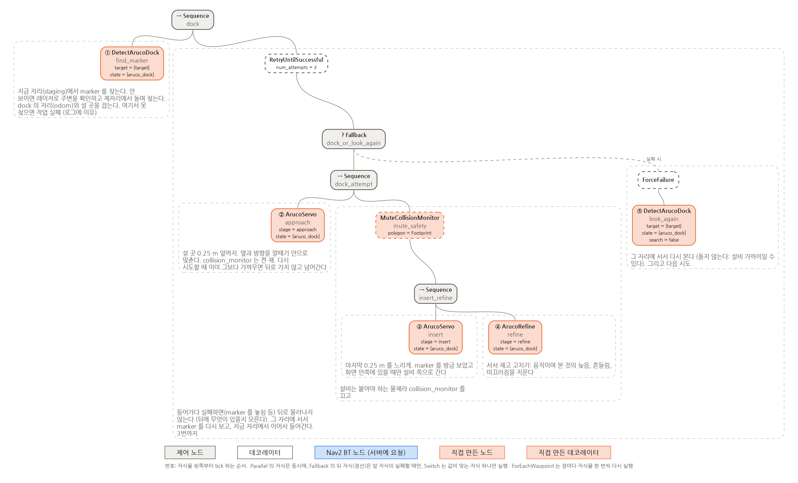
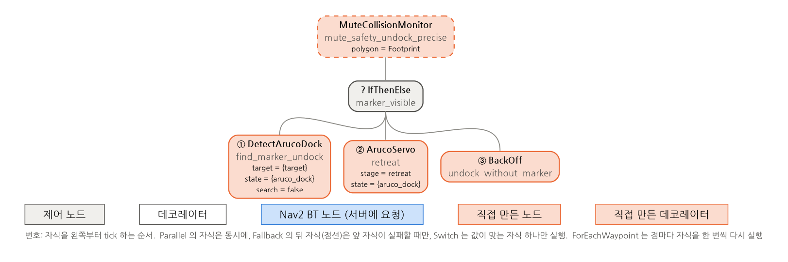

# 설비 앞 15 cm 정밀 도킹: ArUco marker 하나, 4바퀴 메카넘

설비(기계)의 도킹 면에 붙인 **ArUco marker 하나(0번, 60 mm)** 를 RealSense 컬러 카메라로 보고, 메카넘 로봇의 앞면을 설비에서 **15 cm** 떨어진 자리에 mm 단위로 세운다. 그 자리에서 설비 작업을 한 뒤 undock 한다. 작업은 `task_client.py` 로 보낸다: `dock:dock_a <staging 자리>`, `undock`, `undock_precise:dock_a`. 미션 BT 의 다른 부분은 [README.md](README.md).



Gazebo 결과 (참값):

| 조건 | 앞뒤 [mm] | 옆 [mm] | 방향 [°] |
|---|---|---|---|
| 실제와의 차이 없음, 도면 값 목표 (4회) | +0.1 ~ +0.7 | -0.2 ~ -0.3 | 0.01 |
| 차이 넣음 (메카넘 미끄러짐 + 카메라 TF yaw 1.5°, 옆 1 cm + marker 크기 2 %), 도면 값 목표 (3회) | -2.4 ~ -2.7 | **-6.3 ~ -6.5** | **+1.5** |
| 같은 차이, **가르친 자세** 목표 (5회) | +0.8 ~ +1.5 | -0.1 ~ -0.3 | 0.00 ~ 0.02 |



목차

- [1. 해 보기 (시뮬레이션)](#1-해-보기-시뮬레이션)
- [2. 실제 로봇으로 옮기기](#2-실제-로봇으로-옮기기)
- [3. 설정 파일 하나: docking.yaml](#3-설정-파일-하나-dockingyaml)
- [4. marker 크기와 15 cm](#4-marker-크기와-15-cm)
- [5. 자세 추정 (aruco_detector.py)](#5-자세-추정-aruco_detectorpy)
- [6. 도킹 순서와 제어](#6-도킹-순서와-제어)
- [7. undock 두 가지](#7-undock-두-가지)
- [8. 가르친 자세: 고정 오차 지우기](#8-가르친-자세-고정-오차-지우기)
- [9. 시뮬레이션 실험](#9-시뮬레이션-실험)
- [10. 실제 로봇에서의 정밀도](#10-실제-로봇에서의-정밀도)
- [11. find_marker 가 실패할 때](#11-find_marker-가-실패할-때)
- [12. 파일](#12-파일)
- [참고 자료](#참고-자료)

---

## 1. 해 보기 (시뮬레이션)

```bash
# 터미널 1: 창고 + 4바퀴 메카넘 로봇(컬러 카메라) + 동쪽 벽 앞의 설비 모형 (도킹 면 x = 4.55, y = 1.0)
#          + marker 검출 노드 (aruco_detector.launch.py 를 같이 띄운다. 따로 띄우려면 aruco_detector:=False)
ros2 launch simple_line_bringup simple_line.launch.py world:=warehouse robot:=mecanum dock:=True
# 터미널 2
ros2 run bt_mission task_server
# 터미널 3
ros2 run bt_mission task_client.py
task> dock:dock_a 3.85,-2.5 3.85,1.0,0    # 마지막 점 = 설비 앞 staging 자리 (planner 가 직선이라 한 점을 거친다)
task> undock                              # 곧게 뒤로 0.4 m
task> dock:dock_a 3.85,1.25,-15           # 옆 0.25 m, 비스듬히 15 도에서
task> undock_precise:dock_a               # marker 를 보며 dock 축을 따라 물러난다
```

실제 로봇과의 차이를 넣어 보려면 (9장):

```bash
ros2 launch simple_line_bringup simple_line.launch.py world:=warehouse robot:=mecanum dock:=True \
    mecanum_slip:=True camera_tf_error:=1.5,0.0,0.01 aruco_detector:=False
ros2 launch bt_mission aruco_detector.launch.py use_sim_time:=True marker_scale:=1.02
```

RViz: `/dock/aruco_debug` (Image: 찾은 marker, 바닥 위 자세로 다시 그린 모서리, 예상 오차), `/dock/aruco_estimate` (PoseStamped: 필터가 잡은 dock 자리), `/dock/final_error` (붙은 뒤 서서 잰 오차).



붙은 자리(카메라 ↔ marker 0.16 m)에서 본 `/dock/aruco_debug`. marker 는 230 px 이고 위아래로 125 px 씩 남는다. 초록 = 검출한 모서리, 빨간 점 = 추정한 바닥 위 자세로 다시 그린 모서리. 둘이 겹치고 `tilt 0.0deg z +0mm` 이면 카메라 TF 와 설정이 맞다.

## 2. 실제 로봇으로 옮기기

코드는 그대로 두고 **`config/docking.yaml` 한 파일**만 로봇에 맞춘다 (3장). 순서:

1. **설정 파일**: `bt_mission/config/docking.yaml` 을 로봇 PC 로 복사해 [로봇], [설비] 표시가 있는 값을 고친다 (로봇 치수, 토픽과 frame 이름, marker 크기와 높이, 붙는 거리). 그 경로를 두 곳에 넘긴다:
   ```bash
   ros2 run bt_mission task_server --ros-args -p docking_config:=/path/docking.yaml
   ros2 launch bt_mission aruco_detector.launch.py camera:=/camera/camera config_file:=/path/docking.yaml
   ```
   BT 노드는 작업을 시작할 때마다 파일을 다시 읽으므로, 값을 고친 뒤 task_server 를 다시 띄울 필요가 없다. 모르는 이름(오타)은 경고로 알려 준다.
2. **marker 인쇄와 부착** (4장): `tools/make_aruco_dock.py` 가 만든 `docs/aruco_marker_dock_a.svg` 를 100 % 로 인쇄한다. 설비의 도킹 면에, marker 중심이 카메라 렌즈 높이에 오게 붙인다.
3. **카메라** (RealSense): 컬러 영상과 camera_info 가 나오게 띄운다. 예 (realsense-ros 4.x. 옵션 이름은 판마다 조금 다르니 `ros2 launch realsense2_camera rs_launch.py --show-args` 로 확인한다):
   ```bash
   ros2 launch realsense2_camera rs_launch.py rgb_camera.color_profile:=848x480x30 enable_sync:=true \
       align_depth.enable:=true          # 깊이를 쓸 때 (use_depth:=True)
   ```
   토픽은 `/camera/camera/color/image_raw`, `/camera/camera/color/camera_info` (그래서 `camera:=/camera/camera`).
4. **카메라 TF**: `base_footprint` 에서 카메라의 optical frame (`camera_color_optical_frame`) 까지 TF 가 이어져야 한다. URDF 에 카메라를 넣거나 `static_transform_publisher` 로 `base_link -> camera_link` 를 낸다. 줄자로 잰 값으로 시작하고, detector 의 진단(`tilt`, `z`)을 보며 맞춘다 (10-2).
5. **보정** (10-3): `dock_calibrate.py` 로 미끄러짐 배율과 데드밴드를 재서 `motion` 에 적는다.
6. **가르치기** (8장): 로봇을 손으로 정확한 도킹 자리에 놓고 `aruco_teach.py`.
7. **확인** (10-4): `dock` → 작업 → `undock` 을 20번 되풀이하며 영상이 아닌 기준으로 잰다.

시뮬레이션과 실제 로봇이 다르게 쓰는 것은 로봇/카메라 드라이버와 이 설정 파일뿐이다. 도킹 코드, BT, detector 는 같다.

## 3. 설정 파일 하나: docking.yaml

로봇, 카메라, 설비마다 달라지는 값은 모두 `bt_mission/config/docking.yaml` 에 있다. `task.xml` 에는 "무엇을 어떤 순서로" 만 있고, 노드는 XML 의 `stage="approach"` 같은 이름으로 자기 값을 찾는다.

| 구역 | 내용 | 누가 읽나 |
|---|---|---|
| `dictionary`, `docks` | [설비] dock 마다 marker 번호, 크기, 높이, 붙는 거리(`gap`: 로봇 앞면 ↔ 도킹 면) | detector, BT, 도구 |
| `robot` | [로봇] 중심에서 앞/뒤/옆면까지, 제자리 회전 반지름 | BT |
| `ros` | [로봇] odom/base frame, cmd_vel, 레이저, 검출 토픽 | BT, 도구 |
| `motion` | 속도 한계, 가속도, 이득, 허용오차, 깔때기. **[측정]** 데드밴드(`min_*`), 배율(`scale_*`), odom 흐름 | BT |
| `stages` | 단계마다 `motion` 을 덮어쓰는 값과 단계의 동작 (approach, insert, refine, retreat) | BT |
| `detect` | marker 찾기: 보는 시간, 돌아 볼 각도, 가르친 자세 폴더 | BT |
| `safety` | 가까이 붙을 때: 방금 본 marker 만 믿기, 화면 끝 여유, 최소 거리 | BT |
| `undock` | 단순 undock 의 거리와 속도 | BT |

- 값을 찾는 순서: `stages.<stage>.<이름>` → `motion.<이름>` → 코드의 기본값 (파일의 값과 같다).
- 파일 안의 주석이 항목마다 뜻과 단위를 적어 두었다. 코드 쪽은 `include/bt_mission/docking_config.hpp` 하나가 파일을 읽는다 (ROS 와 무관, `test_docking_config.cpp`).
- `task.xml` 을 고칠 일은 순서를 바꿀 때뿐이다 (예: 재시도 횟수, 단계 추가).

## 4. marker 크기와 15 cm



**marker: DICT_4X4_50 의 0번, 검은 테두리 바깥 한 변 60 mm, 흰 여백 20 mm (종이 100 x 100 mm).**

크기는 "붙은 자리에서 화면에 다 들어오고, 조금 어긋나도 잘리지 않는 가장 큰 것" 으로 정했다.

| | 값 | 근거 |
|---|---|---|
| 붙은 자리의 카메라 ↔ marker | 0.16 m | 로봇 앞면 ↔ 설비 0.15 m, 카메라는 앞면 1 cm 안쪽 |
| 그 거리에서 보이는 범위 (D435 컬러, 69° x 42°) | 가로 0.22 m, 세로 0.12 m | 세로가 좁다 |
| 60 mm marker 의 크기 | 230 px (848 x 480) | 세로 480 px 의 48 % |
| 남는 여유 | 위아래 125 px (33 mm), 좌우 310 px (81 mm) | 높이가 ±1.5 cm, 옆이 ±7 cm 틀려도 화면 안 |
| 붙은 자리의 정밀도 (합성 영상) | 옆 0.1 mm, 방향 0.02° | 5-2 |
| 찾을 수 있는 거리 | 한 변 16 px 이상 = 약 2.2 m. **방향까지 믿을 만한 것은 0.8 m 안** | staging 은 설비 면에서 로봇 중심 0.6 ~ 0.9 m |

- **더 크게 하면** 붙은 자리에서 여유가 줄어든다 (80 mm 면 위아래 17 mm). 접근 중 로봇이 앞뒤로 기울거나 높이가 틀리면 잘린다. **더 작게 하면** 멀리서 방향이 나빠진다 (같은 거리에서 화소 수에 비례).
- 다른 카메라, 다른 거리면: **한 변 ≈ 0.38 x (붙은 자리의 카메라 ↔ marker 거리)** (세로 화각 42° 에서 화면 높이의 절반). 세로 화각이 넓은 카메라(D455 컬러 65°)면 0.6 배까지 키울 수 있다.
- 컬러를 1280 x 720 으로 받으면 화소가 1.5 배라 먼 거리의 방향이 그만큼 좋아진다 (detector 계산은 2.3 배 무겁다).

인쇄와 부착:

1. `python3 tools/make_aruco_dock.py config/docking.yaml dock_a marker_dock_a` → `marker_dock_a.svg` (mm 단위). 브라우저나 Inkscape 에서 **실제 크기(100 %)** 로 인쇄한다 ("용지에 맞춤" 을 끈다). 같이 찍히는 50 mm 눈금을 자로 재서 배율을 확인한다.
2. marker 한 변을 캘리퍼로 잰다. 60.0 mm 가 아니면 `docking.yaml` 의 `size` 를 잰 값으로 고친다 (1 % 틀리면 거리가 1 % 틀린다).
3. 무광 용지에 레이저 프린터로. 단단하고 평평한 판(아크릴, 알루미늄 복합판)에 붙이거나 설비의 평평한 면에 바로 붙인다. 휘거나 들뜨면 그만큼 자세가 틀린다. 흰 여백을 자르지 않는다.
4. 높이: marker 중심 = 카메라 렌즈 높이 (`docks.dock_a.height`). 수준기로 수평을 맞춘다.
5. 로봇 그림자가 marker 를 덮으므로 설비 쪽 조명이 일정한지 본다. 반사되는 코팅지, 유리 뒤는 피한다.

**15 cm 때문에 바뀐 것** (거리 값 말고):

| 걱정 | 한 것 |
|---|---|
| 가까워서 marker 가 화면 밖으로 나간다 | marker 크기와 높이를 위처럼 정했다. 접근 중에는 "깔때기" 가 옆과 방향을 먼저 맞추므로 (6-2) marker 가 화면 가운데로 온다 |
| 잘린 marker 로 틀린 자세를 낸다 | detector 는 모서리가 화면 끝 6 px 안에 걸린 marker 를 버린다. 검출마다 화면 끝까지의 여유(`border_px`)를 같이 보낸다 |
| marker 를 못 보는데 설비 쪽으로 계속 간다 | **설비 쪽으로 가는 것은 marker 를 0.5 초 안에 보았고 화면 끝에서 10 px 안쪽일 때만.** 아니면 옆과 방향만 고쳐서 marker 를 화면 가운데로 되돌린다. 2 초 동안 못 보면 멈추고 그 자리에서 다시 본다 (`safety.fresh_detection`, `min_border_px`, `stages.*.lost_timeout`) |
| 설비에 부딪힌다 | 카메라가 marker 에 `safety.min_camera_distance` (0.10 m) 보다 가까워지면 멈추고 실패한다. 마지막 구간은 0.05 m/s, 지나치면 그만큼만 되돌린다 |
| 깊이 카메라가 가까이서 못 잰다 | 스테레오 깊이는 최소 거리가 있다 (D435 는 848 x 480 에서 약 0.2 m). 붙은 자리의 판단은 컬러 영상만으로 한다. 깊이는 멀리서 방향을 돕는 데만 쓴다 (5-3) |
| 컬러 카메라 초점 | D435 계열 컬러는 고정 초점이라 0.16 m 에서 조금 흐리다. 칸이 10 mm 인 4x4 marker 는 흐려도 읽힌다. 흐림 때문에 생기는 모서리 편향은 고정 오차라 가르친 자세가 지운다 (8장) |

## 5. 자세 추정 (aruco_detector.py)

영상 한 장마다 로봇(base_footprint)에서 본 dock 의 바닥 위 자세 (x, y, yaw) 후보 1 ~ 2 개와 각각의 공분산을 `dock/aruco` 로 낸다 (`bt_mission_msgs/ArucoDetection`, 영상을 찍은 시각).

dock 좌표계 D: 원점 = 바닥에서 도킹 면의 가운데, x = 설비에서 로봇 쪽, z = 위. 로봇은 D 에서 (gap + 로봇 앞면까지 = 0.31 m, 0, 180°) 에 선다.

### 5-1. 왜 그냥 PnP 가 아닌가

정사각형 하나(점 4개)의 PnP 는 IPPE 로 풀면 **해가 둘** 나온다. 정면에 가깝거나 멀어서 원근이 약하면 두 해의 재투영 오차가 거의 같아, 오차가 작은 쪽을 고르면 가끔 법선이 뒤집힌 쪽을 고른다. 뒤집히지 않아도 모서리 넷으로는 **방향(yaw)과 기울기(pitch, roll)가 잘 갈리지 않는다**: yaw 가 바뀌면 왼쪽과 오른쪽 변의 길이가 조금 달라질 뿐이다.

### 5-2. 바닥 사전분포를 둔 6자유도 MAP

설비는 바닥에 서 있고, 카메라가 로봇 어디에 달렸는지(TF)와 marker 의 높이를 안다. 그렇다고 "기울기 0, 높이 0" 을 못박으면(3자유도) 카메라 TF 의 높이가 1 cm, pitch 가 1° 만 틀려도 풀이가 방향을 비틀어 옆으로 수 cm 틀린다 (이전 구성의 실험에서 2 ~ 15 cm). 그래서 6자유도 p = (x, y, yaw, z, roll, pitch) 를 풀되 "바닥에 서 있다" 를 **사전분포**로 둔다:

```
p* = argmin_p   Σᵢ ‖ π(K, T_cam←base · T_base←D(p) · cᵢ) − uᵢ ‖² / σ_px²      (모서리 4개 = 식 8개)
             +  z² / σ_z²  +  roll² / σ_tilt²  +  pitch² / σ_tilt²             (사전분포: σ_z 1 cm, σ_tilt 1.5°)
             +  (yaw − yaw_depth)² / σ_depth²                                   (깊이를 쓸 때만, 5-3)
풀이: Levenberg-Marquardt. 시작점은 IPPE 의 두 해
```

- 가까이서 영상이 기울기를 잘 말해 주면 영상이 이긴다 (TF 가 틀려도 따라간다). 멀거나 정면이라 말해 주지 못하면 사전분포가 뒤집힌 해와 기울기-방향 섞임을 막는다.
- 두 시작점이 같은 자리로 모이면 후보 하나, 다른 자리로 모이면 둘 다 낸다. 고르는 것은 BT 의 필터다 (지금까지의 추정에 가까운 쪽).
- 공분산: 정보 행렬 JᵀJ 를 뒤집어 (x, y, yaw) 부분을 꺼낸다. 멀면 크고 가까우면 작다. 필터가 측정마다 무게를 다르게 주는 근거다.
- 진단: 추정한 dock 의 기울기(`tilt_deg`)와 바닥 높이(`height_offset`). 가까이서 늘 3°, 1.5 cm 를 넘으면 경고한다 (카메라 TF, marker 높이 점검).

합성 영상(848 x 480, 블러, 잡음)으로 잰 60 mm marker 의 오차. "옆" = 그 추정으로 붙었을 때 로봇이 옆으로 어긋날 거리, 6장의 평균:

| 로봇 중심 ↔ 설비 (카메라 ↔ marker) | marker | MAP: 옆 [mm] / 방향 [°] | 6자유도 PnP |
|---|---|---|---|
| 붙은 자리 0.31 m (0.16 m) | 230 px | **0.09 / 0.02** | 1.94 / 0.35 |
| 같은 자리, 카메라 TF 높이 1 cm 또는 pitch 1° 틀림 | | **0.09 / 0.02** | 1.94 / 0.35 |
| 0.40 m (0.25 m) | 147 px | **0.30 / 0.05** | 0.66 / 0.12 |
| 0.56 m (0.41 m) = approach 가 끝나는 곳 | 89 px | **0.64 / 0.12** | 3.70 / 0.68 |
| 0.75 m (0.60 m) = staging | 61 px | **2.5 / 0.46** | 9.5 / 1.74 |
| 1.0 m (0.85 m) | 43 px | 9.2 / 1.66 | 10.7 / 1.95 |
| 1.5 m (1.35 m) | 26 px | 66 / 12 | 54 / 10 |

- 붙은 자리에서는 옆 0.1 mm, 방향 0.02°. 마지막 판단은 여기서 한다.
- **1 m 밖에서 본 한 장은 방향을 믿을 수 없다** (60 mm marker 의 한계). 그래서 staging 은 설비에서 0.6 ~ 0.9 m 에 두고, 한 장으로 정하지 않고 다가가며 정확해지는 측정을 필터로 합친다 (6-1).

### 5-3. 깊이로 방향 돕기 (선택, `use_depth:=True`)

RealSense 의 컬러에 맞춘 깊이(`aligned_depth_to_color`)에서 marker 둘레 면의 점들에 평면을 맞춰 방향을 재고, MAP 에 관측 한 줄로 더한다. 모서리 넷의 원근 대신 수백 ~ 수천 점으로 재므로 marker 가 작게 보이는 거리에서 방향이 좋아진다.

- Gazebo: staging(카메라 0.55 m)에서 잡은 dock 방향의 σ 가 2.8° → 0.10°.
- 깊이가 유효하지 않은 거리(`depth_min_range`, 기본 0.2 m 안)에서는 저절로 빠지고 컬러만 쓴다. 붙은 자리의 정밀도는 깊이와 무관하다.
- marker 가 붙은 면이 평평해야 한다 (종이보다 넓게, 10 cm 사방). 깊이의 고정 편향이 있으므로 σ 를 0.3° 아래로는 믿지 않는다 (`depth_yaw_sigma_deg`).
- 실제 깊이 카메라에서는 확인하지 못했다. 처음에는 끄고(`use_depth:=False`) 쓰다가, 접근 초반에 로봇이 좌우로 흔들리며 방향을 찾는 것이 보이면 켠다.

그 밖에: OpenCV 4.5 (Ubuntu 22.04 의 `python3-opencv`) 와 4.7 이상을 모두 쓴다. `stamp_offset` 은 영상 stamp 에 더하는 시간이다 (드라이버의 stamp 가 실제 찍은 때보다 늦으면 음수).

## 6. 도킹 순서와 제어



```
find_marker   DetectArucoDock: 그 자리에서 보고, 안 보이면 제자리에서 돌며 찾는다 (6-4). 못 찾으면 작업 실패
3번까지:
  approach    ArucoServo: 설 곳 0.25 m 앞까지, 0.15 m/s, collision_monitor 켠 채. 이미 더 가까우면 건너뛴다
  insert      [collision_monitor 끔] ArucoServo: 마지막 0.25 m, 0.05 m/s
  refine      ArucoRefine: 서서 재고 고치기
  실패하면    look_again: 그 자리에 서서 다시 본다 (돌지 않는다, 뒤로 가지 않는다) → 지금 자리에서 다음 시도
```

### 6-1. dock 의 자리: Kalman 필터 (`DockFilter`)

- 측정: detector 가 낸 base 기준 자세를, 영상을 **찍은 시각**의 TF (odom ← base_footprint) 로 odom 에 옮긴다. 움직이며 찍은 영상이 50 ~ 150 ms 늦게 와도 그만큼 틀리지 않는다.
- 상태: D 의 odom 자세 (x, y, yaw). 설비는 움직이지 않으므로 예측은 "그대로" 이고, odom 이 흐르는 만큼만 불확실도를 키운다: 시간에 비례(`odom_drift`) + **움직인 거리에 비례**(`odom_slip`, `odom_yaw_per_m`. 메카넘은 옆으로 갈 때 특히 크다).
- 갱신: 측정마다 공분산이 다르므로 멀리서 본 것보다 가까이서 본 것이 수백 배 크게 반영된다. 다가갈수록 저절로 정확해진다.
- 후보가 둘이면 필터에 Mahalanobis 거리로 가까운 쪽. 거리² > 16.3 (99.9 %) 이면 버리고, 8번 연달아 버리면 다시 잡는다.
- 서서 볼 때는 여러 장을 합친다 (`fuseDetections`: 다수결로 자리를 잡고, 장마다 그 자리에 가까운 후보로 다시 정보 가중 평균).

### 6-2. 제어: dock 좌표계의 오차와 깔때기 (`mecanumStep`)

```
dock 좌표계의 속도:  v_along = -k_along · along · gate · advance     (설비 쪽으로 갈 때만 gate, advance)
                    v_lat   = -k_lat · lat
                    ω       = -k_yaw · yaw
gate (깔때기): 옆 오차가 폭 w(d) = 4 mm + 0.15 · d 안이면 1, 그 두 배 밖이면 0 (방향도 같은 식, 0.6° + 14°/m · d)
advance: marker 를 방금 보았고 화면 안쪽에 있으면 1, 아니면 0 (4장)
로봇 좌표계로 돌려서 축마다 최대 속도 (방향은 유지), 최소 속도(데드밴드), 명령 배율, 가속도 제한
```

- 메카넘이라 세 축을 동시에 줄이고, 길은 dock 좌표계에서 곧다.
- 깔때기: 옆과 방향이 남은 거리에 비해 크게 틀리면 앞으로 가지 않고 옆과 방향만 고친다. 비스듬히 들어가 모서리가 먼저 닿는 일을 막고, marker 를 화면 가운데에 둔다.

| 메카넘의 성질 | 한 것 |
|---|---|
| 옆으로 갈 때 롤러가 미끄러진다 (명령의 80 ~ 95 %) | 끝까지 영상으로 닫힌 제어. 옆 속도와 가속도를 낮게. 잰 배율 `scale_vy` 로 미리 보정. 필터의 불확실도를 간 거리에 비례 |
| 옆으로 가면 조금씩 돈다 | 세 축을 동시에 제어 |
| 아주 느린 명령은 안 움직인다 | 축마다 최소 속도 (`min_vx`, `min_vy`, `min_wz`) |
| 롤러가 바뀔 때의 진동 | 마지막 판단은 서서 본 영상으로 (6-3) |

### 6-3. 서서 재고 고치기 (`ArucoRefine`)

```
반복 (최대 3번):
  서기 0.5 s
  1 s 동안 marker 를 보고 합친다. 그동안 측정이 1.5 mm 넘게 흩어져 있으면 (아직 흔들린다) 4 s 까지 더 기다린다
  남은 오차가 1.5 mm, 1.5 mm, 0.2° 안이면 끝
  아니면 odom 으로 그만큼 고친다 (0.03 m/s)
끝나면 서서 잰 마지막 오차를 dock/final_error 로 낸다 (기록해서 추이를 본다)
```

미끄러져 덜 가면 다음 측정이 잡아서 다시 고친다. odom 의 정확도와 상관없이 마지막 mm 를 맞춘다.

### 6-4. 안 보일 때, 놓쳤을 때: 뒤로 가지 않고 그 자리에서

물러나도 더 잘 보이는 것이 아니고 (못 찾는 이유는 대개 방향이나 잠깐 가려짐), 뒤에 레이저보다 낮은 물건이 있을 수 있다. 그래서 그 자리에서 해결한다.

- **처음 찾기** (`find_marker`): 서서 3 s 본다. 안 보이면 처음 방향에서 +30°, -30°, +60°, -60° 로 제자리 회전하며 다시 본다 (화각 69° 와 합쳐 ±95°). 돌기 전과 도는 동안 레이저로 몸이 쓸고 갈 원 (`robot.turn_radius` + `detect.clearance`) 안을 보고, 무엇이 있으면 돌지 않는다. detector 가 아예 없으면 바로 실패한다.
- **들어가다 놓쳤을 때** (`look_again`): 그 자리에 서서 다시 본다 (돌지 않는다). 다음 시도의 approach 는 `hold_if_closer` 라 이미 더 가까우면 건너뛰고, 설비에서 멀어지는 쪽 명령은 내지 않는다.

## 7. undock 두 가지

| | `undock` (기본) | `undock_precise:dock_a` |
|---|---|---|
| 방법 | 지금 방향 그대로 곧게 뒤로 0.4 m (`BackOff`, odom 기준) | marker 를 보며 dock 축을 따라 물러나 "붙은 자리 + 0.40 m" 에 선다 (`ArucoServo`, stage `retreat`) |
| 뒤 확인 | 레이저로 몸이 지나갈 사각형을 본다. 막혀 있으면 선다 | 같다 |
| 선 자리 | 붙어 있던 자세와 바퀴 미끄러짐을 그대로 물려받는다 | 설비 기준으로 정해진다: 옆과 방향을 맞추며 나온다 |
| marker 가 안 보이면 | 상관없다 | 단순 undock 으로 바꿔서 한다 |
| 쓸 때 | 보통. 설비에서 떨어지기만 하면 될 때 | 나온 자리가 정확해야 할 때: 좁은 통로, 바로 옆 설비로 이동, 나온 자리에서 다시 정밀 작업 |



Gazebo (미끄러짐 + 카메라 TF + marker 크기 오차를 넣은 조건, 참값):

| | 선 자리 (설비 면에서 로봇 중심) | 옆 | 방향 |
|---|---|---|---|
| `undock_precise`, 3회 | 697.7 ~ 698.3 mm (흩어짐 0.6 mm) | -0.1 ~ -0.2 mm | 0.00 ~ 0.01° |
| `undock`, 가르친 자세로 붙은 뒤 2회 | 692.8 ~ 694.6 mm | -0.1 ~ -0.4 mm | 0.00 ~ 0.01° |
| `undock`, 도면 값으로 붙은 뒤 (옆 -6 mm, 1.5° 틀린 채) 2회 | 689.0 ~ 690.7 mm | **+3.5 ~ +3.7 mm** | **1.5°** |

- 단순 undock 은 곧게 뒤로 가므로 붙어 있던 자세의 오차가 그대로 남고(방향 1.5° 면 0.4 m 뒤에서 옆 1 cm), 앞뒤는 미끄러진 만큼 덜 간다.
- 정밀 undock 은 선 자리가 0.6 mm 안에서 되풀이된다. 710 mm 가 아니라 698 mm 에 선 것은 넣어 둔 marker 크기 오차 2 % 때문이다 (늘 같은 값이라 되풀이에는 영향이 없다. 실제로는 marker 를 재서 `size` 를 맞춘다).

## 8. 가르친 자세: 고정 오차 지우기

도면 값(`gap`)으로 설 곳을 계산하면 카메라 TF, marker 의 크기와 붙인 자리, 카메라 내부값, 서브픽셀 모서리의 편향이 모두 들어간다. 각각 mm 와 0.x° 단위로 틀리기 쉽고, **몇 번을 봐도 그대로 남는다.** 로봇이 서서 다시 재도 같은 틀린 값으로 재므로 스스로 알아채지 못한다 (9장).

**가르친 자세**: 로봇을 한 번 손으로(조이스틱으로) 정확한 도킹 자리에 놓고 `aruco_teach.py` 로 그때 detector 가 본 dock 의 자세 q* 를 남긴다. 설 곳 = (q*)⁻¹.

```bash
ros2 run bt_mission aruco_teach.py --ros-args -p dock:=dock_a     # ~/.ros/aruco_taught/dock_a.yaml
```

```
detector 가 보는 것      q = f(로봇 자세; TF, marker 치수, 내부값, 편향)     (f 는 틀렸지만 매번 같다)
설 곳에 섰을 때          q = q*  ⇔  f(지금) = f(가르칠 때)  ⇔  지금 = 가르칠 때
```

- "정확한 도킹 자리" 는 설비 작업이 실제로 되는 자리다 (지그, 게이지 블록, 설비의 기준면으로 맞춘다). 가르친 자세의 정밀도는 이때 로봇을 얼마나 잘 놓았는지가 정한다.
- `DetectArucoDock` 는 `~/.ros/aruco_taught/<dock>.yaml` 이 있으면 그것을 설 곳으로 쓴다 (없으면 도면 값). 로그의 `target (taught ...)` 로 확인한다.
- 카메라를 다시 달거나 marker 를 다시 붙이면 다시 가르친다. dock 마다 가르친다.
- `aruco_teach.py` 가 적는 `robot_in_dock` 과 도면 값 (0.31 m, 0, 180°) 의 차이가 TF 와 치수의 오차다. 9장에서는 "313.4 mm, +6.3 mm, 178.50°" 로, 넣은 오차가 그대로 드러났다.

## 9. 시뮬레이션 실험

실제 로봇에서 생길 차이 셋을 Gazebo 에 일부러 넣고, 무엇이 그것을 지우는지 보았다.

| 넣은 차이 | 방법 | 값 |
|---|---|---|
| 메카넘 미끄러짐, 바퀴 odom | `mecanum_slip:=True`. 몸체는 명령의 일부만 가고, odom 은 바퀴처럼 명령을 적분한다 | 앞 98 %, 옆 90 %, 회전 96 %, 옆 1 m 에 0.04 rad 돎, 속도 잡음 2 % |
| 카메라 TF | `camera_tf_error:=1.5,0.0,0.01`. TF 의 카메라 자리만 바꾼다 | yaw 1.5°, 옆 1 cm |
| marker 크기 | `marker_scale:=1.02`. detector 가 marker 를 실제보다 2 % 크다고 믿는다 | 2 % |

staging 세 곳(로봇 중심이 설비 면 0.70 ~ 0.80 m 앞, 옆 ±0.25 m, ±20°)에서 `dock` → 끝난 자리를 Gazebo 참값으로 잼 → `undock` 을 되풀이했다.

| | 조건 | 횟수 | 앞뒤 [mm] (+ 덜 감) | 옆 [mm] | 방향 [°] |
|---|---|---|---|---|---|
| E0 | 차이 없음, 도면 값 | 4 | +0.1 ~ +0.7 | -0.2 ~ -0.3 | 0.01 |
| E1 | 차이 넣음, 도면 값 | 3 | -2.4 ~ -2.7 | **-6.3 ~ -6.5** | **+1.50 ~ +1.53** |
| E2 | 차이 넣음, 가르친 자세 | 5 | +0.8 ~ +1.5 | -0.1 ~ -0.3 | 0.00 ~ 0.02 |

1. **미끄러짐은 거의 영향이 없다.** marker 를 끝까지 보며 닫힌 제어를 하므로 앞뒤 1 mm 안팎에 선다.
2. **고정 오차는 로봇이 스스로 보지 못한다.** E1 에서 로봇은 서서 재고 허용오차 안이라고 판단했지만 참값은 옆 6.5 mm, 1.5° 였다. 실제 로봇의 정밀도는 반드시 **영상이 아닌 기준**으로 재야 한다 (10-4).
3. **가르친 자세가 고정 오차를 지운다** (E2).

그 밖에 확인한 것:

| 경우 | 결과 |
|---|---|
| insert 중에 검출을 1.3 s 끊음 | 설비 쪽 전진을 0.9 s 멈췄다가 이어서 도킹. 앞뒤 -0.7 mm, 옆 -0.3 mm |
| `safety.min_camera_distance` 를 0.20 m 로 | 카메라 0.197 m 에서 "camera too close" 로 멈춤 (로봇 중심 347 mm). 더 가지 않음 |
| 설정 파일을 `docking_config` 로 바꿔 주고 이름 하나를 틀리게 | 그 파일을 읽고 `unknown name 'motion.max_vxx' (typo?)` 경고 |
| 깊이 (`camera_depth:=True`, `use_depth:=True`) | staging 에서 dock 방향 σ 2.8° → 0.10°. 붙은 자리 +0.7 mm, -0.3 mm (깊이 없이와 같다) |
| `dock_calibrate.py` (미끄러짐 조건) | scale_vx 0.995, scale_vy 1.093, scale_wz 1.053, odom_yaw_per_m 0.044 (넣은 값: 1.02, 1.11, 1.04, 0.044. marker 크기 오차 2 % 만큼 작게 나온다) |
| marker 가 화면 밖 (70° 비껴 봄), 옆에 상자, detector 없음 | 6-4 의 동작 (제자리에서 찾음 / 돌지 않고 실패 / 이유와 함께 바로 실패) |

시뮬레이션이 보여 주지 못한 것: 영상의 흔들림과 모션 블러, 노출과 조명, 카메라와 odom 의 시각 어긋남, 고정 초점의 흐림, 바닥에 따라 바뀌는 미끄러짐, 실제 깊이 영상. 10장의 순서로 실제 로봇에서 재고 맞춘다.

## 10. 실제 로봇에서의 정밀도

### 10-1. 오차 예산

| 오차의 근원 | 크기 (이 구성) | 성질 | 다루는 곳 |
|---|---|---|---|
| 모서리 위치 잡음 | 0.1 ~ 0.3 px (붙은 자리에서 1 px = 0.26 mm) | 무작위 | 여러 장 합치기, 서서 재기 (6-3) |
| marker 의 방향 | 붙은 자리 0.02°, 0.6 m 에서 0.5°, 1 m 밖은 못 믿음 | 무작위 + 뒤집힘 | MAP (5-2), 필터 (6-1), 깊이 (5-3) |
| 카메라 TF (extrinsic) | yaw 1.5°, 옆 1 cm → 옆 6.5 mm, 방향 1.5° | **고정** | 가르친 자세 (8장) |
| marker 크기, 붙인 자리 | 2 % → 앞뒤 3 mm | **고정** | 캘리퍼로 재기, 가르친 자세 |
| 서브픽셀 모서리 편향, 초점 흐림 | 안쪽으로 0.1 ~ 0.3 px | **고정** | 가르친 자세 |
| 메카넘 미끄러짐, 데드밴드 | 옆 10 % 안팎, 수 mm/s | 바닥, 하중마다 다름 | 닫힌 제어, 서서 고치기, `dock_calibrate.py` (10-3) |
| 늦음 (영상 → 명령 → 바퀴) | 50 ~ 150 ms | 고정 | 영상 시각의 TF, 느린 마지막 접근, 서서 재기, `stamp_offset` |
| 로봇이 기운다 (가감속), 진동 | 카메라 pitch 가 순간 바뀐다 | 무작위 | MAP 의 사전분포, 서서 재되 흩어짐이 가라앉을 때까지 기다린다 |

무작위 오차는 많이 보고 평균하면 줄지만 고정 오차는 그대로 남는다. 실제 로봇에서 mm 를 맞추는 것은 **가르친 자세 + 서서 재고 고치기 + 잰 배율** 셋이 한다.

### 10-2. 카메라와 TF 점검

1. detector 만 띄우고 로봇을 손으로 설비 앞 여러 자리에 둔다. `/dock/aruco_debug` 에서 rms (< 0.5 px), 빨간 점과 초록 모서리가 겹치는지 본다.
2. 가까이(0.5 m 안)에서 `tilt` < 1°, `z` < 5 mm 가 되도록 TF(카메라 높이, pitch)와 `docks.*.height` 를 고친다.
3. 노출: 자동 노출을 끄고 짧게 고정한다 (모션 블러, 로봇 그림자로 밝기가 바뀌는 것). 서 있을 때와 움직일 때 `/dock/aruco` 의 흩어짐을 비교한다.
4. 시각: `enable_sync`, 하드웨어 시각. 영상 stamp 와 수신 시각의 차이가 일정하게 크면 `stamp_offset` 으로 보정한다.

### 10-3. 배율과 데드밴드 재기 (`dock_calibrate.py`)

로봇을 marker 정면 0.5 ~ 0.7 m 에 세우고 (옆, 뒤로 0.3 m 는 비운다. 짐을 실은 상태로):

```bash
ros2 run bt_mission dock_calibrate.py                                  # 배율 (약 1 분)
ros2 run bt_mission dock_calibrate.py --ros-args -p deadband:=True     # 데드밴드도
```

- 축마다 갔다가 돌아오며 (앞뒤 0.10 m, 옆 0.15 m, 회전 12°) **바퀴 odom 이 말하는 이동**과 **실제 이동**을 비교한다. 실제 이동은 로봇에서 본 marker 의 자리(방위와 거리)와 IMU 의 yaw 로 잰다.
- 결과: `scale_vx`, `scale_vy`, `scale_wz` (바퀴가 간 만큼 / 실제), `odom_slip`, `odom_yaw_per_m`, (`deadband:=True`) `min_vx`, `min_vy`, `min_wz`. 화면과 `~/.ros/dock_calibration.yaml` 에 나온 값을 `docking.yaml` 의 `motion` 에 옮겨 적는다.
- IMU 가 없으면 marker 의 방향을 쓰는데 덜 정확하다 (경고가 나온다). 그때는 더 가까이(0.4 ~ 0.5 m) 서서 잰다.
- 바닥이나 하중이 바뀌면 다시 잰다. 옆으로 갈 때 방향이 많이 틀어지면(`odom_yaw_per_m` 이 0.1 넘게) 바퀴 마모, 하중 치우침, 롤러를 점검한다.

### 10-4. 확인 순서

1. 가르친다 (8장).
2. `dock` → `undock` 을 20번. 매번 로봇이 선 자리를 **영상이 아닌 기준**(설비의 기준면과 다이얼 게이지, 바닥 눈금, 작업 결과)으로 잰다.
3. `ros2 topic echo /dock/final_error` 를 같이 기록한다. 로봇이 스스로 잰 오차(늘 허용오차 안)와 바깥 기준의 차이가 고정 오차다.
4. 평균(치우침)이 크면 다시 가르치거나 TF 를 고친다. 흩어짐이 크면 허용오차, 최소 속도, 배율, 노출을 본다.
5. 오래 쓰면서 `final_error`, `tilt`, 다시 잡은 횟수(`re-initialized`)가 늘면 카메라가 움직였거나 marker 가 손상된 것이다.

### 10-5. 더 높이려면

1. marker 를 2개로 (가로로 0.2 m 떨어뜨려): 방향이 원근이 아니라 두 marker 의 위치 차이로 정해져서, 멀리서도 방향이 정확해진다. 지금 구조에서 `docks` 와 detector 의 자세 추정만 늘리면 된다.
2. 깊이 (5-3) 또는 레이저로 설비 면의 직선을 맞춰 방향을 따로 잰다.
3. 컬러 1280 x 720, global shutter (D435 의 IR 영상, D455 의 컬러).
4. IMU 와 섞은 odom (robot_localization): 접근 중 방향 흐름이 준다.
5. 기계적 마무리: 설비 쪽 V 자 가이드나 핀이 남은 1 ~ 2 mm 를 받아 준다.

## 11. find_marker 가 실패할 때

`find_marker failed` 이면 task_server 로그의 `[aruco] dock '...' not found (...)` 줄이 이유를 말한다.

| 로그 | 원인 | 할 일 |
|---|---|---|
| `aruco_detector is not running` | 검출 노드가 없다. 또는 띄웠지만 죽었다 | `simple_line.launch.py robot:=mecanum dock:=True` 는 같이 띄운다. 따로 띄웠다면 그 터미널의 에러를 본다: `bt_mission_msgs` 를 새로 빌드하지 않았거나 (`colcon build --packages-select bt_mission_msgs bt_mission simple_line_bringup` 후 `source install/setup.bash`), OpenCV/numpy 를 못 불러온다 |
| `running but saw no marker` | 화면에 marker 가 없다 | 카메라가 나오는가 (`ros2 topic hz .../color/image_raw`). staging 이 설비 앞 0.6 ~ 0.9 m 이고 설비를 보는가. `/dock/aruco_debug` 를 RViz 로 |
| `saw only other docks: 'dock_a'` | 작업의 dock 이름이 다르다 | `dock:dock_a` 처럼 `docking.yaml` 의 이름으로 |
| `detections dropped: no TF odom <- base_footprint` | 영상 시각의 로봇 자리를 모른다 | TF 가 끊기지 않았는지, 시계가 섞이지 않았는지 (시뮬레이션이면 detector 는 `use_sim_time:=True`) |
| `only N usable detections` | 너무 느리다 | `ros2 topic hz /dock/aruco`. `detect.look_time` 을 늘리거나 `min_found` 를 줄인다 |
| `Did not turn to search: ...` | 옆에 무엇이 있어 돌지 않았다 | 그 이유를 치우거나 staging 자리를 옮긴다 |

들어가는 중의 실패는 `[aruco] insert: ...` 줄에 이유가 있다: `lost the marker` (2 초 못 봄), `camera too close to the marker` (`safety.min_camera_distance`), `timed out`.

## 12. 파일

```
bt_navigator/
├── DOCKING.md                                    이 문서
├── docs/aruco_marker_dock_a.svg, .png            인쇄용 marker (SVG 를 100 % 로)
├── docs/aruco_results.png, aruco_camera_debug.jpg
├── bt_mission_msgs/msg/ArucoDetection.msg        marker 하나: 후보(DockHypothesis), 화면 끝 여유, 진단
└── bt_mission/
    ├── config/docking.yaml                       ★ 로봇, 카메라, 설비마다 고치는 값 전부
    ├── behavior_trees/task.xml                   순서만: Dock, Undock, UndockPrecise 트리
    ├── include/bt_mission/docking_config.hpp     docking.yaml 읽기 (ROS 없음)
    ├── include/bt_mission/aruco_dock_control.hpp 계산 (ROS 없음): 필터, 후보 고르기, 깔때기, mecanumStep
    ├── include/bt_mission/aruco_dock_nodes.hpp   DetectArucoDock, ArucoServo, ArucoRefine
    ├── include/bt_mission/dock_nodes.hpp         BackOff (단순 undock), MuteCollisionMonitor, 설정 읽기
    ├── scripts/aruco_detector.py                 검출, IPPE, 바닥 사전분포 MAP, 깊이 평면, 공분산, 진단
    ├── scripts/aruco_teach.py                    가르친 자세 남기기
    ├── scripts/dock_calibrate.py                 배율, 데드밴드 재기
    ├── launch/aruco_detector.launch.py
    ├── tools/make_aruco_dock.py                  인쇄용 SVG/PNG, Gazebo 설비 모형
    └── test/                                     test_docking_config, test_aruco_dock_control, test_dock_control (gtest),
                                                  test_aruco_detector.py (합성 영상, Gazebo 영상)

simple_line/simple_line_bringup/
├── robots/make_mecanum.py, mecanum.urdf, mecanum.model   4바퀴 메카넘 로봇
├── models/aruco_dock/                            설비 모형 (make_aruco_dock.py)
├── scripts/mecanum_slip_sim.py                   메카넘 미끄러짐과 바퀴 odom 흉내 (mecanum_slip:=True)
└── launch/simple_line.launch.py                  robot:=mecanum, dock:=True, camera_depth, mecanum_slip, camera_tf_error
```

## 참고 자료

- Nav2 docking 서버 (opennav_docking): staging 자세 → 외부 검출 자세 → 필터 → 제어의 구조. [index.ros.org/r/opennav_docking](https://index.ros.org/r/opennav_docking/), [docs.nav2.org: Docking Server](https://docs.nav2.org/configuration/packages/configuring-docking-server.html)
- OpenCV ArUco 검출: [docs.opencv.org: Detection of ArUco Markers](https://docs.opencv.org/4.x/d5/dae/tutorial_aruco_detection.html)
- IPPE: T. Collins, A. Bartoli, "Infinitesimal Plane-Based Pose Estimation", IJCV 2014. [doi:10.1007/s11263-014-0725-5](https://doi.org/10.1007/s11263-014-0725-5)
- marker 자세의 뒤집힘(ambiguity): [arXiv:1909.11888](https://arxiv.org/abs/1909.11888)
- marker 하나로 로봇 자세 추정: [arXiv:2104.12954](https://arxiv.org/abs/2104.12954)
- 평면 운동 제약을 둔 PnP: [arXiv:2312.08488](https://arxiv.org/abs/2312.08488)
- 도킹의 hybrid 시각 서보: [arXiv:2509.07413](https://arxiv.org/abs/2509.07413)
