# 그림으로 보는 정밀 도킹: 왜 이렇게 만들었나

[DOCKING_STUDY.md](DOCKING_STUDY.md) 는 단계마다 계산을 한 줄씩 따라가는 공부 노트다. 그런데 처음부터 계산을 따라가면 "이걸 왜 보고 있지?", "이게 다른 것과 어떻게 이어지지?" 를 놓치기 쉽다. 이 문서는 그 반대 순서로 간다.

1. **큰 그림 먼저** (1 ~ 4장): 풀려는 문제가 어떤 문제들로 이어지는지("왜" 사다리), 코드 파일들이 무엇을 주고받는지(코드 지도), 한 번의 도킹이 시간 순서로 어떻게 지나가는지, 매 순간 무엇이 돌고 있는지.
2. **그다음 어려운 개념을 그림으로** (5 ~ 9장): 좌표계와 TF, 영상의 늦음, odometry, PnP, IPPE, 칼만 필터. 장마다 **"왜 이것이 필요한가"** 로 시작한다.
3. **마지막에 다시 묶는다** (10장): 모든 "왜" 를 한 줄로 잇고, 더 자세한 계산은 어디서 읽는지 안내한다.

그림의 숫자는 지어낸 값이 아니다. 합성 영상을 실제 detector(`aruco_detector.py`)에 넣고, 실제 필터와 제어 헤더(`aruco_dock_control.hpp`)로 계산했다. 다시 계산하는 방법은 [부록](#부록-그림의-숫자를-다시-계산하기)에 있다.

목차

- [1. "왜" 사다리: 문제 하나가 다음 문제를 낳는다](#1-왜-사다리-문제-하나가-다음-문제를-낳는다)
- [2. 코드 지도: 누가 무엇을 하고 어떻게 이어지나](#2-코드-지도-누가-무엇을-하고-어떻게-이어지나)
- [3. 한 번의 도킹을 시간 순서로](#3-한-번의-도킹을-시간-순서로)
- [4. 매 순간 도는 고리: 보고, 기억하고, 움직이고, 다시 본다](#4-매-순간-도는-고리-보고-기억하고-움직이고-다시-본다)
- [5. 좌표계와 TF: 같은 것을 누가 어디서 보았나](#5-좌표계와-tf-같은-것을-누가-어디서-보았나)
- [6. Odometry: 매끄럽지만 흐르는 자](#6-odometry-매끄럽지만-흐르는-자)
- [7. PnP: 화소 네 개에서 3차원 자세로](#7-pnp-화소-네-개에서-3차원-자세로)
- [8. IPPE: 정사각형 하나가 주는 두 개의 답](#8-ippe-정사각형-하나가-주는-두-개의-답)
  - [8-3. marker 가 둘이면: 답이 하나로 정해지나? 깔때기는?](#8-3-marker-가-둘이면-답이-하나로-정해지나-깔때기는)
- [9. 칼만 필터: 왜 측정과 odom 을 합쳐야 하나](#9-칼만-필터-왜-측정과-odom-을-합쳐야-하나)
- [10. 다시 묶기: "왜" 의 사슬](#10-다시-묶기-왜-의-사슬)
- [부록: 그림의 숫자를 다시 계산하기](#부록-그림의-숫자를-다시-계산하기)

---

## 1. "왜" 사다리: 문제 하나가 다음 문제를 낳는다

정밀 도킹의 코드는 처음부터 복잡하게 설계한 것이 아니다. **문제 하나를 풀면 그 해법이 새 문제를 만들고, 그 문제를 또 푼 결과**다. 이 사슬을 먼저 보면 각 코드가 왜 있는지 보인다.

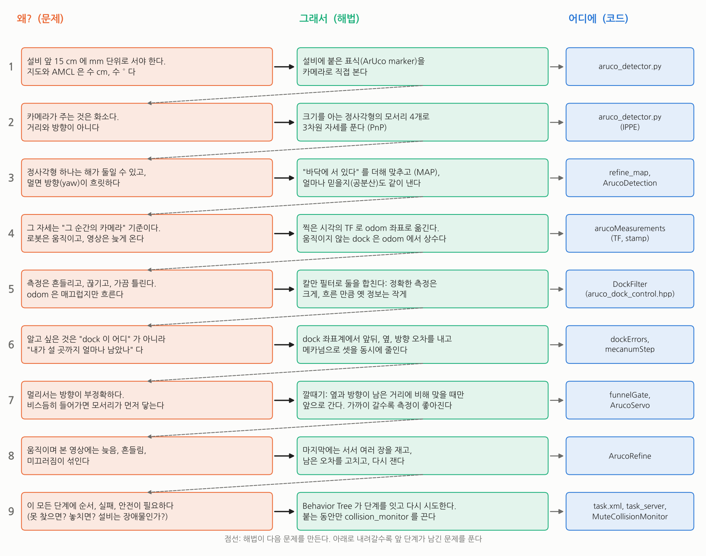

그림 읽는 법: 왼쪽(주황)이 문제, 가운데(초록)가 해법, 오른쪽(파랑)이 그 해법이 사는 코드다. 점선은 "그 해법이 다음 문제를 만든다" 는 뜻이다.

| | 왜? | 그래서 | 이 문서 |
|---|---|---|---|
| 1 | 설비 앞 15 cm 에 mm 단위로 서야 하는데, 지도(AMCL)는 수 cm, 수 ° 의 정밀도다 | 설비에 붙은 marker 를 직접 본다 | 7장 |
| 2 | 카메라는 화소만 준다 | 크기를 아는 정사각형의 모서리 4개로 자세를 푼다 (PnP) | 7장 |
| 3 | 정사각형 하나는 답이 둘일 수 있고, 멀면 방향이 흐릿하다 | 바닥 사전분포로 다시 맞추고, 얼마나 믿을지(공분산)를 같이 낸다 | 8장 |
| 4 | 그 자세는 "그 순간의 카메라" 기준인데 로봇은 움직이고 영상은 늦게 온다 | 찍은 시각의 TF 로 odom 에 옮긴다 | 5장 |
| 5 | 측정은 흔들리고 끊기고, odom 은 흐른다 | 칼만 필터로 합친다 | 6, 9장 |
| 6 | 알고 싶은 것은 "dock 이 어디" 가 아니라 "설 곳까지 얼마나" | dock 좌표계의 오차를 메카넘으로 한꺼번에 줄인다 | 4장 |
| 7 | 멀리서는 방향이 부정확하고, 비스듬히 들어가면 모서리가 먼저 닿는다 | 깔때기: 맞을 때만 앞으로. 가까워질수록 측정이 좋아진다 | 8장 |
| 8 | 움직이며 본 영상에는 늦음, 흔들림, 미끄러짐이 섞인다 | 마지막에는 서서 재고 고친다 | 3장 |
| 9 | 순서, 실패, 안전이 필요하다 | Behavior Tree 가 단계를 잇고 다시 시도한다 | 2, 3장 |

---

## 2. 코드 지도: 누가 무엇을 하고 어떻게 이어지나

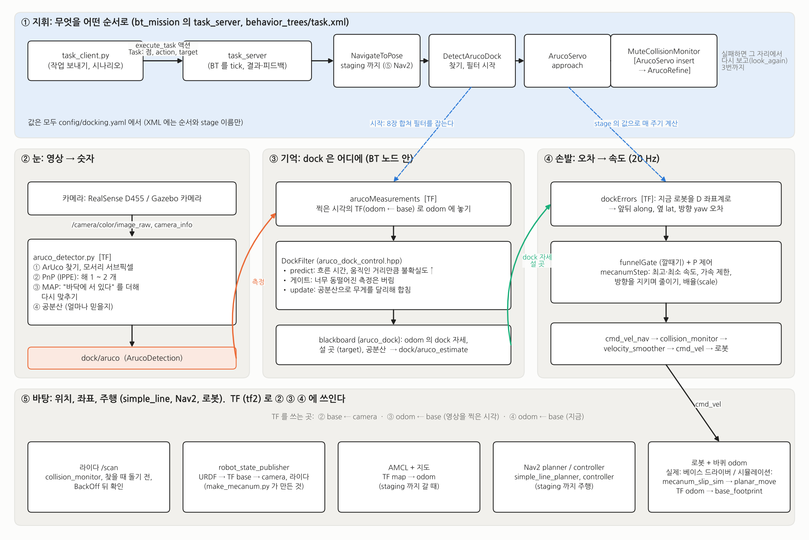

이 프로젝트의 도킹은 **다섯 덩어리**다. 사람의 몸에 비유하면 이해하기 쉽다.

| 덩어리 | 비유 | 하는 일 | 왜 따로 두나 |
|---|---|---|---|
| ① 지휘 | 머리 (계획) | 작업을 받고, 단계를 순서대로 부르고, 실패하면 다시 시도한다 | "무엇을 어떤 순서로" 는 자주 바뀐다. 계산과 떼어 두면 XML 만 고쳐 순서를 바꿀 수 있다 |
| ② 눈 | 눈 | 영상 한 장 → "로봇에서 본 dock 의 자세 + 얼마나 믿을지" | 카메라, 영상 처리, PnP 는 무겁고 OpenCV(Python)가 편하다. 별도 노드로 두면 카메라를 바꿔도 나머지는 그대로다 |
| ③ 기억 | 기억 | 측정들을 odom 에 쌓아 "dock 은 여기" 를 계속 고친다 | 영상은 띄엄띄엄 오지만 제어는 매 순간 dock 의 자리가 필요하다 |
| ④ 손발 | 손발 | 지금 오차를 보고 바퀴 속도 명령을 낸다 | 20 Hz 로 꾸준히 돌아야 한다. 영상이 끊겨도 멈추면 안 된다 |
| ⑤ 바탕 | 몸의 감각 | 로봇이 어디 있고 어디를 보는지 (TF), 지도 주행, 안전 | 도킹 전용이 아니다. Nav2 와 로봇이 이미 갖고 있는 것을 쓴다 |

### 2-1. 파일마다 하는 일

| 파일 | 덩어리 | 하는 일 | 받는 것 → 내는 것 |
|---|---|---|---|
| `bt_mission/scripts/task_client.py` | ① | 작업을 보낸다 (명령줄, 시나리오 파일) | 사람 → `execute_task` 액션 |
| `bt_mission/src/task_server.cpp`, `task_server_main.cpp` | ① | 액션을 받아 BT 를 끝날 때까지 tick, 결과와 피드백 | 액션 goal → BT 의 blackboard |
| `bt_mission/behavior_trees/task.xml` | ① | 순서만 적힌 설계도: 점들 → staging → 찾기 → approach → (안전 끄고) insert → refine, 실패하면 다시 보기 | (코드 아님) |
| `bt_mission/src/mission_nodes.cpp` | ① | `ForEachWaypoint`(점을 차례로 Nav2 에), `DoWork`, `ScanWhileMoving` | blackboard → Nav2 액션 |
| `bt_mission/src/dock_nodes.cpp` | ① ④ | `BackOff`(곧게 뒤로), `MuteCollisionMonitor`(붙는 동안 안전 영역 끄기) | 레이저, 파라미터 서비스 |
| `bt_mission/scripts/aruco_detector.py` | ② | marker 찾기 → IPPE → 바닥 사전분포 MAP → 공분산 | 영상, camera_info, TF(base ← camera) → `dock/aruco` |
| `bt_mission_msgs/msg/ArucoDetection.msg`, `DockHypothesis.msg` | ② → ③ | 로봇(base)에서 본 dock 후보 1 ~ 2 개, 공분산, **영상을 찍은 시각** | |
| `bt_mission/src/aruco_dock_nodes.cpp` | ③ ④ | `DetectArucoDock`(찾기, 필터 시작), `ArucoServo`(필터 갱신 + 제어), `ArucoRefine`(서서 재고 고치기), `arucoMeasurements`(odom 으로 옮기기) | `dock/aruco`, TF → `cmd_vel_nav` |
| `bt_mission/include/bt_mission/aruco_dock_control.hpp` | ③ ④ | ROS 와 무관한 계산: `DockFilter`, `fuseDetections`, `dockErrors`, `funnelGate`, `mecanumStep` | 숫자 → 숫자 (그래서 시험하기 쉽다) |
| `bt_mission/include/bt_mission/dock_control.hpp` | ③ ④ | 2D 자세(`Pose2`)의 합성, 역변환 | |
| `bt_mission/config/docking.yaml`, `docking_config.hpp` | 전부 | 값 전부: marker 크기와 자리, 로봇 치수, 속도, 허용오차, 단계 | |
| `bt_mission/scripts/aruco_teach.py` | 도구 | 정확히 붙인 자리를 "가르친 자세" 로 저장 (고정 오차 지우기) | → `~/.ros/aruco_taught/<dock>.yaml` |
| `bt_mission/scripts/dock_calibrate.py` | 도구 | 실제 로봇의 미끄러짐 배율, 데드밴드를 잰다 | → `docking.yaml` 의 `motion` |
| `simple_line/simple_line_bringup/launch/simple_line.launch.py` | ⑤ | Gazebo, 로봇, Nav2, detector 를 한꺼번에 | |
| `simple_line/simple_line_bringup/robots/make_mecanum.py` | ⑤ | 로봇 모델 (URDF: TF base → camera, 라이다) | |
| `simple_line/simple_line_bringup/scripts/mecanum_slip_sim.py` | ⑤ | 시뮬레이션에 메카넘 미끄러짐과 "흐르는 odom" 을 넣는다 | `cmd_vel` → 몸체 속도, `/odom`, TF |
| `simple_line/simple_line_planner`, `simple_line_controller` | ⑤ | staging 까지의 지도 주행 (Nav2 플러그인) | |

### 2-2. 메시지 하나가 지나가는 길

영상 한 장이 바퀴 명령이 되기까지를 따라가 보자 (괄호는 그 단계의 "왜").

```
카메라 영상 (1280 x 720)
  │ aruco_detector.py: marker 의 모서리 4개 (화소)                      ← 카메라는 화소만 준다
  │ PnP (IPPE): 카메라에서 본 marker 의 자세 1 ~ 2 개                    ← 정사각형의 크기와 모양을 알기 때문
  │ MAP: 바닥에 서 있다는 사실을 더해 다시 맞추고, 공분산 계산             ← 해가 둘이거나 흐릿할 때를 대비 (8장)
  │ TF(base ← camera) 로 로봇에서 본 dock 으로 바꿈                       ← 로봇이 알고 싶은 것은 카메라가 아니라 자기 몸 기준
  ▼
dock/aruco (ArucoDetection, stamp = 찍은 시각)
  │ arucoMeasurements: 찍은 시각의 TF(odom ← base) 로 odom 에 놓기        ← 영상은 늦게 오고 로봇은 움직인다 (5-4)
  │ DockFilter: predict(시간, 움직임) → 게이트 → update                   ← 측정은 흔들리고, odom 은 흐른다 (9장)
  ▼
blackboard {aruco_dock}: odom 의 dock 자세 + 설 곳
  │ (20 Hz) 지금 로봇 자세 TF(odom ← base, 지금) 를 D 좌표계로             ← 오차는 설비 기준으로 봐야 뜻이 있다
  │ dockErrors: along, lat, yaw → funnelGate → P 제어 → mecanumStep      ← 비스듬히 들어가지 않게, 너무 빠르지 않게
  ▼
cmd_vel_nav → collision_monitor → velocity_smoother → cmd_vel → 로봇
  │ 로봇이 움직이면 바퀴 odom 이 바뀌고, 카메라가 다시 본다 (4장의 고리)
```

---

## 3. 한 번의 도킹을 시간 순서로

Gazebo 에서 실제로 돌린 작업 하나 (시나리오 S2, [DOCKING_STUDY 8장](DOCKING_STUDY.md#8-종합-한-번의-도킹을-시간-순서로) 의 로그) 를 칸별로 그렸다.

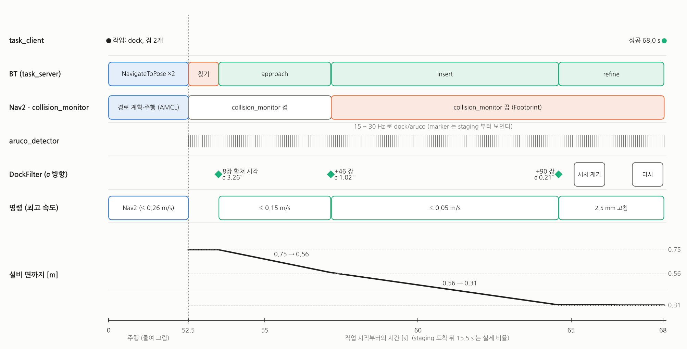

| 구간 | 걸린 시간 | 무슨 일 | 왜 이 단계가 있나 |
|---|---|---|---|
| 주행 | 52.5 s | Nav2 가 지도(AMCL)로 staging 자리까지 | 지도 주행은 수 cm 면 충분하다. marker 가 보이는 곳까지만 데려다 주면 된다 |
| 찾기 | 1.0 s | 서서 0.5 s 기다리고, 8장을 합쳐 필터를 시작 (σ 방향 3.26°) | 멈춰 본 여러 장이 움직이며 본 한 장보다 낫다. 한 장은 틀린 해일 수도 있다 (8장) |
| approach | 3.7 s | 0.75 → 0.56 m. 최고 0.15 m/s. 46장으로 필터가 σ 1.02° 까지 | 멀리서는 느슨하게 빨리. 가까워질수록 측정이 좋아지므로 다가가는 것 자체가 정밀도를 올린다 |
| 안전 끄기 | 즉시 | `collision_monitor` 의 Footprint 를 끈다 | 설비는 "붙어야 하는" 물체라, 켜 두면 마지막 몇 cm 를 막는다 |
| insert | 7.4 s | 0.56 → 0.31 m. 최고 0.05 m/s. 90장으로 σ 0.21° | 가까이서는 느리고 엄격하게. marker 를 방금 봤고 화면 안쪽일 때만 앞으로 |
| refine | 3.4 s | 서서 1 s 재기 → 2.5 mm 고침 → 다시 재기 (0.5 mm) | 움직이며 본 영상의 늦음, 흔들림, 미끄러짐을 지운다 |
| 안전 켜기 | 즉시 | Footprint 를 다시 켠다 | 붙은 뒤에는 다시 안전하게 |

맨 아래 칸의 선이 설비까지의 거리다. approach 와 insert 는 같은 노드(`ArucoServo`)인데 `docking.yaml` 의 `stages` 에서 다른 값을 읽는다. 이것이 XML 에 "무엇을 어떤 순서로" 만 두고 값을 설정 파일로 뺀 이유다.

---

## 4. 매 순간 도는 고리: 보고, 기억하고, 움직이고, 다시 본다

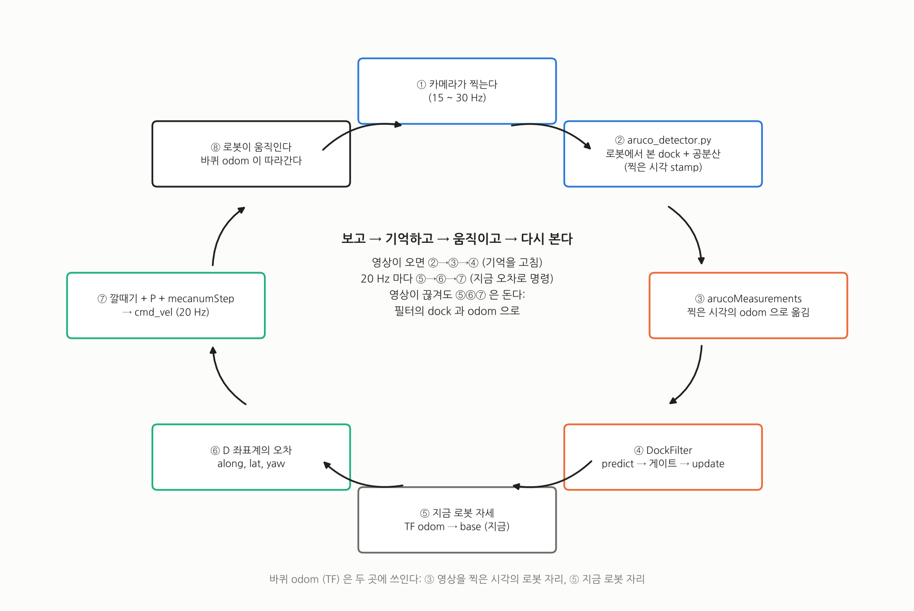

`ArucoServo` 안에서는 두 개의 시계가 따로 돈다.

- **영상이 올 때마다 (15 ~ 30 Hz)**: ② → ③ → ④. 기억(dock 의 자리)을 고친다.
- **50 ms 마다 (20 Hz)**: ⑤ → ⑥ → ⑦. 지금 로봇 자리로 오차를 내고 명령한다.

**왜 둘을 나누나**: 영상은 늦고, 불규칙하고, 끊긴다. 영상이 올 때만 명령하면 영상이 끊긴 사이 로봇은 마지막 명령으로 계속 가거나 멈칫한다. 기억(필터)이 있으면 영상이 끊겨도 "dock 은 여기 있었고, 나는 odom 으로 이만큼 움직였다" 로 오차를 계속 계산할 수 있다. 그래서 9장의 실험에서 marker 를 1 초 못 본 동안에도 필터의 오차는 매끄럽게 이어진다.

바퀴 odom 은 두 곳에 쓰인다: ③ 영상을 **찍은 시각**의 로봇 자리, ⑤ **지금**의 로봇 자리. 같은 TF 를 시각만 달리 묻는다 (5-4).

---

## 5. 좌표계와 TF: 같은 것을 누가 어디서 보았나

### 5-1. 왜 좌표계가 여러 개인가

센서와 물체는 저마다 **자기 기준이 자연스럽다**. 카메라는 "렌즈 앞으로 몇 m, 영상 오른쪽으로 몇 m" 로 보고, 로봇은 "내 앞으로, 내 왼쪽으로", 지도는 "방의 구석에서" 로 본다. 정밀 도킹은 이것들을 섞어야 한다: 카메라가 본 marker 를, 로봇이 움직여도 변하지 않는 기준에 놓고, 그것을 다시 지금 로봇 기준의 오차로 바꾼다.

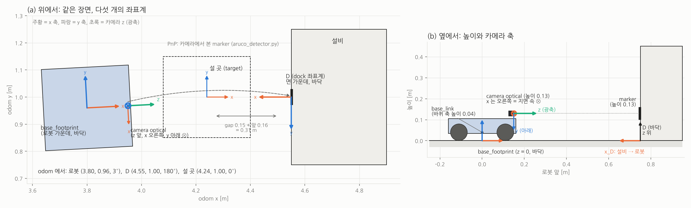

| 좌표계 | 원점과 축 | 누가 쓰나 |
|---|---|---|
| `odom` | 로봇이 켜진 자리 근처. 매끄럽게 이어지지만 흐른다 (6장) | 필터가 dock 을 기억하는 곳 |
| `base_footprint` | 로봇 가운데의 바닥. x 앞, y 왼쪽, z 위 | 제어 명령, detector 의 출력 |
| camera optical | 렌즈 중심. **z 앞(광축), x 오른쪽, y 아래** | PnP 의 결과 |
| D (dock) | 설비 면 가운데의 **바닥**. x 는 설비에서 로봇 쪽, z 위 | 오차 (along = D 의 x, lat = D 의 y) |
| 설 곳 (target) | D 에서 (0.31 m, 0, 180°). 로봇이 서야 할 자세 | 목표 |

**같은 점, 네 개의 숫자**: 위 그림 (a) 의 장면에서 marker 가운데 한 점을 좌표계마다 쓰면 (`fig_geom.py` 로 계산):

| 좌표계 | marker 가운데 [m] | 읽는 법 |
|---|---|---|
| camera optical | (−0.0007, 0.000, 0.601) | 렌즈 앞 0.601 m, 거의 정가운데 |
| base_footprint | (0.751, 0.0007, 0.130) | 로봇 가운데에서 앞 0.751 m (= 0.601 + 카메라가 앞으로 0.15), 높이 0.13 |
| D | (0, 0, 0.130) | 설비 면의 가운데, 높이 0.13 (`docking.yaml` 의 `height`) |
| odom | (4.55, 1.00, 0.130) | 창고 안의 자리 |

**왜 카메라 축은 이상하게 생겼나** (그림 (b)): 영상의 화소 좌표가 왼쪽 위에서 시작해 u 는 오른쪽, v 는 아래로 커지기 때문에 카메라 좌표계도 x 오른쪽, y 아래로 맞춘다. 그러면 z 는 앞이 된다. 로봇의 x 앞, y 왼쪽, z 위와 다르므로 URDF 에 "축만 돌리는" 변환(`camera_rgb_optical_frame`)이 따로 있다. 이것을 잊으면 앞이 아래로 가는 식의 엉뚱한 결과가 나온다.

**왜 D 의 원점을 바닥에 두나**: 로봇의 `base_footprint` 도 바닥에 있으므로 둘 다 "바닥 평면 위의 2D 자세 (x, y, yaw)" 로 다룰 수 있다. marker 의 높이는 설정값으로 따로 들고 간다.

### 5-2. TF 나무: 누가 어느 변환을 내나

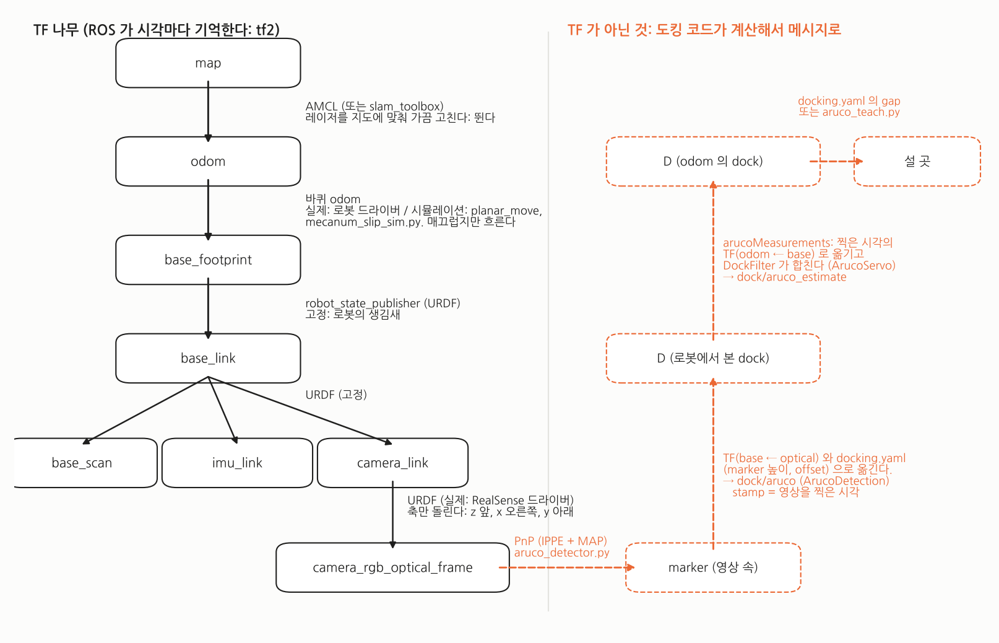

ROS 의 TF(tf2)는 "좌표계 A 에서 B 로 가는 변환" 을 **시각별로 기억하는 나무**다. 왼쪽이 TF, 오른쪽(점선)은 TF 가 아니라 도킹 코드가 계산해 메시지로 주고받는 것이다.

| 변환 | 내는 쪽 | 성질 |
|---|---|---|
| map → odom | AMCL (지도 + 레이저) | 정확하지만 고칠 때 **뛴다** |
| odom → base_footprint | 바퀴 odom (실제: 로봇 드라이버, 시뮬레이션: `planar_move` 또는 `mecanum_slip_sim.py`) | **매끄럽지만 흐른다** |
| base_footprint → base_link → camera, 라이다 | `robot_state_publisher` (URDF) | 고정. 로봇의 생김새 |
| optical → marker | `aruco_detector.py` (PnP) | 영상마다 계산 |
| base → D | `aruco_detector.py` 의 출력 `dock/aruco` | 후보 + 공분산 + 찍은 시각 |
| odom → D | `ArucoServo` 의 `DockFilter` (`dock/aruco_estimate`) | 측정을 합친 추정 |

**왜 dock 은 TF 에 넣지 않나**: TF 는 "확실한 변환" 을 위한 것이다. dock 의 자리는 불확실도(공분산)와 함께 다뤄야 하고, 후보가 둘일 수도 있고, 누가 언제 고칠지(필터)가 정해져 있다. 그래서 BT 노드가 blackboard 에 들고 있고, 보기용으로만 `dock/aruco_estimate` 를 낸다.

변환을 잇는 계산(합성, 역변환)은 [DOCKING_STUDY 1-2](DOCKING_STUDY.md#1-2-변환을-잇고-뒤집기) 에 숫자 예제가 있다. 도킹에서 쓰는 사슬은 이것 하나다:

```
odom 에서 본 D  =  (odom ← base, 찍은 시각)  ∘  (base ← camera)  ∘  (camera ← marker, PnP)  ∘  (marker ← D, docking.yaml)
                     바퀴 odom (TF)            URDF (TF)          aruco_detector.py         marker 의 높이, offset
```

### 5-3. 왜 "찍은 시각" 이 중요한가: 영상의 늦음

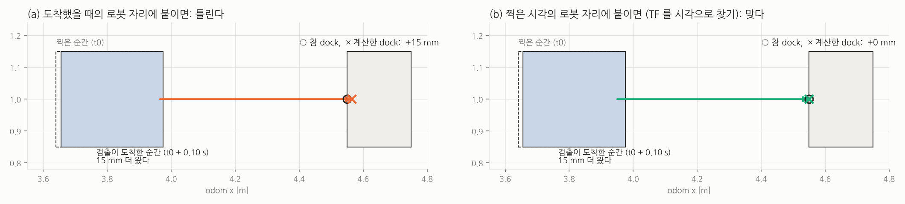

영상은 찍은 뒤 처리와 전송을 거쳐 50 ~ 100 ms 뒤에 도착한다. 그동안 로봇은 움직인다.

- **(a) 도착한 순간의 로봇 자리에 붙이면**: 0.15 m/s 로 0.1 s 늦으면 로봇은 15 mm 더 왔는데, 측정은 "15 mm 전의 로봇에서 본 것" 이다. dock 이 **15 mm 더 멀리** 있다고 계산된다. 돌고 있으면 더 크다: 0.4 rad/s 로 0.1 s 면 2.3° 이고, 0.6 m 앞의 marker 는 옆으로 **24 mm** 틀린다.
- **(b) 찍은 시각의 로봇 자리에 붙이면**: 맞다. 그래서 `ArucoDetection` 의 `header.stamp` 는 **영상을 찍은 시각**이고, `arucoMeasurements` 는 `tf.lookupTransform(odom, base, stamp)` 로 그 시각의 로봇 자리를 묻는다. TF 가 시각별로 기억하는 이유다.

이렇게 해도 남는 늦음(카메라 시계와 컴퓨터 시계의 차이 등)은 `stamp_offset` 으로 맞추고, 마지막 판단은 서서 본 영상(refine)으로 한다.

---

## 6. Odometry: 매끄럽지만 흐르는 자

### 6-1. 무엇인가

바퀴 odom 은 "바퀴가 얼마나 돌았나" 에서 "몸이 얼마나 움직였나" 를 계산해(메카넘은 [MECANUM_STUDY 5장](MECANUM_STUDY.md#5-거꾸로-바퀴에서-몸체로-정기구학-odom)) **적분한** 자세다. 매 순간 `x += (vx cos θ − vy sin θ) dt` 를 쌓는다. 바깥을 보지 않으므로 늘 매끄럽게 이어지고, 빠르다(수십 Hz 이상).

### 6-2. 왜 흐르나

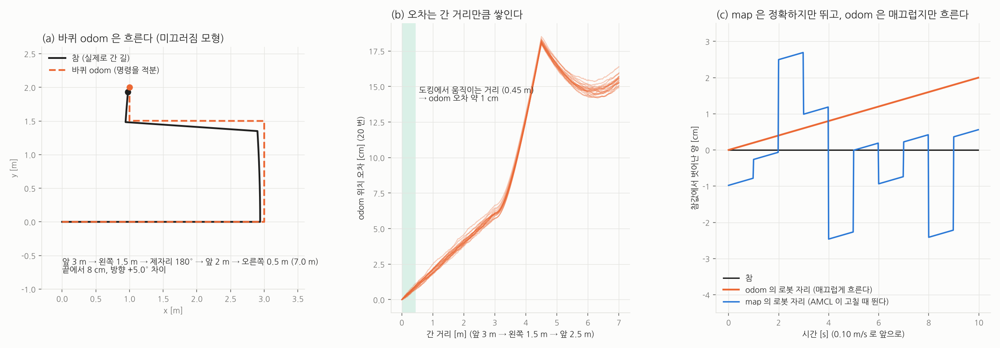

- **(a)**: 바퀴는 명령대로 돌지만 몸은 덜 간다(미끄러짐). 이 프로젝트의 시뮬레이션 모형(`mecanum_slip_sim.py`: 앞 98 %, 옆 90 %, 회전 96 %, 옆 1 m 에 0.04 rad 돎)으로 7 m 를 가면 odom 은 끝에서 8 cm, 방향 5° 틀린다.
- **(b)**: 오차는 **간 거리만큼 쌓인다**. 옆으로 가는 구간(3 ~ 4.5 m)에서 특히 빨리 쌓인다 (메카넘의 롤러가 옆으로 갈 때 가장 많이 미끄러진다). 방향 오차는 그 뒤로 가는 거리만큼 위치 오차로 바뀐다.
- 도킹에서 움직이는 0.45 m 동안에도 odom 은 약 **8.5 mm** 틀린다(앞 2 % 미끄러짐). 허용오차가 3 mm 이므로 odom 만으로는 부족하다. 반면 영상 두 장 사이(1/15 s, 10 mm 이동)의 odom 오차는 0.2 mm 다. **짧게는 아주 정확하고, 길게는 흐른다.**

### 6-3. 왜 dock 을 map 이 아니라 odom 에 두나

- **(c)**: AMCL 은 지도와 레이저를 맞춰 `map → odom` 을 고친다. 길게 보면 정확하지만, 고칠 때마다 로봇의 map 자리가 **cm 단위로 뛴다**. odom 의 자리는 뛰지 않고 천천히 흐른다.
- 도킹은 15 초 안의 0.5 m 짜리 일이다. 이 짧은 시간에는 "정확하지만 뛰는" map 보다 "흐르지만 매끄러운" odom 이 낫다. dock 을 map 에 두면 AMCL 이 고칠 때마다 dock 이 cm 씩 뛰고, 로봇은 그만큼 갑자기 옆으로 꺾는다.
- 그리고 dock 은 움직이지 않으므로 odom 에서는 **(흐름을 빼면) 상수**다. 상수 하나를 추정하는 것은 필터로서 가장 쉬운 문제다 (9-4).
- odom 의 흐름은 영상이 고친다. 영상은 늘 "설비 기준" 이라 흐르지 않는다. 이것이 9장의 칼만 필터가 하는 일이다.

---

## 7. PnP: 화소 네 개에서 3차원 자세로

### 7-1. 왜 모서리 4개면 되나

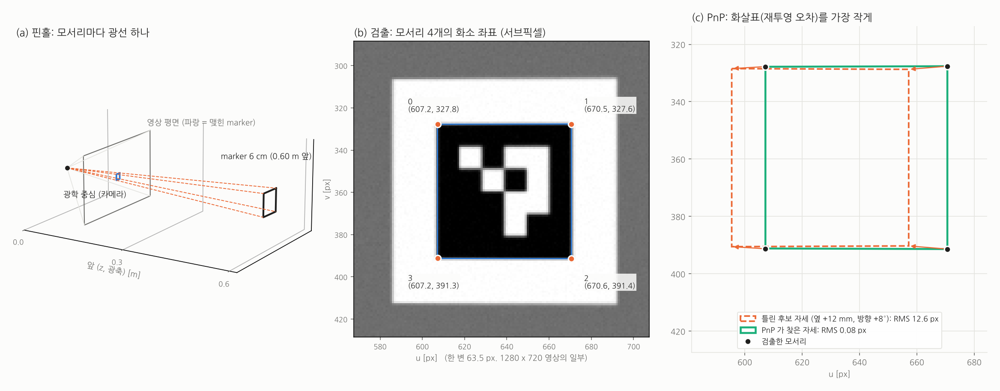

- **(a) 핀홀**: 3차원의 점 하나는 렌즈 중심을 지나는 **광선 하나** 위의 어딘가에 찍힌다. 화소 좌표만으로는 그 광선 위 어디인지(거리)를 모른다.
- 그런데 marker 는 **한 변 6 cm 인 정사각형**이다. 모서리 4개가 각자의 광선 위에 있으면서 서로 정확히 6 cm 정사각형을 이루는 자세는 (거의) 하나뿐이다. 이것을 찾는 것이 **PnP** (Perspective-n-Point: 점 n 개로 자세 구하기)다.
- **(b)**: 실제로 detector 가 찾은 모서리 4개 (서브픽셀: 화소의 소수점까지). 한 변이 63.5 px 다. 핀홀 식으로 거리 ≈ f × 실제 크기 / 영상 크기 = 640 × 0.06 / 63.5 = **0.605 m** (참값 0.601 m). 크기가 거리를, 사다리꼴로 찌그러진 정도가 방향을 알려 준다 ([DOCKING_STUDY 1-4](DOCKING_STUDY.md#1-4-카메라는-3차원-점을-어떻게-화소로-찍나-핀홀-모델)).
- **(c)**: 자세를 하나 가정하면 모서리가 어디 찍혀야 하는지 계산할 수 있다(재투영). 검출한 모서리와의 차이(화살표)가 **재투영 오차**다. 옆 12 mm, 방향 8° 틀린 자세는 RMS 12.6 px, PnP 가 찾은 자세는 0.08 px 다. PnP 는 이 화살표들의 제곱합이 가장 작은 자세를 찾는다.

### 7-2. 왜 방향(yaw)이 가장 약한가

`bp_ippe.png` 의 (f) 를 먼저 보자 (8장 그림의 오른쪽 아래). 방향을 일부러 틀리게 고정하고 나머지를 가장 잘 맞췄을 때의 재투영 오차다.

| 로봇 중심 ↔ 설비 면 | 방향 4° 틀림 | 방향 10° 틀림 |
|---|---|---|
| 1.00 m | 0.06 ~ 0.08 px | 0.25 ~ 0.32 px |
| 0.60 m | 0.20 ~ 0.24 px | 0.59 ~ 0.80 px |
| 0.35 m | 1.0 ~ 1.1 px | 2.5 ~ 3.2 px |

멀리서는 방향이 10° 틀려도 영상이 0.3 px 밖에 바뀌지 않는다. 모서리 잡음(약 0.5 px)보다 작으므로 **영상 한 장으로는 방향을 몇 ° 안으로 정할 수 없다**. 가까이 가면 같은 10° 가 3 px 차이가 나서 또렷하다. 이것이

- detector 가 멀리서 방향의 σ 를 크게(1 m 에서 십수 °) 내는 이유이고,
- 필터가 먼 측정을 덜 믿는 이유이고 (9장),
- 깔때기가 "가까이 갈 때까지 정확히 맞추라고 하지 않는" 이유다 ([DOCKING_STUDY 4-3](DOCKING_STUDY.md#4-3-깔때기-funnel-gate)).

방향 1° 틀림은 설 곳(설비에서 0.31 m)에서 옆으로 약 5 mm 다. 그래서 정밀 도킹의 핵심은 결국 **방향을 얼마나 잘 아느냐**다.

---

## 8. IPPE: 정사각형 하나가 주는 두 개의 답

### 8-1. 무엇인가

평면 위의 점들로 푸는 PnP 는 답이 둘 나올 수 있다. OpenCV 의 IPPE (Infinitesimal Plane-based Pose Estimation) 는 그 둘을 다 준다. 두 답의 **면 법선(marker 가 바라보는 방향)은 시선을 축으로 거울상**이다. 멀리서 작게 보이면 두 답이 영상에서 거의 똑같이 보인다.

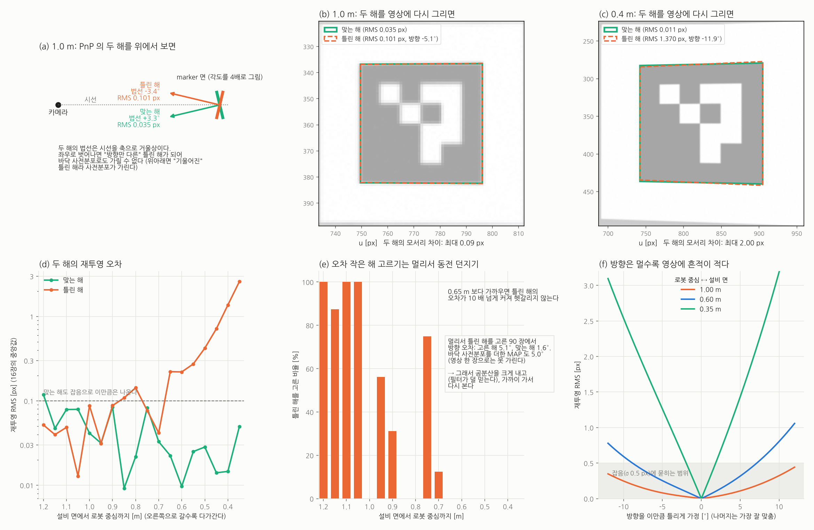

- **(a)**: 1.0 m 에서 실제로 나온 두 답을 위에서 본 것. 시선에서 법선이 +3.3° 와 −3.3° 로 벗어난 거울상이다 (그림은 각도를 4배로 그렸다).
- **(b)**: 그 두 답으로 모서리를 다시 그리면 차이가 **최대 0.09 px** 다. 잡음보다 훨씬 작다. 재투영 오차도 0.035 px 와 0.101 px 로 둘 다 잡음 수준이다.
- **(c)**: 0.4 m 에서는 틀린 답(방향 −11.9°)의 모서리가 **2.0 px** 어긋나고 재투영 오차가 1.37 px 다. 헷갈리지 않는다.
- **(d)**: 거리별로 두 답의 재투영 오차 (16장의 중앙값). 0.7 m 보다 멀면 둘이 엉켜 있고, 0.65 m 보다 가까우면 틀린 답의 오차가 10배 넘게 커진다.
- **(e)**: "재투영 오차가 작은 답" 을 고르면 틀리는 비율. 1.05 ~ 1.2 m 에서는 거의 늘 틀리고, 0.65 m 보다 가까우면 한 번도 틀리지 않는다.

### 8-2. 이 프로젝트는 어떻게 대처하나 (그리고 무엇은 못 하나)

`ex_ippe.py` 로 288장(거리 18곳 × 16장)을 보면:

- detector 의 **바닥 사전분포 MAP** ("dock 은 바닥에 서 있다": 기울기 σ 1.5°, 높이 σ 1 cm, [DOCKING_STUDY 2-6](DOCKING_STUDY.md#2-6-map-다듬기-영상과-바닥에-서-있다-를-같이-맞추기-refine_map)) 은 288장 모두에서 두 답을 **하나로 모았다**. 법선이 시선에서 위아래로 벗어난 쌍둥이는 "기울어진 marker" 라서 사전분포가 가려 준다. 예: 1 m 에서 로봇이 5°, 15° 돌아 섰을 때 IPPE 의 두 답은 둘 다 marker 가 ±3 ~ 4° 앞뒤로 기울었다고 했다 (실제는 0°). MAP 은 기울기를 0.02° 로 되돌렸다.
- 하지만 이 실험처럼 법선이 **좌우로** 벗어나 있으면 틀린 답은 "방향만 다른 marker" 다. 사전분포로도 못 가린다. 오차 작은 답을 잘못 고른 90장에서 방향 오차는 고른 답 5.1°, MAP 5.0° 로 같았다 (맞는 답은 1.6°). **멀리서 본 영상 한 장으로는 풀 수 없는 문제**다.

그래서 이 프로젝트는 영상 한 장에 기대지 않고, 여러 겹으로 막는다.

| 장치 | 무엇을 막나 | 어디 |
|---|---|---|
| 바닥 사전분포 MAP | 기울어진 쌍둥이 답 | `refine_map` |
| 큰 공분산 | 멀리서 본 방향을 필터가 덜 믿게 (σ 가 크면 무게가 작다) | `ArucoDetection.hypotheses[].covariance` |
| 서서 8장 합치기 (중앙값 + 게이트) | 한 장의 틀린 답이 처음 값을 정하는 것 | `fuseDetections` |
| 후보가 둘이면 필터에 가까운 쪽 | 뒤집힌 후보 | `closestHypothesis` |
| 게이트 (Mahalanobis) | 지금 아는 것과 동떨어진 측정 | `DockFilter::update` |
| 깔때기 | 방향을 아직 잘 모를 때 설비 쪽으로 가는 것 | `funnelGate` |
| 다가가기 그 자체 | 0.65 m 보다 가까우면 모호함이 사라진다. 필터는 가까운 측정을 크게 믿는다 | approach, insert |
| 서서 재고 고치기 | 마지막 mm | `ArucoRefine` |
| marker 둘 (선택) | marker 사이의 거리가 방향을 정해 준다 (8-3) | `docking.yaml` 의 `markers` |

### 8-3. marker 가 둘이면: 답이 하나로 정해지나? 깔때기는?

`dock_b` 처럼 60 mm marker 둘을 중심 간격 160 mm 로 나란히 붙인 경우다 ([DOCKING.md 8-3](DOCKING.md#8-3-marker-둘-dock_b-크기-배치-달라지는-것)). 숫자는 `ex_two_markers.py` (288장씩) 와 `ex_why_filter.cpp` (marker 둘의 측정 108장) 로 냈다.

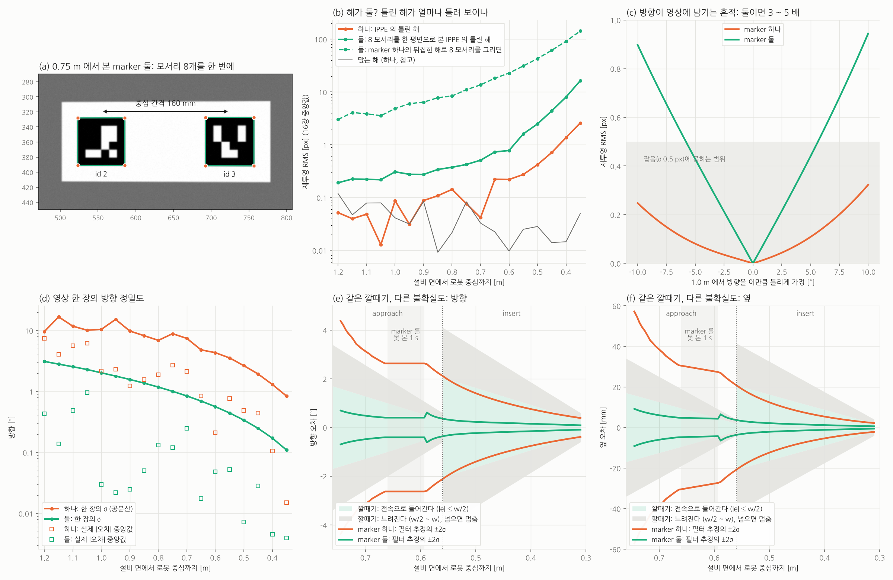

**짧은 답**

- **답이 둘인 문제는 "없어진다" 기보다 "문제가 되지 않을 만큼 작아진다".** 모서리 8개도 여전히 한 평면 위에 있어서, 8개를 한 평면 물체로 보고 IPPE 를 돌리면 수학적으로는 답이 여전히 둘 나온다. 하지만 틀린 답이 영상에서 훨씬 틀려 보이고, 남는 모호함은 방향 1.7° 정도라 그 거리의 보통 잡음 안에 묻힌다. detector 의 후보는 288장 모두 하나였다.
- **깔때기는 똑같다.** 깔때기(`funnelGate`)는 "추정한 오차" 와 "남은 거리" 만 보고, 값(`funnel_lat0`, `funnel_lat_slope`, `funnel_yaw0_deg`, `funnel_yaw_slope_deg`)은 `docking.yaml` 의 `motion` 과 `stages` 에서 읽는다. marker 수는 보지 않고, dock 마다 따로 둘 수도 없다. 달라지는 것은 깔때기에 **들어가는 추정의 질**이다.

**(b) 답이 둘? 틀린 답이 얼마나 틀려 보이나** (재투영 RMS, 16장의 중앙값. 맞는 답은 0.01 ~ 0.1 px)

| 로봇 중심 ↔ 설비 면 | 하나: IPPE 의 틀린 답 | 둘: 8 모서리를 한 평면으로 본 IPPE 의 틀린 답 | 둘: marker 하나의 뒤집힌 답으로 8 모서리를 그리면 |
|---|---|---|---|
| 1.0 m | 0.09 px | 0.31 px | 4.9 px |
| 0.75 m | 0.08 px | 0.42 px | 11 px |
| 0.5 m | 0.42 px | 2.5 px | 43 px |
| 0.35 m | 2.6 px | 16 px | 143 px |

- **왜 marker 하나의 뒤집힘은 살아남지 못하나** (점선): detector 의 `estimate_dock` 은 marker 마다 IPPE 두 답(둘이면 시작점 4개)에서 출발해 **모서리 8개 전부**의 오차로 줄을 세운다. marker 하나의 뒤집힌 답은 방향이 5 ~ 10° 다르다. 그 답대로라면 160 mm 옆의 다른 marker 는 앞뒤로 1 ~ 3 cm 다른 자리에 있어야 하는데 (160 mm × sin 5 ~ 10°) 실제 영상은 그렇지 않다. 그래서 1 m 에서도 5 px, 가까우면 수십 ~ 140 px 어긋난다. 가장 좋은 시작점과 "다른 골짜기" 의 시작점 하나만 MAP 으로 다듬고, 둘이 같은 자리로 모이면 후보 하나만 낸다.
- **평면 전체의 쌍둥이는 남지만 작다** (초록 실선): 8 모서리를 한 평면으로 보면 0.95 m 보다 먼 곳에서 오차 작은 답이 틀린 경우가 31 % 다 (marker 하나는 74 %). 하지만 그때 틀린 답의 방향 오차는 1.7° (하나는 4.4°) 로, 그 거리에서 한 장의 방향 σ(2 ~ 3°) 안이다. 두 답이 한 골짜기로 합쳐져 "뒤집힘" 이 아니라 "보통 잡음" 이 된 것이다.
- 그래도 코드는 후보 둘을 낼 수 있게 남겨 두었다. 후보가 둘이면 BT 의 필터가 지금 추정에 가까운 쪽을 고른다 (`closestHypothesis`). marker 하나일 때와 같은 길이다.

**(c), (d) 방향은 얼마나 좋아지나**

방향이 바뀌면 두 marker 중 하나는 다가오고 하나는 멀어진다. 160 mm 떨어진 두 점의 앞뒤 차이는 크기와 자리로 영상에 또렷이 남는다. 정사각형 하나가 사다리꼴로 찌그러진 정도보다 훨씬 크다.

| | marker 하나 | marker 둘 |
|---|---|---|
| 1.0 m 에서 방향 4° 틀리게 두면 재투영 오차 | 0.06 ~ 0.08 px (잡음에 묻힘) | 0.34 px |
| 같은 것, 10° | 0.25 ~ 0.32 px | 0.90 px |
| 한 장의 방향 σ, 1.0 m | 10.5° | 2.0° |
| 같은 것, 0.75 m | 8.9° | 1.0° |
| 같은 것, 0.35 m | 0.84° | 0.11° |

**(e), (f) 같은 깔때기, 다른 불확실도**

깔때기는 필터가 추정한 오차를 띠(band)와 비교한다. 그런데 추정에는 불확실도가 있으니, 깔때기 눈에는 **"추정의 ±2σ 만큼은 진짜 오차가 없어도 오차처럼 보일 수 있다"**. 그림은 그 ±2σ (필터의 dock 불확실도를 "로봇이 D 에서 어디 있나" 로 옮긴 값) 를 깔때기의 띠 위에 겹친 것이다. 초록 띠 안이면 전속으로 들어가고, 회색 띠에서는 느려지고, 그 밖이면 설비 쪽으로는 가지 않고 옆과 방향만 고친다.

| | 깔때기 (전속 / 멈춤) | marker 하나: 추정의 ±2σ | marker 둘: 추정의 ±2σ |
|---|---|---|---|
| approach 시작 (0.75 m), 방향 | ±1.6° / ±3.2° | **±4.4°** | ±0.7° |
| 같은 곳, 옆 | ±16 mm / ±32 mm | **±57 mm** | ±9 mm |
| insert 시작 (0.56 m), 방향 | ±2.0° / ±4.1° | ±2.1° | ±0.4° |
| 같은 곳, 옆 | ±21 mm / ±42 mm | ±21 mm | ±4 mm |
| 붙기 직전 (0.32 m), 방향 | ±0.37° / ±0.74° | ±0.39° | ±0.09° |
| 같은 곳, 옆 | ±2.8 mm / ±5.5 mm | ±2.2 mm | ±0.6 mm |

- **marker 하나**: 접근 초반에는 추정의 흔들림이 깔때기보다 넓다. 그래서 추정이 자리를 잡을 때까지 깔때기가 자주 좁아지고, 로봇은 "있는지 없는지 모를" 옆과 방향 오차를 고치며 천천히 들어간다. Gazebo 에서 본 "접근 초반에 좌우로 흔들리며 방향을 찾는" 모습이 이것이다 ([DOCKING.md 8-3](DOCKING.md#8-3-marker-둘-dock_b-크기-배치-달라지는-것)). 붙기 직전에도 ±2σ 가 깔때기의 전속 띠와 비슷해서, 마지막을 서서 재고 고치는(refine) 단계가 특히 중요하다.
- **marker 둘**: 추정의 흔들림이 처음부터 깔때기의 전속 띠 안에 있다. 깔때기는 **진짜로 틀어진 것에만** 반응한다. 같은 깔때기인데 덜 막히고 더 곧게 들어간다.

**왜 깔때기를 marker 수에 따라 바꾸지 않았나**

1. 깔때기의 첫째 목적은 **기하**다: 비스듬히 들어가 로봇 모서리가 설비에 먼저 닿지 않게, marker 가 화면 밖으로 나가지 않게. 이것은 marker 수와 상관없다.
2. 둘째 목적("아직 잘 모를 때 서두르지 않기")은 marker 가 둘이면 **저절로** 덜 걸린다. 위 표처럼 같은 띠라도 추정이 좁으니 막히지 않는다. 따로 바꾸지 않아도 알맞게 된다.
3. 마지막 정확도는 깔때기가 아니라 **허용오차(`tol_*`)와 refine** 이 정한다. 깔때기를 좁혀도 끝의 정확도는 그대로고 느려지기만 한다.

marker 가 둘이면 더 할 수 있는 것은 따로 있다: staging 을 더 멀리, 더 비스듬히 두기, approach 를 더 빠르게. 다만 지금은 `stages` 와 `motion` 이 dock 마다가 아니라 **모든 dock 에 공통**이라, 바꾸면 marker 하나인 `dock_a` 에도 똑같이 적용된다. dock 마다 다르게 하려면 `docks.<dock>` 아래에 단계 값을 덮어쓰는 기능을 더해야 한다 (지금은 없다).

**marker 수에 따라 실제로 달라지는 로직**

| 곳 | marker 하나 | marker 둘 이상 | 왜 |
|---|---|---|---|
| 자세 (`estimate_dock`) | 모서리 4개, 시작점 2개 | 보인 marker 의 모서리 전부 (8개), 시작점 = marker 마다의 IPPE 두 답 | 모서리를 한꺼번에 맞춰야 marker 사이 거리가 방향을 정해 준다 |
| 화면 끝 여유 (`border_px`, `safety.min_border_px`) | 그 marker | **가장 여유 있는** marker | 하나가 화면 밖으로 나가도 남은 것으로 자세가 나오므로 멈추지 않는다 |
| marker 하나가 가려지면 | 도킹할 수 없다 | 남은 하나로 계속 (그 동안은 marker 하나의 정밀도) | 공분산이 그만큼 커져서 필터가 저절로 덜 믿는다 |
| 서서 재기 (`refine.all_markers: true`) | | 전부 보인 영상만 | 일부만 보고 푼 자세는 가르칠 때(전부 보고)와 고정 오차가 다르다 |
| 가르친 자세 (`aruco_teach.py`) | | 본 marker 번호를 함께 적고, 구성이 다르면 쓰지 않는다 | 같은 이유 |
| 필터, 깔때기, `mecanumStep`, BT | 같다 | 같다 | 받는 것이 똑같이 "dock 의 자세 + 공분산" 이다 |

**marker 가 둘이어도 칼만 필터가 필요한가**: 9-2 의 실험을 marker 둘의 측정으로 다시 돌리면 (`gen_meas.py dock_b`, `ex_why_filter meas_dock_b.txt`):

| 방법 | 멀리서 장마다 튀는 옆 | 0.56 m (옆, 방향) | 붙는 자리 (앞뒤, 옆, 방향) |
|---|---|---|---|
| 측정 한 장 그대로 | 0.9 mm (가장 크게 2.8 mm) | (−0.1 mm, −0.01°) | (0.03 mm, 0.00 mm, 0.000°) |
| 처음에 한 번 재고 odom 만 | | (−5.4 mm, −0.40°) | (**−8.2 mm, −3.7 mm, −0.40°**): 실패 |
| 예측 없는 필터 | | (−4.2 mm, −0.31°) | (−1.1 mm, 0.0 mm, 0.000°) |
| 이 프로젝트의 칼만 필터 | | (−0.5 mm, −0.05°) | (0.01 mm, 0.00 mm, 0.000°) |

- 측정 한 장이 이미 좋아서 "흔들림을 줄인다" 는 이유는 약해진다 (7.6 mm → 0.9 mm).
- 하지만 **odom 은 여전히 흐른다.** 처음에 잰 값만 믿으면 marker 둘이어도 실패한다. 측정을 계속 넣어 흐름을 지워야 한다.
- 필터는 그 밖에도 끊김(둘 다 가려지거나 반사)을 odom 으로 메우고, 이상한 측정을 게이트로 버린다. marker 둘이어도 필터의 역할이 "잡음 줄이기" 에서 "흐름 지우기와 끊김 메우기" 쪽으로 옮겨 갈 뿐 없어지지 않는다.

---

## 9. 칼만 필터: 왜 측정과 odom 을 합쳐야 하나

### 9-1. 두 정보원은 서로의 약점을 메운다

| | 영상 측정 (marker) | 바퀴 odom |
|---|---|---|
| 기준 | **설비 기준**. 흐르지 않는다 | 바퀴 기준. **흐른다** (6장) |
| 짧은 시간 | 장마다 흔들린다 (멀리서 옆 수 mm ~ 수 cm, 방향 수 °) | 아주 정확하다 (영상 두 장 사이 0.2 mm) |
| 언제 | 15 ~ 30 Hz, 늦게 오고, **끊긴다** (반사, 화면 밖, 흔들림) | 늘, 빠르게 |
| 실수 | 가끔 틀린 답 (8장) | 큰 실수는 없지만 쌓인다 |
| 거리에 따라 | 가까울수록 훨씬 좋아진다 | 거리와 무관 (간 거리만큼 쌓임) |

측정만 쓰면 흔들리고 끊기고, odom 만 쓰면 흐른다. **칼만 필터는 둘을 "얼마나 믿을지(분산)" 의 비율로 섞는다.** 측정이 정확하면(가까우면) 측정을 크게, odom 이 많이 흘렀으면(많이 움직였으면) 옛 정보를 작게 믿는다.

### 9-2. 실험: 네 가지 방법으로 같은 길을 가 보면

`ex_why_filter.cpp` 는 실제 detector 가 합성 영상 108장에서 낸 측정(staging 8장 + 다가가며 100장)을 받아, 이 프로젝트의 시뮬레이션과 같은 미끄러짐을 odom 에 넣고, 앞 0.66 ~ 0.59 m 에서 1초 동안 marker 를 못 본다고 두었다. 네 방법이 "로봇이 설 곳에 대해 어디 있다고 생각하는지" 의 오차를 비교한다. 제어는 이 생각을 0 으로 몰아가므로, **이 오차가 그대로 도킹 오차로 남는다.**

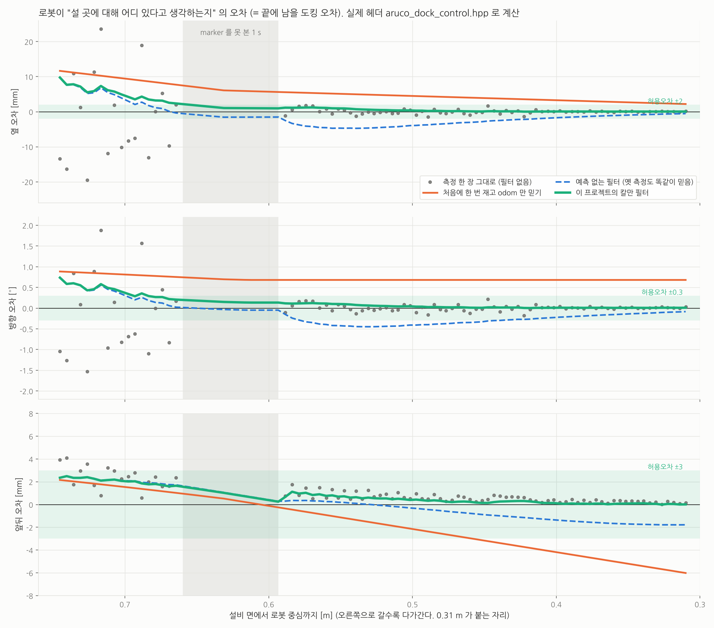

| 방법 | 멀리서 (0.5 m 보다 먼 곳) | 0.56 m 에서 (옆, 방향) | 붙는 자리 0.31 m 에서 (앞뒤, 옆, 방향) | 허용오차 (3 mm, 2 mm, 0.3°) |
|---|---|---|---|---|
| 측정 한 장 그대로 | 장마다 옆이 평균 **7.6 mm** 씩 튄다 (가장 크게 23.6 mm, 방향은 가장 크게 1.9°) | (그때그때) | (0.1, 0.2 mm, 0.03°) | 끝은 통과. 하지만 가는 내내 명령이 널뛰고, 못 본 동안은 낡은 값을 들고 있다 |
| 처음에 한 번 재고 odom 만 | 매끄럽지만 처음 오차(방향 0.88°)를 그대로 들고 간다 | (5.2 mm, 0.68°) | (**−6.0 mm**, 2.2 mm, **0.68°**) | 실패: odom 이 흐른 만큼과 처음 오차가 그대로 남는다 |
| 예측 없는 필터 | 처음엔 잘 줄인다 | (**−4.5 mm**, **−0.40°**) | (−1.8 mm, −0.5 mm, −0.08°) | 중간에 허용오차 밖, 끝에 앞뒤 1.8 mm 치우침 |
| **이 프로젝트의 칼만 필터** | 장마다 0.40 mm 씩만 움직인다 | (1.1 mm, 0.11°) | (**0.01 mm, 0.06 mm, 0.01°**) | 통과. 가는 내내 매끄럽고, 못 본 1 초도 이어진다 |

각각이 알려 주는 "왜":

1. **측정만 쓰면 안 되는 이유**: 멀리서 본 측정은 장마다 수 mm ~ 수 cm 씩 튄다. 이것을 그대로 제어에 넣으면 로봇이 잡음을 쫓아 좌우로 흔들리고, 카메라가 흔들리면 측정은 더 나빠진다. 끊긴 동안은 판단할 근거가 없다.
2. **odom 만 쓰면 안 되는 이유**: 처음 잰 값의 오차(방향 0.88°, 앞뒤 +2 mm)를 고칠 기회가 없고, 다가가는 동안 odom 이 흐른 만큼(앞 2 % 미끄러짐으로 약 −9 mm)이 더해져 끝에 앞뒤 −6 mm, 방향 0.68° 가 남는다.
3. **예측(불확실도 키우기)이 필요한 이유**: 옛 측정은 "그때의 odom" 기준이다. odom 이 흐르면 옛 측정은 점점 지금과 안 맞는데, 예측 없이 모두 똑같이 믿으면 결과가 옛 값 쪽으로 끌려간다(중간에 −4.5 mm). 이 프로젝트의 필터는 **움직인 거리에 비례해** 불확실도를 키워서(`predictMotion`, `odom_slip` 0.10) 옛 정보를 알맞게 잊는다.
4. **필터가 주는 것**: 흔들림은 평균으로 줄이고(멀리서 장마다 0.40 mm), 흐름은 새 측정으로 고치고, 끊김은 odom 으로 메우고, 가까운 정확한 측정을 크게 믿어서 끝에서 0.1 mm 안으로 간다.

### 9-3. 한 번의 예측과 갱신

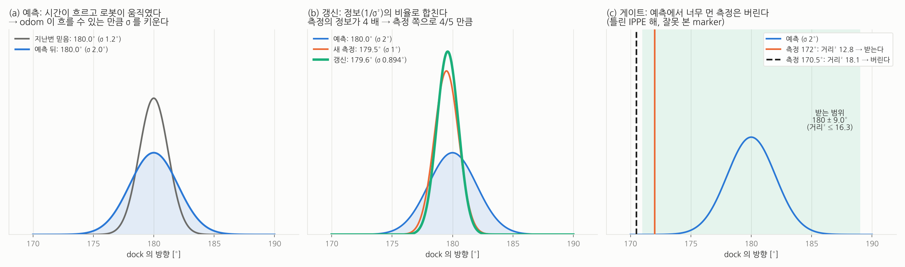

방향 하나만 떼어 1차원으로 보면:

- **(a) 예측**: 시간이 흐르고 로봇이 움직였다. dock 은 그대로지만 "odom 이 흘렀을 수 있다" 만큼 덜 확실해진다. 평균은 그대로, σ 만 커진다 (그림의 1.2° → 2.0° 는 예시).
- **(b) 갱신**: 예측 180.0° (σ 2°) 와 측정 179.5° (σ 1°). 정보(1/σ²)가 1/4 대 1, 즉 측정이 4배다. 그래서 결과는 측정 쪽으로 차이의 4/5 만큼 간 **179.6°**, σ 는 둘보다 작은 **0.894°** (실제 `DockFilter::update` 가 낸 값, [DOCKING_STUDY 1-6](DOCKING_STUDY.md#1-6-불확실도-표준편차-공분산-정보)).
- **(c) 게이트**: 예측과 측정의 차이를 둘의 합친 σ(여기서는 √(2² + 1²) = 2.24°)로 나눈 거리의 제곱이 16.3 보다 크면 버린다. 172° 는 거리² 12.8 로 받고, 170.5° 는 18.1 로 버린다. 틀린 IPPE 답이나 잘못 본 marker 가 필터를 망치지 않게 한다. (실제 코드는 x, y, 방향 셋을 함께 본다. 16.3 은 자유도 3 의 99.9 % 값이다.) 연달아 8번 버리면 "처음 값이 틀렸다" 고 보고 새 측정으로 다시 잡는다.

### 9-4. 왜 이렇게 단순한 필터로 되나

이 필터의 상태는 **움직이지 않는 dock 의 odom 자세 (x, y, yaw)** 세 개뿐이고, 측정도 같은 세 개다 (`arucoMeasurements` 가 이미 odom 으로 옮겨 준다). 로봇의 움직임은 TF 가 처리하므로 필터에는 "움직임 모델" 이 필요 없다. 로봇이 움직인 것은 "odom 이 흘렀을 수 있는 양" 으로만 들어온다. 칼만 필터의 가장 쉬운 꼴(상수 추정 + 천천히 새는 믿음)이 되도록 좌표계를 고른 것이다. 6-3 에서 dock 을 odom 에 둔 이유가 여기서 다시 나온다.

### 9-5. 필터가 해 주지 못하는 것

필터는 **흔들리는 오차(무작위)** 는 줄이지만, **늘 같은 쪽으로 틀리는 오차(고정)** 는 줄이지 못한다. 카메라가 URDF 와 1° 다르게 달렸거나 marker 를 2 mm 비뚤게 붙였다면, 모든 측정이 같은 쪽으로 틀리고 필터는 그것을 정확하게 믿는다. 이것을 지우는 것이 **가르친 자세** (`aruco_teach.py`, [DOCKING_STUDY 9-2](DOCKING_STUDY.md#9-2-가르친-자세가-고정-오차를-지우는-원리)) 다: 정확히 붙인 자리에서 본 것을 목표로 쓰면, 고정 오차는 측정과 목표에 똑같이 들어가 지워진다.

---

## 10. 다시 묶기: "왜" 의 사슬

이 문서의 모든 그림을 한 줄로 이으면 이렇다.

> 지도만으로는 mm 를 못 맞춰서 **marker 를 본다** → 카메라는 화소만 주니 **PnP** 로 자세를 푼다 → 정사각형 하나는 멀리서 **답이 둘이거나 방향이 흐릿하니** 바닥 사전분포를 더하고 **얼마나 믿을지(공분산)** 를 같이 낸다 → 그 자세는 **그 순간의 카메라** 기준이니 **찍은 시각의 TF** 로 움직이지 않는 기준(**odom**)에 놓는다 → odom 은 **매끄럽지만 흐르고** 측정은 **정확하지만 흔들리고 끊기니** **칼만 필터** 로 합친다 → 필터의 dock 과 **지금의 odom** 으로 **설 곳까지의 오차**를 매 순간 내고 → 방향을 아직 잘 모를 때는 **깔때기** 로 앞으로 가지 않으며 **메카넘** 으로 셋을 함께 줄인다 → 다가갈수록 측정이 좋아져 필터가 좁혀지고 → 마지막에 **서서 재고 고치며** → 늘 같은 쪽으로 틀리는 것은 **가르친 자세** 로 지운다 → 이 모든 단계의 순서와 실패와 안전은 **Behavior Tree** 가 잇는다.

**더 자세히 읽을 곳**

| 알고 싶은 것 | 어디 |
|---|---|
| 좌표 변환의 계산 (합성, 역변환, 숫자 예제) | [DOCKING_STUDY 1-2](DOCKING_STUDY.md#1-2-변환을-잇고-뒤집기), [1-3](DOCKING_STUDY.md#1-3-3차원-자세와-tf) |
| 핀홀 투영을 손으로 | [DOCKING_STUDY 1-4](DOCKING_STUDY.md#1-4-카메라는-3차원-점을-어떻게-화소로-찍나-핀홀-모델) |
| detector 의 단계별 숫자 (IPPE, MAP, 공분산) | [DOCKING_STUDY 2-4](DOCKING_STUDY.md#2-4-첫-추정-ippe-와-해가-둘) ~ [2-7](DOCKING_STUDY.md#2-7-이-측정을-얼마나-믿을-수-있나-공분산) |
| 필터의 계산 (8장 합치기, 예측, 갱신) | [DOCKING_STUDY 3-3](DOCKING_STUDY.md#3-3-처음-잡기-서서-여러-장을-합치기-fusedetections) ~ [3-5](DOCKING_STUDY.md#3-5-갱신-새-측정을-합치기-update) |
| 한 제어 주기의 판단 순서, 깔때기, mecanumStep | [DOCKING_STUDY 4-2](DOCKING_STUDY.md#4-2-한-주기의-판단-순서-arucoservoonrunning) ~ [4-4](DOCKING_STUDY.md#4-4-mecanumstep-오차에서-명령까지-한-단계씩) |
| 서서 재고 고치기 | [DOCKING_STUDY 5장](DOCKING_STUDY.md#5-서서-재고-고치기-arucorefine) |
| BT 트리와 실패할 때의 길 | [DOCKING_STUDY 7-1](DOCKING_STUDY.md#7-1-도킹-트리) |
| 메카넘 바퀴, 바퀴 odom 의 식 | [MECANUM_STUDY.md](MECANUM_STUDY.md) |
| marker 둘의 크기, 배치, Gazebo 결과 | [DOCKING.md 8-3](DOCKING.md#8-3-marker-둘-dock_b-크기-배치-달라지는-것) |
| 설정, 실제 로봇으로 옮기기, 실험 결과 | [DOCKING.md](DOCKING.md) |

---

## 부록: 그림의 숫자를 다시 계산하기

```bash
cd bt_navigator/bt_mission/tools/study
python3 ex_detector.py        # 7장: 모서리, 크기에서 거리, PnP (DOCKING_STUDY 2장과 같은 예)
python3 ex_ippe.py            # 7-2, 8장: 거리별 IPPE 두 답, 틀린 답 고르는 비율, MAP, 방향을 틀리게 두었을 때의 재투영 오차
python3 gen_meas.py           # 9장의 입력: 합성 영상 108장을 실제 detector 로 잰 meas.txt
g++ -std=c++17 -I../../include ex_why_filter.cpp -o ex_why_filter && ./ex_why_filter > why.csv   # 9-2: 네 방법 비교
python3 ex_two_markers.py      # 8-3: marker 하나와 둘 (답이 둘?, 방향, 한 장의 σ)
python3 gen_meas.py dock_b && ./ex_why_filter meas_dock_b.txt > why_b.csv          # 8-3: marker 둘로 네 방법 비교
```

| 스크립트 | 쓰는 실제 코드 | 바꿔 볼 만한 것 |
|---|---|---|
| `ex_ippe.py` | `aruco_detector.py` (`ippe`, `estimate`), 시험용 합성 영상 | 로봇이 돌아선 각도(10°), 거리 |
| `ex_why_filter.cpp` | `aruco_dock_control.hpp` (`DockFilter`, `fuseDetections`, `closestHypothesis`) | 미끄러짐 (`sx`, `sy`, `sw`), marker 를 못 보는 구간, `predictMotion` 의 값 |
| `ex_two_markers.py` | `aruco_detector.py` (`estimate_dock`, `ippe`), OpenCV 의 평면 IPPE | `dock_b` 의 marker 간격 (`docking.yaml`), 거리, 돌아선 각도 |

- 숫자는 OpenCV 5.0 으로 냈다. Ubuntu 22.04 의 OpenCV 4.5 로 돌리면 서브픽셀 모서리가 조금 달라 끝자리가 바뀐다 (결론은 같다).
- 좌표계, odom, 시간 순서, 코드 지도 그림은 숫자 대신 구조를 보이는 그림이다. 좌표계 그림의 숫자(로봇 (3.80, 0.96, 3°), marker 가운데의 네 가지 좌표)는 `DOCKING_STUDY` 의 예제와 같은 장면이고, odom 그림 (a)(b) 는 `mecanum_slip_sim.py` 와 같은 미끄러짐 모형, (c) 의 AMCL 은 "1초마다 σ 1.5 cm 로 고친다" 고 가정한 개념 그림이다.
