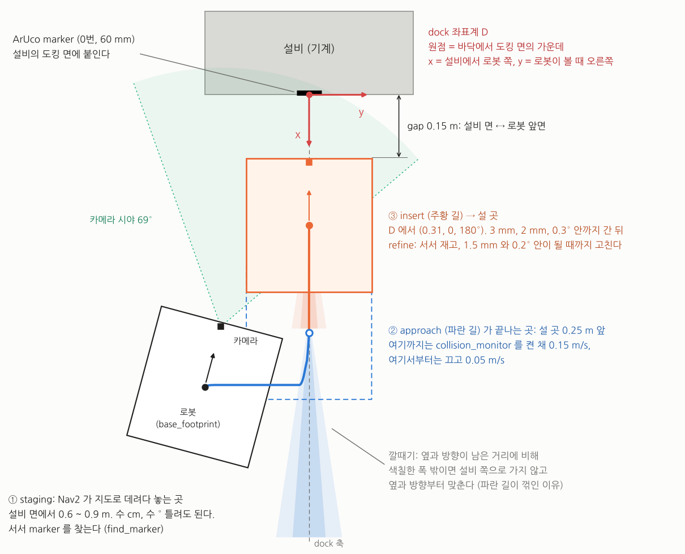
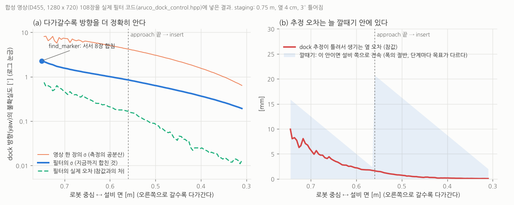

# ArUco 도킹 공부 노트: 기초 개념부터 판단 로직까지

이 문서는 **처음 공부하는 사람**을 위한 풀이다. [DOCKING.md](DOCKING.md) 가 "무엇을 했고 어떻게 쓰나" 를 정리한 참고서라면, 이 문서는 "왜 그렇게 되고, 안에서 어떤 계산과 판단이 일어나나" 를 처음부터 차례로 푼다.

- **기초 개념부터** 시작한다: 좌표계, 카메라, 영상 처리, 불확실도(공분산), 최적화, 제어, BT.
- 그 개념들이 **이 프로젝트의 어느 코드에서 어떻게 쓰이는지** 단계마다 보여 준다.
- **숫자 예제는 모두 실제 코드로 계산했다.** 합성 영상(카메라는 RealSense D455, 1280 x 720)을 `aruco_detector.py` 에 넣고, 그 측정을 C++ 헤더 `aruco_dock_control.hpp` 의 필터와 제어 함수에 넣어 중간값을 뽑았다. 그래서 이 문서의 숫자를 손으로 따라 계산하면 코드가 내는 값과 맞는다.
- 판단 로직은 코드의 순서 그대로 흐름도로 그렸다. 문턱값은 `config/docking.yaml` 의 기본값이다.

수식은 고등학교 수학(삼각함수, 행렬 곱) 정도면 따라올 수 있게 썼다. 처음 읽을 때는 각 장의 "한 줄 요약" 과 "예제" 만 읽고, 다시 읽을 때 식을 따라가도 된다.

목차

- [0. 한 장으로 보는 전체](#0-한-장으로-보는-전체)
- [1. 기초 개념](#1-기초-개념)
  - [1-1. 자세와 좌표계: "누가 어디서 보았나"](#1-1-자세와-좌표계-누가-어디서-보았나)
  - [1-2. 변환을 잇고 뒤집기](#1-2-변환을-잇고-뒤집기)
  - [1-3. 3차원 자세와 TF](#1-3-3차원-자세와-tf)
  - [1-4. 카메라는 3차원 점을 어떻게 화소로 찍나 (핀홀 모델)](#1-4-카메라는-3차원-점을-어떻게-화소로-찍나-핀홀-모델)
  - [1-5. 영상 처리 기초](#1-5-영상-처리-기초)
  - [1-6. 불확실도: 표준편차, 공분산, 정보](#1-6-불확실도-표준편차-공분산-정보)
  - [1-7. 최적화: 가장 잘 맞는 값 찾기](#1-7-최적화-가장-잘-맞는-값-찾기)
  - [1-8. 제어 기초](#1-8-제어-기초)
  - [1-9. Behavior Tree 기초](#1-9-behavior-tree-기초)
- [2. 눈: 영상 한 장에서 dock 의 자세까지 (aruco_detector.py)](#2-눈-영상-한-장에서-dock-의-자세까지-aruco_detectorpy)
- [3. 기억: dock 은 어디 있나 (Kalman 필터)](#3-기억-dock-은-어디-있나-kalman-필터)
- [4. 손발: 한 제어 주기의 계산 (ArucoServo, mecanumStep)](#4-손발-한-제어-주기의-계산-arucoservo-mecanumstep)
- [5. 서서 재고 고치기 (ArucoRefine)](#5-서서-재고-고치기-arucorefine)
- [6. 찾기와 undock (DetectArucoDock, BackOff, 안전 영역)](#6-찾기와-undock-detectarucodock-backoff-안전-영역)
- [7. 지휘: BT 가 단계를 잇는 방법](#7-지휘-bt-가-단계를-잇는-방법)
- [8. 종합: 한 번의 도킹을 시간 순서로](#8-종합-한-번의-도킹을-시간-순서로)
- [9. 오차는 어디서 오고 무엇이 지우나](#9-오차는-어디서-오고-무엇이-지우나)
- [10. 연습문제](#10-연습문제)
- [11. 용어 정리](#11-용어-정리)
- [부록: 이 문서의 숫자를 직접 다시 계산하기](#부록-이-문서의-숫자를-직접-다시-계산하기)

---

## 0. 한 장으로 보는 전체

**풀려는 문제**: 로봇의 앞면을 설비 면에서 15 cm 떨어진 자리에 mm 단위로 세운다.

**왜 지도(Nav2, AMCL)만으로는 안 되나**: AMCL 은 레이저로 지도와 맞춰 위치를 추정한다. 그 정밀도는 수 cm, 수 ° 다. 이 프로젝트의 창고 시뮬레이션에서도 설비 앞에서 AMCL 의 위치가 참값과 5 ~ 7 cm 달랐다. mm 를 맞추려면 **맞춰야 할 대상(설비)을 직접 보고** 그것에 대한 상대 위치를 재야 한다. 그래서 설비에 ArUco marker 를 붙이고 카메라로 본다.

**해법은 세 부분과 지휘자 하나다.**

```
      ┌──────────────── 눈 (2장) ───────────────┐   ┌──── 기억 (3장) ────┐   ┌──── 손발 (4, 5장) ────┐
영상 ─▶ marker 찾기 → 모서리 4개 → 자세 계산    ─▶  dock 의 자리를     ─▶  지금 오차 계산 →      ─▶ 바퀴
15~30 Hz            (화소)        (로봇에서 본 dock   odom 에 기억하고      속도 명령 (vx, vy, wz)
                                   + 불확실도)        새 영상마다 고친다    20 Hz
      └─────────────────────────────────────────┘   └────────────────────┘   └──────────────────────┘
                        ▲                                   ▲                          ▲
                        └────────────── 지휘: Behavior Tree (7장) ─────────────────────┘
                     찾기 → 다가가기 → 들어가기 → 서서 고치기, 실패하면 그 자리에서 다시 보기
```

| 부분 | 하는 일 | 파일 | 한 줄 요약 |
|---|---|---|---|
| 눈 | 영상 한 장 → "로봇에서 본 dock 의 자세" 와 그 불확실도 | `scripts/aruco_detector.py` | 크기를 아는 정사각형이 영상에 어떻게 찍혔는지로 거리와 방향을 거꾸로 계산한다 |
| 기억 | 측정들을 합쳐 dock 이 odom 의 어디 있는지 기억 | `include/bt_mission/aruco_dock_control.hpp` 의 `DockFilter` | 정확한 측정은 크게, 부정확한 측정은 작게 믿으며 평균한다 |
| 손발 | 지금 로봇이 목표에서 얼마나 틀렸는지 → 속도 명령 | 같은 헤더의 `mecanumStep`, `src/aruco_dock_nodes.cpp` 의 `ArucoServo`, `ArucoRefine` | 틀린 만큼 비례해서 움직이되, 옆과 방향이 맞아야 앞으로 간다 |
| 지휘 | 단계의 순서, 실패했을 때 할 일 | `behavior_trees/task.xml` | 찾기 → 다가가기 → 들어가기 → 고치기, 놓치면 그 자리에서 다시 보기 |

이 문서는 이 순서로 간다: 1장에서 필요한 기초 개념을 모두 배우고, 2 ~ 6장에서 각 부분이 그 개념을 어떻게 쓰는지 숫자로 따라가고, 7 ~ 8장에서 BT 가 그것들을 어떻게 잇는지 실제 로그로 본다. 9장은 "그래서 오차가 어디서 생기고 무엇이 지우나" 를 정리한다.

---

## 1. 기초 개념

### 1-1. 자세와 좌표계: "누가 어디서 보았나"

**한 줄 요약**: 위치와 방향은 늘 "어느 좌표계에서 본 것인가" 와 함께 말해야 한다.

바닥을 움직이는 로봇의 **자세(pose)** 는 세 숫자다: 위치 `x`, `y` [m] 와 방향 `yaw` [rad 또는 °] (x 축에서 반시계 방향으로 잰 각). 이 세 숫자는 **기준이 되는 좌표계(frame)** 가 있어야 뜻이 있다. 같은 로봇이라도 지도에서 보면 (3.85, 1.0, 0°) 이고, 설비에서 보면 (0.70, 0, 180°) 이다.

이 프로젝트가 쓰는 좌표계:

| 좌표계 | 원점과 축 | 누가 정하나 | 무엇에 쓰나 |
|---|---|---|---|
| `map` | 지도의 원점 | 지도 파일 | Nav2 로 staging 까지 갈 때 |
| `odom` | 로봇을 켠 자리. 바퀴의 회전을 적분한 기준 | 로봇 드라이버 | 짧은 시간의 정확한 움직임. **도킹의 기준** |
| `base_footprint` (로봇) | 로봇 중심의 바닥. x = 앞, y = 왼쪽 | URDF | 로봇에 달린 모든 것의 기준 |
| `camera_color_optical_frame` | 카메라 렌즈. **x = 오른쪽, y = 아래, z = 앞** | 카메라 드라이버, TF | 카메라가 본 것 |
| D (dock) | 바닥에서 설비 도킹 면의 가운데. x = 설비에서 로봇 쪽, y = 로봇이 설비를 볼 때 오른쪽, z = 위 | `docking.yaml` | 도킹의 목표와 오차 |



위 그림(위에서 본 모습)에서 빨간 화살표가 D 의 축이다. 붙은 자리는 D 에서 **(0.31 m, 0, 180°)** 이다: 로봇 중심이 설비 면에서 0.31 m (= 간격 0.15 + 로봇 중심에서 앞면까지 0.16) 앞에 있고, 옆으로 0, 설비를 바라본다(D 의 x 축과 반대 방향 = 180°).

**같은 관계를 두 방향에서 말할 수 있다.** 이 문서의 예제 상황을 보자.

- 로봇이 D 에서 (0.75 m, +0.04 m, 183°) 에 있다: 설비 면에서 0.75 m 앞, D 의 +y 쪽으로 4 cm, 설비를 정면보다 3° 왼쪽으로 돌아 본다.
- 같은 상황을 로봇에서 보면 dock(D 의 원점과 방향)은 (0.7511 m, +0.0007 m, 177.00°) 에 있다.

카메라가 직접 재는 것은 두 번째("로봇에서 본 dock") 다. 제어에 필요한 것은 첫 번째("dock 에서 본 로봇") 다. 둘을 오가는 계산이 다음 절이다.

### 1-2. 변환을 잇고 뒤집기

**한 줄 요약**: "A 에서 본 B" 와 "B 에서 본 C" 를 이으면 "A 에서 본 C" 가 되고, 뒤집으면 "B 에서 본 A" 가 된다.

2D 자세 `a = (x, y, θ)` 는 "좌표계 A 에서 본 좌표계 B 의 원점 위치와 축의 방향" 이다. 코드(`aruco_dock_control.hpp`)의 두 함수가 전부다.

```
compose(a, b)  = a 다음에 b  (b 는 a 의 좌표계에서 잰 것)
               = ( a.x + cos(a.θ)·b.x − sin(a.θ)·b.y,
                   a.y + sin(a.θ)·b.x + cos(a.θ)·b.y,
                   a.θ + b.θ )

inverse(a)     = a 를 거꾸로 본 것 ("B 에서 본 A")
               = ( −(cos(a.θ)·a.x + sin(a.θ)·a.y),
                   −(−sin(a.θ)·a.x + cos(a.θ)·a.y),
                   −a.θ )

relative(F, p) = compose(inverse(F), p)   "좌표계 F 에서 본 p"
```

`compose` 의 앞 두 줄은 "b 의 위치를 a 의 방향만큼 돌려서 a 의 위치에 더한다" 는 뜻이다. 돌리는 부분이 2x2 회전 행렬 `[[cos, −sin], [sin, cos]]` 이다.

**예제 (손으로 따라 해 보기)**: 로봇이 D 에서 `r = (0.75, 0.04, 183°)`. 그러면 로봇에서 본 dock 은 `inverse(r)` 이다. cos 183° = −0.99863, sin 183° = −0.05234 이므로

```
x = −(−0.99863·0.75 + (−0.05234)·0.04) = −(−0.74897 − 0.00209) = 0.75107 m
y = −(0.05234·0.75 + (−0.99863)·0.04)  = −(0.03926 − 0.03995) = 0.00069 m
θ = −183° = 177°
```

1-1 의 (0.7511, 0.0007, 177.00°) 와 같다. 옆 오차 4 cm 가 로봇에서 보면 0.7 mm 로 거의 사라진 것은, 로봇이 3° 돌아 있어서 dock 쪽을 거의 정면으로 보고 있기 때문이다 (0.75 m · sin 3° ≈ 3.9 cm 가 4 cm 를 상쇄).

**이 프로젝트에서 이 계산이 쓰이는 세 곳**:

```
① 측정을 odom 으로:    odom 에서 본 dock  = compose( odom 에서 본 로봇(영상을 찍은 시각), 로봇에서 본 dock(카메라가 잼) )
② 제어의 오차:         dock 에서 본 로봇  = relative( odom 에서 본 dock(필터), odom 에서 본 로봇(지금) )
③ 가르친 자세:         설 곳(D 에서 로봇)  = inverse( 가르칠 때 로봇에서 본 dock )
```

①은 3장(`arucoMeasurements`), ②는 4장(`ArucoServo`), ③은 9장(가르친 자세)에 나온다.

### 1-3. 3차원 자세와 TF

**한 줄 요약**: 3차원에서는 위치 3개와 회전 3개(roll, pitch, yaw), 모두 6개의 숫자다. ROS 는 좌표계 사이의 관계를 TF 로 관리한다.

- 회전은 3x3 **회전 행렬** `R` 로 쓴다. 점 `X` 를 좌표계 B 에서 A 로 옮기면 `X_A = R_AB · X_B + t_AB` 이다 (`t_AB` 는 A 에서 본 B 의 원점).
- roll(x 축 둘레), pitch(y 축 둘레), yaw(z 축 둘레)는 회전을 세 각으로 쓴 것이다. 바닥 로봇에게 중요한 것은 yaw 이고, 설비가 바닥에 똑바로 서 있으면 roll, pitch 는 0 이다. 이 "0 일 것이다" 라는 믿음을 2장에서 **사전분포** 로 쓴다.
- **TF** 는 ROS 가 좌표계들의 관계를 나무 모양으로 관리하는 것이다. 이 프로젝트의 나무:

```
map ──(AMCL)── odom ──(바퀴 odom)── base_footprint ──(URDF, 고정)── camera_link ──(드라이버)── camera_color_optical_frame
                                                     └──(URDF, 고정)── base_scan (레이저)
```

`tf2` 에 "시각 t 에 odom 에서 본 base_footprint 는?" 이라고 물으면 그 시각의 값을 보간해서 준다. 영상은 찍은 뒤 50 ~ 150 ms 늦게 처리되므로, **영상을 찍은 시각** 의 로봇 자리를 물어야 한다 (3-2).

**카메라 좌표계(optical frame)의 축이 로봇과 다른 것** 에 주의하자. 로봇은 x 가 앞인데 카메라 영상의 관례는 z 가 앞(시선), x 가 영상의 오른쪽, y 가 영상의 아래다. 그래서 로봇 → 카메라는 축을 바꾸는 회전이 들어간다.

```
카메라 좌표 (x_c, y_c, z_c) = ( −y_로봇,  −z_로봇,  x_로봇 )   (카메라 위치를 뺀 뒤)
                                 오른쪽 =   아래 =    앞 =
                                 −왼쪽     −위
```

이 프로젝트의 시뮬레이션 로봇은 카메라가 로봇 중심에서 앞 0.15 m, 높이 0.13 m 에 있다.

### 1-4. 카메라는 3차원 점을 어떻게 화소로 찍나 (핀홀 모델)

**한 줄 요약**: 멀리 있는 것은 작게, 옆에 있는 것은 영상의 옆에 찍힌다. 그 비율이 초점거리 `f` 다.

바늘구멍 사진기를 생각하자. 카메라 좌표 `(x_c, y_c, z_c)` 의 점은 영상의 화소 `(u, v)` 에 찍힌다:

```
u = f_x · (x_c / z_c) + c_x
v = f_y · (y_c / z_c) + c_y

K = [ f_x   0   c_x ]      카메라 내부값 (intrinsics). RealSense 는 이것을 camera_info 토픽으로 준다
    [  0   f_y  c_y ]      f: 초점거리 [화소],  (c_x, c_y): 영상의 중심 [화소]
    [  0    0    1  ]
```

이 프로젝트의 카메라(D455 컬러, 1280 x 720, 가로 화각 90°): `f_x = f_y = 640`, `c_x = 639.5`, `c_y = 359.5`. 가로 화각과의 관계는 `tan(화각/2) = (영상 폭/2) / f` → `tan 45° = 640 / 640 = 1` 이다.

**예제: marker 의 왼쪽 위 모서리 하나를 손으로 투영해 보기** (1-1 의 상황)

marker 의 왼쪽 위 모서리는 D 에서 (0, −0.03, 0.16) 이다 (도킹 면 위, 가운데에서 3 cm 왼쪽, 높이 16 cm).

```
① D → 로봇:  로봇에서 본 dock (0.7511, 0.0007, 177°) 로 돌리고 옮긴다
            x = 0.7511 + cos177°·0 − sin177°·(−0.03) = 0.7511 + 0.0016 = 0.7526
            y = 0.0007 + sin177°·0 + cos177°·(−0.03) = 0.0007 + 0.0300 = 0.0307
            z = 0.16
② 로봇 → 카메라: 카메라 위치 (0.15, 0, 0.13) 를 빼고 축을 바꾼다
            x_c = −(0.0307 − 0)    = −0.0307   (영상의 왼쪽)
            y_c = −(0.16 − 0.13)   = −0.0300   (영상의 위)
            z_c =  (0.7526 − 0.15) =  0.6026   (앞으로 0.60 m)
③ 카메라 → 화소:
            u = 640 · (−0.0307 / 0.6026) + 639.5 = 606.9
            v = 640 · (−0.0300 / 0.6026) + 359.5 = 327.6
```

코드(`project_dock`)가 계산한 값도 (606.95, 327.64) 다. 네 모서리를 모두 투영하면 한 변이 약 64 화소인 사각형이 된다.

**거꾸로 생각하면 크기에서 거리가 나온다.** 한 변 `s` = 0.06 m 인 marker 가 `n` 화소로 보이면, 닮은꼴 삼각형에서 거리 ≈ `f · s / n` 이다. 영상에서 63.5 화소였으므로 640 · 0.06 / 63.5 = **0.605 m**. 실제 카메라 ↔ marker 거리 0.6035 m 와 거의 같다. 이것이 2장의 자세 계산의 직관이다.

> 실제 렌즈는 가장자리가 휘어 보인다 (왜곡). `camera_info` 는 그것을 고치는 계수(`D`)도 준다. 코드는 OpenCV 함수(`projectPoints`, `solvePnP`)에 그 계수를 넘겨서 처리한다. 이 문서의 예제는 왜곡이 없는 합성 영상이다.

### 1-5. 영상 처리 기초

**한 줄 요약**: 흑백으로 바꾸고, 어두운 영역의 경계를 찾고, 그 가운데 정사각형 모양을 골라, 안쪽 무늬를 읽는다.

| 개념 | 뜻 | ArUco 검출에서 |
|---|---|---|
| 흑백(grayscale) | 화소마다 밝기 0 ~ 255 하나 | 색은 쓰지 않는다 |
| 이진화(threshold) | 밝기를 기준값과 비교해 0 또는 1 로 | **adaptive**: 화소마다 주변 평균을 기준으로 삼아서 조명이 고르지 않아도 된다 |
| 윤곽선(contour) | 이진 영상에서 영역의 경계선 | 검은 사각형의 테두리를 찾는다 |
| 다각형 근사 | 윤곽선을 몇 개의 꼭짓점으로 줄인다 | 꼭짓점이 4개이고 볼록하면 marker 후보 |
| 원근 제거(perspective warp) | 비스듬히 찍힌 사각형을 정면에서 본 정사각형으로 편다 | 펴진 그림에서 칸마다 흑백을 읽는다 |
| 서브픽셀(subpixel) | 모서리 위치를 화소보다 잘게 (예: 607.18) | **정밀도의 근원**. 밝기 변화의 기울기로 모서리를 0.1 ~ 0.3 화소까지 맞춘다 |

ArUco marker 의 구조(검은 테두리 + 안쪽 4 x 4 비트), dictionary, 찾는 과정의 그림은 [DOCKING.md 2장](DOCKING.md#2-aruco-marker-의-원리) 에 단계별로 있다. 이 문서에서 중요한 결론은 하나다: **검출의 결과는 marker 번호와 네 모서리의 화소 좌표(서브픽셀) 뿐이다.** 나머지는 모두 이 여덟 개의 숫자(모서리 4개 x (u, v))에서 계산한다.

### 1-6. 불확실도: 표준편차, 공분산, 정보

**한 줄 요약**: 측정은 늘 조금씩 틀린다. 얼마나 틀릴 수 있는지를 숫자로 들고 다니면, 여러 측정을 어떻게 합쳐야 하는지가 저절로 정해진다.

**표준편차 σ**: 같은 것을 여러 번 재면 값이 흩어진다. 그 흩어짐의 크기가 σ 다. "x = 4.553 m, σ = 2 mm" 는 "참값이 대략 4.553 ± 2 mm 안에 있을 것" 이라는 뜻이다 (정규분포면 약 68 % 확률). **분산** 은 σ² 다.

**공분산 행렬 Σ**: 숫자가 여러 개(x, y, yaw)면 각각의 분산과 함께 "같이 틀리는 정도" 도 있다. 3x3 행렬로 쓴다.

```
Σ = [ σ_x²      cov(x,y)    cov(x,yaw) ]     대각선: 각 값의 분산
    [ cov(y,x)  σ_y²        cov(y,yaw) ]     대각선 밖: 둘이 같이 틀리는 정도
    [ cov(yaw,x) cov(yaw,y) σ_yaw²     ]     (예: 방향이 틀리면 옆 위치도 같이 틀린다)
```

위에서 보면 (x, y) 의 공분산은 **타원** 이다. 2장의 예제에서 카메라 한 장으로 잰 dock 의 자세는 σ_x = 5.2 mm, σ_y = 0.77 mm 였다. x(카메라에서 멀어지는 방향, 깊이)가 y(옆)보다 7배 부정확하다. 이유는 1-4 에 있다:

- **옆(y)** 은 marker 가 영상의 어디에 찍혔나로 잰다. 0.6 m 앞에서 1 화소 = 0.6 / 640 = 0.94 mm.
- **거리(x)** 는 marker 가 얼마나 크게 찍혔나로 잰다. 63.5 화소가 64.5 화소가 되려면 거리가 0.6 · (1/63.5) ≈ 9.5 mm 줄어야 한다. 그래서 같은 화소 잡음에 거리는 10배 더 흔들린다.
- **방향(yaw)** 은 사다리꼴로 찌그러진 정도로 잰다 (2-4). 가장 약하다: 같은 자리에서 σ_yaw = 6.8°.

**정보(information) = 공분산의 역**: 분산이 작을수록 그 측정이 주는 정보가 많다. 정보 `I = Σ⁻¹` 로 쓰면, **독립인 두 측정을 합친 정보는 두 정보의 합** 이다. 그래서 가장 좋은 합치기는 "정보로 가중한 평균" 이다.

```
1차원:  측정 z₁ (분산 σ₁²),  z₂ (분산 σ₂²)
        합친 값    = (z₁/σ₁² + z₂/σ₂²) / (1/σ₁² + 1/σ₂²)
        합친 분산  = 1 / (1/σ₁² + 1/σ₂²)            ← 늘 둘 중 작은 것보다도 작다

여러 차원:  Σ = (Σ Σᵢ⁻¹)⁻¹,   x = Σ · Σ Σᵢ⁻¹ zᵢ       (이 프로젝트의 fuse 함수가 이것)
```

**예제**: dock 의 x 를 4.553 m (σ 2 mm) 로 알고 있는데, 새 측정이 4.551 m (σ 2 mm) 다. 정보가 같으므로 그냥 평균 4.552 m, 분산은 1/(1/4 + 1/4) = 2 → σ = **1.41 mm**. 방향은 180.0° (σ 2°) 로 알고 있는데 새 측정이 179.5° (σ 1°) 면, 새 측정의 정보가 4배라 결과는 180 − 0.5 · 4/5 = **179.6°**, σ = √(1/(1/4 + 1)) = **0.894°**. (이 두 숫자는 실제 `DockFilter::update` 가 낸 값이다.)

**같은 측정을 N 번** 하면 σ 는 1/√N 로 준다 (8장이면 1/2.8). 단, 측정끼리 **독립** 일 때만이다. 같은 자리에서 같은 각도로 본 영상들은 같은 쪽으로 틀리는 성분(편향)을 공유하므로 평균해도 그것은 줄지 않는다. 3장에서 이것을 실제로 본다.

**Mahalanobis 거리**: "이 새 측정이 지금 알고 있는 것과 얼마나 동떨어졌나" 를 σ 단위로 잰 거리다.

```
d² = (z − x)ᵀ · S⁻¹ · (z − x),    S = 지금 추정의 공분산 + 측정의 공분산
```

1차원이면 `d = |z − x| / σ` 이다. "d² 가 16.3 보다 크면 버린다" 는 이 프로젝트의 규칙(`kGate`)은, 정상적인 측정이라면 그보다 클 확률이 0.1 % 밖에 안 되는 값이다 (자유도 3 의 카이제곱 분포의 99.9 % 점). 즉 **"정상적으로는 일어날 수 없을 만큼 동떨어진 측정은 무언가 잘못된 것(잘못 본 marker, 뒤집힌 해)으로 보고 버린다"** 는 뜻이다.

### 1-7. 최적화: 가장 잘 맞는 값 찾기

**한 줄 요약**: "이 자세라면 모서리가 어디에 찍혔어야 하나" 를 계산해서, 실제로 찍힌 자리와의 차이(잔차)의 제곱합이 가장 작은 자세를 찾는다.

- **재투영 오차(reprojection error)**: 어떤 자세 `p` 를 가정하고 1-4 의 식으로 모서리를 투영한 자리 `π(p)` 와 실제로 검출된 자리 `u` 의 차이. 모서리 4개 x (u, v) = 숫자 8개.
- **잔차 벡터 r(p)**: 그 8개의 차이를 화소 잡음 σ_px 로 나눈 것. 단위가 "σ 몇 개" 가 된다.
- **최소제곱**: `|r(p)|²` 를 가장 작게 하는 `p` 를 찾는다. 식이 비선형(나눗셈, 삼각함수)이라 한 번에 풀리지 않고, 조금씩 고쳐 간다.
- **Jacobian J**: `p` 를 조금 바꿀 때 잔차가 얼마나 바뀌나 (편미분의 표). 코드는 각 성분을 1e-7 만큼 바꿔 보는 수치 미분으로 구한다.
- **Gauss-Newton / Levenberg-Marquardt(LM)**: `(JᵀJ) Δp = −Jᵀr` 를 풀어 `p ← p + Δp` 로 고치기를 되풀이한다. LM 은 고친 것이 오히려 나빠지면 걸음을 줄이는 안전장치(`λ`)를 더한 것이다.
- **사전분포(prior)와 MAP**: 영상 말고도 미리 아는 것이 있으면(예: "설비는 바닥에 서 있으니 기울기는 0 근처") 잔차에 그 줄을 더한다: `(pitch − 0) / σ_tilt`. 영상이 잘 말해 주는 것은 영상이, 영상이 잘 말해 주지 못하는 것은 사전분포가 정한다. 이것이 **MAP (maximum a posteriori)** 추정이다.
- **추정의 공분산 ≈ (JᵀJ)⁻¹**: 최적점에서 J 를 보면 "어느 방향으로 p 를 바꾸면 잔차가 크게 바뀌나" 를 안다. 잔차가 크게 바뀌는 방향은 영상이 잘 정해 주는 방향이고(작은 분산), 거의 안 바뀌는 방향은 잘 모르는 방향이다(큰 분산). 1-6 의 σ_x 5.2 mm, σ_yaw 6.8° 가 이렇게 나온다.

### 1-8. 제어 기초

**한 줄 요약**: 틀린 만큼 비례해서 움직이고(P 제어), 너무 빠르거나 너무 느리거나 너무 갑작스럽지 않게 다듬는다.

| 개념 | 식 | 왜 |
|---|---|---|
| 비례 제어 (P) | `v = −k · e` | 오차 e 가 크면 빨리, 작으면 천천히. 목표에 다가가며 저절로 느려져 부드럽게 선다 |
| 포화(saturation) | `|v| ≤ v_max` | 로봇과 안전을 위한 속도 상한. **여러 축을 같은 비율로 줄이면** 가는 방향이 바뀌지 않는다 |
| 가속도 제한 | `|v − v_이전| ≤ a · dt` | 갑자기 바뀌는 명령은 바퀴가 미끄러지고 몸이 기운다 (카메라도 흔들린다) |
| 데드밴드(최소 속도) | `0 < |v| < v_min` 이면 `v_min` 으로 | 아주 느린 명령은 마찰 때문에 모터가 움직이지 못한다 |
| 허용오차 | `|e| ≤ tol` 이면 `v = 0` | 끝없이 미세하게 움찔거리지 않게 |

**메카넘 운동학**: 메카넘 바퀴 넷은 바퀴 속도의 조합으로 로봇을 앞뒤(`vx`), 옆(`vy`), 회전(`wz`)을 **동시에, 따로** 움직일 수 있다 (차동 구동 로봇은 `vy` 가 없다). 그래서 "돌고 → 가고 → 돌기" 가 아니라 세 오차를 한꺼번에 줄일 수 있다.

**좌표 회전**: 오차는 D(설비) 기준으로 계산하는데(앞뒤 = 설비 쪽, 옆 = 설비와 나란히), 명령은 로봇 기준(`vx` = 로봇의 앞)이다. 로봇이 D 에서 방향 `θ` 를 보고 있으면

```
vx =  cos θ · v_along + sin θ · v_lat         (D 의 속도 → 로봇의 속도)
vy = −sin θ · v_along + cos θ · v_lat
```

로봇이 설비를 정면으로 보면 θ = 180° 라 `vx = −v_along`, `vy = −v_lat` 이다. D 의 x 는 설비에서 멀어지는 방향이므로 "설비 쪽으로" 는 `v_along < 0`, 즉 로봇의 앞(`vx > 0`)이다.

### 1-9. Behavior Tree 기초

**한 줄 요약**: 할 일을 나무 모양으로 짜고, 위에서부터 자주(100 Hz) "지금 어때?" 하고 물어(tick) 진행한다.

- **tick** 을 받은 노드는 셋 중 하나를 답한다: `RUNNING`(아직 하는 중), `SUCCESS`, `FAILURE`.
- **Sequence**: 자식을 차례로. 하나라도 FAILURE 면 멈추고 FAILURE.
- **Fallback**: 자식을 차례로. 하나라도 SUCCESS 면 멈추고 SUCCESS. ("이게 안 되면 저것")
- **RetryUntilSuccessful(n)**: 자식이 FAILURE 면 n 번까지 다시.
- **ForceFailure**: 자식이 무엇을 답하든 FAILURE 로 바꾼다.
- **IfThenElse(조건, 그러면, 아니면)**: 조건 자식이 SUCCESS 면 둘째, 아니면 셋째.
- **Decorator**: 자식 하나를 감싸 앞뒤로 무언가를 한다. 이 프로젝트의 `MuteCollisionMonitor` 는 자식이 도는 동안만 안전 영역을 끈다.
- **StatefulActionNode**: 시간이 걸리는 일을 하는 노드. `onStart()`(처음 한 번: 준비) → `onRunning()`(tick 마다: 한 걸음) → `onHalted()`(누가 멈추면: 정리). 도킹 노드 셋(`DetectArucoDock`, `ArucoServo`, `ArucoRefine`)이 모두 이것이다.
- **blackboard**: 노드끼리 값을 주고받는 칠판. `{aruco_dock}` 에 dock 의 필터와 설 곳이 담겨 노드 사이를 오간다.

BT 자체의 자세한 설명은 [README.md 2장](README.md#2-bt-기초-이-예제를-읽는-데-필요한-만큼) 에 있다.

---
## 2. 눈: 영상 한 장에서 dock 의 자세까지 (aruco_detector.py)

**한 줄 요약**: 영상에서 모서리 4개를 찾고, "어떤 자세여야 모서리가 그렇게 찍히나" 를 거꾸로 풀어, 로봇에서 본 dock 의 (x, y, yaw) 와 그 불확실도를 낸다.

이 장은 하나의 예제를 처음부터 끝까지 따라간다.

> **예제 상황**: 로봇이 staging 근처, D 에서 (0.75 m, +4 cm, 183°). marker 는 `dock_a` (0번, 60 mm, 중심 높이 0.13 m). 카메라는 D455 컬러 1280 x 720. 합성 영상에 실제 카메라처럼 약간의 흐림과 밝기 잡음을 넣었다. 참값: 로봇에서 본 dock = (0.7511 m, 0.0007 m, 177.00°).

`detect()` 가 영상 한 장마다 하는 일의 흐름:

```
영상 ─▶ [2-2] marker 찾기 ──▶ 모서리 4개 (화소)
            │ dock 에 없는 번호면 버림
            ▼
        [2-3] 쓸 수 있나?  한 변 ≥ 16 px, 모서리가 화면 끝에서 6 px 넘게 안쪽
            │ 아니면 버림 (잘린 marker 로 틀린 자세를 내지 않게)
            ▼
        [2-4] 첫 추정 IPPE: 해 2개 (평면 PnP)
            ▼
        [2-5] 해마다 좌표 바꾸기: 카메라에서 본 marker → 로봇에서 본 dock (6자유도)
            ▼
        [2-6] 해마다 MAP 다듬기 (영상 잔차 8줄 + 바닥 사전분포 3줄)
            ▼
        [2-7] 같은 자리로 모인 해는 하나로, 해마다 공분산 (JᵀJ)⁻¹
            ▼
        [2-8] 진단 (기울기, 높이), 경고
            ▼
        [2-9] 메시지 ArucoDetection 하나 발행 (dock/aruco)
```

### 2-1. 입력: 미리 알고 있는 것

| 무엇 | 어디서 | 예제의 값 |
|---|---|---|
| 카메라 내부값 K, 왜곡 D | `camera_info` 토픽 (RealSense 가 공장 보정값을 준다) | f = 640, c = (639.5, 359.5), 왜곡 없음 |
| 로봇에서 본 카메라 | TF `base_footprint → camera_color_optical_frame` | 앞 0.15 m, 높이 0.13 m, 축 바꿈 (1-3) |
| marker 의 번호, 크기, 붙인 자리 | `docking.yaml` 의 `docks` | 0번, 0.06 m, 높이 0.13 m, 도킹 면에 바로 (offset 0), 가운데 (lateral 0) |

`docking.yaml` 에서 marker 네 모서리의 D 좌표가 정해진다 (`DockMarker.corners_D`). 로봇이 설비를 바라볼 때의 순서(왼쪽 위부터 시계 방향)다. D 의 y 는 로봇이 볼 때 오른쪽이므로 왼쪽 모서리가 y = −0.03 이다.

```
          y_D = −0.03         y_D = +0.03
z = 0.16   [0] 왼위 ──────── [1] 오른위
             │                    │
z = 0.10   [3] 왼아래 ─────── [2] 오른아래        (모두 x_D = 0: 도킹 면 위)
```

### 2-2. marker 찾기: 모서리의 화소 좌표

OpenCV `detectMarkers` (1-5 의 과정)가 낸 모서리와, 참값 자세로 투영한 자리(1-4 의 계산)를 비교하면:

| 모서리 | 참값 투영 (u, v) | 검출 (u, v) | 차이 [화소] |
|---|---|---|---|
| 0 왼위 | (606.95, 327.64) | (607.18, 327.76) | (+0.23, +0.12) |
| 1 오른위 | (670.74, 327.47) | (670.54, 327.64) | (−0.20, +0.16) |
| 2 오른아래 | (670.74, 391.53) | (670.57, 391.37) | (−0.17, −0.15) |
| 3 왼아래 | (606.95, 391.36) | (607.19, 391.28) | (+0.25, −0.08) |

검출은 화소보다 잘게(서브픽셀) 맞추지만 **0.1 ~ 0.25 화소씩 틀린다.** 흐림과 잡음 때문이다. 이 작은 오차가 이 장에서 다룰 모든 불확실도의 출발점이다. 코드는 이것을 `pixel_sigma = 0.5` 화소로 **보수적으로** 가정한다 (실제보다 2배쯤 크게 잡는다).

### 2-3. 쓸 수 있는 marker 인가 (`usable`)

```
한 변 = 네 변 길이의 평균 = 63.5 px        ≥ 16 px (min_marker_px)        → 통과
화면 끝까지 가장 가까운 거리 = 327.6 px     모서리가 끝에서 6 px (SIDE_MARGIN) 넘게 안쪽 → 통과
```

- 한 변이 16 화소보다 작으면 모서리가 너무 부정확해서 버린다 (이 카메라로 약 2.4 m).
- 모서리가 화면 끝에 걸리면 marker 가 잘렸을 수 있다. 잘린 marker 의 "모서리" 는 실제 모서리가 아니므로 틀린 자세를 낸다. 그래서 버린다.
- 화면 끝까지의 거리(`border_px`, 여기서 327.6)는 메시지에도 담는다. 4장의 안전 규칙이 "marker 가 화면 끝에서 10 px 안쪽이어야 설비 쪽으로 간다" 에 쓴다.

### 2-4. 첫 추정: IPPE 와 "해가 둘"

모서리 4개(식 8개)로 모르는 것 6개(카메라에서 본 marker 의 위치 3, 회전 3)를 푸는 것이 **PnP** 다. 점들이 한 평면(정사각형)에 있을 때 쓰는 빠른 풀이가 **IPPE** (`cv2.solvePnPGeneric(..., SOLVEPNP_IPPE_SQUARE)`) 이고, 이것은 **해를 둘** 낸다.

| | 재투영 오차 (RMS) | 카메라 ↔ marker | 로봇에서 본 dock 의 방향 |
|---|---|---|---|
| IPPE 해 1 | 0.062 px | 0.6035 m | **174.89°** |
| IPPE 해 2 | 0.140 px | 0.6035 m | **185.23°** |
| 참값 | | 0.6029 m | 177.00° |

두 해는 **거리는 같고 방향만 ±5° 정도 갈린다.** 왜 그럴까?

```
위에서 본 모습:                     카메라에 찍힌 모습:

   해 1:  ╲  (왼쪽이 멀다)           ┌──────┐    두 경우 모두 거의 같은
                                    │      │    정사각형으로 찍힌다
   해 2:  ╱  (오른쪽이 멀다)         └──────┘    (0.6 m 앞에서 5° 기울어도
                                                 좌우 변 길이 차이가 0.5 px)
   카메라 ▲
```

marker 면이 왼쪽으로 기울었는지 오른쪽으로 기울었는지는 "왼쪽 변과 오른쪽 변의 길이 차이" (원근)로만 알 수 있다. 0.6 m 에서 64 화소인 marker 가 5° 기울면 그 차이는 약 0.5 화소로, 모서리 잡음(0.1 ~ 0.25 px)과 크게 다르지 않다. 그래서 **두 해의 재투영 오차가 둘 다 아주 작고(0.06 vs 0.14 px), 어느 쪽이 맞는지 영상만으로는 확신할 수 없다.** 오차가 작은 쪽을 그냥 고르면 가끔 반대쪽(뒤집힌 해)을 고른다.

이 프로젝트는 여기서 하나를 고르지 않는다. 두 해를 모두 다음 단계의 출발점으로 쓴다.

### 2-5. 좌표 바꾸기: 카메라에서 본 marker → 로봇에서 본 dock

IPPE 의 결과는 "카메라 좌표계에서 본 marker 좌표계" (`R_cam_M`, `t_cam_M`)다. 필요한 것은 "로봇에서 본 D" 다. 1-2 의 잇기를 3차원으로 한다 (`dock6_from_marker`):

```
로봇에서 본 marker:  R_base_M = R_base_cam · R_cam_M,     t_base_M = R_base_cam · t_cam_M + t_base_cam
로봇에서 본 D:       R_base_D = R_base_M · R_D_Mᵀ,        t_base_D = t_base_M − R_base_D · t_D_M
                    (R_D_M, t_D_M: D 에서 본 marker. docking.yaml 의 높이, offset, lateral 로 정해짐)

6개의 숫자로:  p = (x, y, yaw, z, roll, pitch)
              x, y, z = t_base_D,   yaw, roll, pitch = R_base_D 의 각
```

예제의 해 1 은 p = (0.7536, 0.0007, 174.89°, z −0.0000, roll 0.01°, pitch 0.04°) 다. 설비가 바닥에 서 있으므로 z, roll, pitch 는 0 근처가 맞다.

### 2-6. MAP 다듬기: 영상과 "바닥에 서 있다" 를 같이 맞추기 (`refine_map`)

**한 줄 요약**: 영상의 잔차 8줄과 "높이 0, 기울기 0" 이라는 믿음 3줄을 합친 잔차를 최소로 하는 6자유도 자세를 찾는다.

```
잔차 r(p) = [ (π(p, 모서리ᵢ) − 검출ᵢ) / σ_px        i = 0..3, (u, v) 각각 → 8줄   σ_px = 0.5 px
              z     / σ_z                                             → 1줄   σ_z = 1 cm
              roll  / σ_tilt                                          → 1줄   σ_tilt = 1.5°
              pitch / σ_tilt                                          → 1줄
              (깊이를 쓰면) (yaw − yaw_깊이) / σ_깊이                    → 1줄   9-3 참고 ]

p* = argmin |r(p)|²      (LM, 최대 30번 되풀이, 시작점 = IPPE 해)
```

**왜 이렇게 하나**: 2-4 에서 본 대로 영상은 yaw 와 기울기(roll, pitch)를 잘 구분하지 못한다. marker 면이 yaw 로 돈 것과, 앞뒤로 조금 기운 것이 영상에서 비슷하게 보인다. 그런데 설비는 바닥에 서 있으므로 기울기는 0 이어야 한다. 이 믿음을 줄로 더하면, 영상이 "기울었나 돌았나" 를 애매하게 말할 때 "기울지 않았다, 그러니 돈 것이다" 로 정리된다.

**왜 "못박지" 않나** (기울기를 아예 0 으로 고정하지 않는 이유): 카메라 TF 가 실제와 1° 만 달라도(카메라를 조금 숙여 달았다) 영상에서는 dock 이 1° 기운 것처럼 보인다. 기울기를 0 으로 못박으면 그 1° 를 설명하려고 yaw 를 비틀어서 옆으로 수 cm 틀린 답을 낸다. σ_tilt = 1.5° 의 "부드러운" 믿음이면, 가까이서 영상이 기울기를 분명히 말해 줄 때는 영상이 이긴다 (`test_wrong_camera_extrinsics_do_not_break_it`).

**예제 결과**:

| 시작점 | MAP 결과 x, y | yaw | z, roll, pitch | 비용 \|r\|² | 재투영 RMS |
|---|---|---|---|---|---|
| IPPE 해 1 (174.89°) | 0.7542, 0.0006 | **176.51°** | 0.0 mm, 0.016°, −0.001° | 0.067 | 0.064 px |
| IPPE 해 2 (185.23°) | 0.7542, 0.0006 | **176.51°** | 같음 | 0.067 | 0.064 px |
| 참값 | 0.7511, 0.0007 | 177.00° | 0 | | |

**두 시작점이 같은 답(176.51°)으로 모였다.** 기울기를 0 근처로 붙잡자, 영상이 애매하게 남겨 둔 방향이 하나로 정해진 것이다. 이렇게 같은 자리(5 mm, 0.5° 안)로 모이면 후보는 하나가 된다. 멀거나 정면이라 정말로 구분이 안 되면 두 답이 서로 다른 자리로 모이고, 그때는 후보 둘을 다 보낸다 (고르는 것은 3장의 필터).

예제의 남은 오차: x +3.1 mm, y −0.04 mm, yaw −0.49°. 이 yaw 오차는 붙은 자리(설비 면 0.31 m)로 옮기면 옆으로 −2.8 mm 의 오차가 된다 (0.31 m · tan 0.49° ≈ 2.7 mm). **영상 한 장으로는 아직 mm 를 맞출 수 없다**는 뜻이다. 3장의 필터가 이것을 줄인다.

### 2-7. 이 측정을 얼마나 믿을 수 있나: 공분산

1-7 의 마지막 항목대로, 최적점의 Jacobian 으로 공분산을 계산한다.

```
Σ₆ = (JᵀJ)⁻¹          (6 x 6: x, y, yaw, z, roll, pitch)
Σ  = Σ₆ 의 왼쪽 위 3 x 3  (x, y, yaw 만. 나머지는 "모르는 채로 두고 평균한 것" = marginalize)
재투영 RMS 가 pixel_sigma 보다 크면(영상이 생각보다 나쁘면) 영상 줄의 무게를 그만큼 줄인 뒤 계산
```

예제: **σ_x = 5.21 mm, σ_y = 0.77 mm, σ_yaw = 6.79°**.

- 1-6 에서 말한 대로 깊이(x)가 옆(y)보다 7배 불확실하고, 방향(yaw)이 가장 약하다.
- 실제 오차(3.1 mm, 0.04 mm, 0.49°)는 이 σ 들 안에 넉넉히 들어 있다. pixel_sigma 를 보수적으로(0.5 px, 실제는 0.1 ~ 0.25 px) 잡았기 때문이다. 필터는 측정끼리의 **상대적인 무게** 를 쓰므로 모든 σ 가 같은 비율로 크게 잡혀도 합치는 방식은 거의 같다.

**거리에 따라 σ 가 어떻게 바뀌나** (로봇이 정면, 같은 방식의 합성 영상):

| 로봇 중심 ↔ 설비 면 | marker 한 변 | σ_x (깊이) | σ_y (옆) | σ_yaw | 실제 yaw 오차 | 붙은 자리의 옆 오차 |
|---|---|---|---|---|---|---|
| 1.00 m | 45 px | 8.0 mm | 1.09 mm | 17.0° | +1.17° | +6.3 mm |
| 0.75 m (staging) | 64 px | 4.7 mm | 0.78 mm | 9.0° | −0.24° | −1.3 mm |
| 0.56 m (approach 끝) | 94 px | 3.6 mm | 0.54 mm | 4.2° | +0.11° | +0.6 mm |
| 0.40 m | 153 px | 2.5 mm | 0.33 mm | 1.6° | −0.02° | −0.08 mm |
| 0.31 m (붙은 자리) | 240 px | 1.4 mm | 0.21 mm | 0.64° | −0.002° | −0.01 mm |

**가까울수록 정확하다.** 특히 방향의 σ 는 1 m 에서 0.31 m 로 오면서 27분의 1 이 된다. 3장의 필터가 "가까이서 본 측정을 크게 믿는다" 는 것은 이 표의 σ 를 무게로 쓴다는 뜻이다.

### 2-8. 진단: 설정이나 TF 가 틀렸는지 알려 주기

MAP 결과의 z(바닥 높이), roll, pitch 는 원래 0 이어야 한다. 예제는 높이 −0.01 mm, 기울기 0.016° 로 0 이다. 카메라 TF 의 높이가 1 cm 틀리면 가까이서 이 값이 −1 cm 로, pitch 가 1° 틀리면 기울기가 1° 로 드러난다. 그래서 카메라 ↔ marker 가 0.8 m 안인데 기울기가 3° 또는 높이가 1.5 cm 를 넘으면 경고를 낸다 ("카메라 TF, marker 높이와 크기 설정을 확인하라"). 영상이 사전분포를 이길 만큼 분명한 가까운 거리에서만 의미가 있기 때문이다.

### 2-9. 결과 메시지 `ArucoDetection`

영상 한 장이 이 메시지 하나가 된다 (예제의 값):

| 필드 | 값 | 뜻, 누가 쓰나 |
|---|---|---|
| `header.stamp` | 영상을 찍은 시각 (+ `stamp_offset`) | 필터가 이 시각의 로봇 자리를 TF 에서 찾는다 (3-2) |
| `header.frame_id` | `base_footprint` | 자세가 로봇 좌표계에서 잰 것 |
| `dock` | `dock_a` | marker 번호 → dock 이름 (`docking.yaml`) |
| `marker_ids`, `markers_total` | [0], 1 | 자세에 쓴 marker / 그 dock 의 marker 수 (marker 가 둘인 dock 이면 [2, 3], 2) |
| `marker_px` | 63.5 | 한 변의 화소 수 |
| `camera_distance` | 0.603 m | 카메라 ↔ marker 면. 4장의 안전 규칙(너무 가까우면 멈춤) |
| `border_px` | 327.6 | 화면 끝까지의 여유. 4장의 안전 규칙 |
| `hypotheses[]` | 하나: x 0.7542, y 0.0006, yaw 176.51°, 공분산 3x3, 재투영 0.064 px | **필터의 입력** |
| `ambiguity` | 0 | 후보가 둘일 때 두 번째/첫 번째 비용 (클수록 첫 후보가 확실) |
| `tilt_deg`, `height_offset` | 0.016°, −0.00001 m | 진단 (2-8) |
| `depth_used` | false | 깊이 영상으로 방향을 도왔나 |

**marker 가 둘인 dock** (`dock_b`) 이면 2-6 의 잔차가 모서리 8개 = 16줄이 된다. 두 marker 의 위치 차이가 방향을 직접 말해 주므로 σ_yaw 가 몇 배 작아지고, 뒤집힌 해가 남지 않는다 ([DOCKING.md 8-3](DOCKING.md#8-3-marker-둘-dock_b-크기-배치-달라지는-것)). 나머지 과정은 같다.

---

## 3. 기억: dock 은 어디 있나 (Kalman 필터)

**한 줄 요약**: dock 은 움직이지 않는다. 그 자리를 odom 좌표계에 하나 기억해 두고, 새 측정이 올 때마다 "지금까지 아는 것" 과 "새 측정" 을 각자의 불확실도로 가중 평균해 고친다.

### 3-1. 왜 영상 한 장을 그대로 쓰지 않나

1. **한 장은 부정확하다**: 2-7 의 표대로 staging 에서 방향의 σ 가 수 ° 다. 여러 장을 합쳐야 한다.
2. **영상은 늦다**: 찍은 뒤 처리되어 도착하기까지 50 ~ 150 ms. 그동안 로봇은 0.1 m/s 면 5 ~ 15 mm 간다.
3. **영상은 드문드문 온다**: 15 ~ 30 Hz. 제어는 20 Hz 로 매끄럽게 하고 싶다. 영상이 잠깐 끊겨도(가림) 제어는 이어져야 한다.
4. **odom 은 빠르고 짧게는 정확하다**: 바퀴 odom 은 수십 Hz 로 오고, 몇 초 동안은 mm 단위로 맞다. 오래되면 흐른다 (미끄러짐).

그래서 역할을 나눈다: **dock 의 자리** 는 odom 좌표계에 기억하고(필터), **로봇의 움직임** 은 odom 으로 따라간다. 영상이 올 때마다 dock 의 자리를 조금씩 고친다. odom 이 흘러도 다음 영상이 dock 의 자리를 그만큼 옮겨 준다.

### 3-2. 측정을 odom 으로 옮기기 (`arucoMeasurements`)

```
① TF 에 묻는다: "영상을 찍은 시각(header.stamp)에 odom 에서 본 로봇은?" → base = (x_b, y_b, θ_b)
   (0.1 s 안에 답이 없으면 이 측정은 버린다: 로그의 "no TF ... at the image time")
② 후보마다:  odom 에서 본 dock = compose(base, 로봇에서 본 dock)                   (1-2)
③ 공분산도 돌린다:  Σ_odom = R Σ Rᵀ,   R = [[cos θ_b, −sin θ_b, 0], [sin θ_b, cos θ_b, 0], [0, 0, 1]]
   (x, y 의 불확실도 타원을 로봇의 방향만큼 돌린다. yaw 의 분산은 그대로)
```

①이 "영상이 늦어도 틀리지 않는" 이유다. 로봇이 움직이는 중에 찍은 영상이라도, 그 영상을 찍은 순간의 로봇 자리와 이으므로 dock 의 odom 자리는 바르게 나온다.

**예제**: 창고에서 dock 은 odom(여기서는 지도와 같다)의 (4.55, 1.0, 180°) 에 있다. 로봇이 D 에서 (0.75, 0.04, 183°) 이면 odom 에서는 (3.80, 0.96, 3°) 다. 2-6 의 측정(로봇에서 본 dock (0.7542, 0.0006, 176.51°))을 이으면 odom 에서 본 dock ≈ (4.553, 1.000, 179.5°) 가 된다. 참값 (4.55, 1.0, 180°) 에 x 3 mm, yaw 0.5° 의 오차를 가진 측정이다.

### 3-3. 처음 잡기: 서서 여러 장을 합치기 (`fuseDetections`)

필터의 첫 값은 `find_marker` 가 서서 본 8장으로 정한다. 그냥 평균하지 않고 두 번에 나눠 합친다.

```
1) 장마다 첫 후보만 모아서:
     가운데 값 m = (x 의 중앙값, y 의 중앙값, yaw 의 중앙값)      ← 몇 장이 뒤집혀 있어도 중앙값은 안 흔들린다
     m 에서 Mahalanobis d² > 16.3 인 장은 버리고, 나머지를 정보 가중 평균   (1-6)
2) 그 결과를 기준으로 장마다 "가장 가까운 후보" 를 다시 골라 (closestHypothesis) 한 번 더 정보 가중 평균
     ← 첫 후보가 뒤집힌 쪽이던 장도 바른 후보로 쓰게 된다
3) 쓴 장의 수가 max(3, 전체의 절반) 보다 적으면 실패 (서로 맞지 않는다: 다른 방향에서 다시)
```

**예제 (staging 에서 8장)**:

| | dock 의 yaw (odom) | σ_yaw | x |
|---|---|---|---|
| 8장 각각 | 178.68° ~ 179.51° | 6.1° ~ 6.8° | 4.5527 ~ 4.5531 m |
| 합친 결과 | **179.11°** | **2.28°** | 4.5529 m (σ 1.86 mm) |
| 참값 | 180.00° | | 4.5500 m |

- σ 가 6.5° → 2.28° 로, 약 1/√8 이 되었다. 1-6 의 "N 번 재면 1/√N".
- 그런데 **실제 오차(−0.89°)는 8장 각각의 오차와 거의 같다.** 같은 자리에서 같은 각도로 본 8장은 같은 쪽으로 틀리기 때문이다 (1-6 끝의 "독립일 때만"). 합친 σ 2.28° 는 이 편향을 모른다. 이것을 줄이는 것은 **다가가면서 다른 거리, 다른 각도에서 본 측정** 이다 (3-6).

### 3-4. 예측: 시간과 움직임만큼 불확실도 키우기 (`predict`, `predictMotion`)

dock 은 움직이지 않으므로 예측에서 **평균은 그대로** 다. 바뀌는 것은 불확실도다. dock 을 odom 에 기억하는데, odom 자체가 흐르기 때문이다.

```
시간:   Σ ← Σ + diag(q²·dt, q²·dt, q_yaw²·dt)                    q = odom_drift = 0.002 (1초에 2 mm 정도)
움직임: 로봇이 dist [m] 가고 turn [rad] 돌았으면
        s_xy  = odom_slip · dist                                 odom_slip = 0.10 (간 거리의 10 %)
        s_yaw = odom_yaw_per_m · dist + odom_turn_slip · |turn|   0.05 rad/m, 0.05
        Σ ← Σ + diag(s_xy², s_xy², s_yaw²)
```

**예제**: 영상과 영상 사이(1/15 s)에 로봇이 5 mm 갔다면, 시간 몫은 σ 로 0.5 mm, 움직임 몫은 위치 σ 0.5 mm, 방향 σ 0.014° 다. 측정 하나의 σ(수 mm, 수 °)보다 훨씬 작다. 그래서 다가가는 동안에는 측정이 불확실도를 줄이는 쪽이 이긴다 (3-6 의 그림).

메카넘은 옆으로 갈 때 롤러가 미끄러져 바퀴 odom 의 오차가 특히 크다. 그래서 오차를 "시간" 보다 "간 거리" 에 비례하게 둔다. 실제 로봇의 값은 `dock_calibrate.py` 로 잰다 ([DOCKING.md 14-3](DOCKING.md#14-3-배율과-데드밴드-재기-dock_calibratepy)).

### 3-5. 갱신: 새 측정을 합치기 (`update`)

```
S = Σ + R                            지금 추정의 불확실도 + 측정의 불확실도
d² = (z − x)ᵀ S⁻¹ (z − x)            Mahalanobis 거리 (1-6)
d² > 16.3 이면: 버린다 (Rejected). 8번 연달아 버리면 이 측정으로 다시 잡는다 (Reinitialized)
아니면:
  K = Σ S⁻¹                          Kalman 이득: "새 측정을 얼마나 믿나" (0 ~ 1 사이의 행렬)
  x ← x + K (z − x)                  지금 값을 측정 쪽으로 K 만큼 옮긴다
  Σ ← (I − K) Σ                      불확실도는 줄어든다
```

1차원으로 보면 `K = σ_지금² / (σ_지금² + σ_측정²)` 다. 1-6 의 예제(180° σ 2° 와 179.5° σ 1° → 179.6° σ 0.894°)가 바로 이 식이다: K = 4/(4+1) = 0.8.

**"8번 연달아 버리면 다시 잡는다"** 는 안전장치다. 처음 잡은 값이 틀렸으면(예: 뒤집힌 해로 시작) 그 뒤의 바른 측정들이 모두 "너무 동떨어졌다" 며 버려진다. 계속 버려지기만 하면 처음 값이 틀렸다고 보고 새로 시작한다.

**후보가 둘이면** (2-6): 지금 추정에 Mahalanobis 거리로 가까운 쪽을 고른다 (`closestHypothesis`). 이미 dock 의 방향을 대략 알고 있으므로, 영상만으로는 구분할 수 없던 두 해 가운데 맞는 쪽이 저절로 골라진다.

### 3-6. 예제: 다가가는 동안 필터가 어떻게 좋아지나

합성 영상 108장(서서 8장 + 다가가며 100장, 15 Hz)을 실제 `DockFilter` 에 차례로 넣었다. 로봇은 staging (0.75 m, 옆 4 cm, 3°) 에서 출발해 옆과 방향을 맞추며 0.56 m 까지(approach), 그 뒤 0.31 m 까지 곧게(insert) 간다.



| 거리 | 측정 한 장의 σ_yaw | 필터의 σ_yaw | 필터의 실제 yaw 오차 | dock 추정이 틀려서 생기는 로봇의 옆 오차 |
|---|---|---|---|---|
| 0.75 m (서서 8장을 합친 뒤 첫 영상) | 8.1° | 2.19° | 0.75° | 9.9 mm |
| 0.70 m | 7.3° | 1.58° | 0.49° | 6.1 mm |
| 0.65 m | 6.3° | 1.24° | 0.32° | 3.7 mm |
| 0.56 m (approach 끝) | 4.2° | 0.85° | 0.17° | 1.6 mm |
| 0.46 m | 2.4° | 0.52° | 0.04° | 0.4 mm |
| 0.36 m | 1.1° | 0.28° | 0.015° | 0.09 mm |
| 0.31 m (붙은 자리) | 0.64° | 0.19° | 0.013° | 0.07 mm |

읽는 법:

- **(a) 다가갈수록 방향을 더 정확히 안다**: 측정 한 장의 σ(주황)가 거리에 따라 줄고, 필터(파랑)는 그보다 늘 작다 (지금까지의 측정을 다 합쳤으므로). 실제 오차(초록)는 그보다 더 작다 (σ 를 보수적으로 잡았기 때문, 2-7).
- **옆 오차 = 방향 오차 x 거리**: 0.75 m 에서 dock 방향이 0.75° 틀리면, 로봇이 계산하는 "dock 에서 본 내 옆 위치" 가 0.75 m · tan 0.75° ≈ 9.8 mm 틀린다. 멀리서는 방향 오차가 크고 거리(지렛대)도 길어 옆 오차가 cm 가까이 되지만, 다가가면 둘 다 줄어서 붙을 때는 0.1 mm 아래가 된다.
- **(b) 그 오차는 늘 깔때기 안에 있다**: 4-3 의 깔때기가 "이 정도 옆 오차면 설비 쪽으로 가도 된다" 고 허락하는 폭(파란 영역) 안에 dock 추정의 오차(빨강)가 늘 들어 있다. 즉, 멀리서는 대충 맞춘 채 다가가도 되고, 다가가며 더 정확해진 추정으로 마지막 mm 를 맞춘다. **"멀리서 부정확한 측정 → 다가가며 정확해짐" 과 "멀리서는 넓게, 가까이서는 좁게 허락하는 깔때기" 가 짝을 이룬다.**
- 108장 가운데 버려진 측정(d² > 16.3)은 없었다 (모든 d² 가 0.1 아래).

### 3-7. 판단 정리: 측정 하나가 들어왔을 때

```
ArucoDetection 도착
  │
  ├─ dock 이름이 다르면 → 무시
  ├─ (ArucoServo) 카메라 ↔ marker < 0.10 m (min_camera_distance) → 멈추고 실패 "camera too close"
  ├─ 찍은 시각의 TF 가 없으면 → 버림
  ▼
후보마다 odom 으로 (3-2)
  ▼
예측: 지난 측정부터의 시간, 로봇이 간 거리만큼 Σ 를 키움 (3-4)
  ▼
후보 고르기: 필터에 가장 가까운 것 (3-5)
  ▼
d² > 16.3 ?  ── 예 ──▶ 버림 (rejected 수 +1). 연달아 8번이면 이 측정으로 다시 잡기
  │ 아니오
  ▼
갱신 (평균을 옮기고 Σ 를 줄임). accepted 수 +1, "마지막으로 본 시각" = 지금, border_px 기억
  ▼
dock/aruco_estimate 로 지금 추정을 발행 (RViz 에서 볼 수 있다)
```

---
## 4. 손발: 한 제어 주기의 계산 (ArucoServo, mecanumStep)

**한 줄 요약**: 20 Hz 마다 "dock 에서 본 내 자세" 를 계산해 목표와의 오차를 구하고, 깔때기와 안전 규칙을 거친 비례 제어로 (vx, vy, wz) 를 낸다.

### 4-1. 오차의 정의

```
dock 에서 본 로봇   r = relative( 필터의 dock 자세(odom),  odom 에서 본 로봇(지금) )        (1-2 의 ②)
이 단계의 목표      g = ( 설 곳.x + standoff,  설 곳.y,  설 곳.yaw )
                       설 곳 = 가르친 자세가 있으면 그것 (9장), 없으면 도면 값 (gap + robot.front, 0, 180°) = (0.31, 0, 180°)
오차               along = r.x − g.x      + 이면 아직 목표보다 설비에서 멀다 (더 들어가야 한다)
                   lat   = r.y − g.y      D 의 y 방향 (로봇이 설비를 볼 때 오른쪽이 +)
                   yaw   = r.θ − g.θ      (−180° ~ 180° 로 정리)
```

**예제**: 로봇이 D 에서 (0.75, +0.04, 183°) 이고 approach 단계(standoff 0.25 m → 목표 (0.56, 0, 180°))면 오차는 along = +0.19 m, lat = +0.04 m, yaw = +3°. insert 단계(standoff 0 → 목표 (0.31, 0, 180°))로 넘어가면 같은 자리에서 along 만 +0.44 m 가 된다.

필터가 정확하면 r 이 정확하고, 필터가 틀리면 r 도 그만큼 틀린다. 3-6 의 "dock 추정이 틀려서 생기는 옆 오차" 가 바로 r.y 의 오차다.

### 4-2. 한 주기의 판단 순서 (`ArucoServo::onRunning`)

BT 는 100 Hz 로 tick 하지만, 명령은 0.05 s(20 Hz)마다 한 번 낸다.

```
tick (100 Hz)
  │
  ├─[1] 받은 검출을 처리한다 (3-7): 필터 갱신, "마지막으로 본 시각", border_px
  │       └ 카메라 ↔ marker < min_camera_distance (0.10 m) → 명령 0, FAILURE "camera too close to the marker"
  ├─[2] 마지막으로 본 지 lost_timeout (2 s) 넘었나?  (한 번도 못 봤으면 시작한 때부터 센다)
  │       └ 예 → 명령 0, FAILURE "lost the marker"
  ├─[3] 시작한 지 timeout (30 s) 넘었나? → FAILURE "timed out"
  ├─[4] 지난 명령 뒤 0.05 s 안 지났나? → RUNNING (이번 tick 은 쉰다)
  ├─[5] odom 에서 본 로봇을 TF 에서 읽는다. 없으면 명령 0, RUNNING
  ├─[6] 오차 e 계산 (4-1).  hold_if_closer 단계면 along = max(along, 0)  (설비에서 멀어지는 쪽으로 가지 않게)
  ├─[7] e 가 허용오차 안인가? (|along| ≤ tol_along, |lat| ≤ tol_lat, |yaw| ≤ tol_yaw)
  │       └ 예 → 명령 0. 0.3 s 계속 안이면 SUCCESS "reached"
  ├─[8] 설비 쪽으로 가도 되나?  sees = (이 시도에서 marker 를 받아들인 적이 있다)
  │                                    AND (마지막으로 본 지 0.5 s 안: fresh_detection)
  │                                    AND (marker 가 화면 끝에서 10 px 넘게 안쪽: min_border_px)
  │       └ sees 가 아니고 아직 들어가야 하면 "기다린 시간" +0.05 s (로그의 held ... for the marker)
  ├─[9] 명령 = mecanumStep(e, 로봇 방향, 지난 명령, 단계의 값, dt, advance = sees ? 1 : 0)   (4-4)
  ├─[10] (check_behind 단계, 뒤로 갈 때만) 레이저로 몸 뒤의 사각형을 본다. 점이 3개 넘으면
  │       └ 명령 0, FAILURE "something is behind the robot, stopped"
  └─[11] 명령 발행 (cmd_vel_nav → collision_monitor → velocity_smoother → 바퀴), RUNNING
```

[8]이 **"방금 본 marker 만 믿고 설비 쪽으로 간다"** 는 안전 규칙이다. marker 가 가려지거나 화면 끝으로 밀려나면 advance = 0 이 되어, 옆과 방향은 계속 고치되(marker 를 화면 가운데로 되돌리는 쪽) 설비 쪽으로는 가지 않는다. 2 s 동안 다시 보지 못하면 [2]에서 멈추고 실패한다. 그 뒤는 BT 가 "그 자리에서 다시 보기" 로 이어 간다 (7장).

"이 시도에서 marker 를 받아들인 적이 있다" 는 조건은 시나리오 S4 에서 찾은 버그를 고치면서 들어갔다. 예전에는 시작할 때 "마지막으로 본 시각 = 지금" 으로 두어서, marker 가 가려진 채 다시 시도하면 처음 0.5 s 동안 "방금 봤다" 로 판정해 설비 쪽으로 약 25 mm 갔다 ([DOCKING.md 16-12](DOCKING.md#16-12-시나리오가-찾아낸-것)).

### 4-3. 깔때기 (funnel gate)

**한 줄 요약**: 설비까지 많이 남았으면 옆과 방향이 좀 틀려도 앞으로 가고, 가까워질수록 더 정확히 맞아야만 앞으로 간다.

```
남은 거리 d = max(along, 0)
옆의 폭     w_lat(d) = funnel_lat0 + funnel_lat_slope · d   = 4 mm  + 0.15 · d
방향의 폭   w_yaw(d) = funnel_yaw0 + funnel_yaw_slope · d   = 0.6°  + 14°/m · d

gate(e, w) = |e| ≤ w/2 이면 1,   |e| ≥ w 이면 0,   그 사이는 직선으로 1 → 0
gate       = gate(lat, w_lat) · gate(yaw, w_yaw)

설비 쪽 속도 v_along 에 gate 를 곱한다 (설비에서 멀어지는 쪽, 옆, 회전에는 곱하지 않는다)
```

| 남은 거리 d | 옆의 폭 w_lat (전속 / 멈춤) | 방향의 폭 w_yaw (전속 / 멈춤) |
|---|---|---|
| 0.45 m | 35.8 mm / 71.5 mm | 3.45° / 6.9° |
| 0.25 m | 20.8 mm / 41.5 mm | 2.05° / 4.1° |
| 0.10 m | 9.5 mm / 19.0 mm | 1.0° / 2.0° |
| 0.05 m | 5.8 mm / 11.5 mm | 0.65° / 1.3° |
| 0 m | 2.0 mm / 4.0 mm | 0.3° / 0.6° |

**왜 필요한가**:

1. **비스듬히 들어가 모서리가 먼저 닿는 일을 막는다.** 15 cm 앞까지 가는데 방향이 5° 틀린 채 들어가면 로봇의 한쪽 모서리가 먼저 다가간다.
2. **marker 를 화면 가운데에 둔다.** 옆이 많이 틀린 채 다가가면 marker 가 화면 끝으로 밀려나 잘린다 (2-3). 옆을 먼저 맞추면 가까워질수록 marker 가 화면 가운데에 온다.
3. **필터의 정확도와 짝이 맞는다** (3-6 의 그림 (b)): 멀리서는 추정 자체가 수 mm 틀리므로 폭을 넓게, 가까이서는 추정이 0.1 mm 단위로 정확하므로 폭을 좁게.

### 4-4. mecanumStep: 오차에서 명령까지, 한 단계씩

`aruco_dock_control.hpp` 의 `mecanumStep` 이 하는 일을 insert 단계의 값으로 손으로 따라 해 보자.

> **예제**: insert 단계(max_vx 0.05, max_vy 0.03 m/s, accel_x 0.1, accel_y 0.1 m/s², 이득 k_along 0.8, k_lat 1.2, k_yaw 1.5, 허용오차 3 mm, 2 mm, 0.3°). 오차 along = 200 mm, lat = +12 mm, yaw = +1.5°. 로봇의 D 방향 = 181.5°. 지난 명령 (vx 0.04, vy 0, wz 0), dt = 0.05 s, marker 를 방금 봄 (advance 1).

```
① 허용오차 밖인가?          200 > 3 mm → 밖. 계산한다

② 깔때기                    d = 0.200 m
                            w_lat = 4 + 0.15·200 = 34 mm,  |12| ≤ 17 → gate_lat = 1
                            w_yaw = 0.6 + 14·0.2 = 3.4°,   |1.5| ≤ 1.7 → gate_yaw = 1
                            gate = 1 · 1 · advance 1 = 1

③ D 에서 원하는 속도 (P 제어)  v_along = −0.8 · 0.200 = −0.160 m/s   (음수 = 설비 쪽. gate 를 곱한다: ×1)
                            v_lat   = −1.2 · 0.012 = −0.0144 m/s
                            wz      = −1.5 · 0.0262 rad = −0.0393 rad/s

④ 로봇 좌표계로 돌리기        θ = 181.5°: cos θ = −0.99966, sin θ = −0.02618    (1-8)
                            vx =  cos θ · v_along + sin θ · v_lat = 0.15995 + 0.00038 = +0.1603
                            vy = −sin θ · v_along + cos θ · v_lat = −0.00419 + 0.01440 = +0.0102

⑤ 축마다 최대 속도 (방향 유지) ratio = max(0.1603/0.05, 0.0102/0.03, 1) = 3.21
                            vx = 0.1603/3.21 = 0.0500,   vy = 0.0102/3.21 = 0.0032    ← 같은 비율로 줄여 가는 방향을 지킨다

⑥ 최소 속도 (데드밴드)        로봇 y 로 더 가야 할 거리 = 6.8 mm > tol_lat, 그런데 |vy| 0.0032 < min_vy 0.015
                            → vy = +0.015     (너무 느린 명령은 롤러가 따라오지 못하므로)
                            |wz| 0.0393 ≥ min_wz 0.03 → 그대로

⑦ 명령 배율 (scale_*)         실제 로봇에서 잰 미끄러짐 보정. 여기서는 1 → 그대로

⑧ 가속도 제한                 vx: 지난 0.04 에서 ±0.1·0.05 = ±0.005 → [0.035, 0.045] → 0.045
                            vy: 지난 0   에서 ±0.005           → 0.005
                            wz: 지난 0   에서 ±1.0·0.05 = ±0.05 → −0.0393

결과: (vx, vy, wz) = (+0.045 m/s, +0.005 m/s, −0.039 rad/s)
```

실제 함수도 (+0.0450, +0.0050, −0.0393) 을 냈다. 뜻: 앞으로(설비 쪽) 거의 최고 속도로 가면서, 왼쪽으로 조금(vy +) 옮기고, 오른쪽으로 조금(wz −) 돈다. 로봇은 D 의 +y 쪽(설비를 볼 때 오른쪽)에 12 mm 있으므로 왼쪽으로 가야 가운데로 온다. 방향은 181.5° 로 반시계로 1.5° 더 돌아 있으므로 시계 방향(wz −)으로 돌아야 한다.

같은 함수에 다른 상황을 넣으면:

| 상황 | 깔때기 gate | 원하는 (vx, vy, wz) (가속 제한 전) | 무엇이 다른가 |
|---|---|---|---|
| 위의 예제 | 1.00 | (+0.050, +0.015, −0.039) | 전속으로 들어간다 |
| 옆이 30 mm 틀림 | 0.24 (30 mm 는 폭 34 mm 의 절반을 넘음) | (+0.033, +0.030, −0.039) | 앞으로는 느리게, 옆은 최고 속도로 |
| marker 를 0.5 s 넘게 못 봄 (advance 0) | 1.00 × 0 | (+0.0004, +0.015, −0.039) | 설비 쪽으로는 가지 않고 옆과 방향만 |
| 4 mm 남음, 옆과 방향은 맞음 | 1.00 | (+0.010, 0, 0) | P 제어는 0.0032 m/s 를 원하지만 최소 속도 0.01 로 |
| 앞뒤는 맞고 옆만 2.5 mm | 0.75 | (0, +0.015, 0) | 옆으로만 최소 속도로 |

### 4-5. 단계마다 다른 값 (`docking.yaml` 의 `stages`)

같은 `ArucoServo` 노드가 `stage` 이름으로 다른 값을 읽어 다르게 행동한다.

| | approach | insert | retreat (정밀 undock) |
|---|---|---|---|
| 목표 | 설 곳 + 0.25 m | 설 곳 | 설 곳 + 0.40 m |
| 최고 속도 vx / vy | 0.15 / 0.10 m/s | 0.05 / 0.03 m/s | 0.08 / 0.03 m/s |
| 허용오차 앞뒤 / 옆 / 방향 | 10 mm / 5 mm / 1° | 3 mm / 2 mm / 0.3° | 5 mm / 3 mm / 0.3° |
| collision_monitor | 켠 채 | 끈 채 (설비는 붙어야 할 물체) | 끈 채 |
| `hold_if_closer` | 예: 이미 더 가까우면 건너뛰고, 멀어지는 쪽으로는 가지 않는다 | | |
| `check_behind` | | | 예: 뒤로 갈 때 레이저로 뒤를 본다 |
| 놓침 / 시간 제한 | 2 s / 30 s | 2 s / 30 s | 2 s / 30 s |

approach 는 빠르고 느슨하게(멀리서는 어차피 추정이 부정확하다), insert 는 느리고 엄격하게(가까이서는 추정이 정확하고 설비에 닿을 수 있다).

---

## 5. 서서 재고 고치기 (ArucoRefine)

**한 줄 요약**: 움직이면서 본 영상에는 늦음과 흔들림이 섞인다. 마지막에는 서서 1초 동안 여러 장을 합쳐 다시 재고, 남은 오차를 고치고, 또 잰다.

```
   ┌──────────────────────────────────────────────────────────────────────────────┐
   ▼                                                                              │
[Settle]  명령 0. 0.5 s 기다린다 (그동안의 영상은 버린다: 로봇이 아직 흔들린다)            │
   ▼                                                                              │
[Measure] 영상을 모은다 (marker 가 둘인 dock 은 둘 다 보인 영상만: all_markers)          │
   │ 1 s 가 안 됐으면 계속 모은다                                                    │
   │ 최근 1 s 의 측정이 흩어진 정도(중앙값에서의 거리의 중앙값) > 1.5 mm 이고 4 s 전이면    │
   │   → 아직 흔들린다: 더 기다린다                                                  │
   │ fuseDetections (3-3) 로 합친다. 쓴 장 < 3 이면 FAILURE "marker not seen while standing"
   │ 필터를 이 값으로 다시 잡는다 (서서 잰 것이 가장 정확하다)                          │
   │ 오차 계산 (설 곳 기준)                                                         │
   ├─ 1.5 mm, 1.5 mm, 0.2° 안 → SUCCESS "done after N correction(s)". 오차를 dock/final_error 로
   ├─ 이미 3번 고쳤다 → 5 mm, 4 mm, 1° 안이면 SUCCESS (경고), 아니면 FAILURE "could not correct it"
   ▼                                                                              │
[Move]    서서 잰 dock 자리는 고정한 채, odom 으로 남은 오차만큼 움직인다                  │
          (mecanumStep, refine 단계의 값: 최고 0.03 m/s)                              │
          허용오차 안이거나 8 s 지나면 명령 0, 0.2 s 뒤 ───────────────────────────────┘
```

**왜 이렇게 하나**: 

- 움직이는 중의 측정은 영상의 늦음(찍은 시각의 TF 로 보정하지만 완벽하지 않다), 가감속 때 몸이 기우는 것(카메라 pitch 가 순간 바뀐다), 롤러 진동이 섞인다. 서서 재면 이것들이 없다.
- 1 s 면 15 ~ 30장이다. 붙은 자리에서 한 장의 σ 가 이미 작은데(2-7 의 표: 옆 0.2 mm), 그것을 또 합친다.
- 고치는 동안은 영상을 쓰지 않고 odom 으로만 움직인다. 바퀴가 미끄러져 덜 가면 다음 측정이 그것을 잡아서 다시 고친다. **odom 이 얼마나 정확한지와 상관없이 마지막 mm 를 맞추는 방법** 이다.

**예제 (Gazebo 로그)**: insert 가 "along +2.4 mm" 에서 끝났다 (insert 의 허용오차 3 mm 안). refine 이 서서 재 보니 +2.5 mm (σ 0.5 mm, 14장) 로 1.5 mm 밖 → 2 mm 를 더 들어가고 → 다시 재니 +0.5 mm → 끝 (3.4 s, 고치기 1번).

---

## 6. 찾기와 undock (DetectArucoDock, BackOff, 안전 영역)

### 6-1. 처음 찾기 (`DetectArucoDock`, `find_marker`)

**한 줄 요약**: staging 에 선 채로 marker 를 8장 보고 dock 의 자리를 처음 잡는다. 안 보이면 뒤로 가지 않고 그 자리에서 돌며 찾는다.

```
[Settle]  명령 0, 0.5 s (도착한 직후 흔들림이 가라앉게)
   ▼
[Look]    영상을 모은다 (다른 dock 의 marker 는 "다른 dock 을 봤다" 로만 적어 둔다)
   │ 8장 모였거나 (min_detections), 3 s 지났는데 3장 이상이면 (min_found):
   │    fuseDetections (3-3). 쓴 장 ≥ max(3, 절반) 이면
   │       설 곳을 정한다 (가르친 자세 파일이 있으면 그것, 없으면 도면 값) → 필터를 처음 잡고 → SUCCESS
   │    아니면 (서로 맞지 않는다) 모은 것을 버리고 다른 방향에서 다시
   │ 3 s 동안 못 모았으면:
   │    아무도 dock/aruco 를 내지 않으면 → FAILURE "nobody publishes ..." (돌아 봐야 소용없다)
   │    돌아 볼 방향이 남았으면 → [Turn]
   │    아니면 → FAILURE (이유를 붙여서, 6-2)
   ▼
[Turn]    처음 방향에서 +30° → −30° → +60° → −60° 순서로 (search_angles_deg)
          돌기 전, 그리고 도는 동안 계속: 레이저로 몸이 쓸고 갈 원(turn_radius 0.22 + clearance 0.05 = 0.27 m)
            안에 점이 3개 넘으면 → 돌지 않는다 ("Did not turn to search")
            앞선 시도에서 잡은 dock 에 너무 가까우면(0.37 m 안) → 돌지 않는다
          회전 속도 = 1.5 · 남은 각, 0.1 ~ 0.5 rad/s. 2° 안이면 멈춤
          도는 중에 marker 가 한 장이라도 보이면 → 그 자리에 서서 [Settle] (흔들린 영상은 쓰지 않는다)
```

뒤로 물러나지 않는 이유: 못 찾는 이유는 대개 방향(화각 밖)이나 잠깐의 가림이고, 물러나도 더 잘 보이는 것이 아니다. 그리고 로봇 뒤에는 레이저에 안 보이는 낮은 물건이 있을 수 있다.

### 6-2. 실패할 때의 이유 (로그)

실패하면 원인을 추려 한 줄로 말한다 (`DetectArucoDock::fail`). 위에서부터 먼저 맞는 것:

| 조건 | 로그 | 뜻 |
|---|---|---|
| 아무 검출도 못 받았고 dock/aruco 를 내는 노드가 없다 | `aruco_detector is not running` | 검출 노드가 꺼져 있다 |
| 아무 검출도 못 받았다 | `running but saw no marker` | 화면에 marker 가 없다 |
| 다른 dock 만 봤다 | `saw only other docks: 'dock_a'` | 작업의 dock 이름이 틀렸거나 다른 설비 앞이다 |
| TF 가 없어 버렸다 | `detections dropped: no TF ...` | 영상 시각의 로봇 자리를 모른다 |
| 그 밖 | `only N usable detections` | 너무 적다 (검출이 느리다) |
| 돌 수 없었다 | `Did not turn to search: ...` (뒤에 붙음) | 옆에 무엇이 있었다 |

### 6-3. 단순 undock (`BackOff`)

```
시작:  목표 = 지금 자리에서 지금 방향 그대로 0.40 m 뒤 (odom)
매 주기 (20 Hz):
  목표의 1 cm, 2° 안 → SUCCESS "done"
  레이저가 1 s 넘게 안 오면 → (2 s 지나서) FAILURE "no laser scan to check behind"
  몸 뒤의 사각형(뒷면에서 남은 거리 + 5 cm, 폭 ±(0.15 + 0.05) m) 안에 레이저 점이 3개 넘으면
      → FAILURE "something is behind the robot, stopped"
  명령 = 비례 제어 (최고 0.05 m/s, 최소 0.01 m/s, 가속 0.3 m/s²)
```

marker 를 보지 않으므로 붙어 있던 자세의 오차와 바퀴 미끄러짐을 그대로 물려받는다. 대신 marker 가 안 보여도 된다.

### 6-4. 정밀 undock (`undock_precise`)

같은 `ArucoServo` 를 `stage="retreat"` 로 쓴다. 목표가 "설 곳 + 0.40 m" 이므로 오차의 along 이 음수(목표보다 설비 가까이)가 되고, mecanumStep 이 설비에서 멀어지는 쪽(vx < 0)으로 낸다. 설비에서 멀어지는 쪽에는 깔때기를 곱하지 않으므로 옆과 방향을 맞추며 물러난다. `check_behind` 라 뒤로 갈 때마다 4-2 의 [10]이 뒤를 본다. 시작할 때 marker 가 안 보이면 BT 가 단순 undock 으로 바꾼다 (7-1).

### 6-5. 안전 영역 끄고 켜기 (`MuteCollisionMonitor`)

Nav2 의 collision_monitor 는 로봇 둘레 0.3 m 원 안에 무엇이 있으면 로봇을 세운다. 설비에 15 cm 까지 붙으려면 마지막 구간에서 그것을 꺼야 한다.

```
자식을 시작하기 전:  collision_monitor 에 파라미터 "Footprint.enabled = false" 를 보낸다 (2 s 안에 답이 없으면 FAILURE)
자식이 RUNNING 인 동안:  그대로
자식이 끝나면 (성공이든 실패든):  "Footprint.enabled = true" 를 보낸다 (1 s 씩 3번까지 다시)
                              켜지 못하면 자식이 성공했어도 FAILURE (꺼진 채로 다음 일을 하지 않는다)
누가 멈추면 (취소, 선점):  역시 다시 켠다 (halt)
```

꺼진 동안 로봇을 지키는 것은 4-2 의 규칙들이다: 방금 본 marker 가 없으면 설비 쪽으로 가지 않는다, 카메라가 0.10 m 안이면 멈춘다, 0.05 m/s 로 천천히, 뒤로 갈 때는 레이저로 본다.

---

## 7. 지휘: BT 가 단계를 잇는 방법

### 7-1. 도킹 트리

`behavior_trees/task.xml` 의 `Dock` 트리를 상태와 함께 그리면:

```
Sequence "dock"
├── DetectArucoDock "find_marker"          (6-1)  FAILURE → 도킹 작업 실패 (이유는 로그)
└── RetryUntilSuccessful (3번)
    └── Fallback "dock_or_look_again"
        ├── Sequence "dock_attempt"
        │   ├── ArucoServo "approach"         (stage approach, 4장)
        │   └── MuteCollisionMonitor          (6-5)
        │       └── Sequence "insert_refine"
        │           ├── ArucoServo "insert"   (stage insert)
        │           └── ArucoRefine "refine"  (5장)
        └── ForceFailure
            └── DetectArucoDock "look_again"  (search=false: 돌지 않는다)
```

**정상일 때**: find_marker SUCCESS → approach SUCCESS → (안전 영역 끔) → insert SUCCESS → refine SUCCESS → (안전 영역 켬) → dock_attempt SUCCESS → Fallback SUCCESS → Retry SUCCESS → dock SUCCESS.

**들어가다 marker 를 놓쳤을 때** (시나리오 S4 의 실제 흐름):

```
insert: FAILURE "lost the marker"            (2 s 동안 못 봄. 그동안 설비 쪽으로는 가지 않았다)
  → MuteCollisionMonitor: 안전 영역을 다시 켜고 FAILURE
  → dock_attempt: FAILURE
  → Fallback 의 두 번째: look_again (그 자리에 서서 3.5 s 본다. 돌지 않는다: 설비 가까이일 수 있다)
        보이면 필터를 새로 잡고 SUCCESS, 안 보이면 FAILURE. 어느 쪽이든 ForceFailure 가 FAILURE 로 바꾼다
  → Fallback: FAILURE → Retry: 두 번째 시도
  → approach: "already 76 mm closer than its goal, not backing up" → 곧바로 SUCCESS (hold_if_closer)
  → insert: 지금 자리에서 이어서 들어간다
```

look_again 을 ForceFailure 로 감싼 이유: Fallback 은 자식 하나가 SUCCESS 면 끝나 버린다. look_again 이 marker 를 다시 찾았다고 해서 도킹이 끝난 것은 아니므로, 결과와 상관없이 FAILURE 를 돌려 Retry 가 다음 시도(approach → insert → refine)를 하게 한다. 세 번 모두 실패하면 도킹 작업이 실패하고, 로봇은 그 자리에 선다 (뒤로 가지 않는다).

**undock 트리**:

```
Undock:          MuteCollisionMonitor → BackOff                                   (6-3)
UndockPrecise:   MuteCollisionMonitor → IfThenElse
                                         ├ (조건) DetectArucoDock (search=false)   marker 가 보이나?
                                         ├ (그러면) ArucoServo stage=retreat        (6-4)
                                         └ (아니면) BackOff                         단순 undock 으로
```

### 7-2. tick, 주기, 그리고 콜백

- `task_server` 는 트리를 **100 Hz** 로 tick 한다. 도킹 노드는 그 안에서 **20 Hz** 로만 명령을 낸다 (4-2 의 [4]).
- BT 노드는 ROS 콜백(검출 메시지 받기, 레이저 받기)을 스스로 돌려야 한다. 노드마다 자기 callback group 과 executor 를 갖고, tick 할 때 `spin_some()` 으로 쌓인 메시지를 처리한다 (`DockRos`). Nav2 의 BT 노드와 같은 방식이다.
- 노드끼리는 blackboard 의 `{aruco_dock}` 하나를 넘긴다. 그 안에 dock 이름, **필터**, 설 곳이 들어 있다. 그래서 find_marker 가 잡은 필터를 approach 가 이어 쓰고, approach 가 좋게 만든 필터를 insert 가, insert 의 필터를 refine 이 이어 쓴다.
- 값(속도, 허용오차, ...)은 노드가 시작할 때마다 `docking.yaml` 에서 읽는다. XML 에는 `stage="insert"` 같은 이름만 있다.

---

## 8. 종합: 한 번의 도킹을 시간 순서로

Gazebo 에서 실제로 돌린 `dock:dock_a 4.0,-2.5 3.85,1.0,0` 의 `task_server` 로그 (시나리오 S2 의 첫 작업, 시간은 작업 시작부터 초):

| 시각 | 로그 | 안에서 일어나는 일 |
|---|---|---|
| 0.00 | `[task] t1 started: dock, 2 poses` | 작업을 받았다. 점 2개를 차례로 Nav2 로 |
| 35.52 | `arrived 1/2 (4.00, -2.50)` | 첫 경유점 |
| 52.50 | `arrived 2/2 (3.85, 1.00)` | staging 도착. 여기까지는 지도와 AMCL (수 cm 정밀도) |
| 52.51 | `find_marker: looking for dock 'dock_a' from here` | 6-1: Settle 0.5 s → Look |
| 53.49 | `target (geometry): robot center 310.0 mm from the docking face` | 가르친 자세가 없어 도면 값 (0.31, 0, 180°) |
| 53.49 | `found 'dock_a' at (4.553, 1.001), facing -178.63 deg, sigma x 1.8 y 0.3 mm, yaw 3.26 deg (8 of 8, 0 turn(s), 1.0 s)` | 3-3: 8장을 합쳐 필터를 처음 잡았다. 방향의 σ 3.3° (아직 크다) |
| 53.50 | `approach (stage approach): to 560 mm from the docking face` | 4장: 목표 = 0.31 + 0.25 m |
| 57.15 | `approach: reached in 3.7 s, along +9.0 mm, lateral +0.4 mm, yaw +0.02 deg; dock sigma ... yaw 1.02 deg (46 detections used, 0 rejected, held 0.0 s)` | 허용오차(10 mm, 5 mm, 1°) 안. 46장을 더 합쳐 σ_yaw 3.3° → 1.0°. 버린 측정 0, marker 를 기다린 시간 0 |
| 57.17 | `collision_monitor: Footprint off` | 6-5: 마지막 구간을 위해 안전 영역을 끈다 |
| 57.18 | `insert (stage insert): to 310 mm` | 느리게(0.05 m/s) 마지막 0.25 m |
| 64.59 | `insert: reached in 7.4 s, along +2.4 mm, lateral -0.0 mm, yaw +0.00 deg; dock sigma ... yaw 0.21 deg (90 detections used ...)` | 허용오차(3 mm, 2 mm, 0.3°) 안. σ_yaw 0.21° (3-6 의 그림과 같은 모양) |
| 66.11 | `refine: measured standing (14 frames in 1.0 s, spread 0.0 mm, ...): along +2.5 mm` | 5장: 서서 재 보니 1.5 mm 밖 → 고친다 |
| 68.03 | `refine: measured standing (11 frames ...): along +0.5 mm, lateral +0.0 mm, yaw +0.01 deg` | 다시 재니 안 → 끝 |
| 68.03 | `refine: done after 1 correction(s), 3.4 s` | `dock/final_error` 로 (0.5 mm, 0, 0.01°) |
| 68.04 | `collision_monitor: Footprint on again` | 안전 영역을 다시 켠다 |
| 68.04 | `[task] t1 succeeded in 68.0 s` | 도킹 끝. (이 실행은 참값을 재지 않았다. 같은 시나리오의 다른 두 실행에서 참값은 앞뒤 +0.1 ~ +0.2 mm, 옆 0.0 ~ −0.3 mm, 0.05° 안) |

staging 에 도착한 뒤 붙기까지 15.5 s 였다: 찾기 1.0 s, approach 3.7 s, insert 7.4 s, refine 3.4 s.

그 뒤 `undock_precise:dock_a`:

| 시각 | 로그 | 일 |
|---|---|---|
| 78.11 | `collision_monitor: Footprint off` | 붙은 자리에서는 설비가 안전 영역 안이라 끈다 |
| 79.23 | `found 'dock_a' ... sigma x 0.7 y 0.1 mm, yaw 0.34 deg (8 of 8, 0 turn(s), 1.1 s)` | 7-1 의 IfThenElse 조건: marker 가 보인다 |
| 79.24 | `retreat (stage retreat): to 710 mm` | 6-4: 설 곳 + 0.40 m 로 |
| 86.72 | `retreat: reached in 7.5 s, along -4.4 mm ...` | 허용오차 5 mm 안 |
| 86.72 | `collision_monitor: Footprint on again` | |

---

## 9. 오차는 어디서 오고 무엇이 지우나

### 9-1. 무작위 오차와 고정 오차

| | 무작위 오차 | 고정 오차 (편향) |
|---|---|---|
| 뜻 | 잴 때마다 다르게 틀린다 | 늘 같은 쪽으로 같은 만큼 틀린다 |
| 예 | 모서리 위치의 잡음 (0.1 ~ 0.3 px), 진동, 바퀴 미끄러짐 | 카메라 TF 가 실제와 1.5° 다르다, marker 크기를 2 % 틀리게 적었다, 서브픽셀 모서리가 늘 안쪽으로 쏠린다 |
| 많이 보면 | 줄어든다 (1/√N) | **줄지 않는다** |
| 로봇이 스스로 아나 | 안다 (측정이 흩어진다, 공분산) | **모른다** (매번 같은 틀린 값을 일관되게 잰다) |
| 이 프로젝트에서 지우는 것 | 필터(3장), 서서 여러 장(5장), 닫힌 제어(odom 미끄러짐도 다음 측정이 잡는다) | 가르친 자세 (9-2) |

Gazebo 실험([DOCKING.md 13장](DOCKING.md#13-시뮬레이션-실험))에서 카메라 TF 를 1.5°, 옆 1 cm 틀리게 넣자, 로봇은 서서 재고 "허용오차 안" 이라고 판단했지만 참값은 옆 −6.3 mm, 방향 1.54° 였다. 고정 오차는 로봇이 스스로 볼 수 없다는 것을 보여 준다.

### 9-2. 가르친 자세가 고정 오차를 지우는 원리

detector 가 로봇의 참 자세 `x` 를 보고 내는 측정을 `q = f(x)` 라 하자. 고정 오차가 있으면 `f` 는 틀린 함수지만 **매번 같은 틀린 함수** 다.

```
도면 값으로 설 곳을 정하면:
   목표 q_도면 = (도면 값으로 계산한 "붙었을 때 보여야 할 dock")
   로봇은 f(x) = q_도면 이 될 때까지 간다  →  f 가 틀렸으므로 x 는 참 붙은 자리가 아니다    (−6.3 mm, 1.54°)

가르친 자세로 정하면:
   로봇을 참 붙은 자리 x* 에 손으로 놓고, 그때 detector 가 보는 것을 적는다:  q* = f(x*)
   로봇은 f(x) = q* 가 될 때까지 간다  →  f(x) = f(x*)  →  x = x*                         (f 가 같은 함수이므로)
```

틀린 자(ruler)로 재더라도, 정답 자리를 그 틀린 자로 한 번 재 두고 같은 눈금이 나올 때까지 가면 정답 자리에 선다. 이것이 핵심이다.

**숫자로 (시나리오 S8, 차이를 넣은 Gazebo)**:

| | dock 에서 본 로봇 | 참 붙은 자리와의 차이 |
|---|---|---|
| 도면 값 목표로 붙음 (참값) | | 앞뒤 −2.5 mm, **옆 −6.3 mm, 방향 +1.54°** |
| 로봇을 참 붙은 자리에 놓고 가르침: detector 가 본 것 | (313.6 mm, +6.5 mm, 178.50°) | 도면 값 (310, 0, 180°) 과 다른 만큼이 고정 오차 |
| 가르친 자세 목표로 4번 붙음 (참값) | | 모두 앞뒤 1.4 mm, 옆 0.3 mm, 방향 0.03° 안 |

"가르칠 때 detector 가 본 것" 이 도면 값과 3.6 mm, 6.5 mm, 1.5° 다르다. 그 차이가 TF 와 marker 크기의 오차이고, 가르친 자세를 목표로 하면 그 차이째로 목표가 옮겨져 서로 지워진다. 카메라를 다시 달거나 marker 를 다시 붙이면 `f` 가 바뀌므로 다시 가르쳐야 한다.

### 9-3. 오차 예산 한눈에

| 근원 | 크기 | 성질 | 지우는 것 |
|---|---|---|---|
| 모서리 잡음 | 0.1 ~ 0.3 px | 무작위 | 필터, 서서 여러 장 |
| marker 하나의 방향 | staging 에서 수 ° | 무작위 + 뒤집힘 | MAP 사전분포(2-6), 필터(3장), 다가가기, marker 둘 |
| 영상의 늦음 | 50 ~ 150 ms | 고정에 가깝다 | 찍은 시각의 TF (3-2), 서서 재기 |
| 바퀴 미끄러짐, 데드밴드 | 옆 10 % 안팎 | 바닥, 하중마다 다름 | 닫힌 제어, 서서 고치기, 배율과 최소 속도 |
| 카메라 TF, marker 크기, 서브픽셀 편향 | mm, 0.x° | 고정 | 가르친 자세 |

자세한 표와 실제 로봇에서의 확인 방법은 [DOCKING.md 14장](DOCKING.md#14-실제-로봇에서의-정밀도).

---

## 10. 연습문제

답은 접혀 있다. 먼저 손으로 풀어 보자.

**문제 1.** 로봇이 D 에서 (0.50 m, 0, 180°) 에 있다. 로봇에서 본 dock 은? (`inverse`)

<details><summary>답</summary>

cos 180° = −1, sin 180° = 0. x = −(−1·0.50 + 0·0) = 0.50, y = −(0·0.50 + (−1)·0) = 0, θ = −180° = 180°. 로봇에서 본 dock 은 (0.50, 0, 180°): 앞 0.5 m 에 있고, dock 의 x 축(설비에서 로봇 쪽)이 로봇 쪽을 향한다.
</details>

**문제 2.** 카메라 좌표 (0.02, 0, 0.40) m 의 점은 화소 어디에 찍히나? (f = 640, c = (639.5, 359.5))

<details><summary>답</summary>

u = 640 · 0.02 / 0.40 + 639.5 = 32 + 639.5 = 671.5, v = 640 · 0 / 0.40 + 359.5 = 359.5. 영상 가운데에서 오른쪽으로 32 화소.
</details>

**문제 3.** 한 변 60 mm 인 marker 가 한 변 120 화소로 보인다. 카메라에서 대략 얼마나 떨어져 있나?

<details><summary>답</summary>

f · s / n = 640 · 0.06 / 120 = 0.32 m.
</details>

**문제 4.** dock 의 방향을 2° (σ) 로 알고 있다. 새 측정이 σ 2° 로 들어오면 합친 σ 는? σ 0.5° 측정이면?

<details><summary>답</summary>

σ 2° + σ 2°: 1 / (1/4 + 1/4) = 2 → σ = 1.41°. σ 2° + σ 0.5°: 1 / (1/4 + 1/0.25) = 1 / 4.25 = 0.235 → σ = 0.485°. 정확한 측정 하나가 부정확한 기억을 거의 대신한다. 다가가며 본 측정(작은 σ)이 크게 반영되는 이유다.
</details>

**문제 5.** 필터가 dock 의 방향을 0.5° 틀리게 알고 있다. 로봇이 설비 면에서 0.75 m 에 있을 때와 0.31 m 에 있을 때, 그 때문에 로봇이 계산하는 자기 옆 위치는 얼마나 틀리나?

<details><summary>답</summary>

0.75 · tan 0.5° = 6.5 mm, 0.31 · tan 0.5° = 2.7 mm. 같은 방향 오차라도 가까울수록 옆 오차가 작다 (지렛대가 짧다). 게다가 다가가면 방향 오차 자체도 줄어든다 (3-6).
</details>

**문제 6.** insert 단계에서 남은 거리 0.10 m, 옆 오차 12 mm, 방향 오차 0. 깔때기 gate 는? 설비 쪽 속도는 어떻게 되나?

<details><summary>답</summary>

w_lat = 4 + 0.15 · 100 = 19 mm. 12 mm 는 절반(9.5 mm)보다 크고 19 mm 보다 작으므로 gate = 2 − 2·12/19 = 0.74. P 제어의 설비 쪽 속도 0.8 · 0.10 = 0.08 m/s 에 곱하면 0.059 m/s 인데, 이것도 최고 속도 0.05 m/s 를 넘으므로 (4-4 의 ⑤) 실제로는 0.05 m/s 그대로다. 깔때기가 실제로 느리게 만드는 것은 곱한 값이 최고 속도보다 작아질 때다: 4-4 의 표에서 옆이 30 mm 틀린 경우(gate 0.24)는 0.16 · 0.24 = 0.038 m/s 로 느려졌다. 옆이 19 mm 를 넘으면 gate 0 이 되어 설비 쪽으로는 아예 가지 않는다.
</details>

**문제 7.** insert 도중 marker 를 1 s 동안 못 봤다가 다시 봤다. 로봇은 무엇을 했나?

<details><summary>답</summary>

못 본 지 0.5 s(fresh_detection)가 지난 뒤부터 advance = 0: 설비 쪽으로는 가지 않고 옆과 방향만 고쳤다 (로그의 held 시간이 그만큼 는다). 2 s(lost_timeout) 전에 다시 보았으므로 실패하지 않고, 다시 본 순간부터 advance = 1 로 이어서 들어갔다.
</details>

**문제 8.** 카메라를 다시 달았더니 도킹 결과가 옆으로 4 mm 틀린다. 로봇은 "허용오차 안" 이라고 한다. 무엇을 해야 하나?

<details><summary>답</summary>

고정 오차다 (9-1). 로봇이 스스로 보지 못한다. 로봇을 정확한 붙은 자리에 놓고 `aruco_teach.py` 로 다시 가르친다 (9-2). 카메라 TF 를 줄자로 다시 재서 고치면 도면 값 목표의 오차도 줄지만, mm 단위는 가르친 자세가 지운다.
</details>

---

## 11. 용어 정리

| 용어 | 뜻 | 이 문서에서 |
|---|---|---|
| 자세 (pose) | 위치 + 방향. 2D 는 (x, y, yaw) | 1-1 |
| 좌표계 (frame) | 자세를 재는 기준. map, odom, base_footprint, 카메라, D | 1-1 |
| compose, inverse, relative | 자세를 잇기, 뒤집기, 어느 좌표계에서 보기 | 1-2 |
| TF | ROS 의 좌표계 관계 나무. 시각별로 묻는다 | 1-3 |
| 핀홀 모델, K | 3차원 점 → 화소. f(초점거리), c(중심) | 1-4 |
| 서브픽셀 | 화소보다 잘게 잰 위치 | 1-5 |
| σ, 분산, 공분산 Σ | 얼마나 틀릴 수 있나. 여러 값이면 행렬 | 1-6 |
| 정보 (Σ⁻¹) | 공분산의 역. 독립인 측정의 정보는 더해진다 | 1-6 |
| Mahalanobis 거리 d² | σ 단위로 잰 차이. 16.3 넘으면 버린다 | 1-6, 3-5 |
| 재투영 오차, 잔차 | 가정한 자세로 투영한 자리와 실제 자리의 차이 | 1-7 |
| Jacobian | 입력을 조금 바꿀 때 출력이 바뀌는 비율의 표 | 1-7 |
| LM (Levenberg-Marquardt) | 비선형 최소제곱을 조금씩 고쳐 푸는 방법 | 1-7, 2-6 |
| 사전분포, MAP | 영상 말고도 미리 아는 것(바닥에 서 있다)을 같이 맞춘 추정 | 1-7, 2-6 |
| PnP, IPPE | 점들의 화소와 3차원 자리로 카메라 자세를 푸는 것. 정사각형용 빠른 풀이, 해가 둘 | 2-4 |
| marginalize | 관심 없는 변수의 불확실도를 "모르는 채로 평균" 해 빼는 것 | 2-7 |
| Kalman 필터 | 예측(불확실도 키우기)과 갱신(측정으로 줄이기)의 반복 | 3장 |
| Kalman 이득 K | 새 측정을 얼마나 믿나 | 3-5 |
| P 제어 | 오차에 비례한 명령 | 1-8, 4-4 |
| 포화, 데드밴드, 가속도 제한 | 명령의 상한, 하한, 바뀌는 빠르기 | 1-8, 4-4 |
| 깔때기 (funnel gate) | 남은 거리에 따라 허락하는 옆, 방향 오차의 폭 | 4-3 |
| staging | Nav2 로 가는 마지막 점. 설비 앞 0.6 ~ 0.9 m, marker 가 보이는 곳 | 0, 8 |
| standoff | 단계의 목표가 설 곳에서 떨어진 거리 (approach 0.25 m, retreat 0.40 m) | 4-5 |
| 가르친 자세 (taught pose) | 정확한 붙은 자리에서 detector 가 본 것. 목표로 쓰면 고정 오차가 지워진다 | 9-2 |
| tick, RUNNING/SUCCESS/FAILURE | BT 가 노드에 묻고 노드가 답하는 것 | 1-9 |
| blackboard | BT 노드끼리 값을 주고받는 칠판 | 1-9, 7-2 |

---

## 부록: 이 문서의 숫자를 직접 다시 계산하기

이 문서의 예제 숫자를 낸 스크립트가 `bt_mission/tools/study/` 에 있다. ROS 없이 돈다. 값을 바꿔 가며 돌려 보면 각 단계가 무엇에 민감한지 직접 볼 수 있다 (예: 로봇을 더 비스듬히 두면 IPPE 의 두 해가 어떻게 갈리나, pixel_sigma 를 바꾸면 공분산이 어떻게 되나, 깔때기 값을 바꾸면 명령이 어떻게 되나).

```bash
cd bt_navigator/bt_mission/tools/study
python3 ex_detector.py        # 2장: 모서리, IPPE 두 해, MAP, 공분산, 거리별 σ   (OpenCV, numpy, pytest, yaml 필요)
python3 gen_meas.py           # 3-6 의 입력: 합성 영상 108장의 측정 -> meas.txt
g++ -std=c++17 -I../../include ex_filter.cpp -o ex_filter
./ex_filter filter            # 3-3, 3-6: 서서 8장 합치기, 다가가며 필터
./ex_filter step              # 1-6 의 갱신 예, 4-3 의 깔때기 표, 4-4 의 mecanumStep 예
```

> **OpenCV 판에 따라 숫자가 조금 다르다.** 이 문서의 숫자는 OpenCV 5.0 으로 냈다. Ubuntu 22.04 (Humble) 의 OpenCV 4.5.4 로 돌리면 subpixel 모서리가 0.1 px 쯤 다르게 나와서 끝자리가 바뀐다: 2장의 MAP yaw 는 176.51° 대신 176.58°, σ_yaw 는 6.79° 대신 6.83°, 3-3 의 8장 합친 yaw 는 179.11° 대신 179.52° (σ 2.28° 대신 2.40°). 크기와 결론 (단일 측정의 yaw 는 몇 도로 흔들리고, 합치고 다가가면 1° 아래로 줄어든다) 은 같다. 숫자가 이 정도로 다르면 정상이다.

| 스크립트 | 무엇을 부르나 | 바꿔 볼 만한 것 |
|---|---|---|
| `ex_detector.py` | `aruco_detector.py` 의 함수 (`estimate`, `ippe`, `refine_map`), 시험용 합성 영상 (`test_aruco_detector.py` 의 `render`) | `robot = (0.75, 0.04, ...)` 의 자세, `ad.Prior(...)` 의 σ, `pixel_sigma` |
| `gen_meas.py` | 같음 | staging 자리, 다가가는 길 |
| `ex_filter.cpp` | `aruco_dock_control.hpp` 의 `DockFilter`, `fuseDetections`, `mecanumStep`, `funnelGate` (실제 코드 그대로) | `predict` 의 q, `predictMotion` 의 slip, `MecanumParams` 의 값 |

