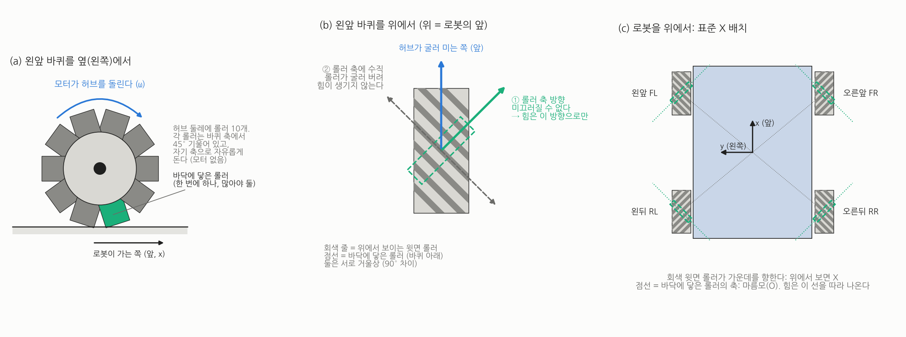
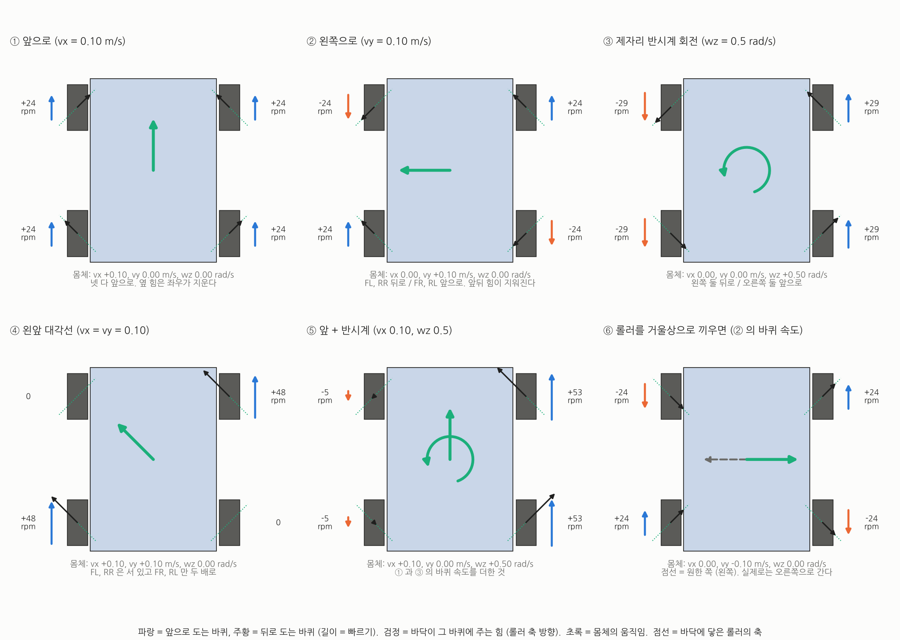
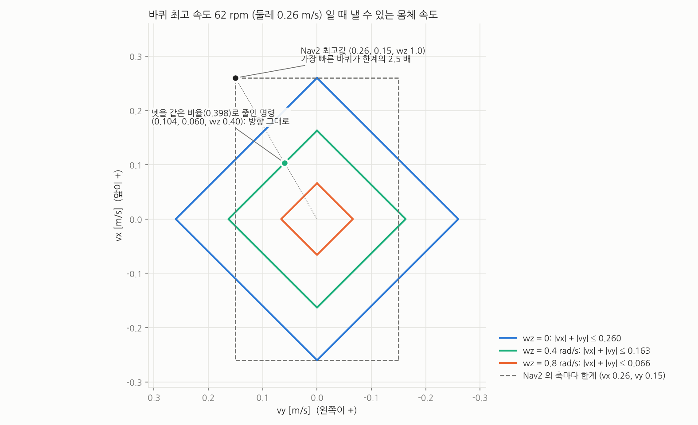
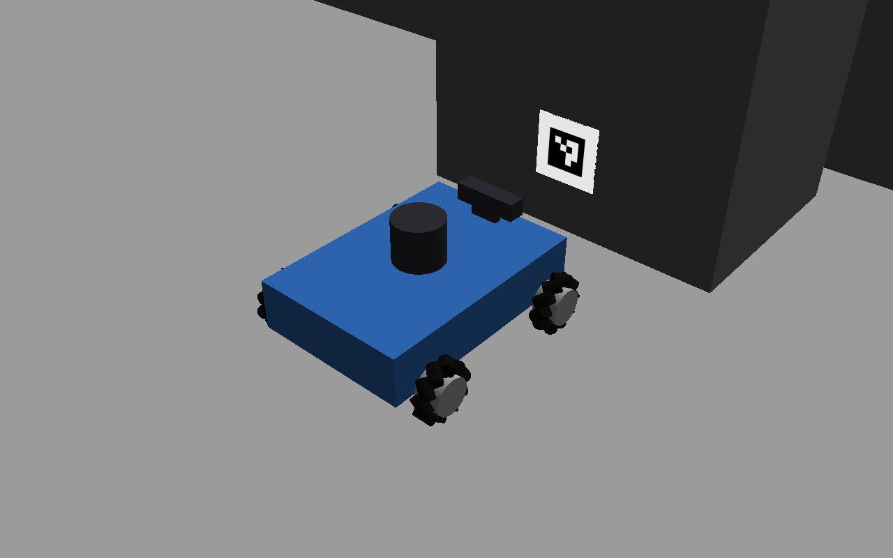

# 메카넘 바퀴 공부 노트: 구조, 힘, 운동학, 그리고 이 프로젝트에서

[DOCKING_STUDY.md](DOCKING_STUDY.md#1-8-제어-기초) 에 "메카넘 바퀴 넷은 바퀴 속도의 조합으로 로봇을 앞뒤(`vx`), 옆(`vy`), 회전(`wz`)을 **동시에, 따로** 움직일 수 있다" 고 한 줄로 적었다. 이 문서는 그 한 줄을 풀어 쓴 것이다.

- **바퀴가 어떻게 생겼나**: 허브와 45° 로 기운 롤러.
- **왜 옆으로 갈 수 있나**: 바퀴 하나가 바닥을 미는 힘의 방향이 45° 로 정해져 있고, 넷을 더하면 어느 방향이든 만들 수 있다.
- **바퀴 속도는 어떻게 정하나**: "바퀴가 닿은 점은 롤러 축 방향으로 미끄러질 수 없다" 는 조건 하나에서 식 넷을 유도한다.
- **실제로는 무엇이 다른가**: 미끄러짐, 진동, 바닥과 하중, 바퀴 속도의 한계.
- **이 프로젝트에서는 어디에 쓰였나**: Nav2 와 도킹의 `cmd_vel` 에서 바퀴까지, 시뮬레이션과 실제 로봇.

**숫자는 모두 이 프로젝트의 메카넘 로봇 치수**(바퀴 반지름 0.04 m, 앞뒤 바퀴 축의 반 길이 0.11 m, 좌우 바퀴의 반 폭 0.1325 m; `simple_line_bringup/robots/make_mecanum.py`)로 `bt_mission/tools/study/ex_mecanum.py` 가 계산했다 ([부록](#부록-이-문서의-숫자를-직접-다시-계산하기)). 수식은 삼각함수, 벡터의 내적, 행렬 곱 정도면 따라올 수 있다. 처음에는 각 장의 "한 줄 요약" 과 그림, 표만 읽어도 된다.



목차

- [0. 한 장 요약](#0-한-장-요약)
- [1. 기초: 평면에서 움직인다는 것](#1-기초-평면에서-움직인다는-것)
  - [1-1. 평면의 자유도는 셋](#1-1-평면의-자유도는-셋)
  - [1-2. 보통 바퀴는 왜 옆으로 못 가나](#1-2-보통-바퀴는-왜-옆으로-못-가나)
  - [1-3. 몸체 위 한 점의 속도](#1-3-몸체-위-한-점의-속도)
  - [1-4. 한 방향의 성분: 내적](#1-4-한-방향의-성분-내적)
- [2. 메카넘 바퀴의 구조](#2-메카넘-바퀴의-구조)
- [3. 원리 1: 바퀴 하나가 바닥을 미는 힘](#3-원리-1-바퀴-하나가-바닥을-미는-힘)
- [4. 원리 2: 바퀴 속도 정하기 (역기구학)](#4-원리-2-바퀴-속도-정하기-역기구학)
- [5. 거꾸로: 바퀴에서 몸체로 (정기구학, odom)](#5-거꾸로-바퀴에서-몸체로-정기구학-odom)
- [6. 바퀴 속도의 한계](#6-바퀴-속도의-한계)
- [7. 실제 메카넘은 무엇이 다른가](#7-실제-메카넘은-무엇이-다른가)
- [8. 이 프로젝트에서의 메카넘](#8-이-프로젝트에서의-메카넘)
- [9. 연습문제](#9-연습문제)
- [10. 용어 정리](#10-용어-정리)
- [부록: 이 문서의 숫자를 직접 다시 계산하기](#부록-이-문서의-숫자를-직접-다시-계산하기)
- [참고 자료](#참고-자료)

---

## 0. 한 장 요약

**세 문장으로**:

1. 메카넘 바퀴의 둘레에는 **자유롭게 도는 롤러**가 45° 로 비스듬히 달려 있다. 그래서 바퀴 하나는 바닥을 **롤러 축 방향(45°)으로만** 민다. 롤러 축에 수직인 쪽으로는 롤러가 굴러 버려 힘이 생기지 않는다.
2. 롤러가 거울상인 바퀴 두 종류를 X 모양으로 놓으면, 네 바퀴의 45° 힘을 **더하는 방법에 따라** 앞뒤, 옆, 회전, 그리고 그 조합이 모두 나온다.
3. 이것을 속도로 쓰면 `바퀴 속도 넷 = 행렬 H × (vx, vy, wz)` 의 **일차식**이다. 그래서 세 움직임이 **따로**(각자의 바퀴 속도 무늬가 있다) 정해지고, **동시에**(무늬를 더하면 된다) 낼 수 있다.

**명령에서 움직임까지**:

```
 Nav2 / 도킹 (ArucoServo)
        │  cmd_vel = (vx, vy, wz)   로봇 기준 몸체 속도
        ▼
 역기구학 (4장)   ω_FL = (vx − vy − (lx+ly)·wz) / r      ω_FR = (vx + vy + (lx+ly)·wz) / r
                 ω_RL = (vx + vy − (lx+ly)·wz) / r      ω_RR = (vx − vy + (lx+ly)·wz) / r
        │  바퀴 넷의 목표 각속도 (넘치면 넷을 같은 비율로 줄인다, 6장)
        ▼
 모터 드라이버    엔코더를 보며 각 바퀴를 목표 속도로 돌린다 (바퀴마다 PID)
        ▼
 바퀴 → 롤러 → 바닥   바퀴마다 45° 힘 (3장). 넷의 합이 몸체를 움직인다
        │
        └─ 엔코더 → 정기구학 (5장) → 바퀴 odom (TF odom → base_footprint)
```

**표기**: x = 로봇의 앞, y = 왼쪽, `wz > 0` = 위에서 볼 때 반시계. 바퀴 순서는 왼앞(FL), 오른앞(FR), 왼뒤(RL), 오른뒤(RR). 바퀴 각속도 `ω > 0` 은 그 바퀴가 로봇을 앞으로 굴리는 쪽이다. 실제 모터는 왼쪽과 오른쪽이 거울상으로 붙어 있어 모터 쪽 부호가 반대일 수 있다 (8-3).

---

## 1. 기초: 평면에서 움직인다는 것

### 1-1. 평면의 자유도는 셋

**한 줄 요약**: 바닥 위의 로봇은 앞뒤, 옆, 회전의 세 가지로 움직일 수 있다. 몸체 속도 `(vx, vy, wz)` 가 그 셋이다.

바닥 위 로봇의 자세는 `(x, y, θ)` 셋으로 정해진다 ([DOCKING_STUDY 1-1](DOCKING_STUDY.md#1-1-자세와-좌표계-누가-어디서-보았나)). 자세가 바뀌는 빠르기도 셋이다. ROS 의 `cmd_vel` 은 이것을 **로봇 좌표계**로 쓴다.

| 성분 | 뜻 | 단위 | 예 |
|---|---|---|---|
| `vx` (`linear.x`) | 로봇의 앞쪽 속도 | m/s | 0.10 = 앞으로 초당 10 cm |
| `vy` (`linear.y`) | 로봇의 왼쪽 속도 | m/s | −0.05 = 오른쪽으로 초당 5 cm |
| `wz` (`angular.z`) | 위에서 볼 때 반시계 회전 속도 | rad/s | 0.5 = 초당 약 29° |

로봇이 이 셋 가운데 **어느 것이든, 어느 조합이든 그 순간에 바로** 낼 수 있으면 **전방향(holonomic)** 로봇이라고 한다.

### 1-2. 보통 바퀴는 왜 옆으로 못 가나

**한 줄 요약**: 보통 바퀴는 구르는 방향으로만 움직이고 옆으로는 마찰이 막는다. 그래서 차동 구동 로봇에는 `vy` 가 없다.

보통 바퀴가 바닥에 닿은 점을 보자.

- **구르는 방향 (앞뒤)**: 바퀴가 돌면 그만큼 간다. 속도 = `r · ω` (r = 반지름, ω = 각속도).
- **옆 방향 (바퀴 축 방향)**: 바퀴는 옆으로 구를 수 없고, 고무와 바닥의 마찰이 옆으로 밀리는 것을 막는다.

바퀴 둘(+ 캐스터)로 움직이는 차동 구동 로봇(TurtleBot3 waffle 등)은 두 바퀴 모두 옆으로 못 가므로 **언제나 `vy = 0`** 이다. 옆으로 10 cm 가려면 "돌고 → 가고 → 다시 돈다" (평행 주차처럼). 이런 제약을 **비홀로노믹(nonholonomic)** 제약이라고 한다. 갈 수 없는 곳이 있는 것은 아니지만, 지금 이 순간 옆으로 가는 속도는 낼 수 없다.

옆으로 가는 방법은 여럿이다.

| 구동 방식 | 바퀴 | 옆으로 가는 방법 | 장단점 |
|---|---|---|---|
| 차동 구동 | 보통 바퀴 2 + 캐스터 | 못 간다 (`vy = 0`) | 단순, 튼튼, 밀어내는 힘이 크다 |
| 옴니 휠 | 둘레에 바퀴 축과 **수직(90°)인** 롤러. 바퀴를 서로 다른 방향으로 둔다 (3개를 120° 로, 4개를 90° 로) | 롤러가 옆 미끄러짐을 받아 준다 | 바퀴 방향이 제각각이라 차체 설계가 까다롭다 |
| **메카넘** | 둘레에 **45°** 롤러. 바퀴는 보통 차처럼 넷 다 앞을 본다 | 45° 힘의 조합 (3장) | 보통 4륜 차체 그대로. 미끄러짐, 진동, 바닥에 민감 (7장) |
| 스워브 | 보통 바퀴를 모터로 돌려 방향을 바꾼다 | 바퀴 자체를 옆으로 돌린다 | 힘이 크고 정확하지만 모터가 두 배, 복잡하다 |

### 1-3. 몸체 위 한 점의 속도

**한 줄 요약**: 몸체가 `(vx, vy, wz)` 로 움직일 때, 몸체 위 점 `(x, y)` 의 속도는 `(vx − wz · y, vy + wz · x)` 다.

바퀴가 닿은 점은 로봇 중심이 아니라 네 귀퉁이에 있다. 그 점이 얼마나 빨리 움직이는지 알아야 바퀴 속도를 정할 수 있다.

몸체 운동은 **평행 이동 + 회전** 으로 나눌 수 있다.

- 평행 이동 `(vx, vy)` 는 몸체의 모든 점에 똑같이 더해진다.
- 회전 `wz` 는 중심에서 `(x, y)` 떨어진 점에 **반지름에 수직인 속도** `wz × (반지름)` 을 더한다. 반시계로 돌 때 앞쪽 점(`x > 0`)은 왼쪽(+y)으로, 왼쪽 점(`y > 0`)은 뒤쪽(−x)으로 간다. 식으로 `(−wz · y, +wz · x)`.

```
점 (x, y) 의 속도 = ( vx − wz · y ,  vy + wz · x )
                     ─────────────   ─────────────
                       앞뒤 성분        옆 성분
```

> **예제**: 왼앞 바퀴(FL)는 `(x, y) = (0.11, 0.1325)` 에 있다. 로봇이 제자리에서 반시계로 `wz = 0.5 rad/s` 돌면
> FL 이 닿은 점의 속도 = `(0 − 0.5 · 0.1325, 0 + 0.5 · 0.11)` = **(−0.066, +0.055) m/s**: 뒤쪽 왼편으로 움직인다.
> 크기는 `0.5 × √(0.11² + 0.1325²) = 0.5 × 0.172 = 0.086 m/s`, 방향은 중심에서 FL 로 그은 선에 수직이다.

### 1-4. 한 방향의 성분: 내적

**한 줄 요약**: 속도 `v` 의 "방향 `a` 쪽 성분" 은 내적 `v · a` 다 (`a` 는 길이 1).

`v = (vx, vy)`, `a = (ax, ay)` (길이 1) 이면 `v · a = vx · ax + vy · ay`. 그림으로는 `v` 를 `a` 선 위에 내린 그림자의 길이다.

> **예제**: `a = (1, −1)/√2` (앞-오른쪽 45°). `v = (0.10, 0)` (앞으로) 이면 `v · a = 0.10 / √2 = 0.0707`. `v = (0, 0.10)` (왼쪽으로) 이면 `v · a = −0.0707` (반대쪽 성분).

메카넘의 모든 계산은 이 내적 하나로 된다. 바퀴가 닿은 점의 속도에서 **롤러 축 방향 성분만** 바퀴가 책임지고, 나머지(롤러 축에 수직인 성분)는 롤러가 굴러서 흡수한다 (4장).

---

## 2. 메카넘 바퀴의 구조

**한 줄 요약**: 모터가 돌리는 허브 둘레에, 모터 없이 자유롭게 도는 롤러가 바퀴 축에서 45° 기울어 달려 있다. 롤러가 왼쪽으로 기운 바퀴와 오른쪽으로 기운 바퀴(거울상)가 있다.

**역사**: 스웨덴 Mecanum AB 사의 엔지니어 Bengt Ilon 이 만들었다 (미국 특허 US 3,876,255, 1972년 출원, 1975년 등록). 그래서 "Ilon 바퀴" 라고도 한다 ([Wikipedia](https://en.wikipedia.org/wiki/Mecanum_wheel), [Google Patents](https://patents.google.com/patent/US3876255A/en)).

**구조** (위 그림 (a), (b)):

| 부분 | 하는 일 | 이 프로젝트의 모델 |
|---|---|---|
| 허브 | 모터 축에 붙어 돈다. 보통 바퀴의 "바퀴" 에 해당 | 반지름 0.04 m, 폭 0.035 m |
| 롤러 | 허브 둘레에 비스듬히 달린 작은 바퀴. **모터가 없고** 자기 축으로 자유롭게 돈다 (베어링) | 10개, 반지름 9 mm, 바퀴 축에서 45° |
| 롤러의 모양 | 가운데가 불룩한 술통 모양. 옆에서 본 바퀴의 윤곽이 원이 되게 해서, 롤러가 바뀌어도 바퀴 중심의 높이가 거의 그대로다 | (모델은 단순한 원기둥) |
| 바닥에 닿는 롤러 | 언제나 하나 또는 둘. 이 롤러의 축 방향이 그 순간 힘의 방향이다 | |

**왼손 바퀴와 오른손 바퀴**: 롤러가 기운 방향이 서로 거울상인 두 종류가 있다. 로봇 하나에 두 개씩 쓰고, **대각선 자리에 같은 종류**를 둔다 (FL 과 RR 이 같고, FR 과 RL 이 같다). 제품마다 "왼쪽/오른쪽", "A/B" 로 부르는 이름이 달라 헷갈리기 쉽다 ([AndyMark](https://www.andymark.com/am-3919) 는 "가운데 롤러가 위-오른쪽을 향하면 right, 위-왼쪽이면 left" 로 구분한다).

**위에서 보면 X, 바닥에서는 O** (위 그림 (b), (c)): 이것이 가장 헷갈리는 부분이다.

- 위에서 내려다보면 보이는 것은 **바퀴 윗면의 롤러**다. 표준 배치에서는 네 바퀴의 윗면 롤러가 모두 **로봇 가운데를 향해** X 모양을 만든다 ([gm0](https://game-manual-0.readthedocs.io/en/stable/docs/drivetrains/holonomic.html), [AndyMark](https://www.andymark.com/am-3919)).
- 그런데 힘을 내는 것은 **바닥에 닿은 롤러**다. 롤러는 허브 둘레를 나선처럼 감고 있어서, 아래쪽 롤러는 위쪽 롤러의 **거울상**(90° 차이)이다. 그래서 바닥에 닿은 롤러의 축을 위에서 본 방향으로 그리면 마름모(O)가 된다.
- 이 문서의 힘과 속도 계산은 모두 **바닥에 닿은 롤러의 축**을 쓴다. 왼앞(FL) 바퀴라면 바닥 롤러의 축은 **앞-오른쪽** `(1, −1)/√2`, 오른앞(FR)은 **앞-왼쪽** `(1, 1)/√2` 다.

| 바퀴 | 자리 (x, y) [m] | 바닥에 닿은 롤러의 축 | 위에서 보이는 윗면 롤러 |
|---|---|---|---|
| 왼앞 FL | (+0.11, +0.1325) | (1, −1)/√2: 앞-오른쪽 | 앞-왼쪽 ↔ 뒤-오른쪽 ("\\", 가운데를 향함) |
| 오른앞 FR | (+0.11, −0.1325) | (1, +1)/√2: 앞-왼쪽 | 앞-오른쪽 ↔ 뒤-왼쪽 ("/") |
| 왼뒤 RL | (−0.11, +0.1325) | (1, +1)/√2: 앞-왼쪽 | "/" |
| 오른뒤 RR | (−0.11, −0.1325) | (1, −1)/√2: 앞-오른쪽 | "\\" |

> 이 노트를 쓰며 확인해 보니, 이 프로젝트의 Gazebo/RViz 모델은 롤러가 거울상(O 배치)으로 그려져 있었다. Gazebo 는 롤러를 물리로 풀지 않으므로(8-2) 시뮬레이션의 움직임에는 영향이 없었고, `make_mecanum.py` 의 롤러 방향만 표준 X 배치로 고쳤다. 지금 모델은 4장의 식(`wheel_joint_publisher.py` 가 쓰는 식)과 맞는다 (`ex_mecanum.py` 가 롤러 축에서 유도한 행렬과 그 식이 같은지 확인한다).

---

## 3. 원리 1: 바퀴 하나가 바닥을 미는 힘

**한 줄 요약**: 바퀴 하나는 롤러 축 방향(45°)으로만 바닥을 민다. 모터 토크 τ 이면 앞으로 `τ/r`, 옆으로 `±τ/r`. 넷의 옆 힘이 서로 지워지면 앞으로, 앞뒤 힘이 지워지면 옆으로 간다.

### 3-1. 왜 롤러 축 방향인가

바닥에 닿은 롤러 하나를 보자 (그림 (b)).

- **롤러 축에 수직인 방향 (② 회색 점선)**: 이쪽으로 밀리면 롤러가 자기 축으로 굴러 버린다. 롤러는 베어링으로 자유롭게 돌기 때문에 이 방향으로는 **힘을 주고받을 수 없다** (베어링 마찰은 작아서 무시한다).
- **롤러 축 방향 (① 초록)**: 이쪽으로는 롤러가 구를 수 없다. 보통 바퀴의 옆 방향처럼 고무와 바닥의 마찰이 미끄러짐을 막는다. **힘은 이 방향으로만 나온다.**

그래서 바퀴 하나가 몸체에 주는 힘은 언제나 그 바퀴의 바닥 롤러 축과 나란하다. 크기와 부호(앞쪽이냐 뒤쪽이냐)는 모터가 정한다.

### 3-2. 힘의 크기

모터가 허브에 토크 τ 를 주면, 바닥이 바퀴를 미는 힘 `F` 의 **앞 성분**이 그 토크와 맞서야 한다 (바퀴 축에 대한 돌림힘의 균형: `F_앞 × r = τ`). 그런데 `F` 는 45° 방향이므로

```
F_앞 = τ / r
F_옆 = ± τ / r          (45° 라 앞 성분과 크기가 같다. 부호는 롤러가 기운 쪽)
|F|  = √2 · τ / r       (롤러 축 방향)
```

> **예제**: τ = 0.1 N·m, r = 0.04 m → 앞으로 **2.50 N**, 옆으로 **±2.50 N**, 롤러 축 방향으로 **3.54 N**.

즉 메카넘 바퀴 하나는 **앞으로 밀면서 동시에 옆으로도 민다.** 혼자서는 비스듬히 미는 바퀴다.

### 3-3. 넷을 더하기

몸체가 받는 것은 네 힘의 합이다: 앞뒤 힘 `Fx`, 옆 힘 `Fy`, 그리고 중심에 대한 돌림힘 `Mz` (바퀴 i 의 힘 `(Fx_i, Fy_i)` 가 자리 `(x_i, y_i)` 에 걸리면 `Mz_i = x_i · Fy_i − y_i · Fx_i`).

바퀴마다 τ = 0.1 N·m 를 주고 부호만 바꿔 보면 (`ex_mecanum.py`):

| 토크 부호 (FL, FR, RL, RR) | 바퀴마다의 힘 (앞, 옆) [N] | 합 Fx, Fy [N], Mz [N·m] | 움직임 |
|---|---|---|---|
| (+, +, +, +) | FL (+2.5, −2.5), FR (+2.5, +2.5), RL (+2.5, +2.5), RR (+2.5, −2.5) | **+10**, 0, 0 | 앞으로. 옆 힘은 좌우가 지운다 |
| (−, +, +, −) | FL (−2.5, +2.5), FR (+2.5, +2.5), RL (+2.5, +2.5), RR (−2.5, +2.5) | 0, **+10**, 0 | 왼쪽으로. 앞뒤 힘을 앞뒤 바퀴가 지운다 |
| (−, +, −, +) | FL (−2.5, +2.5), FR (+2.5, +2.5), RL (−2.5, −2.5), RR (+2.5, −2.5) | 0, 0, **+2.43** | 제자리에서 반시계. 힘은 지워지고 돌림힘만 남는다 |



그림의 검정 화살표가 바퀴마다의 힘(롤러 축 방향), 초록이 몸체의 움직임이다. ①②③ 을 보면:

- **① 앞으로**: 넷 다 앞으로 돈다. 앞의 두 바퀴는 FL 이 앞-오른쪽, FR 이 앞-왼쪽으로 밀어 옆 성분이 서로 지워진다. 뒤의 두 바퀴(RL 앞-왼쪽, RR 앞-오른쪽)도 그렇다. 앞 성분만 남는다.
- **② 왼쪽으로**: FL 과 RR 이 뒤로, FR 과 RL 이 앞으로 돈다. 네 힘이 모두 왼쪽 성분을 갖고, 앞뒤 성분은 앞으로 도는 둘과 뒤로 도는 둘이 지운다. 같은 쪽(왼쪽)의 두 바퀴가 서로 반대로 도는 것이 핵심이다.
- **③ 반시계 회전**: 왼쪽 둘은 뒤로, 오른쪽 둘은 앞으로 (차동 구동의 제자리 회전과 같다). 롤러 덕분에 바퀴가 옆으로 끌려도 저항하지 않아 보통 4륜 차보다 매끄럽게 돈다.

돌림힘 2.43 N·m 는 `4 × (τ/r) × (lx + ly) = 4 × 2.5 × 0.2425` 다. 회전에서 **`lx + ly`** (중심에서 바퀴까지의 앞뒤 거리 + 좌우 거리)가 지렛대 길이 노릇을 한다. 4장의 식에서도 같은 값이 나온다.

### 3-4. 대가: 밀어내는 힘이 약하다

바퀴가 미끄러지기 직전의 힘은 `마찰계수 μ × 수직항력 N` 이다. 보통 바퀴는 이 힘을 모두 앞으로 쓰지만, 메카넘 바퀴는 힘이 45° 로 기울어 있으므로 앞 성분은 그 `cos 45° = 71 %` 다.

> **예제** (가정: 로봇 8 kg, 바퀴마다 N = 19.6 N, μ = 0.6): 보통 바퀴는 앞으로 최대 11.8 N, 메카넘은 **8.3 N** (바퀴 하나).

게다가 롤러 고무는 보통 바퀴보다 마찰계수가 낮은 경우가 많다. 그래서 메카넘 로봇은 **밀어내는 힘이 약하고**, 턱이나 거친 바닥에 약하다 ([gm0](https://game-manual-0.readthedocs.io/en/stable/docs/drivetrains/holonomic.html)). 무거운 짐을 밀거나 경사를 오르는 로봇에는 맞지 않을 수 있다.

---

## 4. 원리 2: 바퀴 속도 정하기 (역기구학)

**한 줄 요약**: "바퀴가 닿은 점의 속도 중 **롤러 축 방향 성분** = 바퀴가 굴러서 내는 속도의 롤러 축 방향 성분" 하나로 바퀴 속도가 정해진다. 결과는 `ω = H · (vx, vy, wz)` 라는 일차식이다.

3장은 "힘을 주면 어떻게 움직이나" 였다. 로봇을 움직일 때는 거꾸로 "이렇게 움직이고 싶으면 바퀴를 얼마나 빨리 돌리나" 가 필요하다. 이것이 **역기구학**이다. 모터 드라이버는 바퀴 속도를 맞추므로(엔코더 + PID) 속도로 생각하는 것이 실용적이다.

### 4-1. 바퀴 하나의 조건

바퀴 i 가 닿은 점이 몸체와 함께 속도 `v_i` 로 움직인다 (1-3). 그 점에서 일어나는 일:

1. 허브가 각속도 `ω_i` 로 돌면 바퀴는 앞으로 `r · ω_i` 만큼 굴러 간다 (보통 바퀴와 같다).
2. 바닥 롤러가 자기 축으로 굴러서, **롤러 축에 수직인 방향**의 차이는 얼마든지 흡수한다.
3. **롤러 축 방향**으로는 흡수할 방법이 없다. 미끄러지지 않으려면 이 방향 성분이 맞아야 한다.

롤러 축을 `a_i` (길이 1) 라고 하면, 3 번을 식으로:

```
v_i · a_i  =  (r · ω_i, 0) · a_i              (몸체가 요구하는 것 = 바퀴가 굴러서 주는 것, 롤러 축 방향으로만)
            =  r · ω_i · cos 45°
→  ω_i = (v_i · a_i) / (r · cos 45°)
```

`a_i = (1, t_i)/√2` (`t_i = ±1`, 2장의 표) 를 넣으면 `cos 45° = 1/√2` 가 지워져서

```
ω_i = ( v_i,앞 + t_i · v_i,옆 ) / r
```

> **예제 1** (앞으로 0.10 m/s, FL): `v_FL = (0.10, 0)`, `t = −1` → `ω = (0.10 − 0)/0.04 = +2.5 rad/s` (24 rpm).
>
> **예제 2** (왼쪽으로 0.10 m/s, FL): `v_FL = (0, 0.10)` → `ω = (0 − 0.10)/0.04 = −2.5 rad/s`. **뒤로** 돈다.
> 그때 닿은 점에서: 몸체는 `(0, 0.10)` 으로 가고 바퀴는 `r·ω = −0.10` 로 굴러 `(−0.10, 0)` 만큼 간다. 차이 `(0.10, 0.10)` 은 롤러 축 `(1, −1)` 에 정확히 수직이라 바닥 롤러가 **0.141 m/s** 로 굴러서 흡수한다. 롤러 축 방향으로는 미끄러짐이 0 이다.

### 4-2. 네 바퀴의 식

1-3 의 `v_i = (vx − wz · y_i, vy + wz · x_i)` 와 2장의 `t_i` 를 넣으면 (`lx = 0.11`, `ly = 0.1325`):

| 바퀴 | 자리 | t | ω = (v_앞 + t · v_옆) / r |
|---|---|---|---|
| FL | (+lx, +ly) | −1 | ( (vx − wz·ly) − (vy + wz·lx) ) / r = **(vx − vy − (lx+ly)·wz) / r** |
| FR | (+lx, −ly) | +1 | ( (vx + wz·ly) + (vy + wz·lx) ) / r = **(vx + vy + (lx+ly)·wz) / r** |
| RL | (−lx, +ly) | +1 | ( (vx − wz·ly) + (vy − wz·lx) ) / r = **(vx + vy − (lx+ly)·wz) / r** |
| RR | (−lx, −ly) | −1 | ( (vx + wz·ly) − (vy − wz·lx) ) / r = **(vx − vy + (lx+ly)·wz) / r** |

행렬로 쓰면 (`ex_mecanum.py` 가 롤러 축에서 직접 유도한 값):

```
 ┌ ω_FL ┐         ┌ 1  −1  −(lx+ly) ┐ ┌ vx ┐          ┌ 25  −25  −6.0625 ┐
 │ ω_FR │ = 1/r · │ 1  +1  +(lx+ly) │ │ vy │   ,  H = │ 25  +25  +6.0625 │   (r = 0.04, lx+ly = 0.2425)
 │ ω_RL │         │ 1  +1  −(lx+ly) │ └ wz ┘          │ 25  +25  −6.0625 │
 └ ω_RR ┘         └ 1  −1  +(lx+ly) ┘                 └ 25  −25  +6.0625 ┘
```

각 열의 뜻:

- **첫 열 (vx)**: 넷 다 `+1`. 앞으로 가려면 넷 다 같은 속도로 앞으로.
- **둘째 열 (vy)**: `−, +, +, −`. 왼쪽으로 가려면 FL·RR 은 뒤로, FR·RL 은 앞으로. 대각선 짝이 같이 움직인다.
- **셋째 열 (wz)**: `−, +, −, +`. 반시계로 돌려면 왼쪽은 뒤로, 오른쪽은 앞으로. 크기에 `lx + ly` 가 곱해진다 (3-3 의 지렛대 길이).

### 4-3. 기본 움직임의 바퀴 속도

| 원하는 움직임 | ω_FL | ω_FR | ω_RL | ω_RR [rad/s] | rpm |
|---|---|---|---|---|---|
| 앞으로 0.10 m/s | +2.50 | +2.50 | +2.50 | +2.50 | 넷 다 +23.9 |
| 왼쪽으로 0.10 m/s | −2.50 | +2.50 | +2.50 | −2.50 | ∓23.9 |
| 반시계 0.5 rad/s | −3.03 | +3.03 | −3.03 | +3.03 | ∓28.9 |
| 왼앞 대각선 (0.10, 0.10) | 0 | +5.00 | +5.00 | 0 | FL·RR **멈춤**, FR·RL 47.7 |
| 앞 0.10 + 반시계 0.5 | −0.53 | +5.53 | −0.53 | +5.53 | |
| 왼쪽 0.10 + 반시계 0.5 | −5.53 | +5.53 | −0.53 | +0.53 | |

살펴볼 점:

- **앞으로와 옆으로의 바퀴 속도가 같다** (둘 다 2.5 rad/s 로 0.10 m/s). 이론으로는 옆으로도 앞으로만큼 빠르다. 실제로는 옆으로 갈 때 롤러가 더 미끄러져 느려진다 (7장).
- **대각선은 두 바퀴만** 쓴다. FL 과 RR 의 바닥 롤러는 축이 앞-오른쪽이라, 왼앞으로 가는 움직임은 그 롤러에 정확히 수직이다. 롤러가 굴러서 다 흡수하므로 허브는 돌 필요가 없다.

### 4-4. "동시에, 따로" 의 정체: 겹치기

식이 **일차식**이라서 움직임을 나눠 계산하고 더해도 똑같다. 이것이 "세 움직임을 따로, 동시에 낼 수 있다" 의 수학적 뜻이다.

> **예제**: 도킹의 한 제어 주기 명령 ([DOCKING_STUDY 4-4](DOCKING_STUDY.md#4-4-mecanumstep-오차에서-명령까지-한-단계씩)) `(vx, vy, wz) = (+0.045, +0.005, −0.0393)`. 앞으로 가면서, 왼쪽으로 조금, 시계 방향으로 조금 돈다.

| | ω_FL | ω_FR | ω_RL | ω_RR [rad/s] |
|---|---|---|---|---|
| vx = 0.045 만 | +1.125 | +1.125 | +1.125 | +1.125 |
| vy = 0.005 만 | −0.125 | +0.125 | +0.125 | −0.125 |
| wz = −0.0393 만 | +0.238 | −0.238 | +0.238 | −0.238 |
| **합 = 한꺼번에 계산한 값** | **+1.238** | **+1.012** | **+1.488** | **+0.762** |

네 바퀴가 모두 앞으로 돌지만 빠르기가 조금씩 다르다. 그 작은 차이가 옆 이동과 회전을 만든다. 바퀴 속도 넷에서 몸체의 세 움직임을 다시 꺼내는 것이 5장이다.

바꿔 말하면 메카넘 로봇의 제어기(Nav2, `mecanumStep`)는 바퀴를 몰라도 된다. `(vx, vy, wz)` 만 정하면 바퀴 속도는 이 식이 정한다.

### 4-5. 왜 꼭 X 배치여야 하나

롤러를 거꾸로 끼우면(넷 다 거울상, O 배치) 행렬이 이렇게 된다 (그림 ⑥).

```
           ┌ 1  +1  −(ly−lx) ┐        r·H_잘못 = ┌ 1  +1  −0.0225 ┐
H_잘못 = 1/r │ 1  −1  +(ly−lx) │                   │ 1  −1  +0.0225 │
           │ 1  −1  −(ly−lx) │                   │ 1  −1  −0.0225 │
           └ 1  +1  +(ly−lx) ┘                   └ 1  +1  +0.0225 ┘
```

- **옆 열의 부호가 뒤집힌다**: 바른 로봇을 왼쪽으로 보내는 바퀴 속도를 주면 **오른쪽으로** 간다 (그림 ⑥).
- **회전 열이 `lx + ly = 0.2425` 에서 `|ly − lx| = 0.0225` 로 작아진다**: 회전에 필요한 바퀴 속도가 1/11 이 된다. 좋은 일이 아니다. 바퀴가 회전을 거의 "붙잡지" 못한다는 뜻이다. 바퀴 속도가 조금만 틀려도 크게 돌고, 바깥에서 조금만 밀어도 돌아간다. 행렬의 조건수(작을수록 좋다)가 4.1 에서 44 가 된다.
- 바퀴 배치가 정사각형(`lx = ly`)이면 회전 열이 0 이 되어 **아예 돌 수 없다** (rank 2).

그림으로 보면: 회전할 때 바퀴가 닿은 점은 "중심에서 바퀴로 그은 선" 에 수직으로 움직인다 (1-3). X 배치에서는 바닥 롤러의 축이 그 방향과 가까워서(정사각형이면 정확히 같다) 바퀴가 회전을 붙잡는다. O 배치에서는 바닥 롤러의 축이 중심을 향해서 회전 방향이 롤러가 자유롭게 구르는 방향이 된다.

**실제 로봇을 조립했을 때 확인할 것**: 옆으로 가는 방향이 반대거나, 제자리 회전이 헐겁고 미끄러지면 바퀴를 거꾸로 끼운 것이다 (위에서 볼 때 윗면 롤러가 X 로 가운데를 향하는지 본다).

### 4-6. 같은 행렬이 힘도 정한다

3장의 힘 계산은 4장의 행렬을 **전치**한 것이다.

```
(Fx, Fy, Mz) = Hᵀ · (τ_FL, τ_FR, τ_RL, τ_RR)
```

모터가 넣는 일률 `Σ τ_i · ω_i` 과 몸체가 받는 일률 `F · v` 가 같아야 하기 때문이다 (미끄러짐이 없으면 에너지가 새지 않는다). `ex_mecanum.py` 의 예: τ = (0.05, −0.02, 0.08, 0.01) N·m, v = 도킹 예제 명령일 때 두 값 모두 0.168356 W.

---

## 5. 거꾸로: 바퀴에서 몸체로 (정기구학, odom)

**한 줄 요약**: 엔코더가 잰 바퀴 속도 넷에서 몸체 속도 셋을 구한다 (바퀴 odom). 식은 넷인데 미지수는 셋이라, 남는 한 방향은 "바퀴끼리 싸운 양" 이다.

### 5-1. 식

`ω = H · v` 를 `v` 에 대해 풀면 된다. 식이 넷, 미지수가 셋이므로 가장 잘 맞는 `v` 를 고른다 (최소제곱, [DOCKING_STUDY 1-7](DOCKING_STUDY.md#1-7-최적화-가장-잘-맞는-값-찾기)). 이 행렬은 모양이 좋아서 결과가 간단하다.

```
vx = r/4             · ( ω_FL + ω_FR + ω_RL + ω_RR )      넷의 평균
vy = r/4             · (−ω_FL + ω_FR + ω_RL − ω_RR )      대각선 짝의 차
wz = r/(4·(lx+ly))   · (−ω_FL + ω_FR − ω_RL + ω_RR )      오른쪽 − 왼쪽
```

> **예제**: 엔코더가 (3, 1, 3, 1) rad/s → `vx = 0.01 × 8 = 0.08 m/s`, `vy = 0.01 × 0 = 0`, `wz = 0.0412 × (−4) = −0.165 rad/s`. 앞으로 가면서 시계 방향으로 돈다 (왼쪽이 빠르다).

바퀴 odom 은 이 속도를 시간에 대해 적분한 것이다: 매 주기 `dt` 마다 지금 방향 `θ` 로 돌려 `x += (vx cos θ − vy sin θ) dt`, `y += (vx sin θ + vy cos θ) dt`, `θ += wz dt` (`mecanum_slip_sim.py` 가 이렇게 한다).

### 5-2. 남는 한 방향: 바퀴끼리 싸우기

바퀴 속도는 넷인데 몸체 움직임은 셋이다. 그래서 **어떤 몸체 움직임으로도 만들 수 없는** 바퀴 속도 무늬가 하나 있다.

```
n = (FL, FR, RL, RR) = (+1, +1, −1, −1)      앞바퀴 둘은 앞으로, 뒷바퀴 둘은 뒤로
```

이렇게 돌리면 앞바퀴는 몸을 앞으로, 뒷바퀴는 뒤로 당긴다 (옆 힘과 돌림힘도 모두 지워진다). 몸체는 움직이지 않고 **롤러가 롤러 축 방향으로 미끄러진다**. 바퀴끼리 싸우는 것이다. 에너지만 버리고 바닥과 롤러가 닳는다.

- **명령 쪽**: 바퀴 속도를 늘 `H · v` 로 만들면 이 성분은 0 이다. 바퀴를 하나씩 따로 정하면(6-2 의 "바퀴마다 자르기" 처럼) 이 성분이 생긴다.
- **측정 쪽**: 엔코더 값에 이 성분이 있으면 무언가 미끄러졌다는 뜻이다. 5-1 의 식(최소제곱)은 이 성분을 버리고 몸체 속도를 구한다.

> **예제** (`ex_mecanum.py`): 도킹 명령의 바퀴 속도에 `0.3 · n` 을 더한 엔코더 값 (1.538, 1.312, 1.188, 0.462) → 5-1 의 식은 명령과 같은 (0.045, 0.005, −0.0393) 을 낸다. 남는 것 (+0.3, +0.3, −0.3, −0.3) 이 싸운 양이다. 이 값을 지켜보면 미끄러짐이나 바퀴 고장을 알아챌 수 있다.

### 5-3. 마찰로 풀어 보기

"바퀴 속도를 정하면 몸체가 그렇게 움직인다" 를 힘으로 확인해 보자. `ex_mecanum.py` 는 바퀴마다 "롤러 축 방향으로 미끄러진 만큼 반대로 미는 마찰"(미끄러짐 속도에 비례하는 단순한 모형)을 두고, 8 kg 몸체를 1초 동안 시간에 따라 풀어 본다.

| 바퀴 속도 | 바퀴마다의 마찰 | 몸체가 선 속도 (vx, vy, wz) | 롤러 축 방향 미끄러짐 [mm/s] |
|---|---|---|---|
| `H · v` (도킹 명령 그대로) | 같다 | (0.045, 0.005, −0.0393) = 명령 | 0, 0, 0, 0 |
| + 싸우는 성분 `0.3 · n` | 같다 | (0.045, 0.005, −0.0393) | −8.5, −8.5, +8.5, +8.5 (넷 다 미끄러진다) |
| + 싸우는 성분 | 앞바퀴가 가볍다 (마찰 1/3) | (**0.039**, 0.005, −0.0393) | −12.7, −12.7, +4.2, +4.2 |

- 맞는 바퀴 속도면 미끄러짐 없이 명령대로 간다. 4장의 식이 물리와 맞는다는 확인이다.
- 싸우는 성분이 있어도 하중이 고르면 몸체는 명령대로 가지만, 바퀴는 계속 미끄러진다.
- **하중이 고르지 않으면 몸체 속도까지 달라진다** (vx 가 13 % 줄었다). 싸움에서 무거운 쪽 바퀴가 이긴다. 실제 로봇에서 "짐을 실으면 움직임이 달라진다" 는 일이 이렇게 생긴다. 그래서 바퀴 속도는 언제나 `(vx, vy, wz)` 에서 4장의 식으로 만든다.

---

## 6. 바퀴 속도의 한계

**한 줄 요약**: 바퀴 넷 중 가장 빠른 것이 한계를 넘으면 **넷을 같은 비율로** 줄인다. 바퀴마다 따로 자르면 가는 방향이 바뀌고 바퀴끼리 싸운다.

### 6-1. 낼 수 있는 몸체 속도는 마름모

4장의 식에서 가장 빠른 바퀴는 `(|vx| + |vy| + (lx+ly)·|wz|) / r` 이다. 바퀴의 최고 각속도를 `ω_max` 라고 하면 낼 수 있는 몸체 속도는

```
|vx| + |vy| + (lx + ly) · |wz|  ≤  r · ω_max
```

이다. 회전이 없으면 `(vx, vy)` 평면의 **마름모**이고, 돌수록 마름모가 작아진다.



> **예제**: 바퀴 최고 62 rpm (`ω_max = 6.5 rad/s`, 바퀴 둘레 속도 0.26 m/s 로 Nav2 의 최고 `vx` 와 같게 가정).
> - 회전 없이 앞으로 또는 옆으로: 0.26 m/s.
> - 회전 없이 **45° 대각선: 0.184 m/s**. 두 바퀴만 쓰기 때문에(4-3) 앞으로보다 느리다.
> - `wz = 0.4 rad/s` 로 돌면서 가면 `|vx| + |vy| ≤ 0.163`, `wz = 0.8` 이면 0.066.

### 6-2. 넘칠 때 줄이는 방법

Nav2 의 `velocity_smoother` 는 **축마다** 한계를 둔다 (`params/holonomic.yaml`: vx 0.26, vy 0.15, wz 1.0 rad/s). 세 축이 한꺼번에 최고값이면 바퀴는 감당하지 못한다.

> **예제**: `(0.26, 0.15, 1.0)` → 바퀴 (−3.31, **+16.31**, +4.19, +8.81) rad/s. 가장 빠른 FR 이 한계(6.5)의 **2.51 배**.

| 줄이는 방법 | 바퀴 [rad/s] | 실제 몸체 속도 | 방향 | 결과 |
|---|---|---|---|---|
| (가) **넷을 같은 비율 0.398 로** | (−1.32, +6.50, +1.67, +3.51) | (0.104, 0.060, 0.398) | 30.0°, 회전/직진 비 3.33 (명령과 같다) | 느려졌을 뿐 가는 길이 같다 |
| (나) 바퀴마다 ±6.5 로 자르기 | (−3.31, +6.50, +4.19, +6.50) | (0.139, 0.075, 0.500) | 28.4°, 비 3.17 (명령과 다르다) | 길이 휘고, 싸우는 성분 (−1.9, −1.9, +1.9, +1.9) 만큼 롤러가 미끄러진다 |

그래서 실제 로봇의 베이스 드라이버는 (가) 처럼 줄여야 한다 (8-3). 도킹의 `mecanumStep` 도 축마다 최고 속도를 넘으면 세 축을 **같은 비율로** 줄여 방향을 지킨다 ([DOCKING_STUDY 4-4 의 ⑤](DOCKING_STUDY.md#4-4-mecanumstep-오차에서-명령까지-한-단계씩)). 도킹은 최고 0.15 m/s 를 넘지 않아 바퀴 한계에 닿을 일이 거의 없지만, 같은 생각이다.

---

## 7. 실제 메카넘은 무엇이 다른가

**한 줄 요약**: 4장의 식은 "롤러가 완벽하게 구르고, 네 바퀴가 늘 바닥에 붙어 있다" 는 이상적인 경우다. 실제로는 옆으로 덜 가고, 조금씩 돌고, 떨린다. 이 프로젝트는 그것을 재서 보정하고, 마지막에는 영상으로 닫힌 제어를 한다.

| 현상 | 왜 | 이 프로젝트에서 한 것 |
|---|---|---|
| **옆으로 덜 간다** (명령의 80 ~ 95 %). 앞으로도 조금 덜 간다 | 롤러 베어링의 마찰, 롤러 고무가 눌리는 것, 롤러가 바뀔 때 닿는 점이 롤러를 따라 움직이는 것. 옆으로 갈 때 롤러가 가장 많이 구르므로 특히 크다 ([gm0](https://game-manual-0.readthedocs.io/en/stable/docs/drivetrains/holonomic.html) 도 "옆으로는 앞으로만큼 빠르지 않다" 고 쓴다) | `docking.yaml` 의 `scale_vx/vy/wz` 로 미리 키운다 (`dock_calibrate.py` 가 잰다, [DOCKING 14-3](DOCKING.md#14-3-배율과-데드밴드-재기-dock_calibratepy)). 시뮬레이션은 `mecanum_slip:=True` 로 옆 90 % |
| **옆으로 가면 조금씩 돈다** | 하중이 고르지 않으면 바퀴마다 미끄러짐이 달라 힘의 합에 돌림힘이 남는다 (5-3). 바퀴 마모, 바퀴 속도 제어의 오차 | 도킹은 세 축을 동시에 제어해 그때그때 고친다. `odom_yaw_per_m` 으로 필터의 불확실도를 키운다. IMU 와 섞은 odom 이면 더 줄어든다 ([DOCKING 14-5](DOCKING.md#14-5-더-높이려면)) |
| **바퀴 odom 이 차동 구동보다 많이 틀린다** | 위 두 가지가 그대로 odom 오차가 된다. 엔코더는 "바퀴가 돈 만큼" 만 안다 | 필터의 예측 불확실도를 "간 거리" 에 비례하게 (`odom_slip`, [DOCKING_STUDY 3-4](DOCKING_STUDY.md#3-4-예측-시간과-움직임만큼-불확실도-키우기-predict-predictmotion)). 마지막은 영상으로 |
| **떨린다** | 롤러와 롤러 사이의 틈, 롤러가 바뀔 때 바퀴 중심의 높이가 조금 바뀐다 | 움직이는 중의 영상은 덜 믿고, 마지막 판단은 서서 본 영상으로 (`ArucoRefine`) |
| **아주 느린 명령에는 안 움직인다** | 정지 마찰, 모터와 드라이버의 데드밴드 | 축마다 최소 속도 `min_vx/vy/wz` |
| **네 바퀴가 모두 닿아야 한다** | 네 점은 평평하지 않은 바닥에서 하나가 뜰 수 있다. 뜬 바퀴는 힘을 못 내서 힘의 합이 틀어진다 | (하드웨어) 평평한 바닥, 서스펜션 또는 흔들리는 축(rocker) |
| **밀어내는 힘이 약하다** | 3-4 (cos 45°, 롤러 고무) | 도킹은 느리고, 설비에 닿기 전에 선다 |
| **먼지, 턱, 카펫에 약하다** | 롤러 사이에 끼고, 작은 롤러는 턱을 못 넘는다 | (운영) 바닥 관리 |

핵심: 메카넘의 **움직임 자체는 정확하지 않다.** 대신 **무엇이든 바로 고칠 수 있다** (옆, 회전을 그 자리에서). 그래서 정밀 도킹은 "정확하게 움직이기" 가 아니라 "자주 보고 고치기"(영상으로 닫힌 제어, [DOCKING_STUDY 4장](DOCKING_STUDY.md#4-손발-한-제어-주기의-계산-arucoservo-mecanumstep)) 로 한다.

---

## 8. 이 프로젝트에서의 메카넘

### 8-1. 명령의 흐름

```
 Nav2 controller (holonomic.yaml)  또는  도킹 ArucoServo (mecanumStep)
        │ cmd_vel (vx, vy, wz)
        ▼
 velocity_smoother (축마다 최고 속도, 가속도)
        │
        ├── [시뮬레이션] (mecanum_slip:=True 면 mecanum_slip_sim.py 가 미끄러진 속도로 바꾼다)
        │        ▼
        │   Gazebo planar_move: 몸체에 그 속도를 그대로 준다 (롤러는 풀지 않는다)
        │   odom: planar_move 의 참값, 또는 mecanum_slip_sim.py 의 "바퀴 odom" (명령을 적분)
        │   RViz 의 바퀴: wheel_joint_publisher.py 가 odom 속도에 4장의 식을 써서 돌린다
        │
        └── [실제 로봇] 베이스 드라이버 (8-3)
                 역기구학 (4장) → 넘치면 같은 비율로 (6장) → 모터 넷
                 엔코더 → 정기구학 (5장) → odom, TF odom → base_footprint
```

### 8-2. Gazebo 는 롤러를 풀지 않는다

`make_mecanum.py` 의 Gazebo 모델은 몸 전체가 link 하나이고, `gazebo_ros_planar_move` 플러그인이 `cmd_vel` 의 `(vx, vy, wz)` 를 몸체 속도로 바로 준다. 롤러 수십 개의 마찰 접촉을 물리 엔진(ODE)으로 풀면 느리고 불안정하기 때문이다. 그래서:

- 시뮬레이션은 "4장의 식이 이상적으로 지켜진 결과" 를 보여 준다. 3장의 힘이나 롤러의 미끄러짐은 계산하지 않는다.
- 실제와의 차이는 `mecanum_slip:=True` 가 따로 넣는다: 몸체는 앞 98 %, 옆 90 %, 회전 96 % 만 가고, 옆으로 1 m 갈 때 0.04 rad 돌고, odom 은 명령을 적분해서(바퀴 odom 처럼) 그만큼 틀린다 ([DOCKING 13장](DOCKING.md#13-시뮬레이션-실험)).
- Gazebo 화면의 바퀴는 돌지 않는다. RViz 에서는 `wheel_joint_publisher.py` 가 odom 의 속도로 4장의 식을 계산해 바퀴를 돌린다. 이번에 롤러 모양을 표준 X 배치로 고쳤으므로(2장) RViz 에서 바퀴가 도는 방향과 롤러가 맞는다.



### 8-3. 실제 로봇의 베이스 드라이버가 할 일

Nav2 와 도킹은 `cmd_vel` 만 내고 odom, TF 만 받는다. 그 사이는 로봇의 베이스 드라이버 몫이다. 직접 만들거나 제조사 드라이버를 쓸 때 다음을 확인한다.

| 할 일 | 확인할 것 |
|---|---|
| 역기구학 | 4장의 식. `r`, `lx`, `ly` 는 실제로 잰다 (`lx` = 앞뒤 바퀴 축 사이의 반, `ly` = 좌우 바퀴 접지점 사이의 반) |
| 바퀴 순서와 이름 | 드라이버의 모터 1 ~ 4 가 FL, FR, RL, RR 중 무엇인지 |
| 모터 부호 | 왼쪽 모터와 오른쪽 모터는 거울상으로 붙어 같은 명령에 반대로 돈다. "ω > 0 = 로봇을 앞으로" 가 되도록 오른쪽(또는 왼쪽)의 부호를 뒤집는다 |
| 한계 | 가장 빠른 바퀴가 한계를 넘으면 넷을 같은 비율로 (6-2) |
| 끊김 대비 | `cmd_vel` 이 0.5 s 넘게 안 오면 선다 (watchdog. `mecanum_slip_sim.py` 도 그렇게 흉내 낸다) |
| odom | 5-1 의 식으로 몸체 속도, 적분해서 `odom → base_footprint` TF 와 `/odom`. 옆 방향 공분산을 앞보다 크게 |

ros2_control 을 쓰는 로봇이면 Humble 에도 `ros2_controllers` 의 `mecanum_drive_controller` 가 있다 ([사용법](https://control.ros.org/humble/doc/ros2_controllers/mecanum_drive_controller/doc/userdoc.html), [패키지](https://docs.ros.org/en/humble/p/mecanum_drive_controller/), conda 는 [RoboStack](https://anaconda.org/robostack-humble/ros-humble-mecanum-drive-controller)). 쓸 때는 그 문서의 바퀴 순서, 치수 파라미터의 뜻, 부호 규약을 이 문서의 식과 맞춰 본다.

**조립 후 세 가지 시험** (로봇을 들어 바퀴를 띄우고 먼저 한다):

1. `vx = 0.1` → 넷 다 앞으로 같은 빠르기. 아니면 모터 부호나 순서가 틀렸다.
2. `vy = 0.1` (왼쪽) → FL·RR 뒤로, FR·RL 앞으로. 바닥에 내려 실제로 왼쪽으로 가는지. 반대로 가면 바퀴를 거꾸로 끼웠다 (4-5).
3. `wz = 0.5` (반시계) → 왼쪽 둘 뒤로, 오른쪽 둘 앞으로. 바닥에서 제자리 회전이 단단한지 (헐거우면 역시 4-5).

그다음 바닥에서 축마다 1 m (회전은 360°) 보내고 odom 과 실제(줄자, 각도기)를 비교한다. 정밀 도킹에 쓸 배율은 `dock_calibrate.py` 로 잰다 ([DOCKING 14-3](DOCKING.md#14-3-배율과-데드밴드-재기-dock_calibratepy)).

### 8-4. 도킹에서 메카넘이 고마운 이유

설비 앞 15 cm 에서 옆으로 12 mm 틀렸다고 하자.

- **차동 구동**: 옆으로 갈 수 없으므로 조금 돌아서 비스듬히 가다가 다시 돌아야 한다 (S 자). 그 사이 카메라가 marker 에서 돌아가고, 공간이 좁은 마지막 몇 cm 에서는 고칠 수 없는 경우가 생긴다. 그래서 차동 구동 도킹은 멀리서부터 길게 정렬한다.
- **메카넘**: `vy` 만 조금 주면 몸의 방향(카메라가 marker 를 보는 방향)을 그대로 둔 채 옆으로 옮긴다. 4-4 의 예처럼 앞으로 가면서 옆과 방향을 **동시에** 고칠 수 있다. 그래서 이 프로젝트의 도킹은 "dock 좌표계에서 곧은 길" 하나로 들어가고, 옆과 방향이 남은 거리에 비해 크게 틀리면 앞으로는 멈추고 그것만 고친다 (깔때기, [DOCKING_STUDY 4-3](DOCKING_STUDY.md#4-3-깔때기-funnel-gate)).

---

## 9. 연습문제

로봇 치수는 이 문서와 같다 (`r = 0.04`, `lx + ly = 0.2425`). 답은 펼쳐 본다.

**1.** `(vx, vy, wz) = (0.05, −0.05, 0)` 의 바퀴 속도는? 어느 쪽으로 가나?

<details><summary>답</summary>

FL = (0.05 + 0.05)/0.04 = **2.5**, FR = (0.05 − 0.05)/0.04 = **0**, RL = **0**, RR = **2.5** rad/s. 앞-오른쪽 대각선. FL 과 RR 만 돈다 (왼앞 대각선의 반대 짝).
</details>

**2.** 엔코더가 (2, 2, 2, 2) rad/s 를 낸다. 몸체 속도는?

<details><summary>답</summary>

vx = 0.04/4 × 8 = **0.08 m/s**, vy = 0, wz = 0. 앞으로만.
</details>

**3.** 엔코더가 (−1, 1, −1, 1) rad/s 다. 몸체 속도는?

<details><summary>답</summary>

vx = 0, vy = 0.01 × (1 + 1 − 1 − 1) = 0, wz = 0.04/(4 × 0.2425) × 4 = **0.165 rad/s** (반시계, 초당 약 9.4°).
</details>

**4.** 엔코더가 (1, 1, −1, −1) rad/s 다. 5-1 의 식은 몸체 속도를 0 이라고 한다. 무슨 일이 일어나고 있나?

<details><summary>답</summary>

5-2 의 "싸우는" 무늬 n 그대로다. 앞바퀴는 앞으로, 뒷바퀴는 뒤로 돌며 롤러가 미끄러지고 몸체는 거의 서 있다. 명령이 이렇게 나왔다면 바퀴 속도를 `H · v` 로 만들지 않은 것이고, 명령은 0 인데 엔코더가 이렇다면 배선(앞뒤 모터가 바뀜)이나 부호를 의심한다.
</details>

**5.** `vy = +0.1` (왼쪽)을 보냈는데 로봇이 오른쪽으로 간다. 앞으로와 회전은 맞다. 무엇을 의심하나?

<details><summary>답</summary>

바퀴를 거울상으로 끼웠다 (O 배치, 4-5): 옆 열의 부호만 뒤집힌다. 위에서 볼 때 윗면 롤러가 가운데를 향하는 X 인지 본다. 이때는 제자리 회전도 헐거울 것이다. (드라이버의 y 부호를 잘못 둔 경우도 같은 증상이지만, 그때는 회전이 단단하다.)
</details>

**6.** 바퀴 최고 6.5 rad/s 에서 `(0.2, 0.1, 0.5)` 를 보내면? 같은 비율로 줄인 명령은?

<details><summary>답</summary>

바퀴 = (−0.53, **+10.53**, +4.47, +5.53). 가장 빠른 FR 이 10.53 > 6.5. 비율 6.5/10.53 = **0.617** → `(0.123, 0.062, 0.309)`. 확인: |0.123| + |0.062| + 0.2425 × 0.309 = 0.260 = r · ω_max.
</details>

**7.** 회전 없이 낼 수 있는 최고 속도가 앞으로는 0.26 m/s 인데 45° 대각선은 0.184 m/s 다. 왜인가?

<details><summary>답</summary>

대각선에서는 두 바퀴만 돌고(4-3), 그 두 바퀴가 대각선 속도 `v` 를 내려면 `ω = (vx + vy)/r = √2 · v / r` 이 필요하다. 그래서 `v ≤ r ω_max / √2 = 0.26/1.414 = 0.184`. 6-1 의 마름모에서 꼭짓점(앞, 옆)이 가장 멀고 변의 가운데(대각선)가 가장 가깝다.
</details>

**8.** FL 과 RR 에만 토크 0.1 N·m (앞으로)를 주고 FR, RL 은 힘을 빼면? 몸체가 받는 힘과 돌림힘은?

<details><summary>답</summary>

FL: (2.5, −2.5) N, RR: (2.5, −2.5) N → 합 **(5, −5) N**, 앞-오른쪽 대각선. 돌림힘: FL 은 0.11 × (−2.5) − 0.1325 × 2.5 = −0.606, RR 은 (−0.11) × (−2.5) − (−0.1325) × 2.5 = +0.606 → **0**. 대각선으로 돌지 않고 미끄러지듯 간다 (연습 1 의 움직임).
</details>

**9.** 바퀴 배치가 정사각형(`lx = ly`)인 로봇에 바퀴를 거울상으로 끼우면 왜 아예 돌 수 없나?

<details><summary>답</summary>

회전 열의 크기가 `|ly − lx| = 0` 이 된다 (4-5). 정사각형이면 바닥 롤러의 축이 정확히 중심을 향하고, 회전할 때 바퀴가 닿은 점의 속도(중심선에 수직)가 롤러 축에 정확히 수직이라 롤러가 다 흡수한다. 바퀴를 어떻게 돌려도 돌림힘이 0 이고, 거꾸로 회전은 아무것도 붙잡지 못한다.
</details>

---

## 10. 용어 정리

| 용어 | 뜻 | 처음 나온 곳 |
|---|---|---|
| 몸체 속도 (`vx`, `vy`, `wz`) | 로봇 좌표계의 앞, 왼쪽 속도와 반시계 회전 속도. `cmd_vel` | 1-1 |
| 전방향 (holonomic) | 세 몸체 속도를 그 순간 마음대로 낼 수 있는 것 | 1-1 |
| 비홀로노믹 제약 | 지금 이 순간 낼 수 없는 속도가 있는 것 (차동 구동의 `vy`) | 1-2 |
| 허브 | 모터가 돌리는 바퀴의 몸통 | 2 |
| 롤러 | 허브 둘레에 45° 로 달린, 모터 없이 자유롭게 도는 작은 바퀴 | 2 |
| X 배치 / O 배치 | 위에서 본 윗면 롤러가 가운데를 향하는 표준 배치 / 그 거울상 (잘못 끼운 것) | 2, 4-5 |
| 롤러 축 방향 | 바퀴가 미끄러질 수 없고 힘이 나오는 방향 | 3-1 |
| 역기구학 | 몸체 속도 → 바퀴 속도. `ω = H v` | 4 |
| 정기구학 | 바퀴 속도 → 몸체 속도. `v = H⁺ ω` (최소제곱) | 5 |
| 바퀴 odom | 정기구학으로 구한 속도를 적분한 자세 | 5-1 |
| 싸우는 성분 | 어떤 몸체 움직임으로도 만들 수 없는 바퀴 속도 무늬 (+, +, −, −). 미끄러짐만 만든다 | 5-2 |
| 겹치기 (선형성) | 움직임마다 바퀴 속도를 구해 더해도 같다. "동시에, 따로" 의 뜻 | 4-4 |
| 조건수 | 행렬이 얼마나 "고르게" 붙잡는지. 클수록 작은 오차에 크게 흔들린다 | 4-5 |
| 같은 비율로 줄이기 | 바퀴가 넘칠 때 넷에 같은 비율을 곱해 방향을 지키는 것 | 6-2 |
| 배율 (`scale_*`) | 명령 / 실제로 나온 속도. 미끄러짐 보정 | 7 |

---

## 부록: 이 문서의 숫자를 직접 다시 계산하기

```bash
cd bt_navigator/bt_mission/tools/study
python3 ex_mecanum.py        # numpy 만 있으면 된다 (ROS 없이)
```

| 출력의 절 | 이 문서 | 바꿔 볼 만한 것 |
|---|---|---|
| 치수와 역기구학 행렬 | 2, 4-2 (롤러 축에서 H 를 유도하고 `wheel_joint_publisher.py` 의 식과 비교) | `make_mecanum.py` 의 `WHEEL_X`, `WHEEL_Y`, `WHEELS` 의 tilt |
| 기본 움직임 | 4-3 | `basic` 의 명령 |
| 겹치기 | 4-4 | `cmd` |
| 힘 | 3-3, 4-6 | `tau` |
| 정기구학과 여분의 한 방향 | 5-1, 5-2 | `0.3 * n` 의 크기 |
| 마찰로 풀어 보기 | 5-3 | 바퀴마다의 마찰 `c` (하중) |
| 잘못 끼운 바퀴 | 4-5 | 정사각형 크기 |
| 바퀴 속도의 한계 | 6 | `w_max`, `nav` |
| 견인력 | 3-4 | `mass`, `mu` |

로봇 치수는 `simple_line/simple_line_bringup/robots/make_mecanum.py` 에서 읽는다. 실제 로봇의 치수로 바꾸면 그 로봇의 숫자가 나온다.

---

## 참고 자료

- [Mecanum wheel (Wikipedia)](https://en.wikipedia.org/wiki/Mecanum_wheel): 역사, 구조
- [US 3,876,255 (Google Patents)](https://patents.google.com/patent/US3876255A/en): Bengt Ilon 의 원 특허
- [Holonomic Drivetrains (Game Manual 0)](https://game-manual-0.readthedocs.io/en/stable/docs/drivetrains/holonomic.html): X 배치, 옆 속도, 밀어내는 힘과 견인력의 약점
- [AndyMark 4 in. HD Mecanum Wheels](https://www.andymark.com/am-3919): 왼손/오른손 바퀴 구분, 위에서 본 X 배치
- [REV Robotics: Mecanum wheel setup and behavior](https://docs.revrobotics.com/duo-build/mecanum-drivetrain-v2/mecanum-wheel-setup-and-behavior): 조립 방향과 움직임
- [WPILib: Mecanum Drive Kinematics](https://docs.wpilib.org/en/latest/_sources/docs/software/kinematics-and-odometry/mecanum-drive-kinematics.rst.txt): 같은 좌표 규약(x 앞, y 왼쪽, 반시계 +)의 역기구학, 정기구학
- [ros2_controllers mecanum_drive_controller (Humble)](https://control.ros.org/humble/doc/ros2_controllers/mecanum_drive_controller/doc/userdoc.html), [패키지 문서](https://docs.ros.org/en/humble/p/mecanum_drive_controller/)
- K. M. Lynch, F. C. Park, *Modern Robotics*, 13장 (바퀴 달린 이동 로봇): 전방향 바퀴의 운동학을 일반적으로 유도한다
