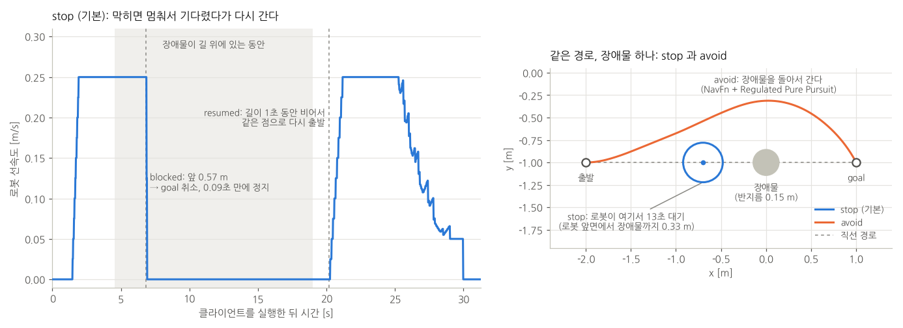

# bt_navigator: BT 로 이동과 작업을 조합하는 미션

[simple_line/MULTI_GOAL.md](../simple_line/MULTI_GOAL.md) 의 방법은 Nav2 명령 하나로 여러 goal 을 돈다. 실제 작업에서는 "어디로 가서 무엇을 하라" 가 실행 중에 정해지고, 점에 서서 일하거나 움직이면서 일한다.

이런 일은 Nav2 위에 **상위 작업 계층**을 두고 맡긴다. 상위 작업 계층이 작업을 받아서, 단계마다 Nav2 명령을 골라 보낸다. 이 폴더는 상위 작업 계층을 BT(BehaviorTree.CPP)로 만든 예제다.

- **작업 하나** = 들를 점들 + 할 일 (`go`, `inspect`, `scan`, `look_around`)
- 로봇은 **점마다 멈춰서** 위치와 방향을 맞추고, 도착을 알린 뒤 다음 점으로 간다.
- 작업은 **액션**(`execute_task`)으로 받는다. 결과, 진행 상황(BT 상태 포함), 취소, 선점이 있다.
- 길에 장애물이 있으면 **멈춰서 기다렸다가** 길이 비면 다시 간다 (stop & go, 기본). 작업마다 **돌아가기**(avoid)로 바꿀 수 있다 (6장).

```
bt_navigator/
├── bt_mission/        미션 BT (task.xml), 직접 만든 BT 노드, 작업 액션 서버, 클라이언트
└── bt_mission_msgs/   작업 메시지와 액션 (Task.msg, ExecuteTask.action)
```

| 하고 싶은 것 | 실행 | 장 |
|---|---|---|
| 점과 작업을 실행 중에 액션으로 맡기기 (결과, 진행 상황, 취소, 선점) | `task_server` (`task.xml`)<br>+ `task_client.py` | 4 |
| 위와 같되, 서버를 Nav2 의 `BtActionServer` 와 lifecycle 노드로 | `task_server_lifecycle.launch.py`<br>+ `task_client.py` | 5 |
| 장애물이 있으면 멈췄다가 가기(기본), 또는 돌아가기 | 작업 한 줄에 `avoid` / `none` 을 붙인다 | 6 |

- **명령 내리는 법**(입력 형식과 예시)은 [4-5](#4-5-명령-내리기-입력-형식과-예시) 에 모아 두었다.
- 아래층(planner, controller, 시뮬레이션 launch)은 [`simple_line/`](../simple_line/README.md) 것을 그대로 쓴다.
- 폴더 이름의 bt_navigator 는 Nav2 의 bt_navigator 노드를 바꾼다는 뜻이 아니다. Nav2 bt_navigator 는 그대로 두고, 이 폴더의 미션 BT 가 그 위에서 명령을 보낸다 (1장).

목차

- [0. 빌드와 시뮬레이션 실행](#0-빌드와-시뮬레이션-실행)
- [1. 구조: 미션 BT 는 Nav2 위에 한 층 더 올라간다](#1-구조-미션-bt-는-nav2-위에-한-층-더-올라간다)
- [2. BT 기초: 이 예제를 읽는 데 필요한 만큼](#2-bt-기초-이-예제를-읽는-데-필요한-만큼)
- [3. 코드로 구현하기 (C++)](#3-코드로-구현하기-c)
- [4. 액션으로 작업 맡기 (task_server, task.xml)](#4-액션으로-작업-맡기-task_server-taskxml)
- [5. Nav2 의 BtActionServer 로 만들기 (task_server_lifecycle)](#5-nav2-의-btactionserver-로-만들기-task_server_lifecycle)
- [6. 장애물: 멈춰서 기다리기(stop & go)와 돌아가기(avoid)](#6-장애물-멈춰서-기다리기stop--go와-돌아가기avoid)
- [7. 확인한 것](#7-확인한-것)
- [8. 어떤 방법을 쓸까](#8-어떤-방법을-쓸까)
- [9. 주의할 점 (Humble)](#9-주의할-점-humble)
- [10. 파일](#10-파일)

---

## 0. 빌드와 시뮬레이션 실행

```bash
cd ~/nav2_ws/src/nav2_dwb && git pull
cd ~/nav2_ws
rosdep install --from-paths src --ignore-src -y      # nav2_simple_commander 등
colcon build --symlink-install --packages-select \
  simple_line_planner simple_line_controller simple_line_bringup \
  bt_mission_msgs bt_mission
source install/setup.bash
```

예전 이름(`simple_line_mission`, `simple_line_mission_msgs`)으로 빌드한 적이 있으면 그 결과물은 지운다. 남겨 두면 옛 패키지도 계속 설치된 것으로 보인다.

```bash
cd ~/nav2_ws && rm -rf build/simple_line_mission* install/simple_line_mission*
```

```bash
# 터미널 1: Gazebo + Nav2 + RViz (로봇은 (-2,-1) 에서 +x 를 보고 시작)
export TURTLEBOT3_MODEL=waffle
export GAZEBO_MODEL_PATH=$GAZEBO_MODEL_PATH:/opt/ros/humble/share/turtlebot3_gazebo/models
ros2 launch simple_line_bringup simple_line.launch.py
```

이후 장의 명령은 모두 **터미널 2** 이후에서 실행한다. 좌표는 모두 빈 방(6m x 6m, 벽은 ±3m) map frame 기준이다.

**가장 빨리 해 보기**: 작업을 기다리는 액션 서버를 띄우고, 작업 하나를 보낸다.

```bash
# 터미널 2
ros2 run bt_mission task_server
# 터미널 3: (0,-1) → (0,1) → (-2,-1) 을 차례로 들르고, 마지막 점에서 0° 를 보고 선다
ros2 run bt_mission task_client.py go 0,-1 0,1 -2,-1,0
```

입력 형식과 예시는 [4-5](#4-5-명령-내리기-입력-형식과-예시) 에 있다. 로봇은 레이저(`/scan`)로 앞길을 보고, 장애물이 있으면 멈춰서 기다린다 (6장).

---

## 1. 구조: 미션 BT 는 Nav2 위에 한 층 더 올라간다


| 계층 | 하는 일 | 이 예제에서 |
|---|---|---|
| **입력** (4장) | 어디로 가서 무엇을 할지 보냄 | `task_client.py` → `execute_task` 액션 |
| **상위 작업 계층** | 무엇을, 어떤 순서로, 실패하면 어떻게 | `task_server` 또는 `task_server_lifecycle` (`task.xml`) |
| **bt_navigator** | goal 까지 **어떻게 갈지** (재계획, recovery) | Nav2 기본 BT 그대로 ([MULTI_GOAL.md 1-1](../simple_line/MULTI_GOAL.md#1-1-재계획-주기0333hz와-지난-goal-반경07m은-어디에-있나)) |
| **서버** | 실제 경로 계산, 경로 추종, 제자리 동작 | planner_server (SimpleLinePlanner, avoid 일 때 NavFn), controller_server (SimpleLineController, avoid 일 때 Regulated Pure Pursuit), behavior_server (Spin) |

BT 가 두 개다.

- 이 예제의 **미션 BT** (`task.xml`): 받은 작업을 어떤 순서로, 어떻게 할지 정한다.
- bt_navigator 안의 **navigation BT** (`navigate_to_pose_w_replanning_and_recovery.xml`): goal 하나까지 가는 방법을 정한다. 1초마다 경로를 다시 계산하고, 실패하면 recovery 를 한다. goal 이 올 때마다 새로 실행된다.

미션 BT 의 `NavigateToPose` 노드가 bt_navigator 에 액션을 보내면, bt_navigator 가 navigation BT 를 돌린다. 작업 로직을 navigation BT 에 섞지 않으니, 이동 실패 처리(재계획, recovery)와 작업 실패 처리(보고, 다음 작업)가 서로 엉키지 않는다.

장애물도 두 층으로 나뉜다 (6장). 멈춰서 기다리는 stop & go 는 미션 BT 의 `StopAndGo` 가 레이저를 직접 보고 Nav2 goal 을 멈췄다 다시 보낸다. 돌아가는 avoid 는 미션 BT 가 navigation BT 만 바꿔 주고, 피하는 일은 Nav2 의 planner 와 controller 가 한다.

---

## 2. BT 기초: 이 예제를 읽는 데 필요한 만큼

### tick 과 상태

BT 는 루트부터 **tick** 을 한다. 실행 노드가 tick 을 주기적으로 반복하고(여기서는 100Hz), 매 tick 마다 루트에서 지금 실행할 노드까지 내려간다. tick 을 받은 노드는 셋 중 하나를 돌려준다.

| 상태 | 뜻 |
|---|---|
| `SUCCESS` | 끝났고 성공 |
| `FAILURE` | 끝났고 실패 |
| `RUNNING` | 아직 하는 중. 다음 tick 에 다시 물어봐 달라 |

예를 들어 `task.xml` 로 `inspect 0,-1 1.5,-1,90` 작업을 할 때, `go_inspect` 가 (0,-1) 까지 주행하는 약 11초 동안에도 BT 는 100Hz 로 tick 한다 (그림은 4-2).

1. 매 tick: `by_action → inspect → inspect_points → go_inspect` 로 내려가고, `go_inspect` 는 `RUNNING` 을 돌려준다.
2. (0,-1) 에 도착하면 `go_inspect` 가 `SUCCESS` 를 돌려준다.
3. 같은 tick 안에서 `inspect_points` 가 도착을 알리고, 다음 점 (1.5,-1) 으로 `go_inspect` 를 다시 시작한다.
4. 마지막 점에 도착하면 `inspect_points` 가 `SUCCESS` 를 돌려주고, `inspect` Sequence 가 다음 자식 `work` 를 시작한다.

### 노드 종류

| 종류 | 노드 | 동작 |
|---|---|---|
| 제어 | **Sequence** (→) | 자식을 왼쪽부터 차례로. 하나라도 FAILURE 면 바로 FAILURE. 모두 SUCCESS 면 SUCCESS |
| 제어 | **Parallel** (⇉) | 자식을 매 tick 모두 실행. `success_threshold` 개가 SUCCESS 면 SUCCESS. 나머지 RUNNING 자식은 **halt** (중단) |
| 제어 | **Switch3** (⇢) | `variable` 값이 `case_1..3` 중 맞는 자식 하나만 실행. 맞는 것이 없으면 마지막 자식 (4-3) |
| 데코레이터 | **ForEachWaypoint** (직접 만듦) | 점 목록의 점마다 자식을 한 번씩 다시 실행 (4-2) |
| 데코레이터 | **StopAndGo** (직접 만듦) | 길에 장애물이 있으면 자식을 멈췄다가, 길이 비면 다시 실행 (6-2) |
| 액션 | **Nav2 BT 노드** | `NavigateToPose`, `Spin`. Nav2 서버에 액션을 보내고, 끝날 때까지 RUNNING |
| 액션 | **직접 만든 노드** | `ObstacleMode`, `DoWork`, `ScanWhileMoving` (3장, 6-1) |

### blackboard 와 포트

노드끼리 값을 주고받는 공용 저장소가 **blackboard** 다. XML 에서 `{이름}` 은 blackboard 변수를 뜻한다.

```xml
<!-- {waypoints} 는 서버가 goal 을 받을 때 받은 작업의 점 목록으로 채운다 -->
<ForEachWaypoint poses="{waypoints}" pose="{waypoint}">         <!-- waypoints 를 읽어 지금 갈 점을 waypoint 에 쓰고 -->
  <NavigateToPose goal="{waypoint}"/>                           <!-- waypoint 를 goal 로 읽는다 -->
</ForEachWaypoint>
<ScanWhileMoving interval="0.5"/>                               <!-- {} 가 없으면 적은 값 그대로 -->
```

`poses`, `pose`, `goal`, `interval` 같은 이름이 **포트**다. 각 노드 클래스가 어떤 포트를 갖는지 `providedPorts()` 로 선언한다. `{}` 없이 쓴 값(`"0.5"`)은 문자열 그대로 들어가고, 포트 타입(여기서는 `double`)으로 바뀐다.

---

## 3. 코드로 구현하기 (C++)

BT 를 코드로 쓰는 일은 세 가지다.

1. 필요한 **노드 종류를 만든다**. 직접 만들 노드만.
2. 실행 노드에서 노드 종류를 **factory 에 등록**하고, **blackboard** 를 채운다.
3. XML 로 **트리를 만들고 tick** 한다.

### 3-1. BT 노드 만들기 (`include/bt_mission/mission_nodes.hpp`, `src/mission_nodes.cpp`)
**결과 node 구조.**
```
ROS 노드 /task_server   (실행 파일 task_server. task_server_lifecycle 도 같다)
 └ 미션 BT
    ├ Sequence, Parallel, Switch3                  흐름만 정함. 밖으로 아무것도 안 보냄
    ├ ForEachWaypoint, StopAndGo                   흐름 (점마다 다시 실행, 막히면 멈춤) + 보고
    ├ ObstacleMode, DoWork, ScanWhileMoving        이 ROS 노드 안에서 직접 처리
    └ NavigateToPose, Spin                         다른 ROS 노드에 액션 goal 을 보내고 결과를 기다림
              │ 액션                         │ 액션 (spin)
              ▼                              ▼
ROS 노드 /bt_navigator                   ROS 노드 /behavior_server
 └ navigation BT (또 하나의 트리)
    ├ PipelineSequence, RecoveryNode, RateController   흐름
    └ ComputePathToPose, FollowPath                    다른 ROS 노드에 액션 goal
              │ 액션                  │ 액션
              ▼                       ▼
ROS 노드 /planner_server           ROS 노드 /controller_server
 └ 플러그인 SimpleLinePlanner         └ 플러그인 SimpleLineController
   (ROS 노드 아님, 서버가 부르는 클래스)  (20Hz 로 불려서 /cmd_vel_nav 토픽 발행)
```

아래 코드는 발췌다 (선언과 정의를 한곳에 모으고 일부 줄을 뺐다).

**한 번에 끝나는 노드** (`BT::SyncActionNode`): `tick()` 이 SUCCESS / FAILURE 를 바로 돌려준다.

```cpp
class ObstacleMode : public BT::SyncActionNode           // 작업의 obstacle 값을 두 blackboard 값으로
{
public:
  ObstacleMode(const std::string & name, const BT::NodeConfiguration & config);

  static BT::PortsList providedPorts()                     // XML 에서 쓸 수 있는 속성
  {
    return {
      BT::InputPort<std::string>("mode"),                  // 읽는 값
      BT::OutputPort<bool>("stop_and_go"),                 // 쓰는 값
      BT::OutputPort<std::string>("nav_bt"),
    };
  }

  BT::NodeStatus tick() override
  {
    std::string mode;
    getInput("mode", mode);                                // XML 의 mode="{obstacle}" 을 읽는다
    if (mode.empty() || mode == "stop") {
      setOutput("stop_and_go", true);                      // blackboard 의 {stop_and_go} 에 쓴다
      setOutput("nav_bt", std::string());
    } else if (mode == "avoid") {
      setOutput("stop_and_go", false);
      setOutput("nav_bt", avoid_bt_path);                  // (경로를 찾는 부분은 뺐다)
    } else if (mode == "none") {
      ...
    } else {
      return BT::NodeStatus::FAILURE;                      // 모르는 값
    }
    return BT::NodeStatus::SUCCESS;
  }
};
```

**여러 tick 에 걸쳐 실행되는 노드** (`BT::StatefulActionNode`):

| 함수 | 언제 불리나 |
|---|---|
| `onStart()` | 처음 tick 될 때 |
| `onRunning()` | RUNNING 인 동안 매 tick |
| `onHalted()` | 실행 중에 부모가 중단시킬 때 |

```cpp
// DoWork: 정지 상태 작업 자리. 지금은 duration 초 동안 RUNNING
BT::NodeStatus DoWork::onStart()
{
  getInput("task", task_);
  getInput("duration", duration_);
  start_ = std::chrono::steady_clock::now();
  return BT::NodeStatus::RUNNING;                           // 다음 tick 부터 onRunning()
}

BT::NodeStatus DoWork::onRunning()
{
  const std::chrono::duration<double> elapsed = std::chrono::steady_clock::now() - start_;
  return elapsed.count() < duration_ ? BT::NodeStatus::RUNNING : BT::NodeStatus::SUCCESS;
}
```

- `tick()` 안에서 `sleep` 하면 안 된다. 그러면 그동안 트리 전체가 멈추고, Parallel 의 다른 자식도 tick 을 못 받는다. 오래 걸리는 일은 RUNNING 을 돌려주고 다음 tick 에 이어서 확인한다.
- 실제 작업(촬영, 집기, IO)은 `DoWork` 자리에서 서비스나 액션을 비동기로 부르고, 응답이 올 때까지 RUNNING 을 돌려주면 된다. Nav2 의 `nav2_behavior_tree::BtActionNode<ActionT>` / `BtServiceNode<ServiceT>` 템플릿을 상속하면 액션·서비스 호출 노드를 짧게 만들 수 있다. Nav2 BT 노드들이 그렇게 만들어져 있다.

**주행 중 작업 노드** (`ScanWhileMoving`):

- `onRunning()` 에서 TF 로 로봇 위치를 읽는다.
- `interval` 만큼 움직였으면 위치를 기록하고 `mission/scan_points` (`geometry_msgs/PoseArray`) 로 발행한다.
- 언제나 RUNNING 을 돌려준다. 끝내는 것은 Parallel 의 몫이다.

노드가 쓰는 ROS 노드와 TF 버퍼는 생성자에서 blackboard 로 받는다.

```cpp
ScanWhileMoving::ScanWhileMoving(const std::string & name, const BT::NodeConfiguration & config)
: BT::StatefulActionNode(name, config),
  node_(config.blackboard->get<rclcpp::Node::SharedPtr>("node")),
  tf_(config.blackboard->get<std::shared_ptr<tf2_ros::Buffer>>("tf_buffer"))
```

**등록**: XML 태그 이름과 클래스를 묶는다.

```cpp
void registerNodes(BT::BehaviorTreeFactory & factory)
{
  factory.registerNodeType<DoWork>("DoWork");
  factory.registerNodeType<ScanWhileMoving>("ScanWhileMoving");
  factory.registerNodeType<ForEachWaypoint>("ForEachWaypoint");  // 4-2
  factory.registerNodeType<ObstacleMode>("ObstacleMode");        // 6-1
  factory.registerNodeType<StopAndGo>("StopAndGo");              // 6-2
}
```

### 3-2. 실행 노드 (`src/task_server_main.cpp`)

발췌다 (예외 처리, 로그는 뺐다). 1, 2 의 본문은 `src/bt_common.cpp` 의 `registerAllNodes()`, `createBlackboard()` 에 있다.

```cpp
// 1. BT 노드 종류 등록
BT::BehaviorTreeFactory factory;
BT::SharedLibrary loader;
for (const char * lib : {"nav2_navigate_to_pose_action_bt_node",          // Nav2 가 제공하는 노드:
    "nav2_navigate_through_poses_action_bt_node",                         //   플러그인 .so 를 이름으로
    "nav2_spin_action_bt_node", "nav2_wait_action_bt_node"})               //   (bt_navigator 와 같은 방식)
{
  factory.registerFromPlugin(loader.getOSName(lib));
}
bt_mission::registerNodes(factory);                                        // 직접 만든 노드

// 2. blackboard: Nav2 BT 노드는 생성될 때 이 키들을 꼭 찾는다
auto blackboard = BT::Blackboard::create();
blackboard->set<rclcpp::Node::SharedPtr>("node", node);
blackboard->set<std::shared_ptr<tf2_ros::Buffer>>("tf_buffer", tf_buffer);
blackboard->set<std::chrono::milliseconds>("server_timeout", 1000ms);
blackboard->set<std::chrono::milliseconds>("bt_loop_duration", 10ms);      // 1000 / tick_hz
blackboard->set<std::chrono::milliseconds>("wait_for_service_timeout", 5000ms);
bt_mission::TaskServer::prepareBlackboard(blackboard);                     // 점 목록 항목 (3-3)

// 3. 트리 생성 (bt_navigator 가 active 가 된 뒤에). 트리는 한 번만 만들고 작업마다 다시 쓴다
waitForActive(node, "bt_navigator", g_stop);
BT::Tree tree = factory.createTreeFromFile(bt_xml, blackboard);

// 4. 액션 서버 + tick 루프
bt_mission::TaskServer server(node, tree, blackboard, log_transitions);
rclcpp::WallRate rate(tick_hz);                                            // 기본 100Hz
while (!g_stop) {                                                          // Ctrl-C 까지
  server.step();                                                           // 요청 처리 + tick 한 번 (4-4)
  rate.sleep();
}
server.stop("task_server shutting down");                                  // 실행 중인 작업을 멈추고 알린다
```

나머지 부분은 이렇다.

- **bt_navigator 대기 (`waitForActive`)**: Nav2 BT 노드는 트리를 만들 때 액션 서버를 찾는다. 또 bt_navigator 가 active 가 되기 전에 보낸 goal 은 거절되어, 작업이 바로 실패한다. 그래서 트리를 만들기 전에 `bt_navigator/get_state` 로 active 인지 확인한다.
- **Ctrl-C**: `rclcpp::init(..., SignalHandlerOptions::None)` 으로 rclcpp 의 기본 처리를 끄고 직접 받는다. rclcpp 가 먼저 종료되면 `haltTree()` 가 Nav2 에 취소 요청을 보낼 수 없기 때문이다.
- **TransitionLogger**: 노드 상태가 바뀔 때마다 `[bt] 이름 종류 이전 -> 다음` 을 출력한다. `BT::StatusChangeLogger` 를 상속한 작은 클래스다 (`src/bt_common.cpp`). 지금 RUNNING 인 노드와 마지막으로 실패한 노드도 기억해서, feedback 과 result 에 쓴다.

| 파라미터 | 기본값 | 설명 |
|---|---|---|
| `bt_xml` | `task.xml` | 실행할 XML. 파일 이름만 주면 `share/bt_mission/behavior_trees/` 에서 찾는다 |
| `tick_hz` | 100.0 | tick 주기 [Hz] |
| `log_transitions` | true | 노드 상태 변화 출력 |

### 3-3. Nav2 BT 노드를 쓸 때 알아둘 것

| XML 태그 | 플러그인 라이브러리 | 보내는 액션 | 주요 포트 |
|---|---|---|---|
| `NavigateThroughPoses` | `nav2_navigate_through_poses_action_bt_node` | `navigate_through_poses` | `goals` |
| `NavigateToPose` | `nav2_navigate_to_pose_action_bt_node` | `navigate_to_pose` | `goal` |
| `Spin` | `nav2_spin_action_bt_node` | `spin` | `spin_dist`, `time_allowance`, `is_recovery` |
| `Wait` | `nav2_wait_action_bt_node` | `wait` | `wait_duration` |

- **tick 은 100Hz 정도로.**
  - tick 을 10Hz 로 돌렸을 때, 로봇이 멈춘 뒤 BT 가 SUCCESS 를 받기까지 매번 0.9~1.1초가 걸렸다. 100Hz 에서는 이 지연이 사라졌다. 예전 예제 미션(좌표를 XML 에 적은 미션, 지금은 지웠다)의 시간이 63.7~65.5초에서 60.1~61.5초가 됐다.
  - 원인은 이렇게 보인다. Nav2 BT 노드는 tick 마다 액션 메시지를 조금씩(대개 하나)만 처리한다. bt_navigator 가 feedback 을 빠르게 보내서, 결과 메시지가 그 뒤에 밀렸다.
  - bt_navigator 자신도 기본 10ms(100Hz) 로 tick 한다.
- **점 목록 포트는 타입을 적지 않았다** (`ForEachWaypoint` 의 `poses`).
  - Nav2 Humble 1.1.18 이하의 `NavigateThroughPoses` BT 노드는 `goals` 포트 타입을 `PoseStamped` 로 잘못 선언하고 있다 (1.1.19 부터 `std::vector<PoseStamped>`).
  - 점 목록을 `std::vector<PoseStamped>` 로 선언하면, 같은 blackboard 변수를 `NavigateThroughPoses` 에도 넘기는 트리를 만들 때 타입이 다르다는 오류가 난다. 멈추지 않고 지나가는 가지를 더하는 경우다.
  - 같은 이유로 서버는 트리를 만들기 전에 `waypoints` 를 타입 없는 항목으로 만들어 둔다 (4-4 의 `prepareBlackboard()`).

---

## 4. 액션으로 작업 맡기 (`task_server`, `task.xml`)

실제 작업에서는 사람이나 관제 서버가 실행 중에 "어디로 가서 무엇을 하라" 를 보낸다. 이 예제는 그것을 **액션**으로 받는다. 액션에는 수락 여부, 진행 상황(feedback), 결과, 취소가 표준으로 있다. bt_navigator 가 `navigate_to_pose` 를 액션으로 받는 것과 같은 구조다.

```
task_client.py ──goal: ExecuteTask (Task)────▶ task_server (액션 서버 + BT 실행기)
   ◀── 수락 / 거절                               goal 마다 blackboard 를 채우고 task.xml 을 처음부터 tick
   ◀── feedback: BT 상태, 실행 중인 노드,         cancel  → haltTree → Nav2 goal 취소 → CANCELED
                 도착한 점 수, 장애물로 멈춤      새 goal → 지금 작업 ABORTED("preempted by …") → 새 작업
   ◀── result: success, message, BT 상태          트리 끝 → SUCCEEDED / ABORTED("<노드> failed at waypoint i/n")
   ── cancel ──▶                                    │ 점마다 NavigateToPose, Spin
                                                    ▼
                                         bt_navigator → planner / controller (그대로)
```

| 누가 | 무엇을 정하나 |
|---|---|
| 보내는 쪽 (`task_client.py`, 관제 서버) | **데이터**: 어디로(waypoints), 무엇을(action), 장애물이 있으면 어떻게(obstacle). 여러 작업의 순서 |
| 미션 BT (`task.xml`) | **정책**: action 별로 어떻게 움직이고 무엇을 할지, 실패하면 어떻게 할지 |
| 서버 (`task_server`) | 작업을 받아 트리를 돌리고, 진행 상황과 결과를 돌려준다. 취소, 선점 |
| 아래층 (bt_navigator, planner, controller) | 그대로. `NavigateToPose`, `Spin` 으로 부른다 |

| 액션이 주는 것 | 이 예제에서 |
|---|---|
| 받았는지 | goal 수락 / 거절 응답 (점이 없는 작업은 거절) |
| 진행 상황 | feedback (`task_id`, `bt_status`, `running`, `waypoints_reached`, `waypoints_total`, `blocked`, `elapsed`) |
| 결과 | goal 상태 SUCCEEDED / ABORTED / CANCELED + result (`success`, `message`, `bt_status`) |
| 취소 | cancel → BT halt → Nav2 goal 취소 |
| 실행 중에 새 작업 | **선점**: 지금 작업을 멈추고 새 작업. 차례대로 하려면 보내는 쪽이 하나 끝나면 다음을 보낸다 (`task_client.py` 가 그렇게 한다) |
| 명령줄 | `ros2 action send_goal --feedback` (4-5-5) |

### 4-1. ExecuteTask 액션과 Task 메시지

작업 하나 (`bt_mission_msgs/msg/Task.msg`):

```
string id                                 # 작업 이름 (로그와 mission/status 에 씀). 비우면 서버가 붙인다
geometry_msgs/PoseStamped[] waypoints     # 들를 점들. 1개 이상. orientation 은 그 점에 도착했을 때 볼 방향
string action                             # go | inspect | scan | look_around. 그 외 값이면 이동만
float64 duration                          # inspect 의 작업 시간 [s]
string obstacle                           # stop | avoid | none. 빈 값이면 stop (6장)
```

ROS 2 에서는 새 메시지 형식을 별도 패키지에 정의하는 것이 관례라서, 메시지만 담은 `bt_mission_msgs` 패키지를 따로 두었다.

액션 (`bt_mission_msgs/action/ExecuteTask.action`):

```
# ---- goal ----
Task task                     # 작업 내용 (Task.msg: id, waypoints, action, duration, obstacle)
---
# ---- result ----
bool success
string message                # "done", 또는 실패/중단 이유
                              # ("go_inspect failed at waypoint 2/3", "preempted by t2", "canceled",
                              #  "blocked by an obstacle at waypoint 1/2")
string bt_status              # 트리(task.xml 의 루트)가 마지막으로 돌려준 상태
                              #   SUCCESS | FAILURE | RUNNING (끝나기 전에 멈춤) | IDLE (tick 안 함)
---
# ---- feedback ----
string task_id
string bt_status              # 트리(루트)의 상태. 실행 중이므로 RUNNING
string running                # 지금 RUNNING 인 액션 노드 (이름 순, 예: "go_scan, scanning")
uint32 waypoints_reached      # 지금까지 도착한 점 수 (0 ~ waypoints_total)
uint32 waypoints_total        # 이 작업의 점 수
bool blocked                  # 장애물 때문에 멈춰서 기다리는 중 (obstacle 이 stop 일 때)
float32 elapsed               # 작업 시작 후 지난 시간 [s]
```

- goal 은 위의 `Task` 메시지를 그대로 담는다.
- goal 하나는 작업 하나다. 여러 작업의 순서와 조합은 보내는 쪽이 정한다. 미션 전체를 goal 하나로 보내면 "2번째 작업만 취소" 같은 일이 어렵다.
- 점에 도착할 때마다 `waypoints_reached` 가 1씩 는다. 클라이언트는 이 값이 바뀌면 "도착" 으로 출력한다.
- `bt_status` 는 BT 의 상태 그대로다 (SUCCESS / RUNNING / FAILURE). goal 상태(SUCCEEDED / ABORTED / CANCELED)는 액션의 상태라서 둘을 같이 보낸다. 대응은 4-2 에 있다.

### 4-2. task.xml


작업 하나를 실행하는 트리다. 작업을 기다리고, 결과를 보고하고, 다음 작업을 받는 일은 서버가 맡는다. 그래서 트리에는 "작업 하나를 어떻게 하나" 만 남는다.

1. **`ObstacleMode`**: 작업의 `obstacle` 값으로 장애물을 어떻게 다룰지 정한다 (6장).
2. **`Switch3`**: `{action}` 값으로 가지 하나를 고른다.

   | action | 가지 |
   |---|---|
   | `inspect` | 점을 차례로 들른 뒤 → `DoWork` (duration 초) |
   | `scan` | `Parallel` (점을 차례로 들르기, `ScanWhileMoving`) |
   | `look_around` | 점을 차례로 들른 뒤 → `Spin` 한 바퀴 |
   | 그 외 (`go` 등) | 점을 차례로 들르기만 |

**점마다 멈추기: `ForEachWaypoint`**

"점을 차례로 들르기" 는 직접 만든 데코레이터 `ForEachWaypoint` 가 한다. 점마다 자식 `NavigateToPose` 를 한 번씩 실행한다. 아래 XML 은 `StopAndGo`(6장)를 뺀 모양이다.

```xml
<ForEachWaypoint name="go_points" poses="{waypoints}" pose="{waypoint}" task_id="{task_id}">
  <NavigateToPose name="go_only" goal="{waypoint}"/>
</ForEachWaypoint>
```

```cpp
BT::NodeStatus ForEachWaypoint::tick()       // src/mission_nodes.cpp, 발췌
{
  if (status() == BT::NodeStatus::IDLE) {    // 처음 tick: 점 목록을 읽고 첫 점을 {waypoint} 에
    getInput("poses", poses_);
    index_ = 0;
    setOutput("pose", poses_[0]);
  }
  while (true) {
    const auto child_status = child_node_->executeTick();   // NavigateToPose
    if (child_status == BT::NodeStatus::RUNNING) return BT::NodeStatus::RUNNING;
    haltChild();                             // 자식을 IDLE 로 (다음 점은 새 goal 로 시작)
    if (child_status == BT::NodeStatus::FAILURE) return BT::NodeStatus::FAILURE;
    ++index_;
    setOutput("reached", static_cast<int>(index_));
    reportArrival();                         // 로그 + mission/status "t1 arrived 2/3"
    if (index_ == poses_.size()) return BT::NodeStatus::SUCCESS;
    setOutput("pose", poses_[index_]);       // 다음 점. 같은 tick 에 바로 출발
  }
}
```

- 점 하나에 `NavigateToPose` 하나다. 그래서 로봇은 점마다 멈춰서 **위치와 방향을 맞추고**(goal checker: 0.05m, 약 3°), 도착을 알린 뒤 다음 점으로 간다.
- 중간 점에서 실패하면 그 자리에서 FAILURE 다. 남은 점으로는 가지 않는다.
- 도착을 알릴 때 TF 로 읽은 실제 로봇 위치와의 거리도 로그에 남긴다 (`[waypoint] t1 arrived 1/3 (0.00, -1.00), robot 0.035 m away`).
- `reached` 출력에는 지금까지 도착한 점 수를 쓴다. 서버는 이 값을 feedback 으로 보낸다.

**`NavigateThroughPoses` 를 쓰지 않는 이유**: `NavigateThroughPoses` 는 점들을 이은 꺾은선 하나로 달린다. 앞의 점은 0.7m 안에 들어오면 지난 것으로 치고, 그 자리에서 다음 점으로 새 경로를 긋는다 ([MULTI_GOAL.md 4장](../simple_line/MULTI_GOAL.md#경유-goal-을-정확히-밟지는-않는다)). 실측으로 경유점을 0.23~0.58m 거리로 지나갔다. 그래서 점마다 도착해야 하는 작업 명령에는 맞지 않다. 멈추지 않고 지나가도 되는 점이라면 `NavigateThroughPoses` 가 맞다.


- **트리 결과와 goal 상태**: 트리가 SUCCESS 면 goal 은 SUCCEEDED, FAILURE 면 ABORTED 다. 트리 상태는 result 의 `bt_status` 로도 간다.

  | 언제 | goal 상태 | `bt_status` |
  |---|---|---|
  | 실행 중 (feedback) | - | RUNNING |
  | 트리가 SUCCESS | SUCCEEDED | SUCCESS |
  | 트리가 FAILURE (이동 실패, 장애물로 포기, 모르는 obstacle 값 등) | ABORTED | FAILURE |
  | 끝나기 전에 취소 | CANCELED | RUNNING |
  | 끝나기 전에 선점, 서버 종료 | ABORTED | RUNNING (`task_server_lifecycle` 의 선점은 빈 값, 5-3) |
- **blackboard**: `{waypoints}` `{task_id}` `{action}` `{duration}` `{obstacle}` 은 서버가 goal 을 받을 때 채운다. `{waypoint}` (지금 가는 점) 와 `{waypoints_reached}` 는 `ForEachWaypoint` 가, `{blocked}` 는 `StopAndGo` 가, `{stop_and_go}` 와 `{nav_bt}` 는 `ObstacleMode` 가 쓴다.
- **장애물**: 맨 앞의 `ObstacleMode` 가 작업의 `obstacle` 값을 보고 `StopAndGo` 를 켜거나, `NavigateToPose` 가 쓸 navigation BT 를 바꾼다 (6장).

### 4-3. 명령마다 BT 가 다르게 움직이는 이유

`go 0,-1 0,1.5` 를 보내면 `NavigateToPose` 가 두 번 실행되고, `inspect:5 1,0,0` 을 보내면 한 번 실행된 뒤 5초 작업을 한다. 트리가 명령에 맞춰 바뀌는 것처럼 보이지만, **트리 모양은 바뀌지 않는다.** 바뀌는 것은 blackboard 에 든 값이다.

```
서버가 시작할 때 task.xml 로 트리를 한 번 만든다. 이후 모든 goal 이 같은 트리를 쓴다.

goal 도착 ─▶ 서버가 blackboard 에 쓴다  (TaskServer::start → writeTask, src/bt_common.cpp)
              {action}="inspect"  {waypoints}=[(1,0)]  {duration}=5  {task_id}="t2"
          ─▶ 루트부터 tick
              Switch3            {action} 을 읽고 "inspect" 가지 하나만 실행
               └ Sequence
                  ├ ForEachWaypoint  {waypoints} 를 읽고 점 수(1)만큼 자식을 다시 실행
                  │   └ NavigateToPose   {waypoint} 를 읽어 goal 로 보낸다
                  └ DoWork           {duration} 을 읽고 5초
          ─▶ 끝나면 haltTree(): 모든 노드를 IDLE 로 (다음 goal 은 새 값으로 처음부터)
```

| 보낸 명령 | blackboard | 실행되는 노드 (차례대로) |
|---|---|---|
| `go 0,-1 0,1.5` | action=`go`, waypoints=2개 | Switch3 → (그 외 가지) ForEachWaypoint → NavigateToPose (0,-1) → 도착 → NavigateToPose (0,1.5) → 도착 |
| `inspect:5 1,0,0` | action=`inspect`, waypoints=1개, duration=5 | Switch3 → inspect 가지 → ForEachWaypoint → NavigateToPose (1,0) → 도착 → DoWork 5초 |
| `look_around -1,1.5` | action=`look_around`, waypoints=1개 | Switch3 → look_around 가지 → ForEachWaypoint → NavigateToPose (-1,1.5) → 도착 → Spin |
| `go avoid 1,-1` | action=`go`, obstacle=`avoid` | ObstacleMode 가 nav_bt=`navigate_avoid.xml`, stop_and_go=false 를 씀 → Switch3 → ForEachWaypoint → StopAndGo(꺼짐) → NavigateToPose 가 goal 에 `navigate_avoid.xml` 을 실어 보냄 → bt_navigator 가 장애물을 피하는 트리로 감 |

이렇게 되는 이유는 세 가지다.

1. **포트를 `{이름}` 으로 적으면 blackboard 값을 가리킨다.** `variable="{action}"` 은 "blackboard 의 action 값" 이라는 뜻이다 (2장). 노드는 실행할 때 `getInput()` 으로 그 순간의 값을 읽는다. 그래서 같은 노드라도 들어 있는 값에 따라 다르게 동작한다.
2. **노드가 그 값으로 무엇을 할지 정한다.**
   - `Switch3` 는 시작할 때 `{action}` 과 `case_1..3` 을 비교해서 가지 하나만 실행한다.
   - `ForEachWaypoint` 는 `{waypoints}` 의 점 수만큼 자식을 다시 실행하고, 매번 `{waypoint}` 에 다음 점을 써서 `NavigateToPose` 의 goal 을 바꾼다.
   - `DoWork` 는 `{duration}` 만큼 기다린다.
3. **작업이 끝날 때마다 트리를 초기화한다.** 서버가 `haltTree()` 로 모든 노드를 IDLE 로 돌린다. 다음 goal 은 새 값으로 루트부터 다시 시작한다.

bt_navigator 도 같은 방식이다. `navigate_to_pose` goal 이 오면 목표 위치를 blackboard 의 `{goal}` 에 쓰고, 같은 navigation BT 를 goal 마다 다시 돌린다 (1장, [MULTI_GOAL.md 1-1](../simple_line/MULTI_GOAL.md#1-1-재계획-주기0333hz와-지난-goal-반경07m은-어디에-있나)).

명령으로 바꿀 수 없는 것도 있다. **어떤 action 이 있는지(가지의 종류)와 각 가지의 노드 배치**는 XML 이 정한다. 새 action 을 더하려면 XML 에 가지를 더한다. 이미 있는 노드만 쓰면 다시 빌드할 필요는 없고 서버만 다시 띄운다. 다른 XML 을 쓰려면 `bt_xml` 파라미터로 준다.

### 4-4. TaskServer (`src/task_server.cpp`)

실행 노드(`src/task_server_main.cpp`)의 준비 과정은 3-2 에 있다.

1. 노드 종류를 등록한다.
2. blackboard 를 만든다.
3. bt_navigator 를 기다렸다가 트리를 만든다.

그다음 `TaskServer::step()` 을 100Hz 로 부른다. step 한 번이 하는 일은 이렇다 (발췌).

```cpp
void TaskServer::step()
{
  if (next_) {                           // 지난 step 에서 수락한 goal 을 시작한다
    if (active_) {                       // 선점: 지금 작업을 멈추고 새 작업으로
      finish(Outcome::Aborted, "preempted by " + next_->get_goal()->task.id);
    }
    start(next_);                        // blackboard 에 waypoints, task_id, action, duration
    next_.reset();
  }
  executor_.spin_some();                 // goal, cancel 요청 처리 (콜백은 next_ 에 goal 을 넣기만 한다)
  if (!active_) return;
  if (active_->is_canceling()) {
    finish(Outcome::Canceled, "canceled");
    return;
  }
  const auto status = tree_.tickRoot();
  bt_status_ = status;                   // feedback, result 의 bt_status
  if (status == BT::NodeStatus::RUNNING) {
    publishFeedback();                   // 실행 중인 노드나 도착한 점 수가 바뀌었을 때, 아니면 0.5초마다
  } else if (status == BT::NodeStatus::SUCCESS) {
    finish(Outcome::Succeeded, "done");
  } else {                               // "go_only failed at waypoint 2/3"
    finish(Outcome::Aborted, failureMessage(logger_.lastFailed(), waypointsReached(blackboard_), total_));
  }
}

void TaskServer::finish(Outcome outcome, const std::string & message)
{
  tree_.haltTree();                      // 실행 중인 노드를 멈추고(Nav2 goal 취소) 다음 작업을 위해 초기화
  ... active_->succeed(result) / active_->canceled(result) / active_->abort(result)
}
```

- **콜백은 누가 처리하나**: 액션 서버의 콜백은 서버만의 callback group 에 넣고, `step()` 에서 `spin_some()` 으로 처리한다 (Nav2 BT 노드가 액션 결과를 받는 것과 같은 방식). 콜백과 tick 이 같은 스레드에서 돌아서 잠금이 필요 없다.
- **수락한 goal 은 다음 step 에 시작한다**: 수락한 step 에서 바로 시작하면, 첫 feedback 이 수락 응답보다 먼저 클라이언트에 도착한다. 그러면 클라이언트는 아직 모르는 goal 의 feedback 이라며 버린다. 테스트에서 이 문제를 찾아서 고쳤다.
- **feedback 의 `running`**: `TransitionLogger` (`bt_common.cpp`) 가 상태 변화를 보면서, 지금 RUNNING 인 액션 노드와 마지막으로 실패한 노드를 기억한다. 실패한 노드 이름은 result 의 `message` 가 된다. 점을 다 들르지 못했으면 몇 번째 점으로 가다가 실패했는지도 붙인다.
- **feedback 의 `waypoints_reached`**: `ForEachWaypoint` 가 blackboard 의 `{waypoints_reached}` 에 쓴 값을 읽어 보낸다.
- **트리를 goal 마다 다시 만들지 않는다**: 트리는 한 번 만들고, 작업이 끝날 때마다 `haltTree()` 로 초기화해서 다시 쓴다 (4-3). Nav2 BT 노드는 만들 때 액션 서버를 찾느라 시간이 걸리기 때문이다.
- **`prepareBlackboard()`**: 트리를 만들기 전에 `waypoints` 를 타입 없는 항목으로 만들어 둔다 (3-3).
- **서버 종료 (Ctrl-C)**: 실행 중인 작업을 멈추고(Nav2 goal 취소), 클라이언트에 ABORTED(`"task_server shutting down"`)를 보낸 뒤 끝난다.

### 4-5. 명령 내리기: 입력 형식과 예시

작업은 세 가지 방법으로 보낼 수 있다.

| 방법 | 언제 | 아래 |
|---|---|---|
| `task_client.py` (대화형) | 터미널에서 여러 작업을 차례로, 선점, 취소 | 4-5-1 ~ 4-5-3 |
| `task_client.py <작업>` (한 번) | 스크립트에서 작업 하나를 보내고 결과를 종료 코드로 | 4-5-4 |
| `ros2 action send_goal` | 클라이언트 없이 메시지를 직접 | 4-5-5 |

#### 4-5-1. 한 줄 형식

```
<action>[:<duration>]  [stop|avoid|none]  <점>  [<점> ...]

점 = x,y          방향은 자동으로 채운다
     x,y,yaw      yaw: 그 점에 도착했을 때 볼 방향 [도]
```

| 부분 | 쓰는 법 | 예 |
|---|---|---|
| `action` | `go`, `inspect`, `scan`, `look_around` 중 하나. 꼭 적는다 | `inspect` |
| `:duration` | `inspect` 의 작업 시간 [초]. 생략하면 3초. 다른 action 에서는 쓰이지 않는다 | `inspect:5` |
| `stop` / `avoid` / `none` | 길에 장애물이 있을 때 (6장). 생략하면 `stop`: 멈췄다가 길이 비면 다시 간다. `avoid`: 돌아서 간다. `none`: 보지 않는다. action 뒤 어디에 적어도 된다 | `go avoid 1,1` |
| 점 | `x,y` 또는 `x,y,yaw`. map 좌표 [m], yaw 는 **도(°)** | `1.5,-1`  `1.5,-1,90` |
| 띄어쓰기 | action 과 점, 점과 점 사이는 공백. **점 안에는 공백 없이** 쉼표만 | `go 0,-1 1,1` |
| 주석 | `#` 뒤는 무시 | `go 1,1  # 창고 앞` |

| action | 로봇이 하는 일 |
|---|---|
| `go` | 점을 차례로 들른다 |
| `inspect` | 점을 차례로 들른 뒤, 마지막 점에서 서서 `duration` 초 작업 |
| `scan` | 점을 차례로 들르는 동안 0.5m 마다 스캔 (마지막 점에 도착하면 멈춤) |
| `look_around` | 점을 차례로 들른 뒤, 마지막 점에서 제자리 한 바퀴 |

어느 action 이든 로봇은 **점마다 멈춰서 위치와 방향을 맞추고**, 도착을 알린 뒤 다음 점으로 간다. 출발할 때는 다음 점 쪽으로 먼저 다 돌고 나서 직선으로 간다.

**좌표와 방향** (빈 방 기준)

```
          y
     3 ───┼──────────────┐ 벽          yaw (도착했을 때 볼 방향)
          │              │                   90
          │      ·(0,0)  │                    ▲
          │              │            180 ◀───┼───▶ 0
          │ ▶ 출발       │                    ▼
    -3 ───┼──────────────┘                  -90
         -3              3  x
   출발 위치: (-2, -1), yaw 0°.  벽은 ±3m, 로봇 반지름을 생각해 ±2.5m 안을 쓴다
```

**yaw 를 생략하면** 이렇게 채운다.

- 중간 점: **다음 점 쪽**. 도착하면 다음 점을 향해 돌아 두고, 다음 출발 때 회전이 없다.
- 마지막 점: **직전 점에서 온 방향**. 따로 돌지 않고 선다.
- 작업의 첫 점은 직전 작업의 마지막 점(첫 작업이면 로봇의 현재 위치)에서 온 것으로 본다.

#### 4-5-2. 예시

| 입력 | 로봇이 하는 일 |
|---|---|
| `go 1,-1` | (1,-1) 로 가서 선다. 방향은 온 방향 |
| `go 1,-1,90` | (1,-1) 로 가서 +y 쪽(90°)을 보고 선다 |
| `go 0,-1 0,1 -2,1` | (0,-1) → (0,1) → (-2,1) 을 차례로. 점마다 서서 다음 점 쪽으로 돈 뒤 출발 |
| `go 0,-1 0,1 -2,-1,0` | 세 점을 돌고 마지막 점에서 +x 쪽(0°)을 보고 선다 |
| `inspect 1.5,-1,90` | (1.5,-1) 에서 90° 를 보고 서서 3초 점검 |
| `inspect:10 0,-1 1.5,-1,90` | (0,-1) 에 들렀다가 (1.5,-1) 에서 90° 를 보고 10초 점검 |
| `scan 1.5,1.5 -1,1.5,180` | 두 점을 들르는 동안 0.5m 마다 스캔 |
| `look_around -1,1.5` | (-1,1.5) 에 가서 제자리 한 바퀴 |
| `go avoid 1,-1,0` | 길에 장애물이 있으면 돌아서 (1,-1) 로 간다 |
| `inspect none 1.5,-1,90` | 장애물을 보지 않고 간다 (레이저가 없는 시뮬레이션) |

#### 4-5-3. 대화형 (`task_client.py`)

```bash
ros2 run bt_mission task_client.py
```

| 입력 | 뜻 |
|---|---|
| `<작업 한 줄>` | 작업을 더한다. 실행 중인 작업이 있으면 끝난 뒤에 보낸다 (차례대로) |
| `!<작업 한 줄>` | 지금 작업을 멈추고(선점) 바로 보낸다. 예) `!go -2,-1,0` |
| `cancel` | 지금 작업을 취소하고, 기다리는 작업도 비운다 |
| `help` | 도움말 |
| `quit`, Ctrl-D | 끝낸다. 남은 작업이 있으면 다 끝날 때까지 기다린다 |
| Ctrl-C | 지금 작업을 취소하고 끝낸다 |

```
task> go 0,-1 0,1.5 -2,1.5 -2,-1,0
  -> t1: go (0,-1) -> (0,1.5) -> (-2,1.5) -> (-2,-1)
  .. t1: RUNNING go_only (0.0 s)
  .. t1: arrived 1/4 (0,-1) (12.8 s)
  .. t1: arrived 2/4 (0,1.5) (27.7 s)
  .. t1: arrived 3/4 (-2,1.5) (40.5 s)
  .. t1: arrived 4/4 (-2,-1)
  <- t1 SUCCEEDED: done [BT SUCCESS]
```

| 출력 | 뜻 |
|---|---|
| `-> t1: ...` | 작업 t1 을 보냄 (id 는 클라이언트가 t1, t2, ... 로 붙인다) |
| `.. t2 queued (1 waiting)` | 앞 작업이 끝나기를 기다리는 중 |
| `.. t1: RUNNING go_only (0.0 s)` | 트리 상태와 지금 실행 중인 BT 노드 (feedback 의 `bt_status`, `running`) |
| `.. t1: arrived 2/4 (0,1.5) (27.7 s)` | 4개 중 2번째 점에 도착 |
| `.. t1: blocked by an obstacle, waiting (5.4 s)` | 길이 막혀서 멈췄다 (feedback 의 `blocked`) |
| `.. t1: path clear, going again (18.8 s)` | 길이 비어서 다시 출발 |
| `<- t1 SUCCEEDED: done [BT SUCCESS]` | 결과: goal 상태, message, 트리 상태 (result 의 `bt_status`) |
| `<- t1 CANCELED: canceled [BT RUNNING]` | 끝나기 전에 취소됨. 트리는 RUNNING 이었다 |

자주 하는 실수 (실제 메시지):

| 입력 | 메시지 | 고칠 점 |
|---|---|---|
| `go 1, -1` | `'1,' is not x,y or x,y,yaw_deg (or an obstacle mode: stop, avoid, none)` | 점 안에는 공백 없이: `go 1,-1` |
| `go 1,-1 2` | `'2' is not x,y or x,y,yaw_deg (or an obstacle mode: ...)` | 점마다 x 와 y 를 다 적는다 |
| `go avod 1,1` | `'avod' is not x,y or x,y,yaw_deg (or an obstacle mode: ...)` | 장애물 모드 철자 확인 |
| `go avoid` | `need at least one point` | 점을 하나 이상 |
| `move 1,1` | `unknown action 'move' (one of go, inspect, scan, look_around)` | action 이름 확인 |
| `go` | `need an action and at least one point` | 점을 하나 이상 |
| `inspect:abc 1,1` | `duration 'abc' is not a number (e.g. inspect:5)` | 작업 시간은 숫자 [초] |
| `go 1,-1,1.57` | (오류 없음) | yaw 는 라디안이 아니라 **도**다. 1.57° 로 해석된다. 90° 면 `go 1,-1,90` |

#### 4-5-4. 작업 하나만 보내기

```bash
# 끝날 때까지 기다렸다가 종료. 종료 코드 0 = SUCCEEDED, 1 = 그 외
ros2 run bt_mission task_client.py inspect 0,-1 1.5,-1,90 && echo ok

# 여러 작업을 파일에서 (한 줄에 하나, 차례대로 실행하고 모두 끝나면 종료)
ros2 run bt_mission task_client.py < tasks.txt
```

#### 4-5-5. `ros2 action send_goal` 로 직접

클라이언트 없이 goal 메시지를 직접 적는다. 필드는 4-1 의 `ExecuteTask` 와 `Task` 다.

```bash
ros2 action send_goal --feedback /execute_task bt_mission_msgs/action/ExecuteTask "
task:
  id: b1                                   # 작업 이름 (아무 문자열)
  action: inspect                          # go | inspect | scan | look_around
  duration: 2.0                            # inspect 의 작업 시간 [s]
  obstacle: stop                           # stop | avoid | none (생략하면 stop)
  waypoints:                               # 들를 점, 차례대로
  - header: {frame_id: map}
    pose:
      position: {x: -2.0, y: 0.0}
      orientation: {z: 1.0, w: 0.0}        # yaw 180°
  - header: {frame_id: map}
    pose:
      position: {x: -2.0, y: -1.0}
      orientation: {z: 0.0, w: 1.0}        # yaw 0°
"
```

같은 내용을 한 줄로 (점 두 개, `go`):

```bash
ros2 action send_goal --feedback /execute_task bt_mission_msgs/action/ExecuteTask \
  "{task: {id: a1, action: go, waypoints: [{header: {frame_id: map}, pose: {position: {x: -1.0, y: -1.0}, orientation: {w: 1.0}}}, {header: {frame_id: map}, pose: {position: {x: -1.0, y: 0.0}, orientation: {z: 0.7071, w: 0.7071}}}]}}"
```

**방향(yaw)은 quaternion 으로 적는다.** 바닥에서 도는 로봇이면 `z = sin(yaw/2)`, `w = cos(yaw/2)` 이고 x, y 는 0 이다.

| yaw | `orientation` |
|---|---|
| 0° (+x) | `{z: 0.0, w: 1.0}` |
| 45° | `{z: 0.3827, w: 0.9239}` |
| 90° (+y) | `{z: 0.7071, w: 0.7071}` |
| 180° (-x) | `{z: 1.0, w: 0.0}` |
| -90° (-y) | `{z: -0.7071, w: 0.7071}` |

- `orientation` 을 안 적으면 `{w: 1.0}`, 즉 0° 다. `ros2 action send_goal` 은 yaw 를 채워 주지 않는다. 그래서 점마다 방향을 적지 않으면 로봇이 점마다 0° 쪽으로 돌았다가 다음 점으로 간다. 방향을 자동으로 채우려면 `task_client.py` 를 쓴다.
- `frame_id` 를 비우면 서버가 `map` 으로 채운다.
- 점이 없는 goal 은 거절된다 (`Goal was rejected.`).

출력 (실제, 줄임):

```
Goal accepted with ID: 2224ae7a6b0a4646abc9419ec63832e2

Feedback:
    task_id: a1
bt_status: RUNNING
running: go_only
waypoints_reached: 0
waypoints_total: 2
blocked: false
elapsed: 0.0006170350243337452
...
Feedback:
    task_id: a1
bt_status: RUNNING
running: go_only
waypoints_reached: 1
waypoints_total: 2
blocked: false
elapsed: 6.731001377105713
...
Result:
    success: true
message: done
bt_status: SUCCESS

Goal finished with status: SUCCEEDED
```

### 4-6. 클라이언트가 하는 일 (`scripts/task_client.py`)

- **한 줄 해석**: `parse_line()` 이 한 줄을 action, 점, 장애물 모드로 나누고, `fill_yaws()` 가 적지 않은 yaw 를 채운다.
- **차례대로 실행**: 서버는 새 goal 이 오면 선점하므로, 기다리는 작업은 클라이언트가 큐에 들고 있다가 앞 작업의 result 를 받으면 다음 goal 을 보낸다.
- **도착 출력**: feedback 의 `waypoints_reached` 가 늘면 그 점을 "arrived" 로 출력한다. 마지막 점에 도착하면서 끝나는 작업(`go`, `scan`)은 그 도착을 담은 feedback 없이 결과가 오므로, SUCCEEDED 를 받으면 남은 도착을 출력한다.
- **BT 상태**: 실행 중인 노드 앞에 feedback 의 `bt_status`(RUNNING)를, 결과 뒤에 result 의 `bt_status` 를 `[BT SUCCESS]` 처럼 붙인다.
- **장애물**: feedback 의 `blocked` 가 바뀌면 `blocked by an obstacle, waiting` / `path clear, going again` 을 출력한다.
- **Ctrl-C**: 지금 작업에 cancel 을 보내고, CANCELED 를 받은 뒤 끝낸다.
  - rclpy 기본 Ctrl-C 처리는 ROS 를 먼저 종료해서 cancel 을 보낼 수 없다.
  - 그래서 Ctrl-C 를 플래그로만 받고, 기다리는 루프에서 확인한다. 콜백 도중에 `KeyboardInterrupt` 가 나서 rclpy 내부가 꼬이는 일도 막는다.
- **TF 는 시작할 때 한 번만 읽는다**: 첫 작업의 yaw 를 채우려고 로봇 위치를 한 번 읽고 TF 구독을 끊는다. 계속 받으면 초당 수십 개의 TF 메시지가 feedback, result 처리와 경쟁한다.

### 4-7. 실행

```bash
# 터미널 1: 0장의 launch

# 터미널 2: 작업을 기다리는 액션 서버
ros2 run bt_mission task_server

# 터미널 3
ros2 run bt_mission task_client.py
```

클라이언트 출력 (가짜 로봇으로 실행한 실제 출력. 작업 4개를 한 번에 넣은 경우):

```
task>   -> t1: inspect (0,-1) -> (1.5,-1)
task>   .. t2 queued (1 waiting)
task>   .. t3 queued (2 waiting)
task>   .. t4 queued (3 waiting)
task> waiting for 4 task(s) to finish (Ctrl-C to cancel)
  .. t1: RUNNING go_inspect (0.0 s)
  .. t1: arrived 1/2 (0,-1) (10.8 s)
  .. t1: arrived 2/2 (1.5,-1) (21.8 s)
  .. t1: RUNNING work (21.8 s)
  <- t1 SUCCEEDED: done [BT SUCCESS]
  -> t2: scan (1.5,1.5) -> (-1,1.5)
  .. t2: RUNNING go_scan, scanning (0.0 s)
  .. t2: arrived 1/2 (1.5,1.5) (14.9 s)
  .. t2: arrived 2/2 (-1,1.5)
  <- t2 SUCCEEDED: done [BT SUCCESS]
  -> t3: look_around (-1,1.5)
  .. t3: RUNNING go_look (0.0 s)
  .. t3: arrived 1/1 (-1,1.5) (0.1 s)
  .. t3: RUNNING spin (0.1 s)
  <- t3 SUCCEEDED: done [BT SUCCESS]
  -> t4: go (-2,-1)
  .. t4: RUNNING go_only (0.0 s)
  .. t4: arrived 1/1 (-2,-1)
  <- t4 SUCCEEDED: done [BT SUCCESS]
```

선점 (`go 1.5,-1` 을 보내고 4초 뒤 `!go -2,-1`):

```
task>   -> t1: go (1.5,-1)
task>   .. t1: RUNNING go_only (0.0 s)
  -> t2: go (-2,-1)
task>   .. t2: RUNNING go_only (0.0 s)
  <- t1 ABORTED: preempted by t2 [BT RUNNING]
  .. t2: arrived 1/1 (-2,-1)
  <- t2 SUCCEEDED: done [BT SUCCESS]
```

취소 (`go 1.5,-1` 을 보내고 4초 뒤 `cancel`):

```
task>   -> t1: go (1.5,-1)
task>   .. t1: RUNNING go_only (0.0 s)
  .. canceling t1
task>   <- t1 CANCELED: canceled [BT RUNNING]
```

선점되거나 취소된 작업은 트리가 끝나기 전에 멈췄으므로 `[BT RUNNING]` 이다.

t3 는 t2 의 마지막 점과 같은 곳이라 바로 도착하고 회전한다.

### 4-8. 남은 것

- **실행은 한 번에 하나다.** 서버는 선점만 하고, 대기열은 보내는 쪽이 관리한다.
- **feedback 의 `running` 은 BT 노드 이름이다.** 사람이 읽을 단계 이름이 필요하면 노드 이름을 그렇게 짓거나, feedback 에 필드를 더한다.
- **Nav2 템플릿으로도 만들 수 있다.** Nav2 에는 이 구조를 위한 템플릿 `nav2_behavior_tree::BtActionServer` 가 있다 (bt_navigator 가 이것으로 만들어져 있다). 같은 일을 이 템플릿으로 한 버전과 비교는 5장에 있다.
- **점마다 서는 만큼 느려진다.** 7장의 작업 4개가 약 61초(경유점을 멈추지 않고 지나감)에서 78초(점마다 섬)가 됐다. 멈출 필요가 없는 점은 `NavigateThroughPoses` 로 지나가게 하는 가지를 `task.xml` 에 따로 두면 된다 (포트 타입은 3-3 을 본다).

---

## 5. Nav2 의 BtActionServer 로 만들기 (`task_server_lifecycle`)

4장의 `task_server` 는 액션 서버와 tick 루프를 직접 만들었다. Nav2 에는 같은 일을 하는 템플릿 `nav2_behavior_tree::BtActionServer` 가 있고, bt_navigator 도 `navigate_to_pose`, `navigate_through_poses` 를 이것으로 받는다. 같은 `task.xml` 과 ExecuteTask 액션으로 이 템플릿을 쓴 버전을 옆에 만들었다. 클라이언트(`task_client.py`, `ros2 action send_goal`)는 그대로 쓴다.

### 5-1. 실행

```bash
# 터미널 1: 0장의 launch
# 터미널 2: Nav2 가 뜬 뒤에. 서버와 이 서버만 맡는 lifecycle_manager 를 같이 띄운다
ros2 launch bt_mission task_server_lifecycle.launch.py
# 터미널 3
ros2 run bt_mission task_client.py
```

- lifecycle 노드라서 **configure → activate** 가 되어야 goal 을 받는다. launch 의 `lifecycle_manager_mission` 이 이 일을 한다.
- lifecycle_manager 없이 직접 할 때:
  ```bash
  ros2 run bt_mission task_server_lifecycle
  ros2 lifecycle set /task_server_lifecycle configure
  ros2 lifecycle set /task_server_lifecycle activate
  ```
- `task_server` 와 액션 이름(`/execute_task`)이 같으므로 둘 중 하나만 띄운다.

| 파라미터 | 기본값 | 설명 |
|---|---|---|
| `bt_xml` | `task.xml` | 실행할 트리 |
| `plugin_lib_names` | Nav2 플러그인 4개 + `bt_mission_plugin` | 트리에서 쓰는 BT 노드가 들어 있는 라이브러리 |
| `log_transitions` | true | 노드 상태 변화를 `[bt]` 로그로 출력 |
| `bt_loop_duration` | 10 | tick 주기 [ms] (BtActionServer 파라미터, bt_navigator 와 같은 이름) |
| `default_server_timeout` | 1000 | Nav2 BT 노드가 goal 응답 등을 기다리는 시간 [ms]. BtActionServer 기본은 20 인데 `task_server` 와 맞췄다 |
| `wait_for_service_timeout` | 5000 | 트리를 만들 때 Nav2 액션 서버를 찾는 시간 [ms]. BtActionServer 기본은 1000 |

### 5-2. 구조

```
task_server_lifecycle  (nav2_util::LifecycleNode, src/task_server_lifecycle.cpp)
 └─ BtActionServer<ExecuteTask>  (nav2_behavior_tree, Nav2 가 제공)
      ├─ SimpleActionServer   goal 수락, cancel, 실행 중에 온 goal 하나를 pending 으로 보관
      ├─ BehaviorTreeEngine   plugin_lib_names 의 .so 로 노드 등록, 작업 스레드에서 10ms 마다 tick
      ├─ blackboard           node, server_timeout, bt_loop_duration, wait_for_service_timeout
      └─ RosTopicLogger       BT 노드 상태 변화 → behavior_tree_log 토픽
    이 노드가 채우는 콜백: onGoalReceived, onLoop, onPreempt, onCompletion
```

| lifecycle 전이 | 하는 일 |
|---|---|
| configure | BtActionServer 생성 (액션 서버는 생기지만 아직 goal 을 거절). blackboard 에 `tf_buffer`, 타입 없는 `waypoints` 항목 (3-3) |
| activate | 트리 생성 (Nav2 BT 노드가 Nav2 액션 서버를 찾는다), goal 받기 시작, lifecycle_manager 와 bond 연결 |
| deactivate | 실행 중인 작업을 halt 하고 (Nav2 goal 취소) ABORTED("task server deactivated"). 이후 goal 은 거절 |
| cleanup | 트리, 액션 서버 정리 |

`task_server` 의 코드가 어디로 갔는지:

| `task_server` (4장) | `task_server_lifecycle` |
|---|---|
| 직접 만든 노드는 코드에서 등록 (`registerAllNodes`) | `plugin_lib_names` 로만 등록한다. 그래서 직접 만든 노드를 플러그인 `bt_mission_plugin` 으로 빌드한다 (`src/bt_plugin.cpp` 의 `BT_REGISTER_NODES`) |
| 수락 단계에서 점이 없는 goal 을 거절 | `onGoalReceived` 가 false 를 돌려주면 ABORTED |
| `start()`: blackboard 에 작업 쓰기 | `onGoalReceived` → `startTask()`. 쓰는 함수(`writeTask`)는 같다 |
| `step()`: tick, `publishFeedback()` | tick 은 BtActionServer, feedback 은 `onLoop` |
| `step()`: 새 goal 이면 지금 작업을 끝내고 새 작업 시작 | `onPreempt`: `haltTree()`, `acceptPendingGoal()`, `startTask()` |
| `step()`: cancel 이면 halt 후 CANCELED | BtActionServer 가 확인하고 halt. result 는 `onCompletion` 이 채운다 |
| `finish()`: halt 후 succeed / abort / canceled | BtActionServer 가 `haltAllActions` 후 `onCompletion` 이 채운 result 로 보낸다 |
| main: Ctrl-C 를 직접 받아 `stop()` | `nav2_util::LifecycleNode` 가 ROS 종료 직전에 deactivate → cleanup |
| main: bt_navigator 가 active 가 될 때까지 기다림 | 기다리지 않는다. activate 때 Nav2 액션 서버를 못 찾으면 activate 가 실패한다 |

### 5-3. 선점과 첫 feedback (`src/task_server_lifecycle.cpp`, 발췌)

BtActionServer 는 실행 중에 새 goal 이 오면 pending 으로 두고, tick 마다 `onPreempt` 를 부른다. 아무것도 하지 않으면 지금 작업이 끝난 뒤 이어서 실행된다 (대기열 1칸). bt_navigator 는 여기서 goal 위치만 바꾸고 트리를 계속 돌린다. 작업은 action 에 따라 가지가 달라지므로, 여기서는 트리를 처음부터 다시 돌린다.

```cpp
void TaskServerLifecycle::onPreempt(ExecuteTask::Goal::ConstSharedPtr goal)
{
  if (bt_server_->getTree().rootNode()->status() != BT::NodeStatus::RUNNING) {
    return;                              // 이번 tick 에 막 끝났으면 결과를 먼저 보낸다
  }
  ...
  bt_server_->haltTree();                // 지금 작업의 노드를 멈춘다 (Nav2 goal 취소)
  startTask(*bt_server_->acceptPendingGoal());   // 이전 goal 은 ABORTED (result 는 빈 값)
}
```

- **선점된 goal 의 result 는 빈 값이다.** `acceptPendingGoal()` 안에서 SimpleActionServer 가 빈 result 로 ABORTED 를 보낸다. `task_server` 처럼 `"preempted by t2"` 나 `bt_status` 를 실어 보낼 방법이 없다.
- **트리가 막 끝난 tick 에는 받지 않는다.** 그 tick 에 받으면, 끝난 작업의 SUCCESS 가 새 goal 의 결과로 보내진다.
- **첫 feedback 은 50ms 늦춘다.** BtActionServer 는 goal 을 수락하자마자 다른 스레드에서 tick 을 시작한다. 그래서 첫 feedback 이 수락 응답보다 먼저 도착하면, 클라이언트는 모르는 goal 의 것으로 버린다. gtest 를 10번 돌렸을 때 이렇게 버려진 feedback 이 8개였고, 50ms 늦춘 뒤에는 0개였다. `task_server` 는 수락한 goal 을 다음 step 에 시작해서 같은 문제를 피한다 (4-4).

### 5-4. 두 버전 비교

같은 날 같은 Nav2 서버에 같은 순서로 보낸 결과와, 같은 경우를 확인하는 gtest (7-1, 7-2) 결과다.
시간과 프로세스 수치는 점마다 멈추도록 바꾸기 전(`NavigateThroughPoses` 로 지나가던 때)에 쟀다. 두 버전의 차이를 보려는 것이라 그대로 두었다.

| | `task_server` (직접 구현) | `task_server_lifecycle` (BtActionServer) |
|---|---|---|
| 작업 4개 (7장) | 모두 SUCCEEDED, 61.1 s | 모두 SUCCEEDED, 60.6 s |
| 정상 / cancel / 이동 실패의 결과 | SUCCEEDED("done") / CANCELED("canceled") / ABORTED("go_look failed at waypoint 1/1") | 같음 |
| 선점된 작업 | ABORTED("preempted by t2"), bt_status RUNNING | ABORTED, message 와 bt_status 모두 빈 값 |
| 점이 없는 작업 | 수락 단계에서 REJECTED | 수락된 뒤 ABORTED, message 빈 값 |
| 작업 중 서버 Ctrl-C | ABORTED("task_server shutting down"). 신호 처리를 직접 짰다 | ABORTED("task server deactivated"). LifecycleNode 의 종료 처리 |
| 시작 | 실행하면 bt_navigator 가 active 가 될 때까지 기다린다 | configure → activate 가 필요하다 (lifecycle_manager, launch 부터 active 까지 3.7초). Nav2 가 없으면 activate 실패 |
| 서버가 죽었을 때 | 다른 노드는 알 수 없다 | lifecycle_manager 가 bond 로 4초 안에 알아챈다 (`SERVER task_server_lifecycle IS DOWN`) |
| tick 하는 곳 | 실행 노드의 메인 루프. 요청 처리와 tick 이 한 스레드 | SimpleActionServer 의 작업 스레드. 콜백도 이 스레드에서 불린다 |
| BT 상태 보기 | `[bt]` 로그 | `[bt]` 로그 + `behavior_tree_log` 토픽 (launch 에서 `mission/behavior_tree_log` 로 옮겼다. 안 옮기면 bt_navigator 의 것과 섞인다) |
| 직접 만든 BT 노드 | 코드에서 등록 | 플러그인 .so 로 빌드 |
| 테스트 | `step()` 을 직접 불러 한 단계씩 | 서버를 다른 스레드에서 spin. 가짜 Nav2 노드도 플러그인(`test_fake_nav2`)으로 |
| 코드 (주석 포함) | 342 줄 (헤더 83, cpp 181, main 78) | 356 줄 (헤더 75, cpp 215, main 24, 플러그인 12, launch 30) |
| 대기 중 프로세스 | 스레드 11, 메모리 49 MB | 스레드 12, 52 MB. lifecycle_manager 가 따로 스레드 12, 31 MB |

이 Humble 버전(1.1.18)의 BtActionServer 에는 Groot 모니터링이 없다. BT 상태는 `behavior_tree_log` 토픽으로만 나온다.

### 5-5. 어느 쪽을 쓸까

- **코드 양은 거의 같다.** BtActionServer 가 액션 서버, 스레드, 취소 처리를 맡아 주는 대신 lifecycle 콜백, 플러그인 라이브러리, launch 가 생긴다.
- **lifecycle 버전이 나은 경우**: Nav2 와 같이 켜고 끄고, 서버가 죽으면 알아야 할 때. Nav2 launch 를 직접 구성한다면 이 노드를 bt_navigator 와 같은 lifecycle_manager 의 `node_names` 뒤쪽에 넣어서, Nav2 가 active 가 된 다음에 activate 되게 할 수 있다.
- **`task_server` 가 나은 경우**: 선점 이유 같은 정보를 result 로 보내야 할 때, 흐름을 한 파일에서 처음부터 끝까지 보고 싶을 때, 테스트를 단순하게 하고 싶을 때.

---

## 6. 장애물: 멈춰서 기다리기(stop & go)와 돌아가기(avoid)

작업마다 길에 장애물이 있을 때 어떻게 할지 고른다. Task 의 `obstacle` 필드다. 기본은 stop & go 다.

| `obstacle` | 길에 장애물이 있으면 | 누가 처리하나 | 필요한 것 |
|---|---|---|---|
| `stop` (기본, 생략 가능) | 멈춰서 기다렸다가, 길이 비면 같은 점으로 다시 간다. 경로는 그대로 직선 | 미션 BT 의 `StopAndGo` | 레이저 `/scan` |
| `avoid` | 장애물을 피하는 경로를 새로 만들어 돌아간다 | Nav2: bt_navigator 가 `navigate_avoid.xml` 로, planner `Avoid`(NavFn), controller `FollowPathAvoid`(Regulated Pure Pursuit) | 레이저가 채운 costmap (Nav2 기본 설정에 있다) |
| `none` | 보지 않는다 | - | 없음. 레이저가 없는 시뮬레이션용이고, 장애물에 부딪힐 수 있다 |

```
task> go 1,-1,0                  # stop (기본)
task> go avoid 1,-1,0            # 돌아서 간다
task> inspect:5 none 1.5,-1,90   # 장애물을 보지 않는다
```

`ros2 action send_goal` 로 보낼 때는 `task:` 아래에 `obstacle: avoid` 를 더한다 (4-5-5).



같은 작업(`go 1,-1,0`)을 (0,-1) 에 반지름 0.15 m 장애물을 두고 실행한 결과다 (가짜 로봇과 가짜 레이저, 7-3).

- **왼쪽, stop**: 장애물이 앞 0.57 m 에 들어오자 0.09초 만에 섰다. 13초를 기다렸고, 장애물을 치우자 1.3초 뒤 같은 직선으로 다시 갔다.
- **오른쪽, avoid**: 처음부터 장애물을 돌아가는 경로로 갔다. 장애물 중심에서 0.69 m 떨어져 지나갔다.

### 6-1. 트리에서 고르는 법 (`ObstacleMode`)

```xml
<Sequence name="task">
  <ObstacleMode name="obstacle_mode" mode="{obstacle}" avoid_bt="navigate_avoid.xml"
                stop_and_go="{stop_and_go}" nav_bt="{nav_bt}"/>
  <Switch3 name="by_action" ...>
    ...
      <ForEachWaypoint name="go_points" poses="{waypoints}" pose="{waypoint}" ...>
        <StopAndGo name="stop_go" enabled="{stop_and_go}" goal="{waypoint}"
                   blocked="{blocked}" task_id="{task_id}">
          <NavigateToPose name="go_only" goal="{waypoint}" behavior_tree="{nav_bt}"/>
        </StopAndGo>
      </ForEachWaypoint>
```

작업이 시작되면 `ObstacleMode` 가 `{obstacle}` 을 두 blackboard 값으로 바꾼다.

| `obstacle` | `{stop_and_go}` | `{nav_bt}` | 결과 |
|---|---|---|---|
| `stop`, 빈 값 | true | 빈 값 | `StopAndGo` 가 레이저를 본다. bt_navigator 는 기본 트리(SimpleLinePlanner + SimpleLineController)로 간다 |
| `avoid` | false | `.../behavior_trees/navigate_avoid.xml` | `StopAndGo` 는 자식만 실행한다. bt_navigator 가 이 트리로 간다 |
| `none` | false | 빈 값 | 아무것도 보지 않는다 |

- 트리 모양은 그대로이고, blackboard 값만 바뀐다 (4-3 과 같은 원리).
- `NavigateToPose` 의 `behavior_tree` 포트는 Nav2 액션 goal 의 `behavior_tree` 필드로 그대로 간다. bt_navigator 는 그 goal 만 그 트리로 실행한다. 빈 값이면 기본 트리(`default_nav_to_pose_bt_xml`)를 쓴다.
- 모르는 값이면 `ObstacleMode` 가 FAILURE 다. 클라이언트는 보내기 전에 걸러 낸다.

### 6-2. stop & go (`StopAndGo`, `src/mission_nodes.cpp`)

**길 검사**: 레이저의 점을 goal 의 frame(map)으로 옮긴 뒤, 로봇에서 goal 쪽으로 난 직선을 기준으로 본다.

```
                 half_width (0.25 m)
       ┌──────────────────────────────┐ ↑
  로봇 ●───────────────────────────────┼──────────▶ ● goal
       └──────────────────────────────┘ ↓
       ←──── stop_distance (0.6 m) ────→      goal 이 더 가까우면 goal 까지만
```

- 띠 안에 레이저 점이 하나라도 있으면 막힌 것이다.
- 이 띠는 SimpleLinePlanner 가 긋는 경로와 같다. 그래서 점에 도착해 다음 점 쪽으로 돌기 전에도, 앞으로 갈 방향을 본다.
- goal 너머의 물체(벽 등)는 보지 않는다.

**동작**: 매 tick 길을 보고 둘 중 한 상태에 있다.

| 상태 | 하는 일 | 바뀌는 때 |
|---|---|---|
| 가는 중 | 자식(`NavigateToPose`)을 tick 한다 | 막히면 자식을 halt 한다 (= Nav2 goal 취소, 로봇 정지). `blocked` = true, `"t1 blocked: obstacle 0.57 m ahead"` |
| 기다리는 중 | 자식을 tick 하지 않고 RUNNING 을 돌려준다 | 길이 `resume_delay` 동안 계속 비면 `"t1 resumed after 13.4 s"`, `blocked` = false, 같은 goal 을 다시 보낸다. `max_wait` 를 넘으면 FAILURE |

```cpp
BT::NodeStatus StopAndGo::tick()             // 발췌
{
  ...
  executor_.spin_some();                     // 도착한 scan 을 받는다
  const auto check = checkPath(goal);
  if (state_ != State::kWaiting) {
    if (!check.blocked) return startChild(); // 길이 비었으면 자식(NavigateToPose) tick
    haltChild();                             // 막혔다: Nav2 goal 취소 → 로봇 정지
    state_ = State::kWaiting;
    setOutput("blocked", true);
    report("blocked: " + check.reason, true);
    return BT::NodeStatus::RUNNING;
  }
  if (check.blocked) { ... max_wait 를 넘으면 FAILURE ... return RUNNING; }
  if (resume_delay 동안 비어 있지 않았으면) return BT::NodeStatus::RUNNING;
  report("resumed after ...", false);
  setOutput("blocked", false);
  return startChild();                       // 같은 goal 을 다시 보낸다. 경로는 지금 위치에서 다시 계산
}
```

**로봇만 세우지 않고 goal 을 취소하는 이유**

- simple_line 의 planner 와 controller 는 장애물을 보지 않는다. Nav2 에 맡겨서는 멈추지 않는다.
- goal 을 그대로 둔 채 로봇만 세우면(예: cmd_vel 을 0 으로 막기), controller_server 의 progress checker 가 10초 안에 0.5 m 를 못 갔다며 `Failed to make progress` 를 낸다. 그러면 bt_navigator 가 recovery 를 시작한다: 90° 제자리 회전, 5초 대기, 30 cm 후진. 장애물 앞에서 원하는 동작이 아니다.
- goal 을 취소하면 Nav2 는 아무것도 하지 않고 기다린다. 얼마나 기다릴지는 미션 BT 가 정한다(`max_wait`). 실측으로 13초를 기다리는 동안 Nav2 실패와 recovery 는 0번이었다.
- 다시 갈 때 경로를 지금 위치에서 새로 계산하므로, 직선을 그대로 따라간다. 실측으로 직선에서 벗어난 거리는 0.0 cm 였다.

**레이저가 없거나 끊기면**: scan 이 `scan_timeout`(1초) 넘게 안 오면 막힌 것으로 본다. 그래서 레이저가 없으면 출발하지 않고 `"t1 blocked: no scan on scan"` 을 알린다. 레이저가 없는 환경에서는 `none` 을 쓴다.

**알림**

| 어디로 | 내용 |
|---|---|
| `mission/status` 토픽 (`std_msgs/String`) | `t1 blocked: obstacle 0.57 m ahead`, `t1 resumed after 13.4 s`, `t1 gave up: blocked for 30.0 s` |
| 액션 feedback | `blocked` (true / false). `task_client.py` 는 `t1: blocked by an obstacle, waiting`, `t1: path clear, going again` 으로 출력한다 |
| 액션 result (`max_wait` 를 넘었을 때) | ABORTED, `blocked by an obstacle at waypoint 1/2` |

**설정**: `task.xml` 의 `StopAndGo` 속성으로 바꾼다. `--symlink-install` 로 빌드했다면 다시 빌드하지 않고 서버만 다시 띄우면 된다.

| 속성 | 기본값 | 뜻 |
|---|---|---|
| `stop_distance` | 0.6 | 길 방향으로 로봇 중심에서 이 거리 안에 장애물이 있으면 멈춘다 [m]. 로봇 반지름(0.22)과 여유를 포함한다. 실측 정지 거리는 1.5 cm |
| `half_width` | 0.25 | 길의 반폭 [m]. 로봇 반지름 + 여유 |
| `resume_delay` | 1.0 | 길이 이만큼 계속 비어 있어야 다시 간다 [s]. 잠깐 비었다가 다시 막히는 경우를 걸러 낸다 |
| `max_wait` | 0 | 이보다 오래 막혀 있으면 작업 실패 [s]. 0 이면 계속 기다린다 (취소는 클라이언트가) |
| `scan_topic` | `scan` | `sensor_msgs/LaserScan` |
| `scan_timeout` | 1.0 | scan 이 이만큼 안 오면 막힌 것으로 본다 [s] |
| `robot_frame` | `base_link` | 로봇 위치를 읽을 TF frame |

### 6-3. 돌아가게 하려면 (`avoid`)

장애물을 피해 가려면 Nav2 쪽에 다섯 가지가 있어야 한다. 1 은 Nav2 기본 설정에 이미 있고, 2~5 를 이 저장소에 더했다.

1. **장애물을 costmap 에 올린다.** global costmap 의 `obstacle_layer` 와 local costmap 의 `voxel_layer` 가 `/scan` 을 받아 장애물 칸을 표시하고, 비면 지운다. Nav2 Humble 기본 `nav2_params.yaml` 그대로다 (`simple_line_params.yaml` 은 이 부분을 바꾸지 않았다).
2. **costmap 을 보는 planner.** SimpleLinePlanner 는 costmap 을 보지 않고 직선만 긋는다. 그래서 planner_server 에 NavFn 을 `Avoid` 라는 이름으로 하나 더 등록했다.
3. **costmap 을 보는 controller.** Regulated Pure Pursuit(RPP)를 `FollowPathAvoid` 로 등록했다. 앞길이 local costmap 에서 막혀 있으면 멈추고 새 경로를 기다린다 (`use_collision_detection`).
4. **둘을 부르는 navigation BT.** `behavior_trees/navigate_avoid.xml` 은 Nav2 기본 트리에서 `planner_id="Avoid"`, `controller_id="FollowPathAvoid"` 만 바꾼 것이다. 1초마다 경로를 다시 계산하므로, 움직이는 장애물이 costmap 에 들어오면 경로가 그때그때 바뀐다.
5. **작업마다 고르기.** `ObstacleMode` 가 `{nav_bt}` 에 이 파일 경로를 쓰고, `NavigateToPose` 가 goal 에 실어 보낸다 (6-1).

```yaml
# simple_line_params.yaml (발췌)
planner_server:
  ros__parameters:
    planner_plugins: ["GridBased", "Avoid"]       # GridBased 는 그대로 SimpleLinePlanner
    Avoid:
      plugin: "nav2_navfn_planner/NavfnPlanner"
      tolerance: 0.5
controller_server:
  ros__parameters:
    controller_plugins: ["FollowPath", "FollowPathAvoid"]   # FollowPath 는 그대로 SimpleLineController
    FollowPathAvoid:
      plugin: "nav2_regulated_pure_pursuit_controller::RegulatedPurePursuitController"
      desired_linear_vel: 0.25
      use_collision_detection: true
      rotate_to_heading_angular_vel: 0.5
      ...
```

- **`rotate_to_heading_angular_vel` 를 0.5 로 낮췄다.** RPP 는 목표 방향에 들어올 때까지 이 속도로 돌다가 바로 명령을 끊는다. 그 뒤 velocity_smoother 가 3.2 rad/s² 로 줄이는 동안 더 돈다. 1.0 rad/s 일 때는 goal 에서 7.8° 를 지나쳤고, 0.5 에서는 0.6° 안에 섰다.
- **`stop` 과 `avoid` 의 차이**: stop 은 직선을 지키고 시간을 쓴다. avoid 는 길을 바꾸고 시간을 아낀다. 같은 장애물에서 stop 은 30.2 s(13초 대기 포함), avoid 는 20.5 s 였다 (7-3).
- **avoid 에서도 완전히 막히면**: planner 가 경로를 못 찾거나 controller 가 계속 막히면 Nav2 의 recovery(회전, 대기, 후진)를 거친 뒤 실패한다. 작업은 ABORTED(`go_only failed at waypoint i/n`)가 된다.

**다른 선택지** (이 검증 환경에서는 돌려 보지 못했다)

- **controller 를 DWB 로.** Nav2 Humble 의 기본 `FollowPath` 가 `dwb_core::DWBLocalPlanner` 다. 속도 후보 궤적을 여러 개 굴려 보고 장애물에 가까운 궤적을 피한다 (`BaseObstacle` critic). 그래서 global 경로가 바뀌기 전에도 국소적으로 비켜 간다. `FollowPathAvoid` 의 `plugin` 을 바꾸고, 값은 Nav2 기본 `nav2_params.yaml` 의 `FollowPath` 항목을 옮기면 된다. apt 로 설치한 Humble 에는 들어 있다.
- **planner 를 Smac 으로.** `nav2_smac_planner/SmacPlanner2D` 로 바꿔도 된다.
- **Collision Monitor** (`nav2_collision_monitor`, Humble 부터). controller 와 로봇 사이에서 `cmd_vel` 을 막거나 줄이는 안전 층이다. 어느 모드든 마지막 안전장치로 둘 수 있다. 다만 로봇만 세우고 goal 은 그대로라서, 오래 막히면 위의 progress checker 문제가 생긴다.
- **기본을 avoid 로 바꾸려면**: 클라이언트가 항상 `avoid` 를 넣거나, `ObstacleMode` 에서 빈 값을 avoid 로 보게 고친다.

---

## 7. 확인한 것

모두 같은 환경에서 확인했다.

- **서버**: 실제 Nav2 Humble 서버(map_server, planner_server, controller_server, behavior_server, bt_navigator, velocity_smoother, waypoint_follower). Nav2 기본 BT, 빈 방 맵.
- **로봇**: Gazebo 대신 `cmd_vel` 을 적분하는 가짜 로봇. AMCL 은 쓰지 않았다. 7-3 에서는 가짜 레이저도 붙였다.
- **출발점**: 모두 (-2.0, -1.0, 0°).
- **작업 4개**: 여러 곳에서 같은 작업 4개를 한 번에 넣었다. 정지 작업, 주행 중 작업, 회전, 복귀가 다 들어 있다.

  ```
  inspect 0,-1 1.5,-1,90
  scan 1.5,1.5 -1,1.5,180
  look_around -1,1.5,180
  go -2,-1,0
  ```

Gazebo 자체(월드, 스폰, AMCL)에서는 돌려 보지 못했다.

### 7-1. 액션으로 맡긴 작업 (`task_server`, `task_client.py`)

**단위 테스트** (`test/test_task_server.cpp`, gtest 9개 통과. 장애물 테스트 2개는 7-3. 그 전의 7개는 30번 반복해서 210/210): 실제 `task.xml` 과 `TaskServer` 에 액션 클라이언트로 goal 을 보낸다. Nav2 노드만 가짜다.

| 테스트 | 확인 내용 |
|---|---|
| `RunsATaskAndReportsFeedback` | 점 2개 inspect → SUCCEEDED("done", bt_status SUCCESS). feedback 이 (`go_inspect`, 도착 0) → (`go_inspect`, 1) → (`work`, 2) 로 바뀌고 bt_status 는 늘 RUNNING. 점 사이에도 `running` 이 비지 않음. 점이 차례로 `NavigateToPose` 의 goal 로 감 |
| `RunsTasksOneAfterAnother` | 같은 서버로 작업 두 개 (scan, look_around) 를 차례로 → 둘 다 SUCCEEDED (트리가 작업마다 초기화됨) |
| `NewGoalPreemptsTheRunningOne` | 작업 a 실행 중에 b 를 보냄 → a 는 ABORTED("preempted by b", bt_status RUNNING), a 의 이동 노드 halt, b 는 SUCCEEDED |
| `CancelHaltsTheTask` | scan 실행 중 cancel → CANCELED(bt_status RUNNING), 이동과 스캔 노드 모두 halt |
| `FailedNavigationAbortsWithTheNodeName` | 이동 실패 → ABORTED("go_look failed at waypoint 1/1", bt_status FAILURE), 회전은 하지 않음 |
| `FailureStopsAtThatWaypoint` | 점 3개 중 둘째 점에서 실패 → ABORTED("go_only failed at waypoint 2/3"), 셋째 점으로는 가지 않음 |
| `RejectsATaskWithoutWaypoints` | 점이 없는 goal → 거절 |

이 테스트는 30번 중 한 번꼴로 멈춰 있었다. 클라이언트가 서버를 찾은 직후에 보낸 goal 의 응답이 사라지는 경우인데 (서버가 아직 클라이언트의 응답 구독을 찾지 못한 때), 테스트가 응답을 시간 제한 없이 기다리고 있었다. 지금은 클라이언트를 만든 뒤 잠깐 기다리고, 응답이 없으면 멈추지 않고 실패로 끝낸다.

**Nav2 서버로 실행**: `task_server` 를 띄우고 `task_client.py` 와 `ros2 action` 명령으로 보냈다.

| 항목 | 결과 |
|---|---|
| 작업 4개를 한 번에 입력 (클라이언트가 차례로 보냄) | 모두 SUCCEEDED, 78.5 s (점마다 멈추기 전 약 61초) |
| 점마다 도착 | 6개 점 모두 도착 보고, 도착할 때 로봇과 점의 거리 3.5~4.9 cm |
| t2 feedback | `go_scan, scanning` (이동과 스캔이 동시에 RUNNING), 스캔 10개 |
| 선점 (`!go`) | t1 ABORTED("preempted by t2"), 이어서 t2 SUCCEEDED |
| `cancel` 명령 | t1 CANCELED, bt_navigator 의 goal 취소, 로봇 정지 |
| 클라이언트 Ctrl-C | t1 CANCELED, 로봇 정지 |
| `ros2 action send_goal --feedback` (4-5-5 의 두 명령) | 도착할 때마다 `waypoints_reached` 증가, SUCCEEDED. 점이 없는 goal 은 `Goal was rejected.` |
| 작업 중 `task_server` Ctrl-C | 클라이언트에 ABORTED("task_server shutting down"), Nav2 goal 취소, 로봇 정지 |

점 4개짜리 작업(`go 0,-1 0,1.5 -2,1.5 -2,-1,0`, 사각형)의 구간별 결과. 출발할 때 남은 방향 오차는 다음 점을 향해 다 돈 뒤 출발했는지를 보여 준다.

| 구간 | 출발할 때 남은 방향 오차 | 직선에서 벗어난 최대 거리 | 정지 위치와 점의 거리 |
|---|---|---|---|
| (-2,-1) → (0,-1) | 0.0° | 0.0 cm | 3.5 cm |
| (0,-1) → (0,1.5) | 1.7° | 1.0 cm | 3.4 cm |
| (0,1.5) → (-2,1.5) | 0.6° | 0.2 cm | 3.1 cm |
| (-2,1.5) → (-2,-1) | 0.3° | 0.2 cm | 3.0 cm |

(0,-1) 처럼 yaw 를 생략한 점에서는 도착할 때 다음 점 쪽으로 돌아 둔다. 그래서 다음 구간은 출발할 때 더 돌지 않는다.

### 7-2. BtActionServer 버전 (`task_server_lifecycle`)

**단위 테스트** (`test/test_task_server_lifecycle.cpp`, gtest 8개 통과. 10번 반복해서 80/80): 7-1 와 같은 경우를 lifecycle 노드로 확인한다. 서버 노드는 다른 스레드에서 spin 하고, Nav2 노드는 가짜 플러그인(`test_fake_nav2`)으로 바꿨다. 직접 만든 노드는 `bt_mission_plugin` 을 그대로 쓴다.

| 테스트 | 확인 내용 |
|---|---|
| `RunsATaskAndReportsFeedback` | 점 2개 inspect → SUCCEEDED("done"). feedback 이 (`go_inspect`, 0) → (`go_inspect`, 1) → (`work`, 2) |
| `RunsTasksOneAfterAnother` | 작업 두 개 (scan, look_around) 를 차례로 → 둘 다 SUCCEEDED |
| `NewGoalPreemptsTheRunningOne` | a 는 ABORTED (message 빈 값), a 의 이동 노드 halt, b 는 SUCCEEDED |
| `CancelHaltsTheTask` | feedback `go_scan, scanning` → cancel → CANCELED("canceled"), 이동 노드 halt |
| `FailedNavigationAbortsWithTheNodeName` | ABORTED("go_look failed at waypoint 1/1"), 회전은 하지 않음 |
| `FailureStopsAtThatWaypoint` | ABORTED("go_only failed at waypoint 2/3"), 셋째 점으로는 가지 않음 |
| `TaskWithoutWaypointsIsAcceptedThenAborted` | 점이 없는 goal → 수락된 뒤 ABORTED (`task_server` 는 거절) |
| `DeactivateStopsTheRunningTask` | 작업 중 deactivate → ABORTED("task server deactivated"), 이동 노드 halt. inactive 에서는 goal 거절 |

**Nav2 서버로 실행**: launch 로 lifecycle_manager 와 같이 띄우고 7-1 와 같은 순서로 보냈다. 아래 표는 점마다 멈추도록 바꾸기 전에 쟀고, 바꾼 뒤에는 점 2개 inspect (`inspect:1 0,-1 0,1,90`) 를 보내 arrived 1/2 → 2/2 → work → SUCCEEDED 를 확인했다.

| 항목 | 결과 |
|---|---|
| 작업 4개 | 모두 SUCCEEDED, 60.6 s (같은 날 `task_server` 61.1 s) |
| t2 feedback | `go_scan, scanning` |
| 선점 (`!go`) | t1 ABORTED (message 빈 값), 이어서 t2 SUCCEEDED |
| `cancel` 명령 | t1 CANCELED("canceled"), bt_navigator 의 goal 취소, 로봇 정지 |
| 클라이언트 Ctrl-C | t1 CANCELED, 로봇 정지 |
| `ros2 action send_goal --feedback` | feedback `go_inspect` → `work`, SUCCEEDED |
| 작업 중 서버 Ctrl-C | 클라이언트에 ABORTED("task server deactivated"), Nav2 goal 취소, 로봇 정지. 4초 뒤 lifecycle_manager 가 서버가 죽은 것을 알림 |

### 7-3. 장애물 (`StopAndGo`, avoid)

**단위 테스트** (`test/test_stop_and_go.cpp` 9개, `test/test_task_server.cpp` 에 2개, 모두 통과. 전체 테스트를 3번 돌려 3번 모두 통과): 레이저 scan 은 테스트가 만들어 보내고, 로봇 위치는 TF 버퍼에 직접 넣는다. `NavigateToPose` 만 가짜다.

| 테스트 | 확인 내용 |
|---|---|
| `ClearPathJustRunsTheChild` | 길이 비어 있으면 자식을 그대로 실행. 막힘 보고 없음 |
| `StopsForAnObstacleAndGoesAgainWhenClear` | 앞 0.4 m 에 물체 → 자식 halt, `blocked` = true, `"t1 blocked: obstacle 0.40 m ahead"`. 비어도 `resume_delay` 전에는 기다리고, 지나면 같은 goal 을 다시 보내고 `"t1 resumed after ..."` |
| `IgnoresWhatIsNotOnThePath` | `stop_distance` 밖의 물체, 길 옆(`half_width` 밖)의 물체는 무시 |
| `IgnoresWhatIsBeyondTheGoal` | goal 너머의 물체는 무시 |
| `NoScanCountsAsBlocked` | scan 이 없으면 출발하지 않고 `"t1 blocked: no scan on scan"`. scan 이 오면 출발 |
| `GivesUpAfterMaxWait` | `max_wait` 를 넘으면 FAILURE, `"t1 gave up: blocked for 0.3 s"`, `blocked` 는 true 로 남는다 |
| `AvoidAndNoneDoNotWatchTheScan` | avoid / none 은 scan 없이도 간다. avoid 면 `NavigateToPose` 의 `behavior_tree` 가 avoid 트리 경로, none 이면 빈 값 |
| `UnknownModeFails` | 모르는 `obstacle` 값이면 FAILURE, 출발하지 않음 |
| `FailureMessage.*` | 막혀서 포기한 작업의 result message 가 `blocked by an obstacle at waypoint 2/3` |
| `TaskServerTest.StopAndGoWaitsForTheObstacleAndReportsIt` | 실제 `task.xml` 과 `TaskServer`: 막히면 feedback `blocked` = true, 이동 노드 halt, 기다리는 동안 `running` 이 빈 값. 비면 같은 점으로 다시 가서 SUCCEEDED |
| `TaskServerTest.WithoutAScanTheRobotDoesNotStart` | 레이저가 없으면 feedback `blocked` = true 로 출발하지 않음. 취소하면 CANCELED |

기존 테스트(7-1, 7-2)는 레이저가 없으므로 작업을 `obstacle: none` 으로 보낸다.

**Nav2 서버로 실행**: 가짜 로봇에 5Hz 360° 레이저를 붙였다. 방의 벽(±3 m)과, 토픽으로 놓고 치우는 원기둥 장애물을 본다. 장애물은 반지름 0.15 m 로 (0,-1) 에 두고, 작업은 (-2,-1) 에서 `go 1,-1,0` 이다 (그 직선 위에 장애물이 있다).

- **stop**: 로봇이 x = -1.3 을 지나면 장애물을 놓고, 로봇이 선 뒤 12초가 지나면 치웠다.
- **avoid (처음부터)**: 장애물을 놓고 출발했다.
- **avoid (가는 중에)**: stop 과 같은 때 장애물을 놓았다.

| 항목 | stop<br>(`task_server`) | stop<br>(`task_server_lifecycle`) | avoid<br>(처음부터) | avoid<br>(가는 중에) |
|---|---|---|---|---|
| 결과 | SUCCEEDED | SUCCEEDED | SUCCEEDED | SUCCEEDED |
| 막힘을 알린 거리 (길 방향) | 0.57 m | 0.56 m | - | - |
| 알린 뒤 설 때까지 | 0.09 s | 0.07 s | - | - |
| 선 곳: 로봇 중심 → 장애물 표면 | 0.55 m | 0.55 m | - | - |
| 기다린 시간 | 13.4 s | 13.2 s | - | - |
| 치운 뒤 다시 움직일 때까지 | 1.28 s | 1.14 s | - | - |
| 직선에서 벗어난 최대 거리 | 0.0 cm | 0.0 cm | 68.7 cm | 71.1 cm |
| 장애물 중심과 가장 가까웠던 거리 | - | - | 0.69 m | 0.71 m |
| 도착: 위치 / 방향 오차 | 4.6 cm / 0.0° | 4.7 cm / 0.0° | 4.9 cm / 0.6° | 4.8 cm / 0.4° |
| 전체 시간 | 30.2 s | 29.8 s | 20.5 s | 21.7 s |
| Nav2 실패, recovery | 0 | 0 | 0 | 0 |

- stop 은 progress checker 의 10초보다 오래 기다렸는데도 Nav2 쪽 실패가 없었다. goal 을 취소하고 기다리기 때문이다 (6-2).
- avoid 의 방향 오차는 RPP 의 `rotate_to_heading_angular_vel` 을 0.5 로 낮춘 뒤 값이다. 1.0 일 때는 7.8° 와 10.4° 였다 (6-3).
- Gazebo 의 실제 TurtleBot3 레이저로는 돌려 보지 못했다. 가짜 레이저는 잡음이 없고, 원기둥 하나만 있다.

---

## 8. 어떤 방법을 쓸까

| 상황 | 방법 |
|---|---|
| 경유점을 멈추지 않고 지나 최종 goal 에서만 서면 된다 | `NavigateThroughPoses` ([MULTI_GOAL.md](../simple_line/MULTI_GOAL.md) 의 `send_waypoints.py`) |
| 지점마다 멈춰서 같은 작업을 하고, 순서가 고정이다 | `waypoint_follower` ([MULTI_GOAL.md 5장](../simple_line/MULTI_GOAL.md#5-멈춰-가며-경유하기-waypoint_follower)). 작업은 task executor 플러그인으로 |
| 어디로 가서 무엇을 할지는 실행 중에 사람이나 서버가 정한다 | **`task_server` + ExecuteTask 액션 (4장)**. 점마다 멈춰서 도착을 알리고, 결과, 취소, 선점이 표준으로 있다 |
| 위와 같고, 서버를 Nav2 처럼 lifecycle_manager 로 관리한다 | `task_server_lifecycle` (5장). 비교와 고르는 기준은 5-4, 5-5 |
| 길에 장애물이 있으면 멈췄다가, 비면 같은 길로 간다 | 작업의 `obstacle` 을 `stop` (기본). `StopAndGo` (6-2) |
| 장애물을 돌아서 간다 | `obstacle: avoid`. NavFn + Regulated Pure Pursuit (6-3). controller 를 DWB 로 바꿀 수도 있다 |

---

## 9. 주의할 점 (Humble)

- **도착 직후 회전 감속이 조금 남는다.** goal checker 가 도착을 판정한 직후에도 velocity_smoother 가 감속하는 0.2초 정도 각속도가 남았다 (최대 0.68 rad/s). 작업이 완전한 정지를 요구하면, 작업 노드 앞에 "속도가 0 인지" 확인하는 조건 노드를 두면 된다.
- **점 목록 포트 타입, tick 주기**: 3-3 을 본다.
- **점에 얼마나 정확히 서나**: goal checker 의 `xy_goal_tolerance` / `yaw_goal_tolerance` 가 정한다. `simple_line_params.yaml` 에서 0.05m / 0.05rad 로 줄였다 (Humble 기본 0.25 / 0.25). 실측으로 점에서 3~5cm 안에 섰다.
- **`ros2 action send_goal` 로 보낼 때 방향**: `orientation` 을 안 적으면 0° 다. 점마다 0° 로 돌았다가 다음 점으로 가므로, 방향을 적거나 `task_client.py` 를 쓴다 (4-5-5).
- **`task_server` 와 `task_server_lifecycle` 은 같이 띄우지 않는다.** 둘 다 `/execute_task` 액션을 연다.
- **stop 모드에서는 벽도 장애물이다.** goal 까지의 직선이 벽에 막히면 벽 앞에서 계속 기다린다 (`max_wait` 기본 0). 맵 밖이나 벽 너머의 점을 보내지 않거나, `max_wait` 를 정해 둔다.
- **stop 모드는 레이저가 있어야 움직인다.** `/scan` 이 1초 넘게 안 오면 막힌 것으로 보고 서 있는다. 레이저가 없는 시뮬레이션이나 테스트에서는 `none` 을 쓴다 (6-2).
- **레이저 높이의 물체만 본다.** 2D 레이저 평면보다 낮거나 높은 물체(낮은 상자, 테이블 상판)는 stop 도 avoid 도 보지 못한다. 필요하면 depth 카메라 같은 센서를 더한다.
- **stop 모드의 길 검사는 직선이다.** SimpleLinePlanner 가 긋는 경로와 같아서 지금은 맞다. 휘는 경로를 만드는 planner 를 기본으로 쓰게 되면, `{path}` 를 따라 검사하도록 바꿔야 한다.
- **avoid 는 길이 바뀐다.** 직선에서 최대 0.7 m 벗어났다 (7-3). 정해진 길로만 다녀야 하는 곳에서는 stop 을 쓴다.

---

## 10. 파일

```
bt_navigator/
├── bt_mission_msgs/                         4장
│   ├── msg/Task.msg                         작업 하나 (id, waypoints, action, duration, obstacle)
│   └── action/ExecuteTask.action            goal: Task, result: success/message/bt_status,
│                                            feedback: bt_status/running/도착한 점 수/blocked/elapsed
└── bt_mission/
    ├── behavior_trees/
    │   ├── task.xml                         작업 하나를 실행, 점마다 NavigateToPose (4장)
    │   └── navigate_avoid.xml               avoid 모드의 navigation BT (bt_navigator 가 실행, 6-3)
    ├── include/bt_mission/
    │   ├── mission_nodes.hpp                직접 만든 BT 노드 선언 (포트 포함)
    │   ├── bt_common.hpp                    노드 등록, blackboard, bt_navigator 대기, 상태 로거
    │   ├── task_server.hpp                  ExecuteTask 액션 서버 + BT 실행 (4장)
    │   └── task_server_lifecycle.hpp        같은 일을 BtActionServer + lifecycle 노드로 (5장)
    ├── src/
    │   ├── mission_nodes.cpp                DoWork, ScanWhileMoving, ForEachWaypoint, ObstacleMode, StopAndGo
    │   ├── bt_common.cpp                    서버들이 같이 쓰는 준비 코드 (노드 등록, 작업 → blackboard)
    │   ├── task_server.cpp                  goal 수락, 선점, 취소, feedback, result
    │   ├── task_server_main.cpp             task_server 실행 노드 (3-2)
    │   ├── task_server_lifecycle.cpp        BtActionServer 콜백 (5장)
    │   ├── task_server_lifecycle_main.cpp   task_server_lifecycle 실행 노드
    │   └── bt_plugin.cpp                    직접 만든 BT 노드를 플러그인 bt_mission_plugin 으로 (5장)
    ├── launch/task_server_lifecycle.launch.py   task_server_lifecycle + lifecycle_manager
    ├── scripts/task_client.py               액션 클라이언트: 한 줄 형식 해석, 대기열, 선점(!), cancel, 도착 출력
    ├── test/
    │   ├── test_task_server.cpp             gtest: ExecuteTask 액션 → task.xml (선점, 취소, feedback, BT 상태)
    │   ├── test_task_server_lifecycle.cpp   gtest: 같은 경우를 task_server_lifecycle 로
    │   ├── test_stop_and_go.cpp             gtest: StopAndGo, ObstacleMode (가짜 scan, 6장)
    │   └── test_fakes.hpp / .cpp            테스트가 같이 쓰는 가짜 Nav2 노드 (플러그인 test_fake_nav2)
    ├── tools/draw_bt.py                     XML → 그림 (graphviz)
    └── doc/
        ├── task.png                         BT 그림 (draw_bt.py 로 생성)
        ├── obstacle.png                     stop 과 avoid 의 실행 기록 (6장)
        └── layers.dot / layers.png          계층 구조 그림
```

avoid 모드의 planner `Avoid` 와 controller `FollowPathAvoid` 는 `simple_line/simple_line_bringup/params/simple_line_params.yaml` 에 등록되어 있다 (6-3).
