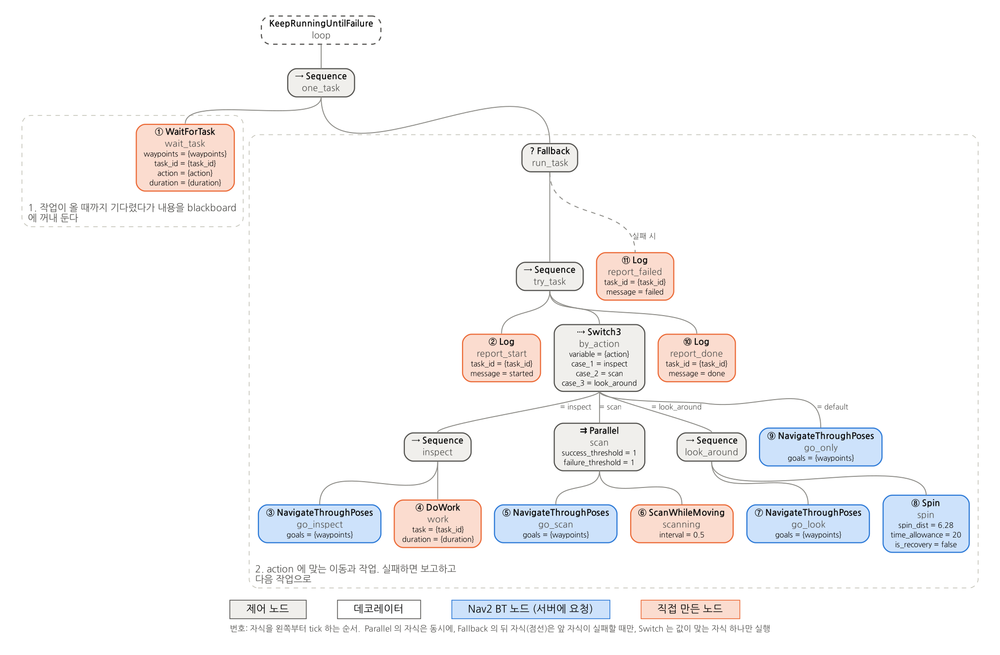
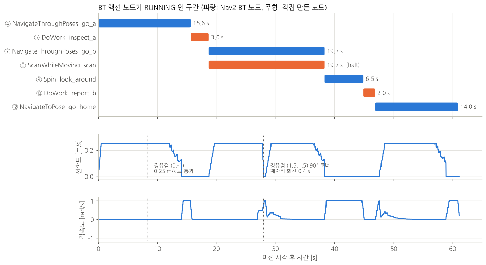

# bt_navigator: BT 로 이동과 작업을 조합하는 미션

[simple_line/MULTI_GOAL.md](../simple_line/MULTI_GOAL.md) 의 방법은 Nav2 명령 하나로 여러 goal 을 돈다. 각각 "경유만" 또는 "goal 마다 정지" 중 하나다. 실제 작업은 이것들이 섞인다.

- **경유점**: 멈추지 않고 지나간다.
- **작업 지점**: 멈춰서 작업한다.
- **주행 중 작업**: 움직이는 동안 한다.

이런 미션은 Nav2 위에 **상위 작업 계층**을 두고, 그 명령들을 단계마다 골라 보낸다. 이 폴더는 상위 작업 계층을 BT(BehaviorTree.CPP)로 만든 예제다. 장애물은 고려하지 않는다.

```
bt_navigator/
├── bt_mission/        미션 BT (XML), 직접 만든 BT 노드, BT 실행 노드, 작업 액션 서버, Python 노드
└── bt_mission_msgs/   작업 메시지와 액션 (Task.msg, ExecuteTask.action)
```

| 하고 싶은 것 | 실행 | 장 |
|---|---|---|
| 경유, 정지 작업, 주행 중 작업, 실패 처리를 섞은 미션 (좌표는 XML 안에) | `mission_bt_runner` (BT)<br>`mission_node.py` (Python) | 1~7 |
| 위와 같되, 좌표와 작업을 실행 중에 토픽으로 받기 | `mission_bt_runner` (`task_loop.xml`)<br>+ `task_sender.py` | 8 |
| 위와 같되, 작업을 액션으로 맡기기 (결과, 진행 상황, 취소, 선점) | `task_server` (`task.xml`)<br>+ `task_client.py` | 9 |
| 위와 같되, 서버를 Nav2 의 `BtActionServer` 와 lifecycle 노드로 | `task_server_lifecycle.launch.py`<br>+ `task_client.py` | 10 |

- 아래층(planner, controller, 시뮬레이션 launch)은 [`simple_line/`](../simple_line/README.md) 것을 그대로 쓴다.
- 폴더 이름의 bt_navigator 는 Nav2 의 bt_navigator 노드를 바꾼다는 뜻이 아니다. Nav2 bt_navigator 는 그대로 두고, 이 폴더의 미션 BT 가 그 위에서 명령을 보낸다 (2장).

목차

- [0. 빌드와 시뮬레이션 실행](#0-빌드와-시뮬레이션-실행)
- [1. 미션](#1-미션)
- [2. 구조: 미션 BT 는 Nav2 위에 한 층 더 올라간다](#2-구조-미션-bt-는-nav2-위에-한-층-더-올라간다)
- [3. BT 기초: 이 예제를 읽는 데 필요한 만큼](#3-bt-기초-이-예제를-읽는-데-필요한-만큼)
- [4. mission.xml 읽기](#4-missionxml-읽기)
- [5. 코드로 구현하기 (C++)](#5-코드로-구현하기-c)
- [6. Python 작업 노드](#6-python-작업-노드)
- [7. 미션 실행](#7-미션-실행)
- [8. 좌표를 토픽으로 받기 (task_loop.xml)](#8-좌표를-토픽으로-받기-task_loopxml)
- [9. 액션으로 작업 맡기 (task_server, task.xml)](#9-액션으로-작업-맡기-task_server-taskxml)
- [10. Nav2 의 BtActionServer 로 만들기 (task_server_lifecycle)](#10-nav2-의-btactionserver-로-만들기-task_server_lifecycle)
- [11. 확인한 것](#11-확인한-것)
- [12. 어떤 방법을 쓸까](#12-어떤-방법을-쓸까)
- [13. 주의할 점 (Humble)](#13-주의할-점-humble)
- [14. 파일](#14-파일)

---

## 0. 빌드와 시뮬레이션 실행

```bash
cd ~/nav2_ws/src/nav2_dwb && git pull
cd ~/nav2_ws
rosdep install --from-paths src --ignore-src -y      # nav2_simple_commander 등
colcon build --symlink-install --packages-select \
  simple_line_planner simple_line_controller simple_line_bringup \
  bt_mission_msgs bt_mission
source install/setup.bash
```

예전 이름(`simple_line_mission`, `simple_line_mission_msgs`)으로 빌드한 적이 있으면 그 결과물은 지운다. 남겨 두면 옛 패키지도 계속 설치된 것으로 보인다.

```bash
cd ~/nav2_ws && rm -rf build/simple_line_mission* install/simple_line_mission*
```

```bash
# 터미널 1: Gazebo + Nav2 + RViz (로봇은 (-2,-1) 에서 +x 를 보고 시작)
export TURTLEBOT3_MODEL=waffle
export GAZEBO_MODEL_PATH=$GAZEBO_MODEL_PATH:/opt/ros/humble/share/turtlebot3_gazebo/models
ros2 launch simple_line_bringup simple_line.launch.py
```

이후 장의 명령은 모두 **터미널 2** 이후에서 실행한다. 좌표는 모두 빈 방(6m x 6m, 벽은 ±3m) map frame 기준이다.

---

## 1. 미션

같은 미션을 두 가지 방법으로 만들었다. 좌표를 실행 중에 받는 BT 는 8장(토픽)과 9장(액션)에 따로 정리했다.

| | 실행 | 미션을 정하는 곳 |
|---|---|---|
| **BT 버전** | `ros2 run bt_mission mission_bt_runner` | `bt_mission/behavior_trees/mission.xml` |
| **Python 버전** | `ros2 run bt_mission mission_node.py` | `bt_mission/scripts/mission_node.py` 맨 위의 `ROUTE_A`, `ROUTE_B`, `HOME` |

두 버전이 부르는 Nav2 기능은 같다.

- **이동**: bt_navigator 의 `NavigateThroughPoses` ([MULTI_GOAL.md 1장](../simple_line/MULTI_GOAL.md#1-경유-경로-navigatethroughposes-가-처리되는-흐름)) / `NavigateToPose`
- **제자리 회전**: behavior_server 의 `Spin`
- **경로 생성과 추종**: `SimpleLinePlanner` / `SimpleLineController` ([MULTI_GOAL.md 3장](../simple_line/MULTI_GOAL.md#3-꺾은선을-따라가기-위한-컨트롤러-동작)의 동작 포함)

로봇은 (-2.0, -1.0) 에서 +x 를 보고 출발한다.

```
  y
 1.5 ┤  B(-1, 1.5) ◀━━━━━━━━━━━━━━━━━━━━━━ (1.5, 1.5)
     │                                      ┃   A → B: 주행 중 0.5m 마다 스캔
     │                                      ┃
 -1  ┤  S(-2, -1) ━━━━━▶ (0, -1) ━━━━━━━▶ A(1.5, -1)
     └──────────────────────────────────────────────── x

  S: 출발점.  (0,-1), (1.5,1.5): 경유점 (멈추지 않음).  A, B: 작업 지점 (정지)
```

| 단계 | 이동 | 이동에 쓰는 Nav2 액션 | 작업 | 실패하면 |
|---|---|---|---|---|
| A | 출발 → (0,-1) 경유 → **A** (1.5,-1, 90°) | `NavigateThroughPoses` | 정지 상태: 점검 3초 | A 를 건너뛰고 B 로 |
| B | A → (1.5,1.5) 경유 → **B** (-1,1.5, 180°) | `NavigateThroughPoses` | 주행 중: 0.5m 마다 스캔<br>정지 상태: 360° 회전 + 보고 2초 | B 를 건너뛰고 복귀 |
| 복귀 | B → 출발점 (-2,-1, 0°) | `NavigateToPose` | - | 한 번 더 시도 |

**경유점과 작업 지점을 한 번에 보낸다.** `NavigateThroughPoses` 는 앞의 점들을 멈추지 않고 지나가고 **마지막 점에서 멈춘다**. 그래서 "경유점 몇 개 + 작업 지점" 을 하나의 명령으로 보내고, 도착하면 작업한다. 경유점이 없는 이동(복귀)은 `NavigateToPose` 로 보낸다.

경로를 작업 지점마다 끊어 보내므로, [MULTI_GOAL.md 4장](../simple_line/MULTI_GOAL.md#최종-goal-이-앞-구간과-겹치면-일찍-끝날-수-있다-humble)의 "최종 goal 이 앞 구간과 겹치면 일찍 끝남" 도 구간마다만 따지면 된다.

---

## 2. 구조: 미션 BT 는 Nav2 위에 한 층 더 올라간다


| 계층 | 하는 일 | 이 예제에서 |
|---|---|---|
| **입력** (8, 9장) | 어디로 가서 무엇을 할지 보냄 | `task_client.py` → `execute_task` 액션, 또는 `task_sender.py` → `mission/task` 토픽 (`mission.xml` 은 입력 없이 XML 안의 좌표를 씀) |
| **상위 작업 계층** | 무엇을, 어떤 순서로, 실패하면 어떻게 | `mission_bt_runner` (BT) 또는 `mission_node.py` (Python) |
| **bt_navigator** | goal 까지 **어떻게 갈지** (재계획, recovery) | Nav2 기본 BT 그대로 ([MULTI_GOAL.md 1-1](../simple_line/MULTI_GOAL.md#1-1-재계획-주기0333hz와-지난-goal-반경07m은-어디에-있나)) |
| **서버** | 실제 경로 계산, 경로 추종, 제자리 동작 | planner_server (SimpleLinePlanner), controller_server (SimpleLineController), behavior_server (Spin) |

BT 가 두 개다.

- 이 예제의 **미션 BT** (`mission.xml`): 작업 순서를 정한다.
- bt_navigator 안의 **navigation BT** (`navigate_through_poses_w_replanning_and_recovery.xml` 등, [MULTI_GOAL.md 1-1](../simple_line/MULTI_GOAL.md#1-1-재계획-주기0333hz와-지난-goal-반경07m은-어디에-있나)): goal 하나까지 가는 방법을 정한다. goal 이 올 때마다 새로 실행된다.

미션 BT 의 `NavigateThroughPoses` 노드가 bt_navigator 에 액션을 보내면, bt_navigator 가 navigation BT 를 돌린다. 작업 로직을 navigation BT 에 섞지 않으니, 이동 실패 처리(재계획, recovery)와 작업 실패 처리(건너뛰기, 재시도)가 서로 엉키지 않는다.

---

## 3. BT 기초: 이 예제를 읽는 데 필요한 만큼

### tick 과 상태

BT 는 루트부터 **tick** 을 한다. 실행 노드가 tick 을 주기적으로 반복하고(여기서는 100Hz), 매 tick 마다 루트에서 지금 실행할 노드까지 내려간다. tick 을 받은 노드는 셋 중 하나를 돌려준다.

| 상태 | 뜻 |
|---|---|
| `SUCCESS` | 끝났고 성공 |
| `FAILURE` | 끝났고 실패 |
| `RUNNING` | 아직 하는 중. 다음 tick 에 다시 물어봐 달라 |

예를 들어 `go_a` 가 주행하는 약 16초 동안에도 BT 는 100Hz 로 tick 한다.

1. 매 tick: `mission → station_a → visit_a → go_a` 로 내려가고, `go_a` 는 `RUNNING` 을 돌려준다.
2. 주행이 끝나면 `go_a` 가 `SUCCESS` 를 돌려준다.
3. 같은 tick 안에서 `visit_a` 가 다음 자식 `inspect_a` 를 시작한다.

### 노드 종류

| 종류 | 노드 | 동작 |
|---|---|---|
| 제어 | **Sequence** (→) | 자식을 왼쪽부터 차례로. 하나라도 FAILURE 면 바로 FAILURE. 모두 SUCCESS 면 SUCCESS |
| 제어 | **Fallback** (?) | 자식을 왼쪽부터 차례로. 하나라도 SUCCESS 면 바로 SUCCESS. 앞 자식이 실패해야 다음 자식을 실행 |
| 제어 | **Parallel** (⇉) | 자식을 매 tick 모두 실행. `success_threshold` 개가 SUCCESS 면 SUCCESS. 나머지 RUNNING 자식은 **halt** (중단) |
| 데코레이터 | **RetryUntilSuccessful** | 자식이 FAILURE 면 `num_attempts` 번까지 다시 |
| 액션 | **Nav2 BT 노드** | `NavigateThroughPoses`, `NavigateToPose`, `Spin`. Nav2 서버에 액션을 보내고, 끝날 때까지 RUNNING |
| 액션 | **직접 만든 노드** | `MakePose(s)`, `DoWork`, `ScanWhileMoving`, `Log` (5장) |

### blackboard 와 포트

노드끼리 값을 주고받는 공용 저장소가 **blackboard** 다. XML 에서 `{이름}` 은 blackboard 변수를 뜻한다.

```xml
<MakePoses poses="0.0,-1.0; 1.5,-1.0,90" output="{route_a}"/>   <!-- route_a 에 쓰고 -->
<NavigateThroughPoses goals="{route_a}"/>                      <!-- route_a 를 읽는다 -->
```

`poses`, `output`, `goals` 같은 이름이 **포트**다. 각 노드 클래스가 어떤 포트를 갖는지 `providedPorts()` 로 선언한다. `{}` 없이 쓴 값(`"0.0,-1.0; ..."`)은 문자열 그대로 들어간다.

---

## 4. mission.xml 읽기

`tools/draw_bt.py` 가 `mission.xml` 을 읽어 그린 그림이다. 원 안의 번호는 자식을 왼쪽부터 tick 하는 순서다. 점선 상자의 제목은 XML 주석이다.


위에서부터 읽으면 이렇다.

```xml
<Sequence name="mission">           <!-- 아래 다섯 묶음을 차례로. 하나라도 실패하면 미션 실패 -->
```

**0. setup**: 목표 위치를 만들어 blackboard 에 넣는다.

```xml
<MakePoses name="make_route_a" poses="0.0,-1.0; 1.5,-1.0,90" output="{route_a}"/>
<MakePoses name="make_route_b" poses="1.5,1.5; -1.0,1.5,180" output="{route_b}"/>
<MakePose name="make_home" pose="-2.0,-1.0,0" output="{home}"/>
```

- 형식은 `"x,y[,yaw_deg]; ..."` 이다.
- 경유점의 yaw 는 생략하면 다음 점 방향으로 채운다.
- 위치를 바꾸려면 여기만 고치면 된다.

**1. station_a**: 경유 → 정지 작업. 못 가면 건너뛴다.

```xml
<Fallback name="station_a">
  <Sequence name="visit_a">
    <NavigateThroughPoses name="go_a" goals="{route_a}"/>       <!-- (0,-1) 은 지나가고 A 에서 정지 -->
    <DoWork name="inspect_a" task="inspect A" duration="3.0"/>  <!-- 정지 상태 작업 -->
  </Sequence>
  <Log name="skip_a" message="station A failed, skipping it"/> <!-- visit_a 가 실패했을 때만 -->
</Fallback>
```

- `go_a` 나 `inspect_a` 가 실패하면 `visit_a` 가 FAILURE 다.
- 그러면 Fallback 이 `skip_a` 를 실행한다. `skip_a` 는 SUCCESS 이므로 `station_a` 전체는 SUCCESS 가 되고, 미션은 B 로 넘어간다.

**2. station_b**: 주행 중 작업 → 정지 작업.

```xml
<Parallel name="go_b_scanning" success_threshold="1" failure_threshold="1">
  <NavigateThroughPoses name="go_b" goals="{route_b}"/>   <!-- 주행 -->
  <ScanWhileMoving name="scan" interval="0.5"/>            <!-- 주행하는 동안 같이 -->
</Parallel>
<Spin name="look_around" spin_dist="6.28" time_allowance="20" is_recovery="false"/>
<DoWork name="report_b" task="report B" duration="2.0"/>
```

`ScanWhileMoving` 은 스스로 끝나지 않는다(항상 RUNNING). 그래서 `go_b` 가 결과를 내야 Parallel 이 끝난다.

| `go_b` 결과 | Parallel | `scan` |
|---|---|---|
| SUCCESS (`success_threshold="1"`) | SUCCESS | halt (중단) |
| FAILURE (`failure_threshold="1"`) | FAILURE | halt (중단) |

**3. 복귀**: 경유점이 없으니 `NavigateToPose` 를 쓴다. 실패하면 한 번 더 시도한다.

```xml
<RetryUntilSuccessful name="retry_home" num_attempts="2">
  <NavigateToPose name="go_home" goal="{home}"/>
</RetryUntilSuccessful>
<Log name="done" message="mission complete"/>
```

복귀가 두 번 다 실패하면 `mission` Sequence 가 FAILURE 로 끝난다.

---

## 5. 코드로 구현하기 (C++)

BT 를 코드로 쓰는 일은 세 가지다.

1. 필요한 **노드 종류를 만든다**. 직접 만들 노드만.
2. 실행 노드에서 노드 종류를 **factory 에 등록**하고, **blackboard** 를 채운다.
3. XML 로 **트리를 만들고 tick** 한다.

### 5-1. BT 노드 만들기 (`include/bt_mission/mission_nodes.hpp`, `src/mission_nodes.cpp`)
**결과 node 구조.**
```
ROS 노드 /mission_bt   (실행 파일 mission_bt_runner)
 └ 미션 BT
    ├ Sequence, Fallback, Parallel, Retry          흐름만 정함. 밖으로 아무것도 안 보냄
    ├ MakePose(s), DoWork, ScanWhileMoving, Log    이 ROS 노드 안에서 직접 처리
    └ NavigateThroughPoses, NavigateToPose, Spin   다른 ROS 노드에 액션 goal 을 보내고 결과를 기다림
              │ 액션                         │ 액션 (spin)
              ▼                              ▼
ROS 노드 /bt_navigator                   ROS 노드 /behavior_server
 └ navigation BT (또 하나의 트리)
    ├ PipelineSequence, RecoveryNode, RateController   흐름
    └ ComputePathThroughPoses, FollowPath              다른 ROS 노드에 액션 goal
              │ 액션                  │ 액션
              ▼                       ▼
ROS 노드 /planner_server           ROS 노드 /controller_server
 └ 플러그인 SimpleLinePlanner         └ 플러그인 SimpleLineController
   (ROS 노드 아님, 서버가 부르는 클래스)  (20Hz 로 불려서 /cmd_vel_nav 토픽 발행)
```

아래 코드는 발췌다 (선언과 정의를 한곳에 모으고 일부 줄을 뺐다).

**한 번에 끝나는 노드** (`BT::SyncActionNode`): `tick()` 이 SUCCESS / FAILURE 를 바로 돌려준다.

```cpp
class Log : public BT::SyncActionNode
{
public:
  Log(const std::string & name, const BT::NodeConfiguration & config);

  static BT::PortsList providedPorts()                     // XML 에서 쓸 수 있는 속성
  {
    return {BT::InputPort<std::string>("message")};
  }

  BT::NodeStatus tick() override
  {
    std::string message;
    getInput("message", message);                          // XML 의 message="..." 를 읽는다
    RCLCPP_INFO(node_->get_logger(), "[log] %s", message.c_str());
    return BT::NodeStatus::SUCCESS;
  }
};
```

**여러 tick 에 걸쳐 실행되는 노드** (`BT::StatefulActionNode`):

| 함수 | 언제 불리나 |
|---|---|
| `onStart()` | 처음 tick 될 때 |
| `onRunning()` | RUNNING 인 동안 매 tick |
| `onHalted()` | 실행 중에 부모가 중단시킬 때 |

```cpp
// DoWork: 정지 상태 작업 자리. 지금은 duration 초 동안 RUNNING
BT::NodeStatus DoWork::onStart()
{
  getInput("task", task_);
  getInput("duration", duration_);
  start_ = std::chrono::steady_clock::now();
  return BT::NodeStatus::RUNNING;                           // 다음 tick 부터 onRunning()
}

BT::NodeStatus DoWork::onRunning()
{
  const std::chrono::duration<double> elapsed = std::chrono::steady_clock::now() - start_;
  return elapsed.count() < duration_ ? BT::NodeStatus::RUNNING : BT::NodeStatus::SUCCESS;
}
```

- `tick()` 안에서 `sleep` 하면 안 된다. 그러면 그동안 트리 전체가 멈추고, Parallel 의 다른 자식도 tick 을 못 받는다. 오래 걸리는 일은 RUNNING 을 돌려주고 다음 tick 에 이어서 확인한다.
- 실제 작업(촬영, 집기, IO)은 `DoWork` 자리에서 서비스나 액션을 비동기로 부르고, 응답이 올 때까지 RUNNING 을 돌려주면 된다. Nav2 의 `nav2_behavior_tree::BtActionNode<ActionT>` / `BtServiceNode<ServiceT>` 템플릿을 상속하면 액션·서비스 호출 노드를 짧게 만들 수 있다. Nav2 BT 노드들이 그렇게 만들어져 있다.

**주행 중 작업 노드** (`ScanWhileMoving`):

- `onRunning()` 에서 TF 로 로봇 위치를 읽는다.
- `interval` 만큼 움직였으면 위치를 기록하고 `mission/scan_points` (`geometry_msgs/PoseArray`) 로 발행한다.
- 언제나 RUNNING 을 돌려준다. 끝내는 것은 Parallel 의 몫이다.

노드가 쓰는 ROS 노드와 TF 버퍼는 생성자에서 blackboard 로 받는다.

```cpp
ScanWhileMoving::ScanWhileMoving(const std::string & name, const BT::NodeConfiguration & config)
: BT::StatefulActionNode(name, config),
  node_(config.blackboard->get<rclcpp::Node::SharedPtr>("node")),
  tf_(config.blackboard->get<std::shared_ptr<tf2_ros::Buffer>>("tf_buffer"))
```

**등록**: XML 태그 이름과 클래스를 묶는다.

```cpp
void registerNodes(BT::BehaviorTreeFactory & factory)
{
  factory.registerNodeType<MakePose>("MakePose");
  factory.registerNodeType<MakePoses>("MakePoses");
  factory.registerNodeType<DoWork>("DoWork");
  factory.registerNodeType<ScanWhileMoving>("ScanWhileMoving");
  factory.registerNodeType<Log>("Log");
}
```

### 5-2. 실행 노드 (`src/mission_bt_runner.cpp`)

발췌다 (예외 처리, 로그는 뺐다). 1, 2 의 본문은 `task_server` 와 같이 쓰려고 `src/bt_common.cpp` 의 `registerAllNodes()`, `createBlackboard()` 로 옮겨 두었다.

```cpp
// 1. BT 노드 종류 등록
BT::BehaviorTreeFactory factory;
BT::SharedLibrary loader;
for (const char * lib : {"nav2_navigate_to_pose_action_bt_node",          // Nav2 가 제공하는 노드:
    "nav2_navigate_through_poses_action_bt_node",                         //   플러그인 .so 를 이름으로
    "nav2_spin_action_bt_node", "nav2_wait_action_bt_node"})               //   (bt_navigator 와 같은 방식)
{
  factory.registerFromPlugin(loader.getOSName(lib));
}
bt_mission::registerNodes(factory);                                        // 직접 만든 노드

// 2. blackboard: Nav2 BT 노드는 생성될 때 이 키들을 꼭 찾는다
auto blackboard = BT::Blackboard::create();
blackboard->set<rclcpp::Node::SharedPtr>("node", node);
blackboard->set<std::shared_ptr<tf2_ros::Buffer>>("tf_buffer", tf_buffer);
blackboard->set<std::chrono::milliseconds>("server_timeout", 1000ms);
blackboard->set<std::chrono::milliseconds>("bt_loop_duration", 10ms);      // 1000 / tick_hz
blackboard->set<std::chrono::milliseconds>("wait_for_service_timeout", 5000ms);

// 3. 트리 생성 (bt_navigator 가 active 가 된 뒤에)
BT::Tree tree = factory.createTreeFromFile(bt_xml, blackboard);

// 4. tick 루프
rclcpp::WallRate rate(tick_hz);                                            // 기본 100Hz
BT::NodeStatus status = BT::NodeStatus::RUNNING;
while (status == BT::NodeStatus::RUNNING) {
  if (g_stop) { tree.haltTree(); break; }                                  // Ctrl-C: 실행 중인 goal 취소
  status = tree.tickRoot();
  rate.sleep();
}
```

나머지 부분은 이렇다.

- **bt_navigator 대기 (`waitForActive`)**: Nav2 BT 노드는 트리를 만들 때 액션 서버를 찾는다. 또 bt_navigator 가 active 가 되기 전에 보낸 goal 은 거절되어, station 을 바로 건너뛰게 된다. 그래서 트리를 만들기 전에 `bt_navigator/get_state` 로 active 인지 확인한다.
- **Ctrl-C**: `rclcpp::init(..., SignalHandlerOptions::None)` 으로 rclcpp 의 기본 처리를 끄고 직접 받는다. rclcpp 가 먼저 종료되면 `haltTree()` 가 Nav2 에 취소 요청을 보낼 수 없기 때문이다.
- **TransitionLogger**: 노드 상태가 바뀔 때마다 `[bt] 이름 종류 이전 -> 다음` 을 출력한다. `BT::StatusChangeLogger` 를 상속한 작은 클래스다 (`src/bt_common.cpp`).

| 파라미터 | 기본값 | 설명 |
|---|---|---|
| `bt_xml` | `share/bt_mission/behavior_trees/mission.xml` | 실행할 XML |
| `tick_hz` | 100.0 | tick 주기 [Hz] |
| `log_transitions` | true | 노드 상태 변화 출력 |

### 5-3. Nav2 BT 노드를 쓸 때 알아둘 것

| XML 태그 | 플러그인 라이브러리 | 보내는 액션 | 주요 포트 |
|---|---|---|---|
| `NavigateThroughPoses` | `nav2_navigate_through_poses_action_bt_node` | `navigate_through_poses` | `goals` |
| `NavigateToPose` | `nav2_navigate_to_pose_action_bt_node` | `navigate_to_pose` | `goal` |
| `Spin` | `nav2_spin_action_bt_node` | `spin` | `spin_dist`, `time_allowance`, `is_recovery` |
| `Wait` | `nav2_wait_action_bt_node` | `wait` | `wait_duration` |

- **tick 은 100Hz 정도로.**
  - tick 을 10Hz 로 돌렸을 때, 로봇이 멈춘 뒤 BT 가 SUCCESS 를 받기까지 매번 0.9~1.1초가 걸렸다. 100Hz 에서는 이 지연이 사라졌다. 미션 시간은 63.7~65.5초에서 60.1~61.5초가 됐다.
  - 원인은 이렇게 보인다. Nav2 BT 노드는 tick 마다 액션 메시지를 조금씩(대개 하나)만 처리한다. bt_navigator 가 feedback 을 빠르게 보내서, 결과 메시지가 그 뒤에 밀렸다.
  - bt_navigator 자신도 기본 10ms(100Hz) 로 tick 한다.
- **`MakePoses` 의 출력 포트는 타입을 적지 않았다.**
  - Nav2 Humble 1.1.18 이하의 `NavigateThroughPoses` BT 노드는 `goals` 포트 타입을 `PoseStamped` 로 잘못 선언하고 있다 (1.1.19 부터 `std::vector<PoseStamped>`).
  - 그래서 `MakePoses` 쪽을 `std::vector<PoseStamped>` 로 선언하면 트리를 만들 때 타입이 다르다는 오류가 난다.
  - 같은 이유로, 1.1.18 에서는 XML 에서 `MakePoses` 가 그 변수를 쓰는 `NavigateThroughPoses` 보다 **앞에** 있어야 한다. 앞에 나온 노드의 포트 타입으로 변수가 정해지기 때문이다. 순서를 바꾸면 실행 중에 `Blackboard::set() failed: once declared, the type of a port shall not change` 가 난다 (확인함).

---

## 6. Python 작업 노드

`scripts/mission_node.py` 는 같은 미션을 BT 없이 위에서 아래로 실행한다. Nav2 와는 `nav2_simple_commander` 의 `BasicNavigator` 로 주고받는다.

```python
ROUTE_A = [(0.0, -1.0, None), (1.5, -1.0, 90.0)]     # (0,-1) 경유 → 작업 지점 A
ROUTE_B = [(1.5, 1.5, None), (-1.0, 1.5, 180.0)]     # (1.5,1.5) 경유 → 작업 지점 B
HOME = [(-2.0, -1.0, 0.0)]

def run_mission(nav):
    # 1. 작업 지점 A ------------------------------------------- BT: Fallback "station_a"
    if drive(nav, ROUTE_A):                                    # NavigateThroughPoses "go_a"
        do_work('inspect A', 3.0)                              # DoWork "inspect_a"
    else:
        print('[log] station A failed, skipping it')           # Log "skip_a"

    # 2. 작업 지점 B ------------------------------------------- BT: Fallback "station_b"
    scanner = Scanner(SCAN_INTERVAL)
    if (drive(nav, ROUTE_B, while_running=scanner)             # Parallel(go_b, scan)
            and spin(nav, 2 * math.pi)):                       # Spin "look_around"
        do_work('report B', 2.0)                               # DoWork "report_b"
    else:
        print('[log] station B failed, skipping it')           # Log "skip_b"

    # 3. 복귀 ------------------------------------------------- BT: RetryUntilSuccessful
    for _ in range(2):
        if drive(nav, HOME):                                   # NavigateToPose "go_home"
            print('[log] mission complete')                    # Log "done"
            return True
    return False
```

| BT | Python |
|---|---|
| Sequence | 위에서 아래로 실행되는 코드 |
| Fallback | `if 성공: ... else: 대신 할 일` |
| RetryUntilSuccessful | `for` 로 다시 시도 |
| Parallel (주행 + 스캔) | 주행이 끝날 때까지 도는 `while not nav.isTaskComplete()` 안에서 feedback 을 보고 스캔 |
| blackboard | 파이썬 변수 |

```python
def drive(nav, points, while_running=None):
    """점이 둘 이상이면 NavigateThroughPoses, 하나면 NavigateToPose."""
    poses = make_poses(nav, points)
    sent = nav.goThroughPoses(poses) if len(poses) > 1 else nav.goToPose(poses[0])
    return sent and wait_until_done(nav, while_running)

def wait_until_done(nav, while_running=None):
    while not nav.isTaskComplete():                    # 0.1 초마다 돌아온다
        feedback = nav.getFeedback()
        if while_running and feedback is not None:
            while_running(feedback)                    # 주행 중 작업 (스캔)
    return nav.getResult() == TaskResult.SUCCEEDED
```

두 군데를 일부러 바꿨다.

- **`nav.waitUntilNav2Active(localizer='controller_server')`**
  - 기본값(`localizer='amcl'`)이면 `amcl_pose` 를 받기 전에 initial pose 로 (0,0) 을 보낸다. 그러면 AMCL 위치가 바뀔 수 있다.
  - 그래서 AMCL 대신 다른 lifecycle 노드가 active 인지만 보게 했다.
- **`rclpy.init(..., signal_handler_options=SignalHandlerOptions.NO)`**
  - rclpy 의 기본 Ctrl-C 처리는 ROS 를 먼저 종료한다. 그러면 `except KeyboardInterrupt:` 의 `nav.cancelTask()` 가 Nav2 에 닿지 못할 수 있다.
  - 이 옵션을 주면 Ctrl-C 는 `KeyboardInterrupt` 로만 오고, 취소가 정상적으로 간다 (확인함).

---

## 7. 미션 실행

0장의 launch 를 띄운 뒤:

```bash
# 둘 중 하나
ros2 run bt_mission mission_bt_runner
ros2 run bt_mission mission_node.py
```

BT 버전 출력 (가짜 로봇으로 실행한 실제 로그. 타임스탬프는 뺐다):

```
[bt] go_a            NavigateThroughPoses IDLE -> RUNNING
[bt] go_a            NavigateThroughPoses RUNNING -> SUCCESS
[work] inspect A: start (3.0 s)
[bt] inspect_a       DoWork               IDLE -> RUNNING
[work] inspect A: done
[bt] inspect_a       DoWork               RUNNING -> SUCCESS
[bt] visit_a         Sequence             RUNNING -> SUCCESS
[bt] station_a       Fallback             RUNNING -> SUCCESS
[bt] station_b       Fallback             IDLE -> RUNNING
[bt] visit_b         Sequence             IDLE -> RUNNING
[bt] go_b            NavigateThroughPoses IDLE -> RUNNING
[scan] start (every 0.50 m)
[scan] #1 at (1.27, -1.00)
[bt] scan            ScanWhileMoving      IDLE -> RUNNING
[bt] go_b_scanning   Parallel             IDLE -> RUNNING
[scan] #2 at (1.31, -0.50)
...
[scan] #9 at (-0.42, 1.47)
[bt] go_b            NavigateThroughPoses RUNNING -> SUCCESS
[scan] stop: 9 scans
[bt] scan            ScanWhileMoving      RUNNING -> HALTED
[bt] go_b_scanning   Parallel             RUNNING -> SUCCESS
[bt] look_around     Spin                 IDLE -> RUNNING
...
[bt] mission         Sequence             RUNNING -> SUCCESS
mission SUCCESS in 60.9 s
```

`go_b` 가 SUCCESS 가 되자, 같은 tick 에서 Parallel 이 `scan` 을 halt 하는 것이 보인다.

**자주 하는 일**

- **미션 바꾸기**
  - BT 버전: `mission.xml` 을 고친다. `--symlink-install` 로 빌드했다면 다시 빌드하지 않아도 된다. 다른 파일을 쓰려면 `--ros-args -p bt_xml:=/path/to/my_mission.xml`.
  - Python 버전: `mission_node.py` 맨 위의 `ROUTE_A`, `ROUTE_B`, `HOME` 을 고친다.
  - 좌표를 고치지 않고 실행 중에 보내려면: 8장 (`task_loop.xml` + `task_sender.py`).
  - 어느 쪽이든 각 `NavigateThroughPoses` 의 마지막 점이 그 구간의 출발점이나 앞 구간과 겹치지 않게 한다 ([MULTI_GOAL.md 4장](../simple_line/MULTI_GOAL.md#최종-goal-이-앞-구간과-겹치면-일찍-끝날-수-있다-humble)).
- **RViz 에서 스캔 위치 보기**: `Add → By topic → /mission/scan_points (PoseArray)`
- **XML 을 고친 뒤 그림 다시 그리기**:

  ```bash
  sudo apt install graphviz fonts-nanum
  cd ~/nav2_ws/src/nav2_dwb/bt_navigator/bt_mission
  python3 tools/draw_bt.py behavior_trees/mission.xml doc/mission_bt.png
  ```

- **중단**: Ctrl-C. 두 버전 모두 실행 중인 Nav2 goal 을 취소하고 끝난다.

---

## 8. 좌표를 토픽으로 받기 (`task_loop.xml`)

`mission.xml` 은 좌표와 순서가 XML 에 박혀 있다. 실제로는 사람이나 관제 서버가 실행 중에 "어디로 가서 무엇을 하라" 를 보낸다. `task_loop.xml` 은 그 방식이다.

```
[입력 노드]  task_sender.py (터미널 입력)  /  관제 서버  /  ros2 topic pub
                │  mission/task    bt_mission_msgs/Task   어디로(waypoints), 무엇을(action)
                ▼
[미션 BT]    mission_bt_runner  (bt_xml:=task_loop.xml)
                WaitForTask ─▶ Switch(action) ─▶ NavigateThroughPoses + DoWork / ScanWhileMoving / Spin
                │  mission/status  std_msgs/String   "t1 accepted: ...", "t1 started", "t1 done" ...
                ▼
[입력 노드]  진행 상황 출력
```

| 누가 | 무엇을 정하나 |
|---|---|
| 입력 노드 | **데이터**: 어디로(waypoints), 무엇을(action) |
| 미션 BT | **정책**: action 별로 어떻게 움직이고 무엇을 할지, 실패하면 어떻게 할지 |
| 아래층 (bt_navigator, planner, controller) | 그대로. `mission.xml` 과 같은 Nav2 액션을 부른다 |

### 8-1. Task 메시지 (`bt_mission_msgs/msg/Task.msg`)

```
string id                                 # 작업 이름 (로그와 mission/status 에 씀). 비우면 BT 가 붙인다
geometry_msgs/PoseStamped[] waypoints     # 경유점들 + 마지막이 작업 지점. 1개 이상
string action                             # go | inspect | scan | look_around. 그 외 값이면 이동만
float64 duration                          # inspect 의 작업 시간 [s]
```

ROS 2 에서는 새 메시지 형식을 별도 패키지에 정의하는 것이 관례라서, 메시지만 담은 `bt_mission_msgs` 패키지를 따로 두었다.

### 8-2. task_loop.xml



1. **`KeepRunningUntilFailure`**: 자식이 SUCCESS 를 내면 처음부터 다시 실행한다. 작업 하나가 한 바퀴다.
2. **`WaitForTask`**: 작업이 올 때까지 RUNNING. 오면 `waypoints`, `task_id`, `action`, `duration` 을 blackboard 에 쓰고 SUCCESS.
3. **`Switch3`**: `{action}` 값으로 가지 하나를 고른다.

   | action | 가지 |
   |---|---|
   | `inspect` | 이동 → `DoWork` (duration 초) |
   | `scan` | `Parallel` (이동, `ScanWhileMoving`) |
   | `look_around` | 이동 → `Spin` 한 바퀴 |
   | 그 외 (`go` 등) | 이동만 |

4. **`Fallback run_task`**: 가지가 실패하면 `report_failed` 가 "failed" 를 보고하고 SUCCESS 를 낸다. 루프는 다음 작업을 기다린다.

이동은 경유점 수와 상관없이 `NavigateThroughPoses` 하나로 보낸다. 점이 하나면 `NavigateToPose` 와 같게 동작한다.

| | `mission.xml` | `task_loop.xml` |
|---|---|---|
| 좌표 | XML 안 (`MakePoses`) | Task 메시지 (`WaitForTask`) |
| 작업 순서 | XML 에 고정 | 받은 순서 |
| 작업 종류 | 지점마다 XML 에 적음 | `action` 값을 보고 `Switch3` 가 고름 |
| 실패 처리 | 지점별 Fallback, 복귀 재시도 | 작업마다 보고하고 다음 작업으로 |
| 끝 | 마지막 단계가 끝나면 | 끝나지 않음 (Ctrl-C) |

### 8-3. WaitForTask 노드 (`src/mission_nodes.cpp`)

발췌다.

```cpp
WaitForTask::WaitForTask(const std::string & name, const BT::NodeConfiguration & config)
: BT::StatefulActionNode(name, config),
  node_(config.blackboard->get<rclcpp::Node::SharedPtr>("node"))
{
  // 구독 콜백은 이 노드만의 callback group 에 넣고, tick 할 때 직접 처리한다
  callback_group_ = node_->create_callback_group(
    rclcpp::CallbackGroupType::MutuallyExclusive, false);
  executor_.add_callback_group(callback_group_, node_->get_node_base_interface());
  rclcpp::SubscriptionOptions options;
  options.callback_group = callback_group_;
  task_sub_ = node_->create_subscription<bt_mission_msgs::msg::Task>(
    "mission/task", rclcpp::QoS(10),
    [this](bt_mission_msgs::msg::Task::ConstSharedPtr msg) {queue_.push_back(*msg);},
    options);
}

BT::NodeStatus WaitForTask::takeTask()        // onStart(), onRunning() 에서 부른다
{
  executor_.spin_some();                      // 도착한 Task 메시지를 queue_ 로
  while (!queue_.empty()) {
    auto task = queue_.front();
    queue_.pop_front();
    if (task.waypoints.empty()) { report(task.id + " rejected: no waypoints"); continue; }
    setOutput("waypoints", task.waypoints);   // → NavigateThroughPoses goals="{waypoints}"
    setOutput("task_id", task.id);
    setOutput("action", task.action);         // → Switch3 variable="{action}"
    setOutput("duration", task.duration);     // → DoWork duration="{duration}"
    return BT::NodeStatus::SUCCESS;
  }
  return BT::NodeStatus::RUNNING;             // 작업이 없으면 다음 tick 에 다시 확인
}
```

- **누가 구독 콜백을 처리하나**: `/mission_bt` ROS 노드는 tick 루프만 돌고 따로 spin 하지 않는다. 그래서 `WaitForTask` 가 자기 callback group 과 executor 를 만들고, tick 될 때 `spin_some()` 으로 도착한 메시지를 꺼낸다. Nav2 BT 노드들도 액션 결과를 이렇게 받는다.
- **실행 중에 들어온 작업**: 다른 작업을 실행하는 동안 `WaitForTask` 는 tick 되지 않는다. 그동안 온 메시지는 구독 큐(QoS depth 10)에 쌓여 있다가 다음 차례에 하나씩 꺼내진다.
- **상태 보고**: `Log` 노드에 `task_id` 포트를 더해, 로그와 함께 `mission/status` 로 `"<id> <message>"` 를 발행한다.
- **출력 포트 `waypoints`**: `MakePoses` 와 같은 이유로 타입을 적지 않았다 (5-3).

### 8-4. 입력 노드 (`scripts/task_sender.py`)

```bash
# 대화형: 한 줄에 작업 하나. 보낸 작업은 BT 가 받은 순서대로 하나씩 실행한다
ros2 run bt_mission task_sender.py
task> inspect 0,-1 1.5,-1,90       # (0,-1) 경유 → (1.5,-1) 에서 정지 → 3초 점검
task> scan 1.5,1.5 -1,1.5,180      # 가는 동안 스캔
task> look_around -1,1.5,180       # 도착 후 한 바퀴
task> go -2,-1,0                   # 이동만
task> inspect:5 1,0,0              # 작업 시간 5초

# 작업 하나만 보내고, 끝날 때까지 기다렸다가 종료 (종료 코드 0 = done)
ros2 run bt_mission task_sender.py inspect 0,-1 1.5,-1,90

# 파일이나 다른 프로그램에서 줄 단위로 넘겨도 된다 (모두 끝날 때까지 기다림)
printf 'inspect 0,-1 1.5,-1,90\ngo -2,-1,0\n' | ros2 run bt_mission task_sender.py
```

- **한 줄 형식**: `<action>[:duration] x,y[,yaw_deg] [x,y[,yaw_deg] ...]` (map frame). 마지막 점이 작업 지점이고, 앞의 점은 경유점이다.
- **yaw 생략**: 중간 점은 다음 점 쪽, 마지막 점은 직전 점에서 온 방향으로 채운다. 작업의 첫 점은 직전 작업의 마지막 점(첫 작업이면 TF 로 읽은 로봇 위치)에서 온 것으로 본다.
- **보내기 전에** BT 쪽 구독이 연결될 때까지 기다린다 (최대 10초). 토픽은 연결 전에 보낸 메시지를 버리기 때문이다.
- **입력을 기다리는 동안에도** 상태 토픽을 받아 `<- t1 done` 처럼 출력한다. 스레드 없이 `select` 로 키보드 입력을 기다리면서 `rclpy.spin_once` 를 돌린다.

입력 노드 없이 직접 보낼 수도 있다. 다른 노드(관제 서버 브리지, GUI)도 같은 토픽에 Task 를 발행하면 된다.

```bash
ros2 topic pub -w 1 --once /mission/task bt_mission_msgs/msg/Task \
  "{id: t9, action: go, waypoints: [{header: {frame_id: map}, pose: {position: {x: 1.0, y: 0.0}, orientation: {w: 1.0}}}]}"
ros2 topic echo /mission/status
```

### 8-5. 실행

```bash
# 터미널 1: 0장의 launch

# 터미널 2: 작업을 기다리는 미션 BT
ros2 run bt_mission mission_bt_runner --ros-args -p bt_xml:=task_loop.xml

# 터미널 3: 작업 보내기
ros2 run bt_mission task_sender.py
```

`bt_xml` 에 파일 이름만 주면 패키지의 `behavior_trees/` 에서 찾는다. 다른 위치의 파일은 전체 경로를 준다.

입력 노드 출력 (가짜 로봇으로 실행한 실제 출력. 작업 4개를 한 번에 넣은 경우):

```
task>   -> t1: inspect (0,-1,0°) -> (1.5,-1,90°), 3 s
task>   -> t2: scan (1.5,1.5,180°) -> (-1,1.5,180°)
task>   -> t3: look_around (-1,1.5,180°)
task>   -> t4: go (-2,-1,0°)
  <- t1 accepted: inspect, 2 poses
  <- t1 started
  <- t1 done
  <- t2 accepted: scan, 2 poses
  <- t2 started
  <- t2 done
  <- t3 accepted: look_around, 1 poses
  <- t3 started
  <- t3 done
  <- t4 accepted: go, 1 poses
  <- t4 started
  <- t4 done
```

### 8-6. 한계와 다음 단계

- **토픽은 보내고 끝이다.** 결과는 상태 토픽으로만 안다. 입력 노드를 꺼도 BT 는 받은 작업을 계속한다. 멈추려면 `mission_bt_runner` 를 Ctrl-C 한다 (실행 중인 Nav2 goal 이 취소된다).
- **받은 순서대로만 실행한다.** 취소, 끼어들기(우선순위), 대기 중인 작업 비우기는 없다.
- **상태가 문자열이다.** 사람이 읽기는 쉽지만 다른 프로그램이 해석하기에는 약하다.
- 이런 기능이 필요해지면 Task 를 **액션 서버**로 받는 것이 보통이다. 액션에는 결과, 진행 상황, 취소가 표준으로 있다. Nav2 가 `navigate_to_pose` 를 토픽이 아니라 액션으로 받는 것과 같은 이유다. 9장이 이 방식이다.
- 각 Task 안에서도 마지막 점이 앞 구간과 겹치지 않게 한다 ([MULTI_GOAL.md 4장](../simple_line/MULTI_GOAL.md#최종-goal-이-앞-구간과-겹치면-일찍-끝날-수-있다-humble)).

---

## 9. 액션으로 작업 맡기 (`task_server`, `task.xml`)

8장의 토픽 방식에는 한계가 있다. 보내고 끝이라 결과를 문자열로만 알 수 있고, 취소도 할 수 없다. 작업을 **액션**으로 받으면 수락 여부, 진행 상황, 결과, 취소가 모두 표준으로 생긴다. bt_navigator 가 `navigate_to_pose` 를 액션으로 받는 것과 같은 구조다.

```
task_client.py ──goal: ExecuteTask (Task)────▶ task_server (액션 서버 + BT 실행기)
   ◀── 수락 / 거절                               goal 마다 blackboard 를 채우고 task.xml 을 처음부터 tick
   ◀── feedback: 실행 중인 노드, 지난 시간         cancel  → haltTree → Nav2 goal 취소 → CANCELED
   ◀── result: success, message                  새 goal → 지금 작업 ABORTED("preempted by …") → 새 작업
   ── cancel ──▶                                 트리 끝 → SUCCEEDED / ABORTED("<노드> failed")
                                                    │ NavigateThroughPoses, Spin
                                                    ▼
                                         bt_navigator → planner / controller (그대로)
```

| | 토픽 (8장) | 액션 (9장) |
|---|---|---|
| 받았는지 | `"t1 accepted"` 문자열 | goal 수락 / 거절 응답 |
| 진행 상황 | 상태 문자열 | feedback (`task_id`, `running`, `elapsed`) |
| 결과 | `"done"` / `"failed"` 문자열 | 상태 SUCCEEDED / ABORTED / CANCELED + result (`success`, `message`) |
| 취소 | 없음 | cancel → BT halt → Nav2 goal 취소 |
| 실행 중에 새 작업 | 큐에 쌓임 | **선점**: 지금 작업을 멈추고 새 작업. 차례대로 하려면 보내는 쪽이 하나 끝나면 다음을 보낸다 |
| 작업 기다리기, 결과 보고 | BT 안 (`WaitForTask`, 반복, `Log`) | 서버 코드. BT 에는 작업 하나만 남는다 |
| 명령줄 | `ros2 topic pub` | `ros2 action send_goal --feedback` |

### 9-1. ExecuteTask 액션 (`bt_mission_msgs/action/ExecuteTask.action`)

```
# ---- goal ----
Task task                     # 작업 내용 (Task.msg: id, waypoints, action, duration)
---
# ---- result ----
bool success
string message                # "done", 또는 실패/중단 이유 ("go_inspect failed", "preempted by t2", "canceled")
---
# ---- feedback ----
string task_id
string running                # 지금 RUNNING 인 액션 노드 (예: "go_scan, scanning")
float32 elapsed               # 작업 시작 후 지난 시간 [s]
```

- goal 은 8장의 `Task` 메시지를 그대로 담는다.
- goal 하나는 작업 하나다. 여러 작업의 순서와 조합은 보내는 쪽이 정한다. 미션 전체를 goal 하나로 보내면 "2번째 작업만 취소" 같은 일이 어렵다.

### 9-2. task.xml


`task_loop.xml` 에서 반복(`KeepRunningUntilFailure`), `WaitForTask`, `Log` 를 뺀 것이다. 작업을 기다리고, 결과를 보고하고, 다음 작업을 받는 일은 서버가 맡는다. 그래서 트리에는 "작업 하나를 어떻게 하나" 만 남는다.

- **action 별 동작**: 8-2 와 같다.
- **트리 결과와 goal 상태**: 트리가 SUCCESS 면 goal 은 SUCCEEDED, FAILURE 면 ABORTED 다.
- **blackboard**: `{waypoints}` `{task_id}` `{action}` `{duration}` 은 서버가 goal 을 받을 때 채운다.

### 9-3. TaskServer (`src/task_server.cpp`)

실행 노드(`src/task_server_main.cpp`)의 준비 과정은 `mission_bt_runner` 와 같다.

1. 노드 종류를 등록한다.
2. blackboard 를 만든다.
3. bt_navigator 를 기다렸다가 트리를 만든다.

그다음 `TaskServer::step()` 을 100Hz 로 부른다. step 한 번이 하는 일은 이렇다 (발췌).

```cpp
void TaskServer::step()
{
  if (next_) {                           // 지난 step 에서 수락한 goal 을 시작한다
    if (active_) {                       // 선점: 지금 작업을 멈추고 새 작업으로
      finish(Outcome::Aborted, "preempted by " + next_->get_goal()->task.id);
    }
    start(next_);                        // blackboard 에 waypoints, task_id, action, duration
    next_.reset();
  }
  executor_.spin_some();                 // goal, cancel 요청 처리 (콜백은 next_ 에 goal 을 넣기만 한다)
  if (!active_) return;
  if (active_->is_canceling()) {
    finish(Outcome::Canceled, "canceled");
    return;
  }
  const auto status = tree_.tickRoot();
  if (status == BT::NodeStatus::RUNNING) {
    publishFeedback();                   // 실행 중인 노드가 바뀌었을 때, 아니면 0.5초마다
  } else if (status == BT::NodeStatus::SUCCESS) {
    finish(Outcome::Succeeded, "done");
  } else {
    finish(Outcome::Aborted, logger_.lastFailed() + " failed");
  }
}

void TaskServer::finish(Outcome outcome, const std::string & message)
{
  tree_.haltTree();                      // 실행 중인 노드를 멈추고(Nav2 goal 취소) 다음 작업을 위해 초기화
  ... active_->succeed(result) / active_->canceled(result) / active_->abort(result)
}
```

- **콜백은 누가 처리하나**: 액션 서버의 콜백은 서버만의 callback group 에 넣고, `step()` 에서 `spin_some()` 으로 처리한다 (8-3 의 `WaitForTask`, Nav2 BT 노드와 같은 방식). 콜백과 tick 이 같은 스레드에서 돌아서 잠금이 필요 없다.
- **수락한 goal 은 다음 step 에 시작한다**: 수락한 step 에서 바로 시작하면, 첫 feedback 이 수락 응답보다 먼저 클라이언트에 도착한다. 그러면 클라이언트는 아직 모르는 goal 의 feedback 이라며 버린다. 테스트에서 이 문제를 찾아서 고쳤다.
- **feedback 의 `running`**: `TransitionLogger` (`bt_common.cpp`) 가 상태 변화를 보면서, 지금 RUNNING 인 액션 노드와 마지막으로 실패한 노드를 기억한다. 실패한 노드 이름은 result 의 `message` 가 된다.
- **트리를 goal 마다 다시 만들지 않는다**: 트리는 한 번 만들고, 작업이 끝날 때마다 `haltTree()` 로 초기화해서 다시 쓴다. Nav2 BT 노드는 만들 때 액션 서버를 찾느라 시간이 걸리기 때문이다.
- **`prepareBlackboard()`**: 트리를 만들기 전에 `waypoints` 를 타입 없는 항목으로 만들어 둔다. `MakePoses` 와 같은 이유다 (5-3).
- **서버 종료 (Ctrl-C)**: 실행 중인 작업을 멈추고(Nav2 goal 취소), 클라이언트에 ABORTED(`"task_server shutting down"`)를 보낸 뒤 끝난다.

### 9-4. 클라이언트 (`scripts/task_client.py`)

```bash
ros2 run bt_mission task_client.py
task> inspect 0,-1 1.5,-1,90       # 작업 추가. 하고 있는 작업이 있으면 끝난 뒤에 보낸다
task> scan 1.5,1.5 -1,1.5,180
task> !go -2,-1,0                  # 지금 작업을 멈추고(선점) 바로 보낸다
task> cancel                       # 지금 작업을 취소하고, 기다리는 작업도 비운다

# 작업 하나만 보내고 끝날 때까지 기다림 (종료 코드 0 = SUCCEEDED)
ros2 run bt_mission task_client.py inspect 0,-1 1.5,-1,90
```

- **작업 한 줄 형식**: `task_sender.py` 와 같다 (8-4). 해석하는 함수도 그 파일에서 가져다 쓴다.
- **차례대로 실행**: 서버는 새 goal 이 오면 선점하므로, 기다리는 작업은 클라이언트가 큐에 들고 있다가 앞 작업의 result 를 받으면 다음 goal 을 보낸다.
- **Ctrl-C**: 지금 작업에 cancel 을 보내고, CANCELED 를 받은 뒤 끝낸다.
  - rclpy 기본 Ctrl-C 처리는 ROS 를 먼저 종료해서 cancel 을 보낼 수 없다.
  - 그래서 Ctrl-C 를 플래그로만 받고, 기다리는 루프에서 확인한다. 콜백 도중에 `KeyboardInterrupt` 가 나서 rclpy 내부가 꼬이는 일도 막는다.
- **TF 는 시작할 때 한 번만 읽는다**: 첫 작업의 yaw 를 채우려고 로봇 위치를 한 번 읽고 TF 구독을 끊는다. 계속 받으면 초당 수십 개의 TF 메시지가 feedback, result 처리와 경쟁한다.

클라이언트 없이 명령줄로도 보낼 수 있다:

```bash
ros2 action send_goal --feedback /execute_task bt_mission_msgs/action/ExecuteTask \
  "{task: {id: cli, action: inspect, duration: 1.0, waypoints: [{header: {frame_id: map}, pose: {position: {x: -1.5, y: -1.0}, orientation: {w: 1.0}}}]}}"
```

### 9-5. 실행

```bash
# 터미널 1: 0장의 launch

# 터미널 2: 작업을 기다리는 액션 서버
ros2 run bt_mission task_server

# 터미널 3
ros2 run bt_mission task_client.py
```

클라이언트 출력 (가짜 로봇으로 실행한 실제 출력):

```
task>   -> t1: inspect (0,-1) -> (1.5,-1)
task>   .. t2 queued (1 waiting)
task>   .. t3 queued (2 waiting)
task>   .. t4 queued (3 waiting)
  .. t1: go_inspect (0.0 s)
  .. t1: work (15.6 s)
  <- t1 SUCCEEDED: done
  -> t2: scan (1.5,1.5) -> (-1,1.5)
  .. t2: go_scan, scanning (0.0 s)
  <- t2 SUCCEEDED: done
  ...

# 선점                               # 취소
task>   -> t1: go (1.5,-1)           task>   -> t1: go (1.5,-1)
  .. t1: go_only (0.0 s)               .. t1: go_only (0.0 s)
  -> t2: go (-2,-1)                    .. canceling t1
  <- t1 ABORTED: preempted by t2       <- t1 CANCELED: canceled
  .. t2: go_only (0.0 s)
  <- t2 SUCCEEDED: done
```

### 9-6. 남은 것

- **실행은 한 번에 하나다.** 서버는 선점만 하고, 대기열은 보내는 쪽이 관리한다.
- **feedback 의 `running` 은 BT 노드 이름이다.** 사람이 읽을 단계 이름이 필요하면 노드 이름을 그렇게 짓거나, feedback 에 필드를 더한다.
- **Nav2 템플릿으로도 만들 수 있다.** Nav2 에는 이 구조를 위한 템플릿 `nav2_behavior_tree::BtActionServer` 가 있다 (bt_navigator 가 이것으로 만들어져 있다). 같은 일을 이 템플릿으로 한 버전과 비교는 10장에 있다.
- **최종점 겹침에 주의한다.** 각 작업 안에서도 마지막 점이 앞 구간과 겹치지 않게 한다 ([MULTI_GOAL.md 4장](../simple_line/MULTI_GOAL.md#최종-goal-이-앞-구간과-겹치면-일찍-끝날-수-있다-humble)).

---

## 10. Nav2 의 BtActionServer 로 만들기 (`task_server_lifecycle`)

9장의 `task_server` 는 액션 서버와 tick 루프를 직접 만들었다. Nav2 에는 같은 일을 하는 템플릿 `nav2_behavior_tree::BtActionServer` 가 있고, bt_navigator 도 `navigate_to_pose`, `navigate_through_poses` 를 이것으로 받는다. 같은 `task.xml` 과 ExecuteTask 액션으로 이 템플릿을 쓴 버전을 옆에 만들었다. 클라이언트(`task_client.py`, `ros2 action send_goal`)는 그대로 쓴다.

### 10-1. 실행

```bash
# 터미널 1: 0장의 launch
# 터미널 2: Nav2 가 뜬 뒤에. 서버와 이 서버만 맡는 lifecycle_manager 를 같이 띄운다
ros2 launch bt_mission task_server_lifecycle.launch.py
# 터미널 3
ros2 run bt_mission task_client.py
```

- lifecycle 노드라서 **configure → activate** 가 되어야 goal 을 받는다. launch 의 `lifecycle_manager_mission` 이 이 일을 한다.
- lifecycle_manager 없이 직접 할 때:
  ```bash
  ros2 run bt_mission task_server_lifecycle
  ros2 lifecycle set /task_server_lifecycle configure
  ros2 lifecycle set /task_server_lifecycle activate
  ```
- `task_server` 와 액션 이름(`/execute_task`)이 같으므로 둘 중 하나만 띄운다.

| 파라미터 | 기본값 | 설명 |
|---|---|---|
| `bt_xml` | `task.xml` | 실행할 트리 |
| `plugin_lib_names` | Nav2 플러그인 4개 + `bt_mission_plugin` | 트리에서 쓰는 BT 노드가 들어 있는 라이브러리 |
| `log_transitions` | true | 노드 상태 변화를 `[bt]` 로그로 출력 |
| `bt_loop_duration` | 10 | tick 주기 [ms] (BtActionServer 파라미터, bt_navigator 와 같은 이름) |
| `default_server_timeout` | 1000 | Nav2 BT 노드가 goal 응답 등을 기다리는 시간 [ms]. BtActionServer 기본은 20 인데 `task_server` 와 맞췄다 |
| `wait_for_service_timeout` | 5000 | 트리를 만들 때 Nav2 액션 서버를 찾는 시간 [ms]. BtActionServer 기본은 1000 |

### 10-2. 구조

```
task_server_lifecycle  (nav2_util::LifecycleNode, src/task_server_lifecycle.cpp)
 └─ BtActionServer<ExecuteTask>  (nav2_behavior_tree, Nav2 가 제공)
      ├─ SimpleActionServer   goal 수락, cancel, 실행 중에 온 goal 하나를 pending 으로 보관
      ├─ BehaviorTreeEngine   plugin_lib_names 의 .so 로 노드 등록, 작업 스레드에서 10ms 마다 tick
      ├─ blackboard           node, server_timeout, bt_loop_duration, wait_for_service_timeout
      └─ RosTopicLogger       BT 노드 상태 변화 → behavior_tree_log 토픽
    이 노드가 채우는 콜백: onGoalReceived, onLoop, onPreempt, onCompletion
```

| lifecycle 전이 | 하는 일 |
|---|---|
| configure | BtActionServer 생성 (액션 서버는 생기지만 아직 goal 을 거절). blackboard 에 `tf_buffer`, 타입 없는 `waypoints` 항목 (5-3) |
| activate | 트리 생성 (Nav2 BT 노드가 Nav2 액션 서버를 찾는다), goal 받기 시작, lifecycle_manager 와 bond 연결 |
| deactivate | 실행 중인 작업을 halt 하고 (Nav2 goal 취소) ABORTED("task server deactivated"). 이후 goal 은 거절 |
| cleanup | 트리, 액션 서버 정리 |

`task_server` 의 코드가 어디로 갔는지:

| `task_server` (9장) | `task_server_lifecycle` |
|---|---|
| 직접 만든 노드는 코드에서 등록 (`registerAllNodes`) | `plugin_lib_names` 로만 등록한다. 그래서 직접 만든 노드를 플러그인 `bt_mission_plugin` 으로 빌드한다 (`src/bt_plugin.cpp` 의 `BT_REGISTER_NODES`) |
| 수락 단계에서 점이 없는 goal 을 거절 | `onGoalReceived` 가 false 를 돌려주면 ABORTED |
| `start()`: blackboard 에 작업 쓰기 | `onGoalReceived` → `startTask()`. 쓰는 함수(`writeTask`)는 같다 |
| `step()`: tick, `publishFeedback()` | tick 은 BtActionServer, feedback 은 `onLoop` |
| `step()`: 새 goal 이면 지금 작업을 끝내고 새 작업 시작 | `onPreempt`: `haltTree()`, `acceptPendingGoal()`, `startTask()` |
| `step()`: cancel 이면 halt 후 CANCELED | BtActionServer 가 확인하고 halt. result 는 `onCompletion` 이 채운다 |
| `finish()`: halt 후 succeed / abort / canceled | BtActionServer 가 `haltAllActions` 후 `onCompletion` 이 채운 result 로 보낸다 |
| main: Ctrl-C 를 직접 받아 `stop()` | `nav2_util::LifecycleNode` 가 ROS 종료 직전에 deactivate → cleanup |
| main: bt_navigator 가 active 가 될 때까지 기다림 | 기다리지 않는다. activate 때 Nav2 액션 서버를 못 찾으면 activate 가 실패한다 |

### 10-3. 선점과 첫 feedback (`src/task_server_lifecycle.cpp`, 발췌)

BtActionServer 는 실행 중에 새 goal 이 오면 pending 으로 두고, tick 마다 `onPreempt` 를 부른다. 아무것도 하지 않으면 지금 작업이 끝난 뒤 이어서 실행된다 (대기열 1칸). bt_navigator 는 여기서 goal 위치만 바꾸고 트리를 계속 돌린다. 작업은 action 에 따라 가지가 달라지므로, 여기서는 트리를 처음부터 다시 돌린다.

```cpp
void TaskServerLifecycle::onPreempt(ExecuteTask::Goal::ConstSharedPtr goal)
{
  if (bt_server_->getTree().rootNode()->status() != BT::NodeStatus::RUNNING) {
    return;                              // 이번 tick 에 막 끝났으면 결과를 먼저 보낸다
  }
  ...
  bt_server_->haltTree();                // 지금 작업의 노드를 멈춘다 (Nav2 goal 취소)
  startTask(*bt_server_->acceptPendingGoal());   // 이전 goal 은 ABORTED (result 는 빈 값)
}
```

- **선점된 goal 의 result 는 빈 값이다.** `acceptPendingGoal()` 안에서 SimpleActionServer 가 빈 result 로 ABORTED 를 보낸다. `task_server` 처럼 `"preempted by t2"` 를 실어 보낼 방법이 없다.
- **트리가 막 끝난 tick 에는 받지 않는다.** 그 tick 에 받으면, 끝난 작업의 SUCCESS 가 새 goal 의 결과로 보내진다.
- **첫 feedback 은 50ms 늦춘다.** BtActionServer 는 goal 을 수락하자마자 다른 스레드에서 tick 을 시작한다. 그래서 첫 feedback 이 수락 응답보다 먼저 도착하면, 클라이언트는 모르는 goal 의 것으로 버린다. gtest 를 10번 돌렸을 때 이렇게 버려진 feedback 이 8개였고, 50ms 늦춘 뒤에는 0개였다. `task_server` 는 수락한 goal 을 다음 step 에 시작해서 같은 문제를 피한다 (9-3).

### 10-4. 두 버전 비교

같은 날 같은 Nav2 서버에 같은 순서로 보낸 결과와, 같은 경우를 확인하는 gtest (11-3, 11-4) 결과다.

| | `task_server` (직접 구현) | `task_server_lifecycle` (BtActionServer) |
|---|---|---|
| 작업 4개 (`mission.xml` 과 같은 것) | 모두 SUCCEEDED, 61.1 s | 모두 SUCCEEDED, 60.6 s |
| 정상 / cancel / 이동 실패의 결과 | SUCCEEDED("done") / CANCELED("canceled") / ABORTED("go_look failed") | 같음 |
| 선점된 작업 | ABORTED("preempted by t2") | ABORTED, message 빈 값 |
| 점이 없는 작업 | 수락 단계에서 REJECTED | 수락된 뒤 ABORTED, message 빈 값 |
| 작업 중 서버 Ctrl-C | ABORTED("task_server shutting down"). 신호 처리를 직접 짰다 | ABORTED("task server deactivated"). LifecycleNode 의 종료 처리 |
| 시작 | 실행하면 bt_navigator 가 active 가 될 때까지 기다린다 | configure → activate 가 필요하다 (lifecycle_manager, launch 부터 active 까지 3.7초). Nav2 가 없으면 activate 실패 |
| 서버가 죽었을 때 | 다른 노드는 알 수 없다 | lifecycle_manager 가 bond 로 4초 안에 알아챈다 (`SERVER task_server_lifecycle IS DOWN`) |
| tick 하는 곳 | 실행 노드의 메인 루프. 요청 처리와 tick 이 한 스레드 | SimpleActionServer 의 작업 스레드. 콜백도 이 스레드에서 불린다 |
| BT 상태 보기 | `[bt]` 로그 | `[bt]` 로그 + `behavior_tree_log` 토픽 (launch 에서 `mission/behavior_tree_log` 로 옮겼다. 안 옮기면 bt_navigator 의 것과 섞인다) |
| 직접 만든 BT 노드 | 코드에서 등록 | 플러그인 .so 로 빌드 |
| 테스트 | `step()` 을 직접 불러 한 단계씩 | 서버를 다른 스레드에서 spin. 가짜 Nav2 노드도 플러그인(`test_fake_nav2`)으로 |
| 코드 (주석 포함) | 316 줄 (헤더 78, cpp 160, main 78) | 335 줄 (헤더 72, cpp 197, main 24, 플러그인 12, launch 30) |
| 대기 중 프로세스 | 스레드 11, 메모리 49 MB | 스레드 12, 52 MB. lifecycle_manager 가 따로 스레드 12, 31 MB |

이 Humble 버전(1.1.18)의 BtActionServer 에는 Groot 모니터링이 없다. BT 상태는 `behavior_tree_log` 토픽으로만 나온다.

### 10-5. 어느 쪽을 쓸까

- **코드 양은 거의 같다.** BtActionServer 가 액션 서버, 스레드, 취소 처리를 맡아 주는 대신 lifecycle 콜백, 플러그인 라이브러리, launch 가 생긴다.
- **lifecycle 버전이 나은 경우**: Nav2 와 같이 켜고 끄고, 서버가 죽으면 알아야 할 때. Nav2 launch 를 직접 구성한다면 이 노드를 bt_navigator 와 같은 lifecycle_manager 의 `node_names` 뒤쪽에 넣어서, Nav2 가 active 가 된 다음에 activate 되게 할 수 있다.
- **`task_server` 가 나은 경우**: 선점 이유 같은 정보를 result 로 보내야 할 때, 흐름을 한 파일에서 처음부터 끝까지 보고 싶을 때, 테스트를 단순하게 하고 싶을 때.

---

## 11. 확인한 것

모두 같은 환경에서 확인했다.

- **서버**: 실제 Nav2 Humble 서버(map_server, planner_server, controller_server, behavior_server, bt_navigator, velocity_smoother, waypoint_follower). Nav2 기본 BT, 빈 방 맵.
- **로봇**: Gazebo 대신 `cmd_vel` 을 적분하는 가짜 로봇. AMCL 은 쓰지 않았다.
- **출발점**: 모두 (-2.0, -1.0, 0°).

Gazebo 자체(월드, 스폰, AMCL)에서는 돌려 보지 못했다.

### 11-1. 미션 (`mission_bt_runner`, `mission_node.py`)

**단위 테스트** (`test/test_mission.cpp`, gtest 6개 통과): 실제 `mission.xml` 로 테스트한다. Nav2 노드 3개만 3 tick 뒤 정해 둔 결과를 내는 가짜로 바꿨다.

| 테스트 | 확인 내용 |
|---|---|
| `ParsePoses.*` (2개) | `"x,y[,yaw]; ..."` 해석, yaw 자동 채우기, 잘못된 입력 거부 |
| `AllStationsVisited` | 모든 노드가 순서대로 SUCCESS. `scan` 은 RUNNING → HALTED. MakePoses → blackboard → NavigateThroughPoses 로 위치가 전달됨 |
| `FailedStationIsSkipped` | `go_a` 실패 → `inspect_a` 는 실행 안 됨, `skip_a` 실행, B 로 진행 |
| `ReturnHomeIsRetriedOnce` | `go_home` 한 번 실패 → 다시 시도해서 성공 |
| `MissionFailsWhenHomeIsUnreachable` | `go_home` 두 번 실패 → 미션 FAILURE |

**Nav2 서버로 실행**

| 항목 | BT 버전 | Python 버전 |
|---|---|---|
| 결과 | SUCCESS | SUCCESS |
| 미션 시간 | 60.1~61.5 s (4회) | 59.8 s, 60.4 s (2회) |
| 경유점 (0,-1) 통과 속도 | 0.25 m/s (감속 없음) | 0.25 m/s |
| 스캔 | 9개 (0.5 m 간격) | 9개 |
| B 에서 회전 | 363° | (같은 Spin) |
| 정지 위치 오차 (A / B / 출발점) | 0.22 / 0.24 / 0.24 m | 출발점 0.24 m |
| Ctrl-C | goal 취소, 로봇 정지 | goal 취소, 로봇 정지 |

BT 버전 실행 중 노드별 RUNNING 구간과 로봇 속도:



- **경유점 (0,-1)**: 0.25 m/s 그대로 지나간다. `go_a` 하나가 경유점과 A 를 함께 처리한다.
- **경유점 (1.5,1.5)**: 90° 꺾이는 곳이다. carrot 이 45° 넘게 틀어지면서 0.4초 제자리 회전했다. 컨트롤러 동작이고, 경유점이라서 멈춘 것은 아니다 ([MULTI_GOAL.md 4장](../simple_line/MULTI_GOAL.md#모서리에서)).
- **`scan`**: `go_b` 와 같은 구간에 RUNNING 이고, `go_b` 가 끝나는 순간 halt 된다.
- **작업 지점 정지 위치**: A, B 모두 goal 에서 0.22~0.24 m 앞에서 멈췄다. goal checker 의 `xy_goal_tolerance` 0.25 m 안에 들어오면 도착으로 보기 때문이다. 더 정확히 서야 하면 이 값을 줄인다.

### 11-2. 토픽으로 받은 작업 (`task_loop.xml`, `task_sender.py`)

**단위 테스트** (`test/test_task_loop.cpp`, gtest 4개 통과): 실제 `task_loop.xml` 에 `mission/task` 토픽으로 Task 를 보내고, `mission/status` 와 노드 상태 변화를 본다. Nav2 노드만 가짜다.

| 테스트 | 확인 내용 |
|---|---|
| `ActionChoosesTheBehavior` | 작업 5개(inspect, scan, look_around, 빈 action, 모르는 action). action 별로 맞는 가지가 실행되고(`scan` 은 주행이 끝나면 halt), 받은 순서대로 started → done. Task 의 waypoints 가 그대로 `goals` 로 전달됨 |
| `FailedTaskIsReportedAndTheLoopGoesOn` | 이동 실패 → `"t1 failed"` 보고, 다음 작업은 그대로 실행 |
| `TaskWithoutWaypointsIsRejected` | 점이 없는 작업 → `"t1 rejected: no waypoints"`. id 가 없는 작업 → BT 가 `task2` 로 이름 붙임 |
| `WaitsWhileThereIsNoTask` | 작업이 없으면 RUNNING 을 유지하고 `"waiting for a task"` 보고 |

**Nav2 서버로 실행**: `mission_bt_runner` 를 `bt_xml:=task_loop.xml` 로 띄우고 `task_sender.py` 로 보냈다.

| 항목 | 결과 |
|---|---|
| `mission.xml` 과 같은 작업 4개를 한 번에 입력 | 모두 done. 입력 노드 실행부터 마지막 done 까지 약 59초 (`mission.xml` 버전 60~61초) |
| t1 경유점 (0,-1) 통과 속도 | 0.25 m/s (감속 없음) |
| t2 스캔 | 9개 (0.5 m 간격), 주행이 끝나며 halt |
| t3 `look_around` | 이동 후 `Spin` SUCCESS |
| 한 번만 보내기 (`inspect:1 -1,-1,0`) | done 을 받고 종료 코드 0 |
| 작업 중 `mission_bt_runner` Ctrl-C | Nav2 goal 취소, 로봇 정지 |
| 입력 노드 Ctrl-C | 오류 없이 종료 (BT 는 받은 작업을 계속) |

### 11-3. 액션으로 맡긴 작업 (`task_server`, `task_client.py`)

**단위 테스트** (`test/test_task_server.cpp`, gtest 6개 통과): 실제 `task.xml` 과 `TaskServer` 에 액션 클라이언트로 goal 을 보낸다. Nav2 노드만 가짜다.

| 테스트 | 확인 내용 |
|---|---|
| `RunsATaskAndReportsFeedback` | inspect → SUCCEEDED("done"). feedback 의 `running` 이 `go_inspect` → `work` 로 바뀜. waypoints 가 그대로 `goals` 로 전달됨 |
| `RunsTasksOneAfterAnother` | 같은 서버로 작업 두 개 (scan, look_around) 를 차례로 → 둘 다 SUCCEEDED (트리가 작업마다 초기화됨) |
| `NewGoalPreemptsTheRunningOne` | 작업 a 실행 중에 b 를 보냄 → a 는 ABORTED("preempted by b"), a 의 이동 노드 halt, b 는 SUCCEEDED |
| `CancelHaltsTheTask` | scan 실행 중 cancel → CANCELED, 이동과 스캔 노드 모두 halt |
| `FailedNavigationAbortsWithTheNodeName` | 이동 실패 → ABORTED("go_look failed"), 회전은 하지 않음 |
| `RejectsATaskWithoutWaypoints` | 점이 없는 goal → 거절 |

**Nav2 서버로 실행**: `task_server` 를 띄우고 `task_client.py` 와 `ros2 action` 명령으로 보냈다.

| 항목 | 결과 |
|---|---|
| `mission.xml` 과 같은 작업 4개를 한 번에 입력 (클라이언트가 차례로 보냄) | 모두 SUCCEEDED. 클라이언트 실행부터 끝까지 약 61초 |
| t1 경유점 (0,-1) 통과 속도 | 0.25 m/s (감속 없음) |
| t2 feedback | `go_scan, scanning` (이동과 스캔이 동시에 RUNNING) |
| 선점 (`!go`) | t1 ABORTED("preempted by t2"), 이어서 t2 SUCCEEDED |
| `cancel` 명령 | t1 CANCELED, bt_navigator 의 goal 취소, 로봇 정지 |
| 클라이언트 Ctrl-C | t1 CANCELED, 로봇 정지 |
| `ros2 action send_goal --feedback` | feedback `go_inspect` → `work`, SUCCEEDED |
| 작업 중 `task_server` Ctrl-C | 클라이언트에 ABORTED("task_server shutting down"), Nav2 goal 취소, 로봇 정지 |

액션 버전을 만들면서 토픽 버전의 문제를 하나 찾아 고쳤다. `WaitForTask` 와 `Log` 가 상태 publisher 를 따로 쓰고 있어서, `"started"` 가 `"accepted"` 보다 먼저 도착하는 일이 있었다. 지금은 ROS 노드마다 publisher 하나를 같이 쓴다.

### 11-4. BtActionServer 버전 (`task_server_lifecycle`)

**단위 테스트** (`test/test_task_server_lifecycle.cpp`, gtest 7개 통과. 10번 반복해서 70/70): 11-3 과 같은 경우를 lifecycle 노드로 확인한다. 서버 노드는 다른 스레드에서 spin 하고, Nav2 노드는 가짜 플러그인(`test_fake_nav2`)으로 바꿨다. 직접 만든 노드는 `bt_mission_plugin` 을 그대로 쓴다.

| 테스트 | 확인 내용 |
|---|---|
| `RunsATaskAndReportsFeedback` | inspect → SUCCEEDED("done"). feedback 의 `running` 이 `go_inspect` → `work`. waypoints 가 그대로 `goals` 로 |
| `RunsTasksOneAfterAnother` | 작업 두 개 (scan, look_around) 를 차례로 → 둘 다 SUCCEEDED |
| `NewGoalPreemptsTheRunningOne` | a 는 ABORTED (message 빈 값), a 의 이동 노드 halt, b 는 SUCCEEDED |
| `CancelHaltsTheTask` | feedback `go_scan, scanning` → cancel → CANCELED("canceled"), 이동 노드 halt |
| `FailedNavigationAbortsWithTheNodeName` | ABORTED("go_look failed"), 회전은 하지 않음 |
| `TaskWithoutWaypointsIsAcceptedThenAborted` | 점이 없는 goal → 수락된 뒤 ABORTED (`task_server` 는 거절) |
| `DeactivateStopsTheRunningTask` | 작업 중 deactivate → ABORTED("task server deactivated"), 이동 노드 halt. inactive 에서는 goal 거절 |

**Nav2 서버로 실행**: launch 로 lifecycle_manager 와 같이 띄우고 11-3 과 같은 순서로 보냈다.

| 항목 | 결과 |
|---|---|
| `mission.xml` 과 같은 작업 4개 | 모두 SUCCEEDED, 60.6 s (같은 날 `task_server` 61.1 s) |
| t2 feedback | `go_scan, scanning` |
| 선점 (`!go`) | t1 ABORTED (message 빈 값), 이어서 t2 SUCCEEDED |
| `cancel` 명령 | t1 CANCELED("canceled"), bt_navigator 의 goal 취소, 로봇 정지 |
| 클라이언트 Ctrl-C | t1 CANCELED, 로봇 정지 |
| `ros2 action send_goal --feedback` | feedback `go_inspect` → `work`, SUCCEEDED |
| 작업 중 서버 Ctrl-C | 클라이언트에 ABORTED("task server deactivated"), Nav2 goal 취소, 로봇 정지. 4초 뒤 lifecycle_manager 가 서버가 죽은 것을 알림 |

---

## 12. 어떤 방법을 쓸까

| 상황 | 방법 |
|---|---|
| 경유점을 멈추지 않고 지나 최종 goal 에서만 서면 된다 | `NavigateThroughPoses` ([MULTI_GOAL.md](../simple_line/MULTI_GOAL.md) 의 `send_waypoints.py`, 또는 미션의 한 단계) |
| 지점마다 멈춰서 같은 작업을 하고, 순서가 고정이다 | `waypoint_follower` ([MULTI_GOAL.md 5장](../simple_line/MULTI_GOAL.md#5-멈춰-가며-경유하기-waypoint_follower)). 작업은 task executor 플러그인으로 |
| 경유, 정지 작업, 주행 중 작업, 실패 처리가 섞인다 | 상위 작업 계층 (이 문서) |
| 위와 같고, 어디로 가서 무엇을 할지는 실행 중에 사람이나 서버가 정한다 | **`task_server` + ExecuteTask 액션 (9장)**. 결과, 취소, 선점이 표준으로 있다. 토픽 버전(8장)은 가장 단순한 형태 |
| 위와 같고, 서버를 Nav2 처럼 lifecycle_manager 로 관리한다 | `task_server_lifecycle` (10장). 비교와 고르는 기준은 10-4, 10-5 |

상위 작업 계층은 Python 으로 시작해서, 복잡해지면 BT 로 옮기는 것을 권한다.

| | BT (`mission_bt_runner` + XML) | Python (`mission_node.py`) |
|---|---|---|
| 처음 만들기 | 노드 클래스, 등록, 실행 노드가 필요 | 함수 몇 개면 된다 |
| 흐름 읽기 | XML / 그림으로 구조가 보인다 | 코드를 따라 읽어야 한다 |
| 미션 바꾸기 | XML 만 고치면 된다 (빌드 불필요) | 코드를 고친다 |
| 주행 중 작업, 동시에 여러 일 | `Parallel` 로 선언 | 대기 루프 안에 직접 끼워 넣어야 한다 |
| 실패 처리, 재시도 | `Fallback`, `RetryUntilSuccessful` 등 조합 | if / for 가 늘어난다 |
| 중단 | `haltTree()` 한 번에 실행 중인 노드 모두 정리 | 상황마다 직접 취소 |
| 테스트 | 가짜 노드로 로봇 없이 흐름 테스트 (11-1) | 따로 구조를 만들어야 한다 |
| 재사용 | 만든 노드를 다른 미션 XML 에서도 쓴다 | 함수 재사용 |

- **단계가 몇 개 안 되고 순서가 고정이면 Python 이 빠르다.** 프로토타입, 시연, 외부 서버가 순서를 정해 주는 경우가 여기에 해당한다.
- **조건 분기, 실패 처리, 주행 중 작업이 늘어나면 BT 가 낫다.** if / for 가 쌓이기 시작하는 시점이 옮길 때다.
- 두 버전 모두 아래층(Nav2, planner, controller)은 그대로다. 그래서 Python 으로 시작했다가 BT 로 옮겨도 바뀌는 것은 상위 계층뿐이다.

---

## 13. 주의할 점 (Humble)

- **최종 goal 이 앞 구간과 겹치면 안 된다.** `NavigateThroughPoses` 는 마지막 점 근처를 같은 방향으로 지나가면, 경유점이 남아 있어도 도착 처리할 수 있다 ([MULTI_GOAL.md 4장](../simple_line/MULTI_GOAL.md#최종-goal-이-앞-구간과-겹치면-일찍-끝날-수-있다-humble)).
  - `send_waypoints.py` 는 이것을 미리 검사한다.
  - 미션의 `route_a`, `route_b` 는 마지막 점이 출발점이나 앞 구간과 겹치지 않게 골랐다.
- **`NavigateThroughPoses` 를 재시도하면 지나온 경유점으로 되돌아갈 수 있다.** 다시 보내면 목록 전체가 다시 가므로, 이미 지나간 경유점도 다시 간다. 그래서 미션은 재시도를 `NavigateToPose` (복귀)에만 걸었다. 경유 구간을 재시도하려면 남은 점만 다시 보내야 한다.
- **도착 직후 회전 감속이 조금 남는다.** goal checker 가 도착을 판정한 직후에도 velocity_smoother 가 감속하는 0.2초 정도 각속도가 남았다 (최대 0.68 rad/s). 작업이 완전한 정지를 요구하면, 작업 노드 앞에 "속도가 0 인지" 확인하는 조건 노드를 두면 된다.
- **토픽으로 받은 작업은 취소할 수 없다.** 받은 순서대로 끝까지 실행한다 (8-6). 취소가 필요하면 액션 버전(9장)을 쓴다.
- **goals 포트 타입, tick 주기**: 5-3 을 본다.
- **`task_server` 와 `task_server_lifecycle` 은 같이 띄우지 않는다.** 둘 다 `/execute_task` 액션을 연다.

---

## 14. 파일

```
bt_navigator/
├── bt_mission_msgs/                         8, 9장
│   ├── msg/Task.msg                         작업 하나 (id, waypoints, action, duration)
│   └── action/ExecuteTask.action            goal: Task, result: success/message, feedback: running/elapsed
└── bt_mission/
    ├── behavior_trees/
    │   ├── mission.xml                      좌표가 XML 에 있는 미션 (1~7장)
    │   ├── task_loop.xml                    토픽으로 받은 작업을 하나씩 실행 (8장)
    │   └── task.xml                         액션으로 받은 작업 하나를 실행 (9장)
    ├── include/bt_mission/
    │   ├── mission_nodes.hpp                직접 만든 BT 노드 선언 (포트 포함)
    │   ├── bt_common.hpp                    노드 등록, blackboard, bt_navigator 대기, 상태 로거
    │   ├── task_server.hpp                  ExecuteTask 액션 서버 + BT 실행 (9장)
    │   └── task_server_lifecycle.hpp        같은 일을 BtActionServer + lifecycle 노드로 (10장)
    ├── src/
    │   ├── mission_nodes.cpp                MakePose(s), DoWork, ScanWhileMoving, Log, WaitForTask
    │   ├── bt_common.cpp                    실행 노드들이 같이 쓰는 준비 코드 (노드 등록, 작업 → blackboard)
    │   ├── mission_bt_runner.cpp            XML 하나를 끝날 때까지 tick (mission.xml, task_loop.xml)
    │   ├── task_server.cpp                  goal 수락, 선점, 취소, feedback, result
    │   ├── task_server_main.cpp             task_server 실행 노드
    │   ├── task_server_lifecycle.cpp        BtActionServer 콜백 (10장)
    │   ├── task_server_lifecycle_main.cpp   task_server_lifecycle 실행 노드
    │   └── bt_plugin.cpp                    직접 만든 BT 노드를 플러그인 bt_mission_plugin 으로 (10장)
    ├── launch/task_server_lifecycle.launch.py   task_server_lifecycle + lifecycle_manager
    ├── scripts/
    │   ├── mission_node.py                  mission.xml 과 같은 미션의 Python 버전 (BasicNavigator)
    │   ├── task_sender.py                   8장의 입력 노드: Task 토픽 보내기, 상태 출력
    │   └── task_client.py                   9장의 액션 클라이언트: 대기열, 선점(!), cancel, Ctrl-C 취소
    ├── test/
    │   ├── test_mission.cpp                 gtest: 위치 문자열 해석 + mission.xml 흐름
    │   ├── test_task_loop.cpp               gtest: Task 토픽 → task_loop.xml 흐름
    │   ├── test_task_server.cpp             gtest: ExecuteTask 액션 → task.xml (선점, 취소, feedback)
    │   ├── test_task_server_lifecycle.cpp   gtest: 같은 경우를 task_server_lifecycle 로
    │   └── test_fakes.hpp / .cpp            테스트가 같이 쓰는 가짜 Nav2 노드 (플러그인 test_fake_nav2)
    ├── tools/draw_bt.py                     XML → 그림 (graphviz)
    └── doc/
        ├── mission_bt.png, task_loop.png, task.png   BT 그림 (draw_bt.py 로 생성)
        ├── layers.dot / layers.png          계층 구조 그림
        └── timeline.png                     실행 타임라인 (11-1 의 실행 기록으로 그림)
```
