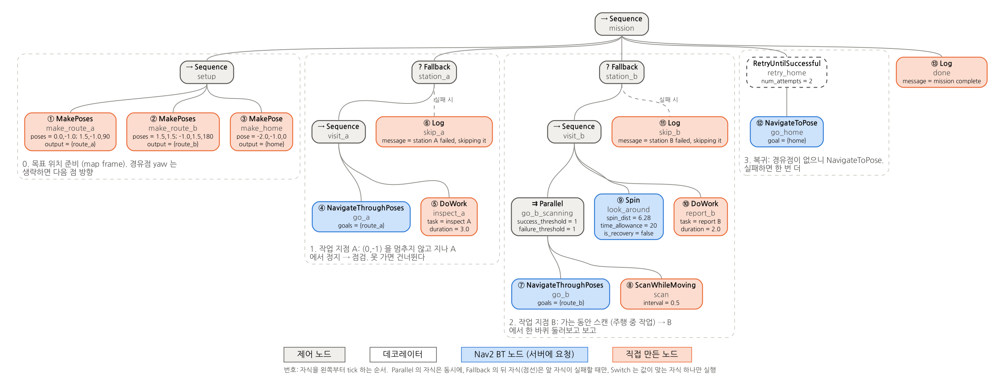
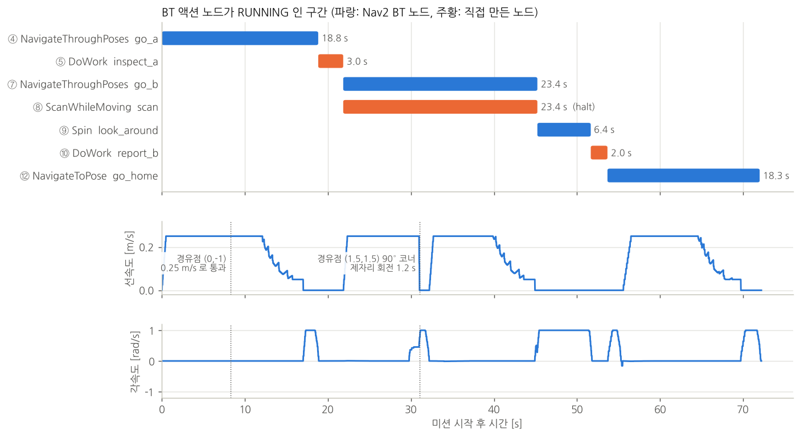

# bt_old_mission: 좌표를 XML 에 적어 둔 미션 (이전 예제)

[bt_navigator/README.md](../README.md) 의 작업 BT 는 갈 곳과 할 일을 실행 중에 토픽이나 액션으로 받는다. 이 패키지는 그보다 앞 단계의 예제로, 지금은 쓰지 않고 참고용으로 남겨 두었다. 장애물 처리(stop & go)도 들어 있지 않다. 갈 곳과 할 일을 **BT XML 안에 미리 적어 두고**, 실행하면 적힌 대로 한 번 돈다. 같은 미션을 Python(BasicNavigator)으로 만든 버전도 있다.

미션에는 네 가지가 섞여 있다.

- **경유점**: 멈추지 않고 지나간다 (`NavigateThroughPoses`).
- **작업 지점**: 멈춰서 작업한다.
- **주행 중 작업**: 움직이는 동안 한다.
- **실패 처리**: 작업 지점에 못 가면 건너뛰고, 복귀는 한 번 더 시도한다.

이 패키지에는 네 가지가 들어 있다.

- 미션 XML
- 좌표 문자열을 pose 로 바꾸는 BT 노드 (`MakePose`, `MakePoses`)
- 같은 미션의 Python 버전
- 테스트

나머지 BT 노드(`DoWork`, `ScanWhileMoving`, `Log`)와 실행 노드(`mission_bt_runner`)는 `bt_mission` 것을 그대로 쓴다. BT 기초와 C++ 로 노드를 만드는 법은 본문 [2장](../README.md#2-bt-기초-이-예제를-읽는-데-필요한-만큼), [3장](../README.md#3-코드로-구현하기-c)에 있다.

목차

- [0. 빌드와 실행](#0-빌드와-실행)
- [1. 미션](#1-미션)
- [2. mission.xml 읽기](#2-missionxml-읽기)
- [3. MakePose, MakePoses 와 실행 (C++)](#3-makepose-makeposes-와-실행-c)
- [4. Python 작업 노드](#4-python-작업-노드)
- [5. 미션 실행](#5-미션-실행)
- [6. 작업을 받는 BT (task_loop.xml, task.xml) 와 비교](#6-작업을-받는-bt-task_loopxml-taskxml-와-비교)
- [7. 확인한 것](#7-확인한-것)
- [8. BT 로 할까, Python 으로 할까](#8-bt-로-할까-python-으로-할까)
- [9. 주의할 점 (Humble)](#9-주의할-점-humble)
- [10. 파일](#10-파일)

---

## 0. 빌드와 실행

```bash
cd ~/nav2_ws
rosdep install --from-paths src --ignore-src -y      # nav2_simple_commander 등
colcon build --symlink-install --packages-select \
  simple_line_planner simple_line_controller simple_line_bringup \
  bt_mission_msgs bt_mission bt_old_mission
source install/setup.bash
```

```bash
# 터미널 1: Gazebo + Nav2 + RViz (본문 0장과 같다)
ros2 launch simple_line_bringup simple_line.launch.py

# 터미널 2: 둘 중 하나
ros2 launch bt_old_mission mission.launch.py     # BT 버전
ros2 run bt_old_mission mission_node.py          # Python 버전
```

예전에는 `mission.xml` 과 `mission_node.py` 가 `bt_mission` 패키지에 있었다. `ros2 run bt_mission mission_bt_runner` 를 그냥 실행하면 이제 [`task_loop.xml`](../README.md#4-좌표를-토픽으로-받기-task_loopxml) 이 뜬다.

---

## 1. 미션

같은 미션을 두 가지 방법으로 만들었다.

| | 실행 | 미션을 정하는 곳 |
|---|---|---|
| **BT 버전** | `ros2 launch bt_old_mission mission.launch.py` | `behavior_trees/mission.xml` |
| **Python 버전** | `ros2 run bt_old_mission mission_node.py` | `scripts/mission_node.py` 맨 위의 `ROUTE_A`, `ROUTE_B`, `HOME` |

두 버전이 부르는 Nav2 기능은 같다.

- **이동**: bt_navigator 의 `NavigateThroughPoses` ([MULTI_GOAL.md 1장](../../simple_line/MULTI_GOAL.md#1-경유-경로-navigatethroughposes-가-처리되는-흐름)) / `NavigateToPose`
- **제자리 회전**: behavior_server 의 `Spin`
- **경로 생성과 추종**: `SimpleLinePlanner` / `SimpleLineController` ([MULTI_GOAL.md 3장](../../simple_line/MULTI_GOAL.md#3-꺾은선을-따라가기-위한-컨트롤러-동작)의 동작 포함)

로봇은 (-2.0, -1.0) 에서 +x 를 보고 출발한다.

```
  y
 1.5 ┤  B(-1, 1.5) ◀━━━━━━━━━━━━━━━━━━━━━━ (1.5, 1.5)
     │                                      ┃   A → B: 주행 중 0.5m 마다 스캔
     │                                      ┃
 -1  ┤  S(-2, -1) ━━━━━▶ (0, -1) ━━━━━━━▶ A(1.5, -1)
     └──────────────────────────────────────────────── x

  S: 출발점.  (0,-1), (1.5,1.5): 경유점 (멈추지 않음).  A, B: 작업 지점 (정지)
```

| 단계 | 이동 | 이동에 쓰는 Nav2 액션 | 작업 | 실패하면 |
|---|---|---|---|---|
| A | 출발 → (0,-1) 경유 → **A** (1.5,-1, 90°) | `NavigateThroughPoses` | 정지 상태: 점검 3초 | A 를 건너뛰고 B 로 |
| B | A → (1.5,1.5) 경유 → **B** (-1,1.5, 180°) | `NavigateThroughPoses` | 주행 중: 0.5m 마다 스캔<br>정지 상태: 360° 회전 + 보고 2초 | B 를 건너뛰고 복귀 |
| 복귀 | B → 출발점 (-2,-1, 0°) | `NavigateToPose` | - | 한 번 더 시도 |

**경유점과 작업 지점을 한 번에 보낸다.** `NavigateThroughPoses` 는 앞의 점들을 멈추지 않고 지나가고 **마지막 점에서 멈춘다**. 그래서 "경유점 몇 개 + 작업 지점" 을 하나의 명령으로 보내고, 도착하면 작업한다. 경유점이 없는 이동(복귀)은 `NavigateToPose` 로 보낸다.

경로를 작업 지점마다 끊어 보내므로, [MULTI_GOAL.md 4장](../../simple_line/MULTI_GOAL.md#최종-goal-이-앞-구간과-겹치면-일찍-끝날-수-있다-humble)의 "최종 goal 이 앞 구간과 겹치면 일찍 끝남" 도 구간마다만 따지면 된다.

---

## 2. mission.xml 읽기

`bt_mission/tools/draw_bt.py` 가 `mission.xml` 을 읽어 그린 그림이다. 원 안의 번호는 자식을 왼쪽부터 tick 하는 순서다. 점선 상자의 제목은 XML 주석이다.



위에서부터 읽으면 이렇다.

```xml
<Sequence name="mission">           <!-- 아래 다섯 묶음을 차례로. 하나라도 실패하면 미션 실패 -->
```

**0. setup**: 목표 위치를 만들어 blackboard 에 넣는다.

```xml
<MakePoses name="make_route_a" poses="0.0,-1.0; 1.5,-1.0,90" output="{route_a}"/>
<MakePoses name="make_route_b" poses="1.5,1.5; -1.0,1.5,180" output="{route_b}"/>
<MakePose name="make_home" pose="-2.0,-1.0,0" output="{home}"/>
```

- 형식은 `"x,y[,yaw_deg]; ..."` 이다.
- 경유점의 yaw 는 생략하면 다음 점 방향으로 채운다.
- 위치를 바꾸려면 여기만 고치면 된다.
- `MakePoses` 가 `output="{route_a}"` 로 blackboard 에 쓰고, 아래의 `NavigateThroughPoses` 가 `goals="{route_a}"` 로 읽는다.

**1. station_a**: 경유 → 정지 작업. 못 가면 건너뛴다.

```xml
<Fallback name="station_a">
  <Sequence name="visit_a">
    <NavigateThroughPoses name="go_a" goals="{route_a}"/>       <!-- (0,-1) 은 지나가고 A 에서 정지 -->
    <DoWork name="inspect_a" task="inspect A" duration="3.0"/>  <!-- 정지 상태 작업 -->
  </Sequence>
  <Log name="skip_a" message="station A failed, skipping it"/> <!-- visit_a 가 실패했을 때만 -->
</Fallback>
```

- `go_a` 나 `inspect_a` 가 실패하면 `visit_a` 가 FAILURE 다.
- 그러면 Fallback 이 `skip_a` 를 실행한다. `skip_a` 는 SUCCESS 이므로 `station_a` 전체는 SUCCESS 가 되고, 미션은 B 로 넘어간다.

**2. station_b**: 주행 중 작업 → 정지 작업.

```xml
<Parallel name="go_b_scanning" success_threshold="1" failure_threshold="1">
  <NavigateThroughPoses name="go_b" goals="{route_b}"/>   <!-- 주행 -->
  <ScanWhileMoving name="scan" interval="0.5"/>            <!-- 주행하는 동안 같이 -->
</Parallel>
<Spin name="look_around" spin_dist="6.28" time_allowance="20" is_recovery="false"/>
<DoWork name="report_b" task="report B" duration="2.0"/>
```

`ScanWhileMoving` 은 스스로 끝나지 않는다(항상 RUNNING). 그래서 `go_b` 가 결과를 내야 Parallel 이 끝난다.

| `go_b` 결과 | Parallel | `scan` |
|---|---|---|
| SUCCESS (`success_threshold="1"`) | SUCCESS | halt (중단) |
| FAILURE (`failure_threshold="1"`) | FAILURE | halt (중단) |

**3. 복귀**: 경유점이 없으니 `NavigateToPose` 를 쓴다. 실패하면 한 번 더 시도한다.

```xml
<RetryUntilSuccessful name="retry_home" num_attempts="2">
  <NavigateToPose name="go_home" goal="{home}"/>
</RetryUntilSuccessful>
<Log name="done" message="mission complete"/>
```

복귀가 두 번 다 실패하면 `mission` Sequence 가 FAILURE 로 끝난다.

---

## 3. MakePose, MakePoses 와 실행 (C++)

### 3-1. 노드 (`include/bt_old_mission/pose_nodes.hpp`, `src/pose_nodes.cpp`)

| 노드 | 입력 포트 | 출력 포트 `output` | 쓰는 곳 |
|---|---|---|---|
| `MakePose` | `pose="x,y,yaw_deg"`, `frame` (기본 `map`) | `PoseStamped` | `NavigateToPose` 의 `goal` |
| `MakePoses` | `poses="x,y[,yaw_deg]; ..."`, `frame` | `std::vector<PoseStamped>` | `NavigateThroughPoses` 의 `goals` |

- 둘 다 `BT::SyncActionNode` 다. tick 한 번에 blackboard 에 쓰고 SUCCESS 를 돌려준다.
- 문자열은 `parsePoses()` 가 읽는다. yaw 를 생략한 점은 진행 방향으로 채운다. 중간 점은 다음 점 쪽, 마지막 점은 이전 점에서 온 방향이다.
- 형식이 틀리거나, 점이 하나뿐인데 yaw 가 없으면 오류 로그를 남기고 FAILURE 를 돌려준다.

### 3-2. 플러그인으로 불러오기

`mission_bt_runner` 는 `bt_mission` 의 노드만 코드에서 등록한다. `MakePose(s)` 는 이 패키지에 있으므로, 플러그인 라이브러리 `bt_old_mission_nodes` 로 빌드하고 실행할 때 이름으로 불러온다. bt_navigator 가 `plugin_lib_names` 로 Nav2 BT 노드를 불러오는 것과 같은 방식이다.

```cpp
// src/pose_nodes.cpp 끝. 라이브러리를 불러오면 이 함수가 불려 노드가 등록된다
BT_REGISTER_NODES(factory)
{
  bt_old_mission::registerPoseNodes(factory);   // MakePose, MakePoses
}
```

```python
# launch/mission.launch.py (발췌)
Node(package='bt_mission', executable='mission_bt_runner', name='mission_bt',
     parameters=[{'bt_xml': os.path.join(share, 'behavior_trees', 'mission.xml'),
                  'extra_plugin_libs': ['bt_old_mission_nodes']}])
```

`mission_bt_runner` 는 `extra_plugin_libs` 의 라이브러리를 Nav2 BT 노드와 같이 `factory.registerFromPlugin()` 으로 불러온다 ([본문 3-2](../README.md#3-2-실행-노드-srcmission_bt_runnercpp)). CMake 에서는 그 라이브러리에 `BT_PLUGIN_EXPORT` 를 정의해야 `BT_REGISTER_NODES` 가 플러그인 진입점이 된다.

launch 없이 실행하려면 두 파라미터를 직접 준다.

```bash
ros2 run bt_mission mission_bt_runner --ros-args \
  -p bt_xml:=$(ros2 pkg prefix bt_old_mission)/share/bt_old_mission/behavior_trees/mission.xml \
  -p "extra_plugin_libs:=[bt_old_mission_nodes]"
```

`extra_plugin_libs` 를 빠뜨리면 트리를 만들 때 바로 끝난다.

```
[ERROR] [mission_bt]: failed to create the tree from .../mission.xml: Error at line 35: -> Node not recognized: MakePoses
```

### 3-3. Nav2 Humble 의 포트 타입 문제

- `MakePoses` 의 출력 포트는 타입을 적지 않았다.
  - Nav2 Humble 1.1.18 이하의 `NavigateThroughPoses` BT 노드는 `goals` 포트 타입을 `PoseStamped` 로 잘못 선언하고 있다 (1.1.19 부터 `std::vector<PoseStamped>`).
  - 그래서 `MakePoses` 쪽을 `std::vector<PoseStamped>` 로 선언하면 트리를 만들 때 타입이 다르다는 오류가 난다.
- 같은 이유로, 1.1.18 에서는 XML 에서 `MakePoses` 가 그 변수를 쓰는 `NavigateThroughPoses` 보다 **앞에** 있어야 한다.
  - 앞에 나온 노드의 포트 타입으로 변수가 정해지기 때문이다.
  - 순서를 바꾸면 실행 중에 `Blackboard::set() failed: once declared, the type of a port shall not change` 가 난다 (확인함).

---

## 4. Python 작업 노드

`scripts/mission_node.py` 는 같은 미션을 BT 없이 위에서 아래로 실행한다. Nav2 와는 `nav2_simple_commander` 의 `BasicNavigator` 로 주고받는다.

```python
ROUTE_A = [(0.0, -1.0, None), (1.5, -1.0, 90.0)]     # (0,-1) 경유 → 작업 지점 A
ROUTE_B = [(1.5, 1.5, None), (-1.0, 1.5, 180.0)]     # (1.5,1.5) 경유 → 작업 지점 B
HOME = [(-2.0, -1.0, 0.0)]

def run_mission(nav):
    # 1. 작업 지점 A ------------------------------------------- BT: Fallback "station_a"
    if drive(nav, ROUTE_A):                                    # NavigateThroughPoses "go_a"
        do_work('inspect A', 3.0)                              # DoWork "inspect_a"
    else:
        print('[log] station A failed, skipping it')           # Log "skip_a"

    # 2. 작업 지점 B ------------------------------------------- BT: Fallback "station_b"
    scanner = Scanner(SCAN_INTERVAL)
    if (drive(nav, ROUTE_B, while_running=scanner)             # Parallel(go_b, scan)
            and spin(nav, 2 * math.pi)):                       # Spin "look_around"
        do_work('report B', 2.0)                               # DoWork "report_b"
    else:
        print('[log] station B failed, skipping it')           # Log "skip_b"

    # 3. 복귀 ------------------------------------------------- BT: RetryUntilSuccessful
    for _ in range(2):
        if drive(nav, HOME):                                   # NavigateToPose "go_home"
            print('[log] mission complete')                    # Log "done"
            return True
    return False
```

| BT | Python |
|---|---|
| Sequence | 위에서 아래로 실행되는 코드 |
| Fallback | `if 성공: ... else: 대신 할 일` |
| RetryUntilSuccessful | `for` 로 다시 시도 |
| Parallel (주행 + 스캔) | 주행이 끝날 때까지 도는 `while not nav.isTaskComplete()` 안에서 feedback 을 보고 스캔 |
| blackboard | 파이썬 변수 |

```python
def drive(nav, points, while_running=None):
    """점이 둘 이상이면 NavigateThroughPoses, 하나면 NavigateToPose."""
    poses = make_poses(nav, points)
    sent = nav.goThroughPoses(poses) if len(poses) > 1 else nav.goToPose(poses[0])
    return sent and wait_until_done(nav, while_running)

def wait_until_done(nav, while_running=None):
    while not nav.isTaskComplete():                    # 0.1 초마다 돌아온다
        feedback = nav.getFeedback()
        if while_running and feedback is not None:
            while_running(feedback)                    # 주행 중 작업 (스캔)
    return nav.getResult() == TaskResult.SUCCEEDED
```

두 군데를 일부러 바꿨다.

- **`nav.waitUntilNav2Active(localizer='controller_server')`**
  - 기본값(`localizer='amcl'`)이면 `amcl_pose` 를 받기 전에 initial pose 로 (0,0) 을 보낸다. 그러면 AMCL 위치가 바뀔 수 있다.
  - 그래서 AMCL 대신 다른 lifecycle 노드가 active 인지만 보게 했다.
- **`rclpy.init(..., signal_handler_options=SignalHandlerOptions.NO)`**
  - rclpy 의 기본 Ctrl-C 처리는 ROS 를 먼저 종료한다. 그러면 `except KeyboardInterrupt:` 의 `nav.cancelTask()` 가 Nav2 에 닿지 못할 수 있다.
  - 이 옵션을 주면 Ctrl-C 는 `KeyboardInterrupt` 로만 오고, 취소가 정상적으로 간다 (확인함).

---

## 5. 미션 실행

0장의 launch 를 띄운 뒤:

```bash
# 둘 중 하나
ros2 launch bt_old_mission mission.launch.py
ros2 run bt_old_mission mission_node.py
```

BT 버전 출력 (가짜 로봇으로 실행한 실제 로그. 타임스탬프는 뺐다):

```
[bt] go_a            NavigateThroughPoses    IDLE -> RUNNING
[bt] go_a            NavigateThroughPoses    RUNNING -> SUCCESS
[work] inspect A: start (3.0 s)
[bt] inspect_a       DoWork                  IDLE -> RUNNING
[work] inspect A: done
[bt] inspect_a       DoWork                  RUNNING -> SUCCESS
[bt] visit_a         Sequence                RUNNING -> SUCCESS
[bt] station_a       Fallback                RUNNING -> SUCCESS
[bt] station_b       Fallback                IDLE -> RUNNING
[bt] visit_b         Sequence                IDLE -> RUNNING
[bt] go_b            NavigateThroughPoses    IDLE -> RUNNING
[scan] start (every 0.50 m)
[scan] #1 at (1.47, -1.00)
[bt] scan            ScanWhileMoving         IDLE -> RUNNING
[bt] go_b_scanning   Parallel                IDLE -> RUNNING
[scan] #2 at (1.48, -0.50)
...
[scan] #10 at (-0.95, 1.49)
[bt] go_b            NavigateThroughPoses    RUNNING -> SUCCESS
[scan] stop: 10 scans
[bt] scan            ScanWhileMoving         RUNNING -> HALTED
[bt] go_b_scanning   Parallel                RUNNING -> SUCCESS
[bt] look_around     Spin                    IDLE -> RUNNING
...
[bt] mission         Sequence                RUNNING -> SUCCESS
mission SUCCESS in 72.0 s
```

`go_b` 가 SUCCESS 가 되자, 같은 tick 에서 Parallel 이 `scan` 을 halt 하는 것이 보인다.

**자주 하는 일**

- **미션 바꾸기**
  - BT 버전: `behavior_trees/mission.xml` 을 고친다. `--symlink-install` 로 빌드했다면 다시 빌드하지 않아도 된다. 다른 파일을 쓰려면 3-2 의 `ros2 run` 명령에서 `bt_xml` 만 바꾼다.
  - Python 버전: `mission_node.py` 맨 위의 `ROUTE_A`, `ROUTE_B`, `HOME` 을 고친다.
  - 좌표를 고치지 않고 실행 중에 보내려면 본문의 작업 BT 를 쓴다 ([4장](../README.md#4-좌표를-토픽으로-받기-task_loopxml) 토픽, [5장](../README.md#5-액션으로-작업-맡기-task_server-taskxml) 액션).
  - 어느 쪽이든 각 `NavigateThroughPoses` 의 마지막 점이 그 구간의 출발점이나 앞 구간과 겹치지 않게 한다 (9장).
- **RViz 에서 스캔 위치 보기**: `Add → By topic → /mission/scan_points (PoseArray)`
- **XML 을 고친 뒤 그림 다시 그리기**:

  ```bash
  sudo apt install graphviz fonts-nanum
  cd ~/nav2_ws/src/nav2_dwb/bt_navigator
  python3 bt_mission/tools/draw_bt.py bt_old_mission/behavior_trees/mission.xml bt_old_mission/doc/mission_bt.png
  ```

- **중단**: Ctrl-C. 두 버전 모두 실행 중인 Nav2 goal 을 취소하고 끝난다.

---

## 6. 작업을 받는 BT (`task_loop.xml`, `task.xml`) 와 비교

본문의 작업 BT 는 같은 노드(`DoWork`, `ScanWhileMoving`, `Spin`)를 쓰지만, 좌표와 순서를 실행 중에 받는다.

| | `mission.xml` (이 패키지) | `task_loop.xml`, `task.xml` (본문 4, 5장) |
|---|---|---|
| 좌표 | XML 안 (`MakePoses`) | Task 메시지, ExecuteTask 액션 goal |
| 여러 점 | `NavigateThroughPoses` 로 지나감 (멈추지 않음) | `ForEachWaypoint` + `NavigateToPose` 로 점마다 멈춤 |
| 작업 순서 | XML 에 고정 | 받은 순서 |
| 작업 종류 | 지점마다 XML 에 적음 | `action` 값을 보고 `Switch3` 가 고름 |
| 실패 처리 | 지점별 Fallback, 복귀 재시도 | 작업마다 보고하고 다음 작업으로 |
| 끝 | 마지막 단계가 끝나면 | 끝나지 않음 (다음 작업을 기다림) |

**시간**: 이 미션과 같은 작업 4개를 본문의 작업 BT 로 보내면 78초 정도 걸린다. 점마다 서서 방향까지 맞추기 때문이다. 이 미션은 경유점을 지나가므로 72초다. 작업 BT 에서도 멈출 필요가 없는 점은 이 미션처럼 `NavigateThroughPoses` 로 지나가게 하는 가지를 따로 두면 된다.

---

## 7. 확인한 것

본문 [8장](../README.md#8-확인한-것)과 같은 환경이다. 실제 Nav2 Humble 서버를 쓰고, Gazebo 대신 `cmd_vel` 을 적분하는 가짜 로봇을 썼다. 출발점은 (-2.0, -1.0, 0°) 이다.

**단위 테스트** (`test/test_old_mission.cpp`, gtest 6개 통과): 실제 `mission.xml` 로 테스트한다. Nav2 노드 3개만 3 tick 뒤 정해 둔 결과를 내는 가짜로 바꿨다.

| 테스트 | 확인 내용 |
|---|---|
| `ParsePoses.*` (2개) | `"x,y[,yaw]; ..."` 해석, yaw 자동 채우기, 잘못된 입력 거부 |
| `AllStationsVisited` | 모든 노드가 순서대로 SUCCESS. `scan` 은 RUNNING → HALTED. MakePoses → blackboard → NavigateThroughPoses 로 위치가 전달됨 |
| `FailedStationIsSkipped` | `go_a` 실패 → `inspect_a` 는 실행 안 됨, `skip_a` 실행, B 로 진행 |
| `ReturnHomeIsRetriedOnce` | `go_home` 한 번 실패 → 다시 시도해서 성공 |
| `MissionFailsWhenHomeIsUnreachable` | `go_home` 두 번 실패 → 미션 FAILURE |

**Nav2 서버로 실행**

| 항목 | BT 버전 | Python 버전 |
|---|---|---|
| 결과 | SUCCESS | SUCCESS |
| 미션 시간 | 72.0 s | 71.5 s |
| 경유점 (0,-1) 통과 속도 | 0.25 m/s (감속 없음) | 0.25 m/s |
| 스캔 | 10개 (0.5 m 간격) | 9개 |
| B 에서 회전 | 363° | (같은 Spin) |
| 정지 위치 오차 (A / B / 출발점) | 0.03 / 0.03 / 0.02 m | 0.03 / 0.04 / 0.04 m |
| Ctrl-C | goal 취소, 로봇 정지 | goal 취소, 로봇 정지 |

패키지를 나눈 뒤에도 같은 스택에서 다시 돌렸다. `ros2 launch bt_old_mission mission.launch.py` 는 SUCCESS, 71.2 s, 스캔 10개. 3-2 의 `ros2 run` 명령은 71.3 s, Python 버전은 71.0 s 였다.

컨트롤러의 회전 정렬과 goal 허용오차를 바꾸기 전에는 미션 시간이 60~61.5 s, 정지 위치 오차가 0.22~0.24 m 였다.
모서리에서 다 돈 뒤에 출발하고, 작업 지점에 더 가까이 가서 서는 만큼 시간이 늘었다.

BT 버전 실행 중 노드별 RUNNING 구간과 로봇 속도:



- **경유점 (0,-1)**: 0.25 m/s 그대로 지나간다. `go_a` 하나가 경유점과 A 를 함께 처리한다.
- **경유점 (1.5,1.5)**: 90° 꺾이는 곳이다. carrot 이 45° 넘게 틀어지면 멈춰서, 다음 구간 쪽으로 방향이 다 맞을 때까지 1.2초 제자리 회전한 뒤 출발했다. 컨트롤러 동작이고, 경유점이라서 멈춘 것은 아니다 ([MULTI_GOAL.md 4장](../../simple_line/MULTI_GOAL.md#모서리에서)).
- **`scan`**: `go_b` 와 같은 구간에 RUNNING 이고, `go_b` 가 끝나는 순간 halt 된다.
- **작업 지점 정지 위치**: A, B 모두 goal 에서 0.03 m 안에 섰다. goal checker 의 `xy_goal_tolerance` 를 0.05 m 로 줄였기 때문이다 (Humble 기본 0.25 m 일 때는 0.22~0.24 m 앞에서 멈췄다).
- **tick 주기**: tick 을 10Hz 로 돌렸을 때는 로봇이 멈춘 뒤 BT 가 SUCCESS 를 받기까지 매번 0.9~1.1초가 걸렸다. 100Hz 에서는 이 지연이 사라져 미션 시간이 63.7~65.5초에서 60.1~61.5초가 됐다 (컨트롤러를 바꾸기 전에 잰 값. 이유는 [본문 3-3](../README.md#3-3-nav2-bt-노드를-쓸-때-알아둘-것)).

---

## 8. BT 로 할까, Python 으로 할까

상위 작업 계층은 Python 으로 시작해서, 복잡해지면 BT 로 옮기는 것을 권한다.

| | BT (`mission_bt_runner` + XML) | Python (`mission_node.py`) |
|---|---|---|
| 처음 만들기 | 노드 클래스, 등록, 실행 노드가 필요 | 함수 몇 개면 된다 |
| 흐름 읽기 | XML / 그림으로 구조가 보인다 | 코드를 따라 읽어야 한다 |
| 미션 바꾸기 | XML 만 고치면 된다 (빌드 불필요) | 코드를 고친다 |
| 주행 중 작업, 동시에 여러 일 | `Parallel` 로 선언 | 대기 루프 안에 직접 끼워 넣어야 한다 |
| 실패 처리, 재시도 | `Fallback`, `RetryUntilSuccessful` 등 조합 | if / for 가 늘어난다 |
| 중단 | `haltTree()` 한 번에 실행 중인 노드 모두 정리 | 상황마다 직접 취소 |
| 테스트 | 가짜 노드로 로봇 없이 흐름 테스트 (7장) | 따로 구조를 만들어야 한다 |
| 재사용 | 만든 노드를 다른 미션 XML 에서도 쓴다 | 함수 재사용 |

- **단계가 몇 개 안 되고 순서가 고정이면 Python 이 빠르다.** 프로토타입, 시연, 외부 서버가 순서를 정해 주는 경우가 여기에 해당한다.
- **조건 분기, 실패 처리, 주행 중 작업이 늘어나면 BT 가 낫다.** if / for 가 쌓이기 시작하는 시점이 옮길 때다.
- 두 버전 모두 아래층(Nav2, planner, controller)은 그대로다. 그래서 Python 으로 시작했다가 BT 로 옮겨도 바뀌는 것은 상위 계층뿐이다.

---

## 9. 주의할 점 (Humble)

- **최종 goal 이 앞 구간과 겹치면 안 된다.** `NavigateThroughPoses` 는 마지막 점 근처를 같은 방향으로 지나가면, 경유점이 남아 있어도 도착 처리할 수 있다 ([MULTI_GOAL.md 4장](../../simple_line/MULTI_GOAL.md#최종-goal-이-앞-구간과-겹치면-일찍-끝날-수-있다-humble)). 미션의 `route_a`, `route_b` 는 마지막 점이 출발점이나 앞 구간과 겹치지 않게 골랐다.
- **`NavigateThroughPoses` 를 재시도하면 지나온 경유점으로 되돌아갈 수 있다.** 다시 보내면 목록 전체가 다시 가므로, 이미 지나간 경유점도 다시 간다. 그래서 미션은 재시도를 `NavigateToPose` (복귀)에만 걸었다. 경유 구간을 재시도하려면 남은 점만 다시 보내야 한다.
- **경유점을 정확히 밟지는 않는다.** 앞의 점은 0.7m 안에 들어오면 지난 것으로 친다. 실측으로 0.23~0.58m 거리로 지나갔다 ([MULTI_GOAL.md 4장](../../simple_line/MULTI_GOAL.md#경유-goal-을-정확히-밟지는-않는다)). 점마다 정확히 서야 하면 본문의 작업 BT 처럼 점마다 `NavigateToPose` 를 보낸다.
- **`MakePoses` 는 그 변수를 읽는 `NavigateThroughPoses` 보다 앞에 둔다** (3-3).

---

## 10. 파일

```
bt_old_mission/
├── behavior_trees/mission.xml               좌표가 XML 에 있는 미션 (1, 2장)
├── include/bt_old_mission/pose_nodes.hpp    MakePose, MakePoses 선언, parsePoses (3장)
├── src/pose_nodes.cpp                       위 구현 + 플러그인 등록 (BT_REGISTER_NODES)
├── launch/mission.launch.py                 bt_mission 의 mission_bt_runner 로 mission.xml 실행
├── scripts/mission_node.py                  같은 미션의 Python 버전 (BasicNavigator, 4장)
├── test/test_old_mission.cpp                gtest: 위치 문자열 해석 + mission.xml 흐름 (가짜 Nav2 노드)
└── doc/
    ├── mission_bt.png                       BT 그림 (bt_mission/tools/draw_bt.py 로 생성)
    └── timeline.png                         실행 타임라인 (7장의 실행 기록으로 그림)
```
