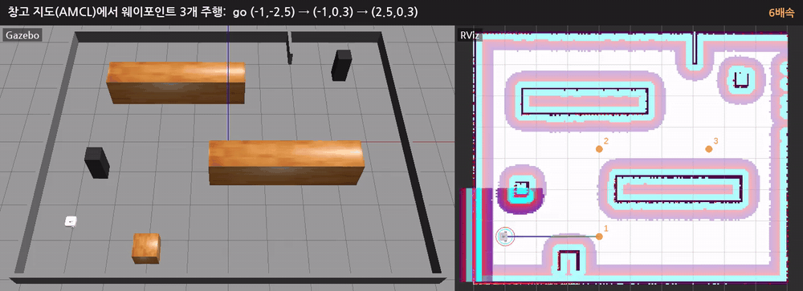
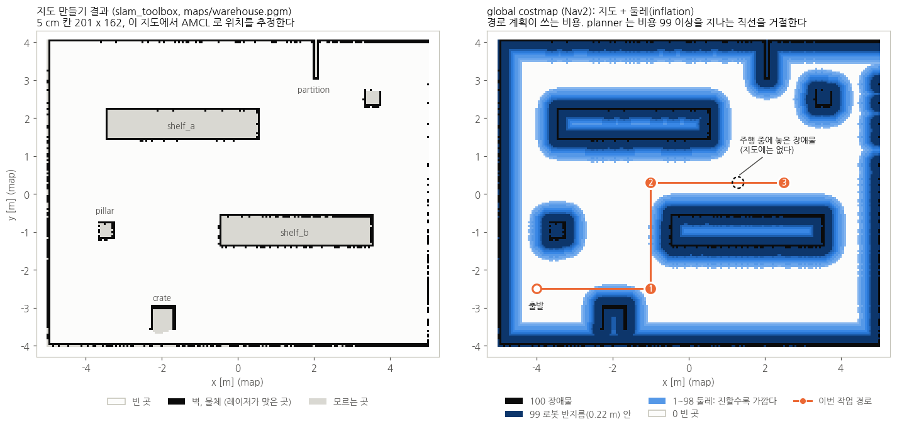

# 시뮬레이션 기록: 창고 지도에서 웨이포인트 주행 중 장애물 stop & go



창고 월드에서 저장한 지도(AMCL)로 점 3개를 차례로 들르는 작업을 보냈다. 선반 사이 통로를 달리는 중에 장애물을 놓았다가, 선 뒤 5초가 지나 치웠다. 왼쪽이 Gazebo, 오른쪽이 RViz다. 그냥 달리는 부분은 6배속, 장애물 앞뒤는 2.5배속이다.

| 파일 | 내용 |
|---|---|
| `warehouse_stop_and_go.mp4` | 위 영상 (14.5초, 1448 x 526, H.264, 380 KB) |
| `warehouse_stop_and_go.gif` | 같은 영상 (1000 px, 10 fps, 2.0 MB). README 에 바로 넣을 때 |
| `warehouse_map_costmap.png` | 지도 만들기 결과(slam_toolbox)와 Nav2 global costmap, 이번 경로 (아래) |
| `warehouse_rviz_path.png` | RViz: 2번에서 3번으로 통로를 달리는 중. 경로(초록, 파랑)와 웨이포인트 1, 2, 3 |
| `warehouse_gazebo_obstacle_stop.png` | Gazebo: 통로의 장애물(빨간 원기둥) 앞에 서서 기다리는 중 |

## 지도와 costmap



- **왼쪽: 지도 만들기 결과.** `slam:=True` 로 창고를 한 바퀴 돌며 slam_toolbox 가 만든 `simple_line_bringup/maps/warehouse.pgm` 그대로다 (5 cm 칸, 201 x 162). 레이저가 맞은 벽과 물체 면은 검정, 레이저가 들어가지 못한 선반과 상자 안쪽은 "모르는 곳" 이다. 주행할 때는 이 지도에서 AMCL 로 위치를 추정한다. 지도를 만든 과정은 [AMR.md 2장](../../simple_line/AMR.md#2-지도-만들기와-위치-추정).
- **오른쪽: global costmap.** 주행 중에 `/global_costmap/costmap` 을 받아 그렸다. 지도의 장애물(100)에 로봇 반지름 0.22 m 띠(99)와 그 바깥으로 갈수록 옅어지는 둘레(inflation, 1~98)를 붙인 것이다. planner(`SimpleLinePlanner`)는 99 이상을 지나는 직선을 거절하므로, 점은 선반과 기둥을 피해 이어지게 골랐다.
- 주행 중에 놓은 장애물은 지도와 global costmap 에 없다. 레이저가 보고 local costmap(RViz 에서 로봇 둘레 3 x 3 m)에만 들어가고, controller 가 그것을 보고 감속한다.

## 시나리오

창고 월드(`simple_line.launch.py world:=warehouse`), 로봇은 (-4,-2.5) 에서 +x 를 보고 시작한다.

1. 작업: `task> go -1,-2.5 -1,0.3 2.5,0.3`. task_server 가 점마다 `NavigateToPose` 를 보낸다 (4장). 점에서 서서 다음 점 쪽으로 제자리 회전한 뒤 간다.
2. 2번에서 3번으로 선반 사이 통로를 달리다가 x = -0.19 를 지날 때 (1.3,0.3) 에 장애물(반지름 0.15 m 원기둥)을 놓았다.
3. controller 가 남은 거리에 맞춰 S 커브로 감속해서 x = 0.45 에 섰다 (로봇 중심 → 장애물 표면 0.70 m). collision_monitor 는 동작하지 않았다.
4. 선 뒤 5초(시뮬레이션 시간)가 지나 장애물을 치웠다. 약 3초 뒤 다시 출발했다 (local costmap 에서 지워지는 시간 + 출발 지연 1초 + 가속).
5. 3번에 도착, 작업 `SUCCEEDED`. 출발부터 도착까지 약 58초.

## 화면에 보이는 것 (RViz)

| 표시 | 뜻 |
|---|---|
| 주황 원과 숫자 | 웨이포인트 1, 2, 3 (녹화용으로 띄운 마커) |
| 초록 선 | global path (`/plan`). task_server 가 점마다 goal 을 보내므로 지금 가는 점까지 한 구간씩 보인다 |
| 파랑 선 | controller 가 따라가는 앞부분 (`/simple_line/local_plan`) |
| 빨간 원 | collision_monitor 의 원 (반지름 0.3 m, 6-2) |
| 초록 원 | local costmap 의 로봇 footprint |
| 선반, 벽 둘레의 분홍, 하늘색 띠 | global costmap (위 그림 오른쪽과 같은 것, RViz 색) |
| 로봇 둘레 3 x 3 m 의 진한 색 | local costmap (레이저로 지금 보는 것. 놓은 장애물도 여기에 나타난다) |

## 직접 해 보기

```bash
ros2 launch simple_line_bringup simple_line.launch.py world:=warehouse
ros2 run bt_mission task_server
ros2 run simple_line_bringup obstacle.py click
ros2 run bt_mission task_client.py
task> go -1,-2.5 -1,0.3 2.5,0.3
```

로봇이 2번을 지나 통로로 들어서면 RViz 의 Publish Point 로 (1.3,0.3) 근처를 찍어 장애물을 놓고, 서 있는 로봇 앞의 장애물을 다시 찍어 치운다. 명령줄로 하려면 `ros2 run simple_line_bringup obstacle.py put 1.3,0.3` / `remove`. 나머지는 [6-1](../README.md#6-1-직접-해-보기-gazebo) 과 같다.

## 녹화한 방법

화면이 없는 환경이라 gzserver 와 Nav2 를 띄운 뒤, gzclient 와 RViz 를 각각 가상 화면(Xvfb)에 띄워 `ffmpeg -f x11grab` 으로 10 fps 녹화했다. 3D 화면 부분만 잘라 나란히 붙이고, 단계마다 설명을 넣고, 구간별로 배속을 달리해 15 fps 로 줄였다. 장애물이 나타나고 사라지는 시점은 Gazebo 화면에서 빨간 원기둥이 보이는 프레임으로 맞췄다.

녹화용으로만 바꾼 것 (저장소의 launch, 설정은 그대로):

- Gazebo 카메라를 비스듬히 위에서 (월드 파일 사본의 `user_camera`). 낮게 보면 앞 선반(높이 1 m)에 통로가 가려진다
- waffle 레이저 광선 표시 끔 (모델 사본의 `<visualize>`)
- RViz: TF 축과 AMCL 입자 끔, 경로를 굵게, 웨이포인트 마커 추가
- 장애물을 놓고 치우는 순간은 스크립트가 `/odom` 을 보고 정했다 (`obstacle.py` 와 같은 Gazebo 서비스)

내 PC 에서 녹화하려면:

- Gazebo: gzclient 툴바 오른쪽 끝의 비디오 카메라 아이콘 (Record a video)
- RViz 와 화면 전체: SimpleScreenRecorder, OBS, 또는 `ffmpeg -f x11grab -video_size 1280x720 -i :0.0+0,0 out.mp4`
- 배속과 GIF: `ffmpeg -i out.mp4 -vf "setpts=PTS/4" -an fast.mp4`, `ffmpeg -i fast.mp4 -vf "fps=10,scale=1000:-1,split[a][b];[a]palettegen[p];[b][p]paletteuse" out.gif`
- costmap 을 그림으로: RViz 에서 Map 표시의 Topic 을 `/global_costmap/costmap` 으로 두고 화면을 캡처하거나, 토픽(`nav_msgs/OccupancyGrid`)을 받아 직접 그린다 (값: -1 모름, 0 빈 곳, 1~98 둘레, 99 로봇 반지름 안, 100 장애물)
