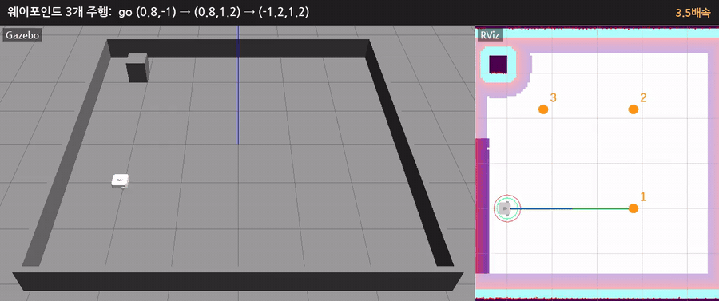

# 시뮬레이션 기록: 웨이포인트 주행 중 장애물 stop & go

점 3개를 차례로 들르는 작업을 보내고, 첫 구간을 달리는 중에 장애물을 놓았다가 선 뒤 5초가 지나 치웠다. 왼쪽이 Gazebo, 오른쪽이 RViz, 3.5배속이다.

| 파일 | 내용 |
|---|---|
| `stop_and_go_waypoints.mp4` | 위 영상 (13.7초, 1302 x 546, H.264, 280 KB) |
| `stop_and_go_waypoints.gif` | 같은 영상 (900 px, 10 fps, 1.3 MB). README 에 바로 넣을 때 |
| `rviz_path.png` | RViz: 첫 구간을 달리는 중. 경로(초록, 파랑)와 웨이포인트 1, 2, 3 |
| `gazebo_obstacle_stop.png` | Gazebo: 장애물(빨간 원기둥) 앞에 서서 기다리는 중 |

## 시나리오

빈 방(`simple_line.launch.py`), 로봇은 (-2,-1) 에서 +x 를 보고 시작한다.

1. 작업: `task> go 0.8,-1 0.8,1.2 -1.2,1.2`. task_server 가 점마다 `NavigateToPose` 를 보낸다 (4장).
2. 로봇이 x = -1.5 를 지날 때 (0,-1) 에 장애물(반지름 0.15 m 원기둥)을 놓았다.
3. controller 가 남은 거리에 맞춰 S 커브로 감속해서 x = -0.87 에 섰다 (로봇 중심 → 장애물 표면 0.72 m). collision_monitor 는 동작하지 않았다.
4. 선 뒤 5초(시뮬레이션 시간)가 지나 장애물을 치웠다. 약 2초 뒤 다시 출발했다 (local costmap 에서 지워지는 시간 + 출발 지연 1초 + 가속).
5. 점 1, 2, 3 에 차례로 도착, 작업 `SUCCEEDED`. 출발부터 도착까지 약 45초.

## 화면에 보이는 것 (RViz)

| 표시 | 뜻 |
|---|---|
| 주황 원과 숫자 | 웨이포인트 1, 2, 3 (녹화용으로 띄운 마커) |
| 초록 선 | global path (`/plan`). task_server 가 점마다 goal 을 보내므로 지금 가는 점까지 한 구간씩 보인다 |
| 파랑 선 | controller 가 따라가는 앞부분 (`/simple_line/local_plan`) |
| 빨간 원 | collision_monitor 의 원 (반지름 0.3 m, 6-2) |
| 초록 원 | local costmap 의 로봇 footprint |
| 장애물 둘레의 색 | local costmap (레이저로 본 장애물과 그 둘레) |

## 직접 해 보기

[6-1](../README.md#6-1-직접-해-보기-gazebo) 의 순서와 같다. 터미널 4 에서 `task> go 0.8,-1 0.8,1.2 -1.2,1.2` 를 보내고, 로봇이 출발하면 RViz 의 Publish Point 로 (0,-1) 근처를 찍어 장애물을 놓고, 서 있는 로봇 앞의 장애물을 다시 찍어 치운다. 명령줄로 하려면 `ros2 run simple_line_bringup obstacle.py put 0,-1` / `remove`.

## 녹화한 방법

화면이 없는 환경이라 gzserver 와 Nav2 를 띄운 뒤, gzclient 와 RViz 를 각각 가상 화면(Xvfb)에 띄워 `ffmpeg -f x11grab` 으로 10 fps 녹화했다. 3D 화면 부분만 잘라 나란히 붙이고, 단계마다 설명을 넣고, 3.5배속 15 fps 로 줄였다.

녹화용으로만 바꾼 것 (저장소의 launch, 설정은 그대로):

- Gazebo 카메라를 비스듬히 (월드 파일 사본의 `user_camera`), waffle 레이저 광선 표시 끔 (모델 사본의 `<visualize>`)
- RViz: TF 축과 AMCL 입자 끔, 경로를 굵게, 웨이포인트 마커 추가
- 장애물을 놓고 치우는 순간은 스크립트가 `/odom` 을 보고 정했다 (`obstacle.py` 와 같은 Gazebo 서비스)

내 PC 에서 녹화하려면:

- Gazebo: gzclient 툴바 오른쪽 끝의 비디오 카메라 아이콘 (Record a video)
- RViz 와 화면 전체: SimpleScreenRecorder, OBS, 또는 `ffmpeg -f x11grab -video_size 1280x720 -i :0.0+0,0 out.mp4`
- 배속과 GIF: `ffmpeg -i out.mp4 -vf "setpts=PTS/3.5" -an fast.mp4`, `ffmpeg -i fast.mp4 -vf "fps=10,scale=900:-1,split[a][b];[a]palettegen[p];[b][p]paletteuse" out.gif`
