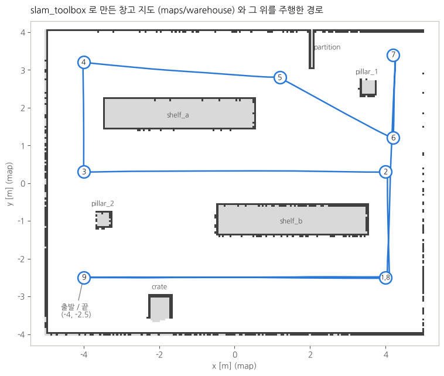
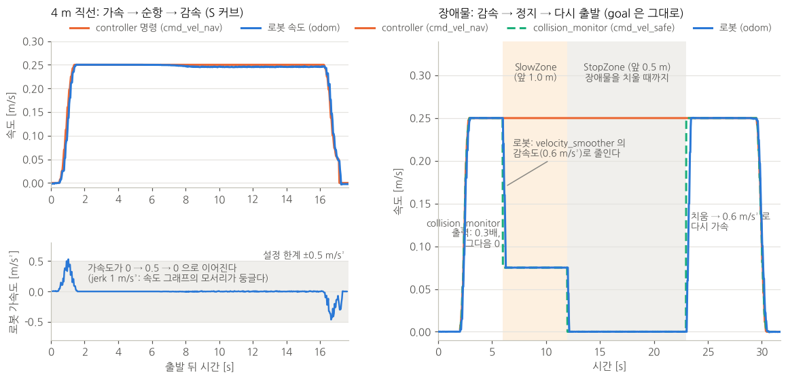

# 실제 AMR 로 옮기기: 지도, 위치 추정, 가감속, 장애물 감속, 개발 방식

이 저장소를 실제 AMR 에서 돌리려고 할 때 필요한 것들을 시뮬레이션(Gazebo, TurtleBot3 waffle)에서 먼저 만들고 확인했다.

| 장 | 내용 | 바뀐 것 |
|---|---|---|
| 1 | launch 구조: 로봇과 내비게이션을 나눈다 | `navigation.launch.py`(로봇과 무관), `simple_line.launch.py`(시뮬레이션 로봇), `rviz.launch.py` |
| 2 | 지도 만들기(SLAM)와 저장한 지도에서 위치 추정(AMCL) | 창고 월드 `worlds/warehouse.world`, 지도 `maps/warehouse.*`, AMCL 설정 |
| 3 | 지도 위에서 점 명령 주기 | planner 가 지도의 장애물을 지나는 직선을 거절 (`fail_on_obstacle`) |
| 4 | 부드러운 가감속 | controller 의 S 커브 속도 프로파일, velocity_smoother 가감속 제한 |
| 5 | 장애물 앞에서 감속하고 서기 | collision_monitor 에 SlowZone 추가, velocity_smoother 앞으로 옮김 |
| 6 | 막혔을 때 로봇이 스스로 돌거나 뒤로 가지 않게 | navigation BT `behavior_trees/navigate_to_pose_amr.xml` |
| 7 | 실제 로봇 개발은 보통 어떻게 하나 | (설명) |
| 8 | 확인한 것 | |

목차

- [1. launch 구조](#1-launch-구조)
- [2. 지도 만들기와 위치 추정](#2-지도-만들기와-위치-추정)
- [3. 지도 위에서 점 명령 주기](#3-지도-위에서-점-명령-주기)
- [4. 가감속](#4-가감속)
- [5. 장애물 앞에서 감속하고 서기](#5-장애물-앞에서-감속하고-서기)
- [6. 막혔을 때: 회전, 후진 없이 기다리기](#6-막혔을-때-회전-후진-없이-기다리기)
- [7. 실제 로봇에서 개발하는 방식](#7-실제-로봇에서-개발하는-방식)
- [8. 확인한 것](#8-확인한-것)
- [9. 파일](#9-파일)

---

## 1. launch 구조

실제 로봇에는 Gazebo 가 없다. 그래서 launch 를 "로봇" 과 "내비게이션" 두 덩어리로 나눴다. 실제 로봇으로 옮길 때는 로봇 쪽만 바꾼다.

```
simple_line.launch.py (시뮬레이션)              실제 로봇
 ├─ 로봇: Gazebo, 스폰, robot_state_publisher     ├─ 로봇: 모터 드라이버, 라이다 드라이버, robot_state_publisher (직접 준비)
 ├─ navigation.launch.py  ◀────── 같은 파일 ──────▶ ├─ navigation.launch.py
 └─ rviz.launch.py                                └─ rviz.launch.py (개발 PC 에서)
```

**로봇이 내비게이션에 줘야 하는 것** (실제 로봇 드라이버가 맞춰야 하는 약속)

| 무엇 | 이름 | 비고 |
|---|---|---|
| 레이저 | `/scan` (`sensor_msgs/LaserScan`) | 지도, AMCL, collision_monitor 가 쓴다 |
| 바퀴 odometry | `/odom` (`nav_msgs/Odometry`) + TF `odom → base_footprint` | 짧은 거리에서 정확해야 한다 (7장) |
| 로봇 모양 | TF `base_footprint → base_link → base_scan` | URDF + robot_state_publisher |
| 속도 명령을 받아 움직이기 | `/cmd_vel` (`geometry_msgs/Twist`) | 명령이 끊기면 서는 watchdog 가 드라이버에 있어야 한다 (7장) |

**`navigation.launch.py`** 가 띄우는 것

| 인자 | 띄우는 노드 |
|---|---|
| `slam:=True` | slam_toolbox (지도를 만들면서 위치 추정) |
| `map:=<지도.yaml>` | map_server + amcl (저장한 지도에서 위치 추정) |
| 공통 | planner_server, controller_server, behavior_server, bt_navigator, waypoint_follower, collision_monitor, velocity_smoother, lifecycle_manager |

그 밖의 인자: `use_sim_time`(시뮬레이션이면 True), `params_file`(기본 `params/simple_line_params.yaml`), `initial_pose_x/y/yaw`(AMCL 시작 위치).

**속도가 로봇까지 가는 길** (5장)

```
controller_server ─┐
                   ├─ /cmd_vel_nav ─▶ collision_monitor ─ /cmd_vel_safe ─▶ velocity_smoother ─ /cmd_vel ─▶ 로봇
behavior_server ───┘                  앞이 막히면 줄이거나 0           가감속 제한
```

- Nav2 Humble 의 기본 launch 와 순서가 다르다. 기본은 controller → velocity_smoother → 로봇이고, behavior_server(회전, 후진)는 velocity_smoother 를 거치지 않는다.
- 여기서는 모든 이동 명령이 collision_monitor 와 velocity_smoother 를 거친다. 그래서 장애물 앞에서 줄이거나 세울 때도 가감속 제한을 지킨다 (5장).
- 로봇은 표준 이름 `/cmd_vel` 을 듣는다. 드라이버를 고칠 필요가 없다.

**파라미터**: 설치된 Humble 기본 `nav2_params.yaml` 과 slam_toolbox 의 `mapper_params_online_async.yaml` 위에 `params/simple_line_params.yaml` 을 덮어쓴다. 실제 로봇에 맞춰 바꿀 값은 그 파일에 `[로봇]` 으로 표시해 두었다 (속도, 가감속, 로봇 크기, collision_monitor 구역, AMCL 의 레이저 오차).

---

## 2. 지도 만들기와 위치 추정

**AMCL 만으로는 지도를 만들 수 없다.** AMCL 은 이미 있는 지도에서 "내가 어디 있나" 를 찾는 일(localization)만 한다. 지도는 SLAM(동시에 지도 만들기와 위치 추정)으로 먼저 만든다. 그래서 두 단계다.

```
1단계 지도 만들기 (한 번)     slam_toolbox ── 로봇을 몰고 다니며 /scan 을 이어 붙인다 ──▶ map_saver_cli ──▶ 지도.pgm + 지도.yaml
2단계 주행 (매일)             map_server(지도.yaml) + AMCL ── /scan 을 지도에 맞춰 map → odom TF ──▶ Nav2, 미션
```

### 2-1. 시뮬레이션에서 해 보기

창고 월드(10 m x 8 m, 선반 2개, 기둥 2개, 칸막이, 상자)를 더했다. 방이 대칭이면 AMCL 이 비슷한 곳을 헷갈리므로 일부러 비대칭으로 놓았다.

```bash
# 1단계: 지도 만들기
ros2 launch simple_line_bringup simple_line.launch.py world:=warehouse slam:=True
ros2 run bt_mission task_server
# 로봇을 몰고 다닌다. RViz 의 Nav2 Goal 로 찍어도 되고, 작업으로 보내도 된다
ros2 run bt_mission task_client.py go 4,-2.5 4,0.3 -4,0.3 -4,3.2 1.2,2.8 4.2,1.2 4.2,3.4 4,-2.5 -4,-2.5,0
# 다 돌았으면 저장 (지도.pgm, 지도.yaml)
ros2 run nav2_map_server map_saver_cli -f ~/maps/warehouse --ros-args -p use_sim_time:=true

# 2단계: 저장한 지도로 주행
ros2 launch simple_line_bringup simple_line.launch.py world:=warehouse map:=$HOME/maps/warehouse.yaml
```

- `map:=` 을 주지 않으면 이 저장소의 `maps/warehouse.yaml` 을 쓴다 (위 1단계로 만들어 넣어 둔 것).
- 지도를 만드는 동안에도 Nav2 는 그 지도로 주행한다. 아직 모르는 곳(회색)으로 가는 직선도 허용한다 (`allow_unknown`).
- 키보드로 몰려면 `ros2 run teleop_twist_keyboard teleop_twist_keyboard --ros-args -r cmd_vel:=cmd_vel_nav`. `cmd_vel_nav` 로 보내면 collision_monitor 와 가감속 제한을 같이 거친다.



위가 1단계로 만든 지도(검정: 벽, 회색: 모르는 곳)와, 2단계에서 같은 점들을 AMCL 로 돈 실제 경로다. 지도는 Gazebo 월드와 3.5 cm, 0.09° 차이로 맞았다.

### 2-2. 실제 로봇에서 지도 만들기

```bash
# 로봇 PC: 드라이버를 띄운 뒤
ros2 launch simple_line_bringup navigation.launch.py slam:=True
# 조이스틱이나 키보드로 천천히 몰고 다닌다 (cmd_vel_nav 로 보내면 안전 구역과 가감속을 거친다)
ros2 run nav2_map_server map_saver_cli -f ~/maps/<현장이름>
```

- **천천히, 한 바퀴 돌아 처음 자리로.** 처음 본 곳을 다시 보면 slam_toolbox 가 쌓인 오차를 고친다(loop closure). 빠르게 돌거나 급히 회전하면 지도가 휜다.
- **움직이는 것은 치운다.** 지도를 만들 때 있던 사람, 카트, 팔레트도 벽으로 남는다. 남았으면 그림 편집기로 `.pgm` 에서 지운다 (흰색 = 빈 곳, 검정 = 벽, 회색 = 모름).
- **유리, 검은 물체, 레이저보다 낮은 물체**는 지도에 잘 안 남는다. 창고 월드에서도 로봇이 멀리 지나간 동쪽 벽은 점선처럼 남았다 (위 그림 오른쪽). 벽 가까이 한 번 더 지나가면 메워진다.
- 지도 파일은 현장마다 버전을 붙여 git 이나 별도 저장소에 둔다. 현장이 바뀌면 다시 만든다.

### 2-3. 저장한 지도에서 시작 위치 주기 (AMCL)

AMCL 은 처음 위치를 알아야 한다. 방법은 셋이다.

| 방법 | 쓰는 법 | 언제 |
|---|---|---|
| launch 인자 | `navigation.launch.py map:=... initial_pose_x:=-4 initial_pose_y:=-2.5 initial_pose_yaw:=0` | 로봇이 늘 같은 곳(충전기, 대기 자리)에서 켜질 때. 시뮬레이션은 스폰 위치로 자동 |
| RViz **2D Pose Estimate** | 지도에서 로봇이 있는 곳을 찍고 방향으로 끈다 | 개발 중, 로봇을 손으로 옮겼을 때 |
| 전역 위치 찾기 | `ros2 service call /reinitialize_global_localization std_srvs/srv/Empty` 뒤 제자리에서 천천히 돈다 | 어디인지 모를 때. 대칭인 곳에서는 틀릴 수 있다 |

- 맞게 잡혔는지는 RViz 에서 레이저 점(빨강)이 지도의 벽에 겹치는지로 본다. 어긋나 있으면 주행을 시작하지 않는다.
- 상용 AMR 은 꺼지기 전 위치를 저장했다가 켜질 때 그 위치로 시작하는 경우가 많다. AMCL 의 `/amcl_pose` 를 주기적으로 파일에 저장하는 작은 노드로 만들 수 있다 (아직 없다).

### 2-4. AMCL 설정

Humble 기본값으로 창고 월드의 같은 경로를 돌았을 때 위치 오차가 평균 10 cm 였다. 기본값은 레이저를 넓게 보고(`sigma_hit` 0.2 m) 위치를 드문드문(0.25 m 마다) 고친다. 아래처럼 바꾸니 평균 3.8 cm 가 됐다 (8장).

| 파라미터 | Humble 기본 | 여기서 | 뜻 |
|---|---|---|---|
| `sigma_hit` | 0.2 | 0.1 | 레이저 거리 오차 표준편차 [m]. 라이다가 정확하면 작게 |
| `z_hit` / `z_rand` | 0.5 / 0.5 | 0.8 / 0.2 | 측정이 맞을 비중 / 엉뚱한 측정(지도에 없는 사람, 물건)의 비중 |
| `max_beams` | 60 | 120 | 한 번에 쓰는 빔 수 |
| `update_min_d` / `update_min_a` | 0.25 m / 0.2 rad | 0.1 m / 0.1 rad | 이만큼 움직이면 위치를 고친다 |

**실제 로봇에서 맞출 것**

- `alpha1`~`alpha5`: odometry 가 얼마나 틀리는지. 바퀴가 미끄러지는 바닥이면 크게(0.2~0.5), 정확하면 작게(0.05~0.1). 시뮬레이션의 odom 은 완벽해서 여기서는 기본 0.2 를 그대로 두었다.
- `sigma_hit`: 라이다 사양의 거리 정확도보다 조금 크게.
- `z_rand`: 사람이 많이 다니는 곳이면 크게.
- RViz 의 파티클 구름(`/particle_cloud`)이 로봇 둘레에 작게 모여 있으면 잘 되는 것이다. 넓게 퍼지면 위치를 모르는 것이다.

---

## 3. 지도 위에서 점 명령 주기

지도 위 좌표는 map frame 이다. 미션 명령(`bt_navigator/README.md` 4-5 장)을 그대로 쓴다.

```
task> go 1.2,2.8 4.2,1.2,0           # 창고 지도 위의 두 점
task> inspect:5 -4,3.2,90
```

- **좌표 읽기**: RViz 의 **Publish Point** 로 지도를 찍으면 `ros2 topic echo /clicked_point` 에 좌표가 나온다. 자주 가는 곳은 이렇게 읽어서 적어 둔다.
- **직선이 지도의 장애물을 지나면 거절한다.** planner(`SimpleLinePlanner`)는 장애물을 돌아가는 길을 만들지 않는다. 대신 직선이 지도의 벽, 선반에 닿으면(로봇 반지름 안, costmap 값 253 이상) 경로를 만들지 않는다. 로봇은 움직이지 않고, 작업은 약 40초 뒤(재시도 6번) 실패한다.

  ```
  task> go 0,2.8        # (-4,-2.5) 에서: 직선이 기둥 pillar_2 옆을 스친다
  planner_server: SimpleLinePlanner: the line crosses an obstacle in the map at (-3.15, -1.38)
  <- t1 ABORTED: go_only failed at waypoint 1/1 [BT FAILURE]
  ```

  선반을 돌아가려면 점을 나눠 준다: `go -4,0.3 0,0.3 0,2.8` 처럼 빈 통로를 따라.
- **지도에 없는 장애물**(사람, 카트)은 planner 가 보지 않는다. global costmap 에 레이저 층을 빼서, 길에 사람이 서 있어도 planner 는 실패하지 않고 collision_monitor 가 로봇을 세운다 (5장).
- 돌아가는 길을 스스로 찾게 하려면 planner 를 NavFn 이나 Smac 으로 바꾼다. 정해진 길로만 다녀야 하는 곳(창고 통로)에서는 지금처럼 점을 이어 주는 쪽이 예측하기 쉽다.

---

## 4. 가감속

실제 로봇은 명령한 속도로 바로 가지 못한다. 모터와 바퀴가 따라갈 수 있게, 그리고 짐이 흔들리지 않게 속도를 천천히 바꿔야 한다. 세 곳에서 맡는다.

| 어디서 | 하는 일 | 설정 |
|---|---|---|
| **controller** (`SimpleLineController`) | 가속 → 순항 → goal 앞 감속을 계획한다. 가속도가 바뀌는 빠르기(jerk)도 제한해서 S 커브로 | `max_linear_accel` 0.5, `max_linear_decel` 0.5, `max_linear_jerk` 1.0 |
| **velocity_smoother** (Nav2) | 마지막으로 가감속 한계를 지킨다. 평소에는 controller 의 프로파일을 그대로 넘기고, 장애물 때문에 속도가 갑자기 바뀔 때 그 변화를 이어 준다 | `max_accel` / `max_decel` 0.6 |
| **모터 드라이버** (로봇) | 바퀴 속도 제어. 대개 자체 가감속 제한이 있다 | 드라이버 설정 |

순서대로 한계를 조금씩 넉넉하게 둔다 (controller ≤ velocity_smoother ≤ 드라이버). 그래야 앞 단계가 계획한 프로파일을 뒤 단계가 깎지 않는다.



**왼쪽, 4 m 직선**: 속도는 1초에 걸쳐 0.25 m/s 까지 오르고, goal 앞에서 같은 모양으로 내려와 섰다. 아래 그래프에서 가속도가 0 → 0.5 → 0 으로 이어진다. 속도 그래프의 꺾이는 곳이 둥근 이유다.

### 4-1. S 커브와 goal 앞 감속 (`include/simple_line_controller/motion_profile.hpp`)

```
속도                                   가속도
 ▲      ________________                ▲  ╱╲
 │    ╱                  ╲              │ ╱  ╲            ╱╲
 │   (                    )             ├────────────────╲──╱──▶
 │__╱                      ╲__          │                 ╲╱
 └──────────────────────────▶ 시간      jerk 제한: 가속도도 기울어진 선으로만 바뀐다
```

- **한 주기씩 목표 속도 쪽으로**: `stepToward()` 가 가속도를 jerk 한계 안에서 바꾸고, 목표 속도에 닿는 순간 가속도도 0 이 되도록 미리 줄인다. 목표를 넘어서지 않는다.
- **언제 감속을 시작하나**: 매 주기 `brakingDistance()` 로 "지금 속도와 가속도에서 브레이크를 걸면 얼마나 가서 서는지" 를 같은 계산으로 미리 굴려 본다. 그 거리가 도착 범위까지 남은 거리에 닿으면 감속한다. 가속하던 중이면 가속도를 되돌리는 동안 더 가는 것까지 들어간다.
- 감속은 `min_approach_linear_vel`(0.05 m/s)까지 하고, 그 속도로 도착 범위(0.05 m)에 들어가 선다.
- 가감속은 **바로 전 주기에 낸 명령**에서 이어 간다. odom 속도에서 이어 가면 odom 의 잡음과 지연이 명령에 그대로 섞인다. 명령이 끊겼다가(새 goal) 다시 시작할 때만 odom 속도에서 시작한다.
- 단위 테스트(`test/test_motion_profile.cpp`, gtest 6개): 가감속과 jerk 한계, 목표를 넘지 않음, S 커브 브레이크 거리(0.25 m/s, 0.5 m/s², 1 m/s³ → 0.125 m), 0.1초 늦게 따라오는 로봇도 정한 자리에 서는지.

| 파라미터 | 여기서 | 정하는 법 (실제 로봇) |
|---|---|---|
| `desired_linear_vel` | 0.25 m/s | 현장 규정 속도 |
| `max_linear_accel` / `max_linear_decel` | 0.5 / 0.5 m/s² | 짐을 실은 채로 미끄러지지 않고 짐이 흔들리지 않는 값. 0.3 부터 올려 본다 |
| `max_linear_jerk` | 1.0 m/s³ | 작을수록 부드럽고 느리다. 가속도 / jerk = 가속도가 다 오르는 데 걸리는 시간 (여기서 0.5초). 0 이면 S 커브 없이 사다리꼴 |
| `max_angular_accel` | 3.2 rad/s² | 회전 관성이 큰 로봇은 1 이하 |

### 4-2. 알아둘 것

- **20 Hz 계단**: 명령은 20 Hz 로 나가서 50 ms 마다 조금씩 바뀌는 계단이다. 실제 모터 드라이버는 그 사이를 수백 Hz~1 kHz 로 보간해서 매끄럽게 만든다. 시뮬레이션에서 velocity_smoother 를 50 Hz 로 올려 봤지만 입력이 20 Hz 라 계단이 남고 오히려 짧은 펄스가 생겨서, controller 와 같은 20 Hz 로 두었다.
- **도착 정확도는 위치 추정이 정한다.** controller 는 AMCL 이 말하는 위치로 선다. 빈 방(특징이 적은 대칭 공간)에서는 AMCL 이 7 cm 틀려서 실제로는 goal 에서 7 cm 떨어져 섰다. 창고 월드에서 AMCL 을 맞춘 뒤에는 0~6 cm 였다 (8장).

---

## 5. 장애물 앞에서 감속하고 서기

안전 레이저 스캐너의 경고 구역 / 보호 구역과 같은 생각으로, collision_monitor 에 구역을 둘 뒀다.

| 구역 | 크기 (로봇 기준) | 레이저 점이 들어오면 |
|---|---|---|
| **SlowZone** (RViz 주황) | 앞 1.0 m, 좌우 0.3 m | 속도를 0.3 배로 (0.25 → 0.075 m/s) |
| **StopZone** (RViz 빨강) | 앞 0.5 m, 좌우 0.25 m | 0 |

collision_monitor 가 velocity_smoother **앞**에 있어서, 줄이거나 0 으로 바꾼 속도가 velocity_smoother 의 감속도(0.6 m/s²)로 이어진다. 로봇에 가는 속도가 갑자기 0 이 되지 않는다. Nav2 goal 은 그대로이고, 치우면 같은 길로 다시 가속해서 간다.

위 그림 오른쪽이 실제 기록이다 (빈 방, 가는 길 (0,-1) 에 반지름 0.15 m 원기둥).

1. 장애물이 앞 0.97 m 에 들어오자 collision_monitor 출력이 0.075 m/s 가 되고, 로봇은 0.6 m/s² 로 줄였다.
2. 0.075 m/s 로 다가가다 앞 0.50 m 에서 StopZone. 0.17초, 0.6 cm 더 가서 섰다. 로봇 앞면에서 장애물까지 0.42 m.
3. 치우자 0.6 m/s² 로 다시 가속해서 goal 까지 갔다. 그동안 controller 는 계속 0.25 m/s 를 내고 있었다 (goal 이 살아 있다).

**구역 크기 정하기 (실제 로봇)**

- 서는 데 필요한 거리 = 반응 지연 x 속도 + 속도² / (2 x 감속도). 레이저 주기(보통 0.05~0.1초)와 collision_monitor, velocity_smoother 주기가 지연이다.
- 예: 1.0 m/s, 감속도 0.5 m/s², 지연 0.2초 → 0.2 + 1.0 = 1.2 m. StopZone 을 그보다 길게, SlowZone 은 더 길게.
- 빠른 로봇이면 속도를 먼저 줄여 두는 SlowZone 이 중요하다. 줄인 속도에서는 서는 거리가 짧다.
- 구역 대신 `action_type: "approach"` 를 쓰면 "충돌까지 남은 시간" 으로 속도를 계속 줄인다 (Humble 지원). 로봇 footprint 가 필요하다.

**소프트웨어 안전장치의 한계**: collision_monitor 는 사람을 지키는 안전 기능으로 인증된 것이 아니다. 실제 AMR 에서 사람 보호는 안전 인증 레이저 스캐너와 안전 PLC 가 모터 전원을 직접 끊는 하드웨어 계층이 맡고, 비상정지 버튼이 있다. collision_monitor 는 그 안쪽에서 부드럽게 서는 역할이다.

---

## 6. 막혔을 때: 회전, 후진 없이 기다리기

Nav2 Humble 의 기본 navigation BT 는 이동이 실패하면 recovery 로 제자리 회전(spin)과 후진(backup)을 한다. 사람과 물건이 있는 곳에서 로봇이 스스로 돌거나 뒤로 가면 위험하다. 그래서 `behavior_trees/navigate_to_pose_amr.xml` 을 기본 트리로 쓴다 (`navigation.launch.py` 가 지정).

- 1초마다 경로를 다시 계산하고 FollowPath 로 따라가는 부분은 기본과 같다.
- 실패하면 costmap 을 비우고 **5초 기다린 뒤** 다시 한다. 7번(처음 + 6번) 실패하면 goal 이 실패한다.

장애물 앞에 서 있으면 이렇게 된다 (창고 월드에서 장애물을 치우지 않고 둠).

| 선 뒤 | 일어난 일 |
|---|---|
| 25 s | `Failed to make progress` (진행 확인 30초, 서기 전 느리게 온 시간 포함). FollowPath 를 다시 보냄 |
| 56 s | 다시 실패 → costmap 비우고 5초 대기 → 경로부터 다시 |
| 그 뒤 | 약 30초마다 실패, 두 번에 한 번 5초 대기 |
| 454 s (7.6분) | goal 실패. 작업은 `go_only failed at waypoint 1/1` 로 ABORTED |

그 7.6분 동안 로봇은 한 번도 움직이지 않았다 (속도 최대 0.0002 m/s). 중간에 치우면 바로 다시 간다. 기다려 줄 시간은 `progress_checker.movement_time_allowance`(30초)와 BT 의 `number_of_retries`(6)로 정한다.

`NavigateThroughPoses`(여러 goal 한 번에, `send_waypoints.py`)는 아직 Nav2 기본 트리를 쓴다. 같은 방식으로 바꾸려면 `default_nav_through_poses_bt_xml` 을 지정한다.

---

## 7. 실제 로봇에서 개발하는 방식

질문: "실제 로봇에서도 개발 PC 처럼 RViz 를 쓰고 터미널로 명령하면 되나?"

**그렇다. 다만 어디서 무엇을 돌리는지를 나눈다.**

```
로봇 PC (로봇에 실림, 예: 산업용 PC, Jetson)          개발 PC (노트북)
 ├─ 드라이버: 모터, 라이다, (IMU), robot_state_publisher  ├─ RViz (rviz.launch.py)
 ├─ navigation.launch.py (AMCL, Nav2, 안전, 가감속)       ├─ 터미널: ssh 로 로봇 PC 에 접속해 launch, 로그
 ├─ task_server (미션)                                   ├─ task_client.py, ros2 topic / service 로 확인
 └─ ros2 bag record (문제가 생기면 기록)                  └─ (나중) 관제 서버, 웹 화면
        ◀──────────── 같은 네트워크(Wi-Fi), 같은 ROS_DOMAIN_ID ────────────▶
```

- **로봇을 움직이는 모든 것은 로봇 PC 에서** 돈다. Wi-Fi 가 끊겨도 제어가 멈추면 안 되기 때문이다. 개발 PC 는 보기와 명령만 한다.
- **실행**: 개발 PC 에서 `ssh` 로 로봇 PC 에 들어가 `tmux` 안에서 launch 한다 (접속이 끊겨도 계속 돈다). 개발이 끝나면 로봇이 켜질 때 자동으로 뜨도록 `systemd` 서비스로 만든다.
- **명령**: 개발 중에는 지금처럼 `task_client.py`, RViz 의 Nav2 Goal, `ros2 action send_goal` 을 쓴다. 운영에서는 관제 서버나 웹 화면이 같은 `execute_task` 액션으로 작업을 보낸다. 액션 이름과 메시지만 맞추면 되므로 미션 쪽은 바뀌지 않는다.
- **상태 보기**: RViz 외에 Foxglove Studio(브라우저, `foxglove_bridge` 로 웹소켓 연결)를 많이 쓴다. DDS 설정 없이 붙고, 무거운 토픽을 골라 받기 쉽다.

**네트워크 (ROS 2 를 Wi-Fi 로 쓸 때 자주 막히는 곳)**

| 문제 | 하는 일 |
|---|---|
| 서로 안 보인다 | 양쪽 `ROS_DOMAIN_ID` 와 RMW(`RMW_IMPLEMENTATION`)를 같게. 방화벽에서 UDP 허용 |
| Wi-Fi 에서 노드 찾기(멀티캐스트)가 불안정 | CycloneDDS 에 상대 IP 를 적거나(peers), Fast DDS discovery server 를 쓴다 |
| RViz 가 느리다, 로봇 제어까지 느려진다 | 개발 PC 에서 큰 토픽(costmap, 점구름, 카메라)을 끄거나 주기를 낮춘다. 지도는 한 번만 받는다 |
| TF 가 "미래/과거" 경고 | 두 PC 의 시계를 맞춘다 (`chrony`). `use_sim_time` 은 반드시 False |

**안전하게 시작하기**

- 비상정지 버튼을 손 닿는 곳에. 조이스틱은 deadman 버튼(누르고 있을 때만 움직임, `teleop_twist_joy`)으로.
- 로봇 드라이버는 `/cmd_vel` 이 0.2~0.5초 끊기면 스스로 서게 한다 (watchdog). 네트워크나 노드가 죽어도 로봇이 계속 달리지 않게.
- 조이스틱과 Nav2 를 같이 쓰려면 `twist_mux` 로 우선순위를 준다 (조이스틱이 이긴다).
- 처음에는 `desired_linear_vel` 과 velocity_smoother 의 `max_velocity` 를 낮춰서(예: 0.1 m/s) 빈 공간에서 시작한다.

**처음 로봇을 올릴 때 확인할 것**

1. `ros2 run tf2_tools view_frames`: `map → odom → base_footprint → base_link → base_scan` 이 이어지는지.
2. `ros2 topic hz /scan /odom`: 주기가 일정한지 (라이다 5~20 Hz, odom 20 Hz 이상).
3. odometry 시험: 2 m 직진, 제자리 360° 회전 뒤 실제 이동과 `/odom` 을 비교한다. 많이 틀리면 바퀴 지름과 바퀴 간격부터 고친다. AMCL 의 `alpha` 도 이 결과로 정한다.
4. RViz 에서 레이저가 로봇 앞을 맞는 방향으로 보는지 (URDF 의 `base_scan` 위치와 방향).
5. collision_monitor: 손이나 상자를 앞에 대서 SlowZone, StopZone 에서 줄이고 서는지 (로봇을 들어 바퀴를 띄운 상태에서 먼저).
6. 그 다음 지도 만들기 (2-2) → AMCL (2-3) → 짧은 goal → 미션.

**저장소를 나누는 방식**: 로봇마다 `<로봇이름>_bringup` 패키지를 따로 둔다 (URDF, 드라이버 launch, 이 파라미터 파일의 로봇용 사본, 지도). 이 저장소의 planner, controller, `navigation.launch.py`, 미션은 그대로 쓰고 `params_file:=` 과 `map:=` 만 넘긴다.

---

## 8. 확인한 것

Gazebo 11 + TurtleBot3 waffle(레이저 5 Hz) + Nav2 Humble 1.1.18, 화면 없이. 실제 위치는 Gazebo 의 odom(이 시뮬레이션에서는 월드 좌표와 같다)으로 쟀다.

| 항목 | 결과 |
|---|---|
| 지도 만들기 (창고, `slam:=True`) | 작업 하나(점 9개, 약 46 m)로 4분 18초, 모두 도착. 지도 201 x 162 칸(5 cm). 월드와 3.5 cm, 0.09° 차이 |
| AMCL, Humble 기본값, 같은 경로 | 위치 오차 평균 10.3 cm, 95% 18.1 cm, 최대 20.9 cm / 방향 평균 1.3°, 95% 3.0° |
| AMCL, 2-4 의 설정 | 위치 오차 평균 **3.8 cm**, 95% 7.1 cm, 최대 14.7 cm / 방향 평균 0.4°, 95% 1.0° |
| 도착 (실제 위치와 명령한 점) | 7곳 0.0~6.0 cm |
| 지도의 장애물을 지나는 직선 | planner 가 거절 `crosses an obstacle in the map at (-3.15, -1.38)`, 로봇은 움직이지 않음, 39초 뒤 ABORTED |
| 직선 주행 (S 커브) | controller 명령(메시지마다, 빈 방 3 m): 가속도 +0.50 / -0.44 m/s², jerk 1.04 m/s³ 이하. 창고 4 m: goal 3.4 cm 앞에 섰다 (도착 범위 5 cm), 직선에서 1.8 cm |
| 장애물 감속 + 정지 (빈 방) | 0.97 m 앞에서 0.075 m/s 로 감속, 0.50 m 앞에서 0.17초 / 0.6 cm 더 가서 정지, 치우자 다시 가서 SUCCEEDED |
| 장애물을 치우지 않음 (6장) | 454초 동안 움직이지 않음, 30초마다 재시도, 그 뒤 ABORTED |
| 작업 4개 (빈 방, 새 launch) | 모두 SUCCEEDED, 70 s |
| `send_waypoints.py`, `follow_waypoints.py` (MULTI_GOAL.md) | 둘 다 SUCCEEDED, 최종 오차 1 cm, 0 cm |
| 단위 테스트 | `test_motion_profile` 6개 통과 |

확인하지 못한 것: 실제 로봇, Gazebo 창(GUI)과 RViz 화면에서의 조작 (RViz 는 화면 없이 띄워 설정이 열리는 것만 확인).

---

## 9. 파일

```
simple_line/
├── AMR.md                                   이 문서
├── doc/motion_profile.png, warehouse_map.png
├── simple_line_controller/
│   ├── include/simple_line_controller/motion_profile.hpp   S 커브 가감속, 브레이크 거리 (4장)
│   ├── src/simple_line_controller.cpp       goal 앞 감속, 바로 전 명령에서 이어 가는 가감속
│   └── test/test_motion_profile.cpp         gtest
├── simple_line_planner/src/simple_line_planner.cpp   지도의 장애물을 지나는 직선 거절 (3장)
└── simple_line_bringup/
    ├── launch/navigation.launch.py          로봇과 무관한 내비게이션 (SLAM 또는 AMCL, Nav2, 안전, 가감속)
    ├── launch/simple_line.launch.py         시뮬레이션 로봇 + navigation + RViz
    ├── launch/rviz.launch.py                RViz (Nav2 화면 + SlowZone, StopZone)
    ├── behavior_trees/navigate_to_pose_amr.xml   회전, 후진 recovery 없는 navigation BT (6장)
    ├── params/simple_line_params.yaml       덮어쓰는 파라미터. [로봇] 표시가 로봇마다 바꿀 값
    ├── worlds/warehouse.world               창고 월드 (지도 만들기, AMCL 시험)
    └── maps/warehouse.pgm, warehouse.yaml   slam_toolbox 로 만든 창고 지도
```
