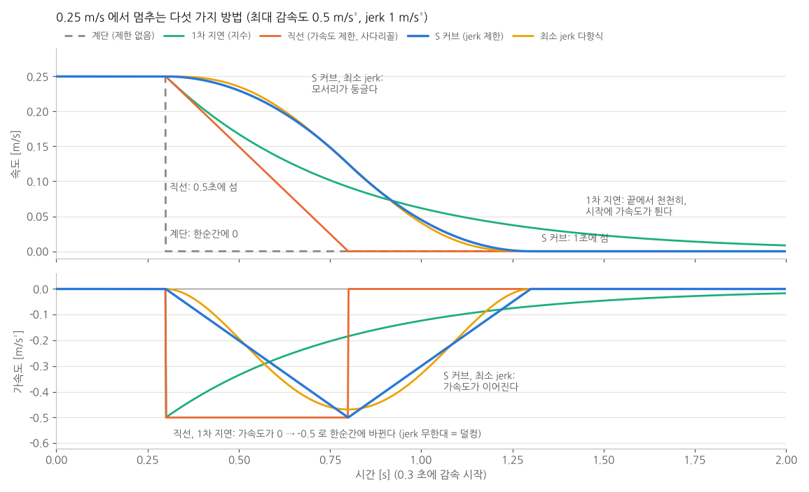
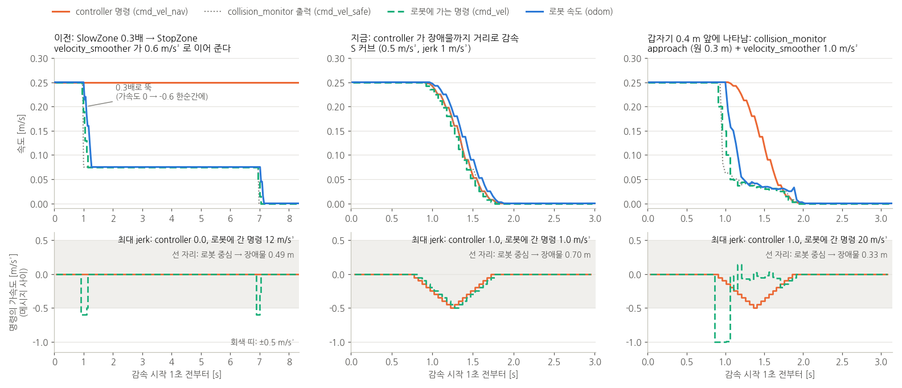
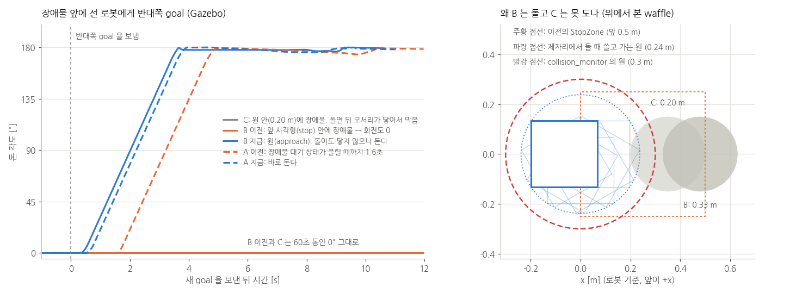

# 실제 AMR 로 옮기기: 지도, 위치 추정, 가감속, 장애물 감속, 개발 방식

이 저장소를 실제 AMR 에서 돌리려고 할 때 필요한 것들을 시뮬레이션(Gazebo, TurtleBot3 waffle)에서 먼저 만들고 확인했다.

| 장 | 내용 | 바뀐 것 |
|---|---|---|
| 1 | launch 구조: 로봇과 내비게이션을 나눈다 | `navigation.launch.py`(로봇과 무관), `simple_line.launch.py`(시뮬레이션 로봇), `rviz.launch.py` |
| 2 | 지도 만들기(SLAM)와 저장한 지도에서 위치 추정(AMCL) | 창고 월드 `worlds/warehouse.world`, 지도 `maps/warehouse.*`, AMCL 설정 |
| 3 | 지도 위에서 점 명령 주기 | planner 가 지도의 장애물을 지나는 직선을 거절 (`fail_on_obstacle`) |
| 4 | 가감속 알고리즘 정리와 선택 | controller 의 S 커브 속도 프로파일, velocity_smoother 는 한계와 비상 감속만 |
| 5 | 장애물 앞에서 감속하고 서기 | controller 가 경로 위 장애물까지 거리로 S 커브 감속. collision_monitor 는 움직이는 방향만 보는 비상 감속(approach) |
| 6 | 막혔을 때 로봇이 스스로 돌거나 뒤로 가지 않게 | navigation BT `behavior_trees/navigate_to_pose_amr.xml` |
| 7 | 실제 로봇 개발은 보통 어떻게 하나 | (설명) |
| 8 | 확인한 것 | |

목차

- [1. launch 구조](#1-launch-구조)
- [2. 지도 만들기와 위치 추정](#2-지도-만들기와-위치-추정)
- [3. 지도 위에서 점 명령 주기](#3-지도-위에서-점-명령-주기)
- [4. 가감속](#4-가감속)
- [5. 장애물 앞에서 감속하고 서기](#5-장애물-앞에서-감속하고-서기)
- [6. 막혔을 때: 회전, 후진 없이 기다리기](#6-막혔을-때-회전-후진-없이-기다리기)
- [7. 실제 로봇에서 개발하는 방식](#7-실제-로봇에서-개발하는-방식)
- [8. 확인한 것](#8-확인한-것)
- [9. 파일](#9-파일)

---

## 1. launch 구조

실제 로봇에는 Gazebo 가 없다. 그래서 launch 를 "로봇" 과 "내비게이션" 두 덩어리로 나눴다. 실제 로봇으로 옮길 때는 로봇 쪽만 바꾼다.

```
simple_line.launch.py (시뮬레이션)              실제 로봇
 ├─ 로봇: Gazebo, 스폰, robot_state_publisher     ├─ 로봇: 모터 드라이버, 라이다 드라이버, robot_state_publisher (직접 준비)
 ├─ navigation.launch.py  ◀────── 같은 파일 ──────▶ ├─ navigation.launch.py
 └─ rviz.launch.py                                └─ rviz.launch.py (개발 PC 에서)
```

**로봇이 내비게이션에 줘야 하는 것** (실제 로봇 드라이버가 맞춰야 하는 약속)

| 무엇 | 이름 | 비고 |
|---|---|---|
| 레이저 | `/scan` (`sensor_msgs/LaserScan`) | 지도, AMCL, collision_monitor 가 쓴다 |
| 바퀴 odometry | `/odom` (`nav_msgs/Odometry`) + TF `odom → base_footprint` | 짧은 거리에서 정확해야 한다 (7장) |
| 로봇 모양 | TF `base_footprint → base_link → base_scan` | URDF + robot_state_publisher |
| 속도 명령을 받아 움직이기 | `/cmd_vel` (`geometry_msgs/Twist`) | 명령이 끊기면 서는 watchdog 가 드라이버에 있어야 한다 (7장) |

**`navigation.launch.py`** 가 띄우는 것

| 인자 | 띄우는 노드 |
|---|---|
| `slam:=True` | slam_toolbox (지도를 만들면서 위치 추정) |
| `map:=<지도.yaml>` | map_server + amcl (저장한 지도에서 위치 추정) |
| 공통 | planner_server, controller_server, behavior_server, bt_navigator, waypoint_follower, collision_monitor, velocity_smoother, lifecycle_manager |

그 밖의 인자: `use_sim_time`(시뮬레이션이면 True), `params_file`(기본 `params/simple_line_params.yaml`), `initial_pose_x/y/yaw`(AMCL 시작 위치).

**속도가 로봇까지 가는 길** (5장)

```
controller_server ─┐
                   ├─ /cmd_vel_nav ─▶ collision_monitor ─ /cmd_vel_safe ─▶ velocity_smoother ─ /cmd_vel ─▶ 로봇
behavior_server ───┘                  갑자기 막히면 0 (비상)           가감속 한계
```

- Nav2 Humble 의 기본 launch 와 순서가 다르다. 기본은 controller → velocity_smoother → 로봇이고, behavior_server(회전, 후진)는 velocity_smoother 를 거치지 않는다.
- 여기서는 모든 이동 명령이 collision_monitor 와 velocity_smoother 를 거친다. 그래서 비상 정지도 가감속 한계(1.0 m/s²)를 지킨다 (5장).
- 로봇은 표준 이름 `/cmd_vel` 을 듣는다. 드라이버를 고칠 필요가 없다.

**파라미터**: 설치된 Humble 기본 `nav2_params.yaml` 과 slam_toolbox 의 `mapper_params_online_async.yaml` 위에 `params/simple_line_params.yaml` 을 덮어쓴다. 실제 로봇에 맞춰 바꿀 값은 그 파일에 `[로봇]` 으로 표시해 두었다 (속도, 가감속, 로봇 크기, collision_monitor 구역, AMCL 의 레이저 오차).

---

## 2. 지도 만들기와 위치 추정

**AMCL 만으로는 지도를 만들 수 없다.** AMCL 은 이미 있는 지도에서 "내가 어디 있나" 를 찾는 일(localization)만 한다. 지도는 SLAM(동시에 지도 만들기와 위치 추정)으로 먼저 만든다. 그래서 두 단계다.

```
1단계 지도 만들기 (한 번)     slam_toolbox ── 로봇을 몰고 다니며 /scan 을 이어 붙인다 ──▶ map_saver_cli ──▶ 지도.pgm + 지도.yaml
2단계 주행 (매일)             map_server(지도.yaml) + AMCL ── /scan 을 지도에 맞춰 map → odom TF ──▶ Nav2, 미션
```

### 2-1. 시뮬레이션에서 해 보기

창고 월드(10 m x 8 m, 선반 2개, 기둥 2개, 칸막이, 상자)를 더했다. 방이 대칭이면 AMCL 이 비슷한 곳을 헷갈리므로 일부러 비대칭으로 놓았다.

```bash
# 1단계: 지도 만들기
ros2 launch simple_line_bringup simple_line.launch.py world:=warehouse slam:=True
ros2 run bt_mission task_server
# 로봇을 몰고 다닌다. RViz 의 Nav2 Goal 로 찍어도 되고, 작업으로 보내도 된다
ros2 run bt_mission task_client.py go 4,-2.5 4,0.3 -4,0.3 -4,3.2 1.2,2.8 4.2,1.2 4.2,3.4 4,-2.5 -4,-2.5,0
# 다 돌았으면 저장 (지도.pgm, 지도.yaml)
ros2 run nav2_map_server map_saver_cli -f ~/maps/warehouse --ros-args -p use_sim_time:=true

# 2단계: 저장한 지도로 주행
ros2 launch simple_line_bringup simple_line.launch.py world:=warehouse map:=$HOME/maps/warehouse.yaml
```

- `map:=` 을 주지 않으면 이 저장소의 `maps/warehouse.yaml` 을 쓴다 (위 1단계로 만들어 넣어 둔 것).
- 지도를 만드는 동안에도 Nav2 는 그 지도로 주행한다. 아직 모르는 곳(회색)으로 가는 직선도 허용한다 (`allow_unknown`).
- 키보드로 몰려면 `ros2 run teleop_twist_keyboard teleop_twist_keyboard --ros-args -r cmd_vel:=cmd_vel_nav`. `cmd_vel_nav` 로 보내면 collision_monitor 와 가감속 제한을 같이 거친다.


위가 1단계로 만든 지도(검정: 벽, 회색: 모르는 곳)와, 2단계에서 같은 점들을 AMCL 로 돈 실제 경로다. 지도는 Gazebo 월드와 3.5 cm, 0.09° 차이로 맞았다.

### 2-2. 실제 로봇에서 지도 만들기

```bash
# 로봇 PC: 드라이버를 띄운 뒤
ros2 launch simple_line_bringup navigation.launch.py slam:=True
# 조이스틱이나 키보드로 천천히 몰고 다닌다 (cmd_vel_nav 로 보내면 안전 구역과 가감속을 거친다)
ros2 run nav2_map_server map_saver_cli -f ~/maps/<현장이름>
```

- **천천히, 한 바퀴 돌아 처음 자리로.** 처음 본 곳을 다시 보면 slam_toolbox 가 쌓인 오차를 고친다(loop closure). 빠르게 돌거나 급히 회전하면 지도가 휜다.
- **움직이는 것은 치운다.** 지도를 만들 때 있던 사람, 카트, 팔레트도 벽으로 남는다. 남았으면 그림 편집기로 `.pgm` 에서 지운다 (흰색 = 빈 곳, 검정 = 벽, 회색 = 모름).
- **유리, 검은 물체, 레이저보다 낮은 물체**는 지도에 잘 안 남는다. 창고 월드에서도 로봇이 멀리 지나간 동쪽 벽은 점선처럼 남았다 (위 그림 오른쪽). 벽 가까이 한 번 더 지나가면 메워진다.
- 지도 파일은 현장마다 버전을 붙여 git 이나 별도 저장소에 둔다. 현장이 바뀌면 다시 만든다.

### 2-3. 저장한 지도에서 시작 위치 주기 (AMCL)

AMCL 은 처음 위치를 알아야 한다. 방법은 셋이다.

| 방법 | 쓰는 법 | 언제 |
|---|---|---|
| launch 인자 | `navigation.launch.py map:=... initial_pose_x:=-4 initial_pose_y:=-2.5 initial_pose_yaw:=0` | 로봇이 늘 같은 곳(충전기, 대기 자리)에서 켜질 때. 시뮬레이션은 스폰 위치로 자동 |
| RViz **2D Pose Estimate** | 지도에서 로봇이 있는 곳을 찍고 방향으로 끈다 | 개발 중, 로봇을 손으로 옮겼을 때 |
| 전역 위치 찾기 | `ros2 service call /reinitialize_global_localization std_srvs/srv/Empty` 뒤 제자리에서 천천히 돈다 | 어디인지 모를 때. 대칭인 곳에서는 틀릴 수 있다 |

- 맞게 잡혔는지는 RViz 에서 레이저 점(빨강)이 지도의 벽에 겹치는지로 본다. 어긋나 있으면 주행을 시작하지 않는다.
- 상용 AMR 은 꺼지기 전 위치를 저장했다가 켜질 때 그 위치로 시작하는 경우가 많다. AMCL 의 `/amcl_pose` 를 주기적으로 파일에 저장하는 작은 노드로 만들 수 있다 (아직 없다).

### 2-4. AMCL 설정

Humble 기본값으로 창고 월드의 같은 경로를 돌았을 때 위치 오차가 평균 10 cm 였다. 기본값은 레이저를 넓게 보고(`sigma_hit` 0.2 m) 위치를 드문드문(0.25 m 마다) 고친다. 아래처럼 바꾸니 평균 3.8 cm 가 됐다 (8장).

| 파라미터 | Humble 기본 | 여기서 | 뜻 |
|---|---|---|---|
| `sigma_hit` | 0.2 | 0.1 | 레이저 거리 오차 표준편차 [m]. 라이다가 정확하면 작게 |
| `z_hit` / `z_rand` | 0.5 / 0.5 | 0.8 / 0.2 | 측정이 맞을 비중 / 엉뚱한 측정(지도에 없는 사람, 물건)의 비중 |
| `max_beams` | 60 | 120 | 한 번에 쓰는 빔 수 |
| `update_min_d` / `update_min_a` | 0.25 m / 0.2 rad | 0.1 m / 0.1 rad | 이만큼 움직이면 위치를 고친다 |

**실제 로봇에서 맞출 것**

- `alpha1`~`alpha5`: odometry 가 얼마나 틀리는지. 바퀴가 미끄러지는 바닥이면 크게(0.2~0.5), 정확하면 작게(0.05~0.1). 시뮬레이션의 odom 은 완벽해서 여기서는 기본 0.2 를 그대로 두었다.
- `sigma_hit`: 라이다 사양의 거리 정확도보다 조금 크게.
- `z_rand`: 사람이 많이 다니는 곳이면 크게.
- RViz 의 파티클 구름(`/particle_cloud`)이 로봇 둘레에 작게 모여 있으면 잘 되는 것이다. 넓게 퍼지면 위치를 모르는 것이다.

---

## 3. 지도 위에서 점 명령 주기

지도 위 좌표는 map frame 이다. 미션 명령(`bt_navigator/README.md` 4-5 장)을 그대로 쓴다.

```
task> go 1.2,2.8 4.2,1.2,0           # 창고 지도 위의 두 점
task> inspect:5 -4,3.2,90
```

- **좌표 읽기**: RViz 의 **Publish Point** 로 지도를 찍으면 `ros2 topic echo /clicked_point` 에 좌표가 나온다. 자주 가는 곳은 이렇게 읽어서 적어 둔다.
- **직선이 지도의 장애물을 지나면 거절한다.** planner(`SimpleLinePlanner`)는 장애물을 돌아가는 길을 만들지 않는다. 대신 직선이 지도의 벽, 선반에 닿으면(로봇 반지름 안, costmap 값 253 이상) 경로를 만들지 않는다. 로봇은 움직이지 않고, 작업은 약 40초 뒤(재시도 6번) 실패한다.

  ```
  task> go 0,2.8        # (-4,-2.5) 에서: 직선이 기둥 pillar_2 옆을 스친다
  planner_server: SimpleLinePlanner: the line crosses an obstacle in the map at (-3.15, -1.38)
  <- t1 ABORTED: go_only failed at waypoint 1/1 [BT FAILURE]
  ```

  선반을 돌아가려면 점을 나눠 준다: `go -4,0.3 0,0.3 0,2.8` 처럼 빈 통로를 따라.
- **지도에 없는 장애물**(사람, 카트)은 planner 가 보지 않는다. global costmap 에 레이저 층을 빼서, 길에 사람이 서 있어도 planner 는 실패하지 않고, controller 가 그 앞에서 감속해서 서서 기다린다 (5장).
- 돌아가는 길을 스스로 찾게 하려면 planner 를 NavFn 이나 Smac 으로 바꾼다. 정해진 길로만 다녀야 하는 곳(창고 통로)에서는 지금처럼 점을 이어 주는 쪽이 예측하기 쉽다.

---

## 4. 가감속

실제 로봇은 명령한 속도로 바로 가지 못한다. 모터와 바퀴가 따라갈 수 있게, 그리고 짐이 흔들리지 않게 속도를 천천히 바꿔야 한다.

### 4-1. 가감속 알고리즘 정리

속도를 바꾸는 방법을 "가속도와 jerk(가속도가 바뀌는 빠르기)가 어떻게 되느냐" 로 나누면 이렇다.

| 방법 | 어떻게 | 가속도 | jerk | 주로 쓰는 곳 |
|---|---|---|---|---|
| 계단 (제한 없음) | 명령을 그대로 낸다 | 무한대 | 무한대 | 시뮬레이션 |
| 1차 지연 (지수, 저역 필터) | 매 주기 `v += (목표 - v) · dt / τ` | 시작할 때 가장 크다 | 시작할 때 무한대 | 간단한 모터 드라이버 필터. 끝에서 한없이 천천히 다가가서 언제 섰는지 애매하다 |
| 직선 (가속도 제한, 사다리꼴) | 매 주기 속도를 `±a·dt` 까지만 바꾼다 | 제한 | 모서리에서 무한대 | Nav2 velocity_smoother, 대부분의 모터 드라이버 ramp |
| **S 커브** (jerk 제한) | 가속도도 매 주기 `±j·dt` 까지만 바꾼다. 가속도가 사다리꼴, 속도가 S 자 | 제한 | 제한 | 산업용 AMR/AGV, 엘리베이터, CNC, 서보 드라이버. ros2_control `diff_drive_controller` 의 jerk 제한 |
| 최소 jerk 다항식 (5차) | 시작과 끝의 속도, 가속도를 맞춘 5차식 | 이어진다 | 이어진다 | 정해진 거리를 정해진 시간에 (로봇 팔) |
| 사인 램프 | 가속도를 sin² 모양으로 | 이어진다 | 이어진다 | S 커브와 비슷. 계산이 닫힌 식 |
| 거리 기반 브레이크 곡선 | `v ≤ sqrt(2 · 감속도 · 남은 거리)` | 제한 | (위 방법에 따라) | goal, 장애물 앞에서 **어디서부터** 감속할지. 위 방법들과 같이 쓴다 |
| 온라인 궤적 생성 (Ruckig, Reflexxes) | 매 주기 지금 상태에서 목표까지 시간 최적 jerk 제한 궤적을 다시 푼다 | 제한 | 제한 | 목표가 계속 바뀌는 곳 (로봇 팔, 일부 AMR) |
| MPC / MPPI | 가속도, jerk 를 비용과 제약으로 넣고 최적화 | 제한 | 제한 | Nav2 MPPI controller, 고급 AMR |



0.25 m/s 에서 같은 최대 감속도(0.5 m/s²)로 서는 경우다. 직선은 0.5초, 6.3 cm 만에 서지만 감속을 시작하는 순간과 서는 순간에 가속도가 0 ↔ -0.5 로 한 번에 바뀐다. 사람이 느끼는 "덜컹", 짐이 앞으로 쏠리는 것, 바퀴와 차체가 흔들리는 것은 가속도의 크기보다 이 바뀌는 빠르기(jerk)에 더 민감하다. S 커브는 1초, 12.5 cm 가 걸리는 대신 가속도가 이어진다.

**질문: "SlowZone 에서 0.3배로 뚝 떨어뜨리면 관성 때문에 덜컹거리지 않나? 직선으로 감속해야 하지 않나?"**

- 로봇에 간 속도는 계단이 아니었다. collision_monitor 뒤의 velocity_smoother 가 0.6 m/s² 의 **직선**으로 이어 줬다 (5장 그림 왼쪽).
- 그래도 덜컹은 남는다. 직선 감속은 가속도가 한 주기(50 ms)에 0 → -0.6 으로 바뀌어서, 로봇에 간 명령의 jerk 가 12 m/s³ 였다. controller 의 S 커브(1 m/s³)의 12배다.
- 그리고 구역 방식은 **어디서** 감속할지를 장애물까지의 거리로 정하지 않는다. 장애물이 1 m 앞에 들어오면 무조건 0.075 m/s 로 줄여서 0.47 m 를 6초 동안 기어갔다.

그래서 바꿨다. 직선이 아니라 S 커브로, 구역이 아니라 남은 거리로 감속한다.

### 4-2. 이 저장소의 선택: 평소에는 controller 의 S 커브, 비상일 때만 직선

| 어디서 | 방법 | 언제 | 설정 |
|---|---|---|---|
| **controller** (`SimpleLineController`) | S 커브 + 거리 기반 브레이크. 가속 → 순항 → goal 이나 경로 위 장애물 앞에서 감속해서 선다 | 평소 전부 | `max_linear_accel` 0.5, `max_linear_decel` 0.5, `max_linear_jerk` 1.0 |
| **collision_monitor** (Nav2) | 로봇 둘레 원을 지금 명령대로 1.2초 움직여 보고, 닿으면 닿기까지 남은 시간에 비례해 줄이거나 0 (approach) | controller 가 서기에 너무 가까이 갑자기 나타났을 때 | `Footprint` 원 0.3 m, 1.2 s |
| **velocity_smoother** (Nav2) | 직선 (가속도 제한). 평소에는 controller 보다 넉넉해서 손대지 않고, 비상 정지를 1.0 m/s² 로 잇는다 | 마지막 한계 | `max_accel` 0.6, `max_decel` -1.0 |
| **모터 드라이버** (로봇) | 바퀴 속도 제어. 대개 자체 ramp 와 전류 제한이 있다 | 항상 | 드라이버 설정 |

- **왜 S 커브인가**: 목표 속도가 매 주기 바뀐다 (장애물 거리, 속도 제한, 경로 재계산). 최소 jerk 다항식처럼 "몇 초 동안 어디까지" 를 미리 정하는 방법은 목표가 바뀔 때마다 다시 풀어야 한다. 여기서 쓴 `stepToward()` 는 지금 (속도, 가속도)에서 한 주기씩 나아가는 온라인 S 커브라서, 목표가 바뀌어도 가속도가 끊기지 않고 이어진다 (Ruckig 와 같은 생각의 단순한 1축 버전). 모터 드라이버와 PLC 에서 흔히 쓰는 방식이라 현장에서 같은 말(가속도, jerk)로 값을 정할 수 있다.
- **언제 감속을 시작하나**: 같은 `stepToward()` 로 "지금 브레이크를 걸면 얼마나 가서 서는지" 를 미리 굴려 본다 (`brakingDistance()`). 그 거리가 남은 거리에 닿으면 감속한다. 예측과 실행이 같은 코드라서 서는 자리가 맞는다.
- **왜 비상 정지만 직선인가**: 비상 정지는 부드러움보다 거리가 먼저다. jerk 를 제한하면 서는 거리가 길어진다 (위 그림: 같은 0.5 m/s² 에서 직선 6.3 cm, S 커브 12.5 cm). 그래서 비상 정지는 직선으로 더 세게(1.0 m/s²) 선다. 대신 평소에는 controller 가 먼저 서서 비상 정지가 일어나지 않게 한다.
- 한계는 뒤 단계일수록 넉넉하게 둔다 (controller ≤ velocity_smoother ≤ 드라이버). 그래야 앞 단계가 계획한 프로파일을 뒤 단계가 깎지 않는다.


**4 m 직선 (창고)**: 속도는 1초에 걸쳐 0.25 m/s 까지 오르고, goal 앞에서 같은 모양으로 내려와 섰다. 아래 그래프에서 가속도가 0 → 0.5 → 0 으로 이어진다. 속도 그래프의 꺾이는 곳이 둥근 이유다.

### 4-3. S 커브와 goal 앞 감속 (`include/simple_line_controller/motion_profile.hpp`)

```
속도                                   가속도
 ▲      ________________                ▲  ╱╲
 │    ╱                  ╲              │ ╱  ╲            ╱╲
 │   (                    )             ├────────────────╲──╱──▶
 │__╱                      ╲__          │                 ╲╱
 └──────────────────────────▶ 시간      jerk 제한: 가속도도 기울어진 선으로만 바뀐다
```

- **한 주기씩 목표 속도 쪽으로**: `stepToward()` 가 가속도를 jerk 한계 안에서 바꾸고, 목표 속도에 닿는 순간 가속도도 0 이 되도록 미리 줄인다. 목표를 넘어서지 않는다.
- **언제 감속을 시작하나**: 매 주기 `brakingDistance()` 로 지금 속도와 가속도에서 서는 거리를 굴려 본다. 가속하던 중이면 가속도를 되돌리는 동안 더 가는 것까지 들어간다.
- goal 앞에서는 `min_approach_linear_vel`(0.05 m/s)까지 감속하고 그 속도로 도착 범위(0.05 m)에 들어간다. 들어서면 같은 S 커브로 0 까지 줄이고, 멈춘 것이 확인되면 도착이다 (`StoppedGoalChecker`). 범위만 보는 goal checker 를 쓰면 들어서는 순간 controller_server 가 0 을 보내서 0.05 m/s 가 한 번에 0 이 된다.
- 가감속은 **바로 전 주기에 낸 명령**에서 이어 간다. odom 속도에서 이어 가면 odom 의 잡음과 지연이 명령에 그대로 섞인다. 명령이 끊겼다가(새 goal) 다시 시작할 때만 odom 속도에서 시작한다.
- 단위 테스트(`test/test_motion_profile.cpp`, gtest 6개): 가감속과 jerk 한계, 목표를 넘지 않음, S 커브 브레이크 거리(0.25 m/s, 0.5 m/s², 1 m/s³ → 0.125 m), 0.1초 늦게 따라오는 로봇도 정한 자리에 서는지.

| 파라미터 | 여기서 | 정하는 법 (실제 로봇) |
|---|---|---|
| `desired_linear_vel` | 0.25 m/s | 현장 규정 속도 |
| `max_linear_accel` / `max_linear_decel` | 0.5 / 0.5 m/s² | 짐을 실은 채로 미끄러지지 않고 짐이 흔들리지 않는 값. 0.3 부터 올려 본다 |
| `max_linear_jerk` | 1.0 m/s³ | 작을수록 부드럽고 느리다. 가속도 / jerk = 가속도가 다 오르는 데 걸리는 시간 (여기서 0.5초). 0 이면 S 커브 없이 사다리꼴 |
| `max_angular_accel` | 3.2 rad/s² | 회전 관성이 큰 로봇은 1 이하 |
| velocity_smoother `max_accel` / `max_decel` | 0.6 / -1.0 m/s² | 가속은 controller 보다 조금 크게. 감속은 비상 정지 감속도: 짐이 미끄러지지 않는 가장 큰 값 |

### 4-4. 알아둘 것

- **회전은 아직 사다리꼴이다.** 제자리 회전(경로 쪽으로, goal 방향으로)은 각가속도 제한(3.2 rad/s²)과 남은 각도로 감속(`sqrt(a · 남은 각)`)만 한다. goal 에서 몇 도를 맞출 때도 0.2~0.6 rad/s 의 짧은 회전이 나오고, 한 번 지나쳐 되돌아온 적도 있다 (5장의 비상 정지 시험 끝). 회전 관성이 큰 로봇이면 같은 S 커브를 각속도에도 쓰는 것이 다음 단계다.
- **두 타이머**: velocity_smoother 는 controller 의 명령을 자기 20 Hz 타이머로 다시 읽어서 낸다. 두 타이머의 위상이 어긋나면 같은 값을 두 번 내고 다음에 두 칸을 건너뛴다 (예: 0.025, 0.025, 0.0075). 0.1초로 재면 가속도 한계 안이지만, 메시지 사이로 재면 jerk 가 7~19 m/s³, 가속도가 두 배(0.95)로 보이기도 한다. 이 시뮬레이션은 Gazebo 시계가 10 Hz 라서 두 타이머가 0.1초마다 두 번씩 몰아서 돌아 특히 잦다. 실제 로봇에서는 모터 드라이버가 보간해서 거의 느껴지지 않는다. 그래도 거슬리면 velocity_smoother 를 빼고 controller → collision_monitor → 로봇으로 보내고, 비상 정지의 감속은 모터 드라이버의 ramp(감속 정지 기능)에 맡기는 구성도 쓴다.
- **20 Hz 계단**: 명령은 20 Hz 로 나가서 50 ms 마다 조금씩 바뀌는 계단이다. 실제 모터 드라이버는 그 사이를 수백 Hz~1 kHz 로 보간해서 매끄럽게 만든다. 시뮬레이션에서 velocity_smoother 를 50 Hz 로 올려 봤지만 입력이 20 Hz 라 계단이 남고 오히려 짧은 펄스가 생겨서, controller 와 같은 20 Hz 로 두었다.
- **도착 정확도는 위치 추정이 정한다.** controller 는 AMCL 이 말하는 위치로 선다. 빈 방(특징이 적은 대칭 공간)에서는 AMCL 이 7 cm 틀려서 실제로는 goal 에서 7 cm 떨어져 섰다. 창고 월드에서 AMCL 을 맞춘 뒤에는 0~6 cm 였다 (8장).

---

## 5. 장애물 앞에서 감속하고 서기

평소에는 **controller** 가 경로 위 장애물까지 남은 거리로 S 커브 감속해서 그 앞에 선다 (goal 앞에서 서는 것과 같은 계산). collision_monitor 는 controller 가 서기에는 너무 가까이 갑자기 나타났을 때만 줄이거나 세우는 **비상 감속**이다. 로봇이 지금 명령대로 움직이면 부딪히는지를 보므로, 장애물 앞에서도 돌아서 나가는 회전은 막지 않는다 (5-2).



빈 방, goal (1,-1) 로 가는 길에 반지름 0.15 m 원기둥. 아래 줄은 로봇에 간 명령(`/cmd_vel`)의 가속도다.

| | 이전: SlowZone 0.3배 → StopZone | 지금: controller S 커브 | 갑자기 0.4 m 앞에: collision_monitor 비상 감속 |
|---|---|---|---|
| 감속 시작 | 장애물이 앞 0.97 m 구역에 들어올 때 | 필요한 거리에서 (로봇 중심 → 장애물 0.80 m) | 원(0.3 m)이 1.2초 안에 닿게 된 순간 |
| 로봇에 간 명령 | 가속도 0 → -0.6 이 한 주기에 (jerk 12 m/s³) | 가속도 0 → -0.5 → 0 (jerk 1.0 m/s³) | 가속도 -1.0 으로 0.05 m/s 까지 (jerk 20 m/s³), 그 뒤 0.03 m/s 로 다가감 |
| 서기까지 | 0.075 m/s 로 6초 기어간 뒤 0.17초 | 0.82초, 10.0 cm | 0.95초, 5.0 cm |
| 선 자리 (로봇 중심 → 장애물 표면) | 0.49 m | 0.70 m (collision_monitor 는 동작 안 함) | 0.33 m |
| 치운 뒤 | 0.6 m/s² 직선으로 가속 | 1.6초 뒤 S 커브로 가속 | 1.9초 뒤 S 커브로 가속 |

"지금" 은 출발부터 도착까지 controller 명령이 가속도 ±0.50 m/s², jerk 1.04 m/s³ 이하였다. 로봇에 간 명령은 velocity_smoother 가 값을 다시 읽는 탓에 메시지 사이 jerk 가 가끔 튀었다 (4-4 의 두 타이머. 같은 시험을 다시 했을 때는 두 칸을 한 번에 내서 메시지 사이 가속도가 -0.95 로 보이기도 했다). 기다리는 8초 동안 로봇은 움직이지 않았고(최대 0.003 m/s), collision_monitor 는 한 번도 동작하지 않았다.

### 5-1. controller 가 하는 일 (`SimpleLineController`)

1. **장애물까지 거리**: 경로를 따라 costmap 칸(5 cm) 간격으로 가면서, 양옆 `obstacle_check_width`(0.3 m) 안에 local costmap 의 장애물 칸(LETHAL, 레이저로 본 것)이 있는 첫 지점까지의 경로 길이를 잰다. 직선 거리가 아니라 경로를 따라 잰다. 로봇(회전 중심)보다 뒤에 있는 칸은 보지 않는다. 처음에는 경로의 첫 점(로봇 자리) 둘레까지 봐서, 장애물을 등지고 돌아선 뒤에도 등 뒤 0.33 m 의 그 장애물을 "앞에 있다" 고 보고 출발하지 않았다.
2. **언제 감속하나**: goal 과 같다. `brakingDistance()` 로 0 까지 서는 거리를 굴려 보고, 그것이 `장애물 거리 - obstacle_stop_distance`(0.4 m)에 닿으면 목표 속도를 0 으로 한다. 그래서 장애물이 멀면 순항 속도 그대로 가다가 필요한 거리에서만 감속한다.
3. **다시 가기**: 장애물이 사라지거나 0.3 m 넘게 멀어지면 감속을 풀고 S 커브로 다시 가속한다. 서서 기다리던 중이면 그 상태가 `obstacle_resume_delay`(1초) 동안 이어져야 출발한다 (안전 스캐너의 재시작 지연과 같은 생각). 처음에는 이 여유가 0.1 m 이고 지연이 없어서, costmap 칸이 한두 칸 흔들리면 장애물 앞에 섰다가 5 cm 움찔 다시 가거나, 감속 중에 0.4초 풀렸다가 다시 감속했다.
4. **기다리는 동안의 회전**: 서 있으면 출발 전에 방향을 몇 도 맞추는 제자리 회전이 있는데, 장애물 앞에서 기다리는 동안에는 하지 않는다 (처음에는 막힌 회전 명령이 0.42 rad/s 까지 쌓였다가 풀리는 순간 한 번에 나갔다). 반대로 경로가 크게 틀어지면(반대쪽 goal) 기다리지 않고 바로 돌고, 장애물 상태는 지난 방향의 것이므로 비운다. 처음에는 대기 상태가 풀릴 때까지 1.6초 동안 돌지 않았다.
5. **로봇이 명령을 따라오지 않으면**: 명령을 내는데 1초 넘게 서 있으면(비상 정지, 걸림) 명령을 `min_approach_linear_vel`(0.05 m/s)로 낮춰 둔다. 풀렸을 때 순항 속도로 튀어 나가지 않는다.

| 파라미터 | 여기서 | 정하는 법 (실제 로봇) |
|---|---|---|
| `obstacle_check` | true | 끄면 장애물은 collision_monitor 만 본다 |
| `obstacle_check_width` | 0.3 m | 로봇 반폭 + 여유. 좁은 통로에서 옆 선반 때문에 서 버리면 줄인다 |
| `obstacle_stop_distance` | 0.4 m | 서는 자리 = 로봇 중심에서 장애물까지 약 width + 이 값. collision_monitor 가 평소에 걸리지 않게, 원 반지름 + (속도 x 1.2초) 보다 멀게 |
| `obstacle_resume_delay` | 1.0 s | 길이 빈 뒤 출발까지. 사람이 지나가는 곳이면 늘린다 |

### 5-2. 비상 감속: 움직이는 방향만 본다 (collision_monitor approach)

**처음 방식의 문제**: 처음에는 로봇 앞 0.5 m 사각형(StopZone, `action_type: "stop"`)에 레이저 점이 들어오면 0 으로 했다. Humble 의 stop 은 회전 속도까지 0 으로 만든다 (`collision_monitor_node.cpp` 의 `processStopSlowdown`). 그래서 장애물이 사각형 안에 있으면, 반대쪽 goal 을 받아 돌아서 나가려 해도 돌지 못했다 (아래 그림 B 이전: 60초 동안 0.5° 돌고 `Failed to make progress` 반복).

**"회전이면 예외로 통과" 로 하지 않은 이유**: 회전도 부딪힐 수 있다. waffle 은 회전 중심(바퀴 축)이 앞쪽에 있어서 제자리에서 돌면 뒤 모서리가 반지름 0.24 m 원을 쓸고 간다. 앞 0.20 m 에 물체가 있을 때 180° 돌면 뒤 모서리가 그것을 친다 (그림 C). 그래서 물어야 할 것은 "회전인가" 가 아니라 **"지금 명령대로 움직이면 부딪히는가"** 다. 직진, 회전, 후진, 멀어지는 방향 모두 같은 질문 하나로 판단된다.

**실제 AMR 은**: 안전 레이저 스캐너에 보호 구역을 여러 벌(field set) 두고, 드라이브가 알려 주는 움직임(전진 속도 구간, 제자리 회전, 후진)에 따라 구역을 바꾼다 (monitoring case 전환). 전진할 때는 앞으로 긴 구역, 제자리 회전할 때는 로봇을 둘러싼 작은 구역, 후진할 때는 뒤쪽 구역이다. Nav2 도 Jazzy 부터는 속도에 따라 구역을 고르는 VelocityPolygon 이 있다. Humble 에서 같은 일을 하는 것이 `approach` 다.

**`approach` (Humble)**: 로봇 둘레 모양을 지금 명령한 속도(직진, 회전 모두)로 `time_before_collision`(1.2초) 앞까지 0.05초씩 움직여 보고(`Polygon::getCollisionTime`), 그 안에 레이저 점이 닿으면 닿기까지 남은 시간에 비례해 속도를 줄인다 (1.2초 뒤에 닿으면 그대로, 0.6초 뒤면 절반). 모양이 지금 이미 점에 닿아 있으면 0 이다.

| 설정 | 값 | 이유 |
|---|---|---|
| 모양 | 원, 반지름 0.3 m (RViz 빨강) | 제자리에서 돌 때 쓸고 가는 원(0.24 m) + 여유 6 cm. 원은 돌아도 모양이 같아서, 이 원 밖의 물체에는 회전이 막히지 않는다. 원 안에 무엇이 있으면 돌다가 닿을 수 있으므로 회전도 막는다 |
| `time_before_collision` | 1.2 s | 0.25 m/s 면 0.3 m 앞까지. controller 가 평소에 서는 자리(0.7 m)보다 가까워서 평소에는 동작하지 않는다 |
| 감속 | velocity_smoother 의 비상 감속 1.0 m/s² | 줄인 속도가 한 번에 바뀌면 velocity_smoother 가 이 기울기로 잇는다 |



장애물 앞에 선 로봇에게 왔던 쪽 goal (-2,-1, 180°) 을 보냈다 (빈 방).

| 경우 | 이전 (StopZone + 대기 상태) | 지금 |
|---|---|---|
| A: controller 가 장애물 0.70 m 앞에 세움 (사각형 밖) | 1.6초 뒤에 돌기 시작, SUCCEEDED | 0.5초 뒤에 돌기 시작, SUCCEEDED |
| B: 갑자기 나타나 0.33 m 앞에 섬 (사각형 안, 원 밖) | 돌지 못함. 60초 동안 0.5°, 진행 실패 반복 | 0.3초 뒤에 돌기 시작, 2초에 90°, SUCCEEDED |
| C: 0.20 m 앞에 장애물 (원 안. 돌면 뒤 모서리가 닿는다) | 돌지 못함 | 돌지 못함 (0.3°). 부딪히지 않는다 |

- C 처럼 원 안에 무엇이 있으면 로봇은 스스로 빠져나오지 않는다. 사람이 치우거나 조이스틱으로 빼낸다. 이 controller 는 후진하지 않는다.
- 위 5장 표 오른쪽(갑자기 0.4 m 앞에)도 approach 로 다시 쟀다. 원이 1.2초 안에 닿게 되자 collision_monitor 출력이 0.25 → 0.06 m/s 로 줄고, 로봇은 1.0 m/s² 로 0.05 m/s 까지 줄인 뒤 controller 가 S 커브로 0 이 될 때까지 0.03 m/s 로 다가가, 0.95초, 5.0 cm 만에 0.33 m 앞에 섰다. stop 사각형일 때(0.27초, 2.6 cm, 0.32 m)와 선 자리는 거의 같다.

**크기 정하기 (실제 로봇)**

- 원의 반지름(또는 다각형)은 로봇이 제자리에서 돌 때 쓸고 가는 범위 + 여유. 길쭉한 로봇이면 원이 너무 커지므로 `type: "polygon"` 으로 실제 모양을 준다 (Humble 의 approach 다각형은 모양을 `local_costmap/published_footprint` 에서 받는다. local costmap 에 `footprint` 를 적는다).
- 비상 정지 거리 = 반응 지연 x 속도 + 속도² / (2 x 비상 감속도). 레이저 주기(보통 0.05~0.1초)와 collision_monitor, velocity_smoother 주기가 지연이다. 예: 1.0 m/s, 1.0 m/s², 지연 0.2초 → 0.2 + 0.5 = 0.7 m. `time_before_collision` x 속도가 그보다 길게 (1.0 m/s 면 1.2초 → 1.2 m).
- controller 가 서는 자리(width + stop_distance)는 원 반지름 + (속도 x `time_before_collision`) 보다 멀게. 그래야 평소에 비상 감속이 끼어들지 않는다.
- **local costmap 이 브레이크 거리보다 멀리 봐야 한다.** S 커브로 서는 거리는 `v²/(2a) + v·a/(2j)` 다. 1.0 m/s, 0.5 m/s², 1 m/s³ 이면 1.25 m 이고, 여기에 서는 자리(0.7 m)를 더해 약 2 m 앞의 장애물을 봐야 한다. 지금 local costmap 은 3 x 3 m(앞 1.5 m)라서 0.25 m/s 에는 넉넉하지만, 빠른 로봇이면 `local_costmap` 의 `width` / `height` 를 늘린다. 못 보면 늦게 감속해서 비상 정지가 대신 세운다.

**소프트웨어 안전장치의 한계**: collision_monitor 는 사람을 지키는 안전 기능으로 인증된 것이 아니다. 실제 AMR 에서 사람 보호는 안전 인증 레이저 스캐너와 안전 PLC 가 모터 전원을 직접 끊는 하드웨어 계층이 맡고, 비상정지 버튼이 있다. 안전 스캐너는 보통 속도에 따라 보호 구역을 바꾸고, 그 앞의 경고 구역에서 감속시키기도 한다. 이 저장소의 controller 와 collision_monitor 는 그 안쪽에서 부드럽게 서는 역할이다.

---

## 6. 막혔을 때: 회전, 후진 없이 기다리기

Nav2 Humble 의 기본 navigation BT 는 이동이 실패하면 recovery 로 제자리 회전(spin)과 후진(backup)을 한다. 사람과 물건이 있는 곳에서 로봇이 스스로 돌거나 뒤로 가면 위험하다. 그래서 `behavior_trees/navigate_to_pose_amr.xml` 을 기본 트리로 쓴다 (`navigation.launch.py` 가 지정).

- 1초마다 경로를 다시 계산하고 FollowPath 로 따라가는 부분은 기본과 같다.
- 실패하면 costmap 을 비우고 **5초 기다린 뒤** 다시 한다. 7번(처음 + 6번) 실패하면 goal 이 실패한다.

장애물 앞에 서 있으면 이렇게 된다 (창고 월드에서 장애물을 치우지 않고 둠, 감속 시작부터 잰 시간).

| 시간 | 일어난 일 |
|---|---|
| 0 s | controller 가 감속해서 장애물 0.71 m 앞(로봇 중심)에 섬 |
| 31 s | `Failed to make progress` (진행 확인 30초). FollowPath 를 다시 보냄 |
| 61 s | 다시 실패 → costmap 비우고 5초 대기 → 경로부터 다시 |
| 그 뒤 | 약 30초마다 실패, 두 번에 한 번 5초 대기 |
| 457 s (7.6분) | goal 실패. 작업은 `go_only failed at waypoint 1/1` 로 ABORTED |

그 7.6분 동안 로봇은 한 번도 움직이지 않았다 (controller 명령 0, 로봇 속도 최대 0.0003 m/s). costmap 을 비운 직후에도 다시 출발하지 않았다. 레이저가 다시 장애물을 표시하는 데 0.2초면 되고, 출발에는 1초 동안 길이 비어 있어야 하기 때문이다 (5-1). 중간에 치우면 1~2초 뒤 다시 간다. 기다려 줄 시간은 `progress_checker.movement_time_allowance`(30초)와 BT 의 `number_of_retries`(6)로 정한다.

`NavigateThroughPoses`(여러 goal 한 번에, `send_waypoints.py`)는 아직 Nav2 기본 트리를 쓴다. 같은 방식으로 바꾸려면 `default_nav_through_poses_bt_xml` 을 지정한다.

---

## 7. 실제 로봇에서 개발하는 방식

질문: "실제 로봇에서도 개발 PC 처럼 RViz 를 쓰고 터미널로 명령하면 되나?"

**그렇다. 다만 어디서 무엇을 돌리는지를 나눈다.**

```
로봇 PC (로봇에 실림, 예: 산업용 PC, Jetson)          개발 PC (노트북)
 ├─ 드라이버: 모터, 라이다, (IMU), robot_state_publisher  ├─ RViz (rviz.launch.py)
 ├─ navigation.launch.py (AMCL, Nav2, 안전, 가감속)       ├─ 터미널: ssh 로 로봇 PC 에 접속해 launch, 로그
 ├─ task_server (미션)                                   ├─ task_client.py, ros2 topic / service 로 확인
 └─ ros2 bag record (문제가 생기면 기록)                  └─ (나중) 관제 서버, 웹 화면
        ◀──────────── 같은 네트워크(Wi-Fi), 같은 ROS_DOMAIN_ID ────────────▶
```

- **로봇을 움직이는 모든 것은 로봇 PC 에서** 돈다. Wi-Fi 가 끊겨도 제어가 멈추면 안 되기 때문이다. 개발 PC 는 보기와 명령만 한다.
- **실행**: 개발 PC 에서 `ssh` 로 로봇 PC 에 들어가 `tmux` 안에서 launch 한다 (접속이 끊겨도 계속 돈다). 개발이 끝나면 로봇이 켜질 때 자동으로 뜨도록 `systemd` 서비스로 만든다.
- **명령**: 개발 중에는 지금처럼 `task_client.py`, RViz 의 Nav2 Goal, `ros2 action send_goal` 을 쓴다. 운영에서는 관제 서버나 웹 화면이 같은 `execute_task` 액션으로 작업을 보낸다. 액션 이름과 메시지만 맞추면 되므로 미션 쪽은 바뀌지 않는다.
- **상태 보기**: RViz 외에 Foxglove Studio(브라우저, `foxglove_bridge` 로 웹소켓 연결)를 많이 쓴다. DDS 설정 없이 붙고, 무거운 토픽을 골라 받기 쉽다.

**네트워크 (ROS 2 를 Wi-Fi 로 쓸 때 자주 막히는 곳)**

| 문제 | 하는 일 |
|---|---|
| 서로 안 보인다 | 양쪽 `ROS_DOMAIN_ID` 와 RMW(`RMW_IMPLEMENTATION`)를 같게. 방화벽에서 UDP 허용 |
| Wi-Fi 에서 노드 찾기(멀티캐스트)가 불안정 | CycloneDDS 에 상대 IP 를 적거나(peers), Fast DDS discovery server 를 쓴다 |
| RViz 가 느리다, 로봇 제어까지 느려진다 | 개발 PC 에서 큰 토픽(costmap, 점구름, 카메라)을 끄거나 주기를 낮춘다. 지도는 한 번만 받는다 |
| TF 가 "미래/과거" 경고 | 두 PC 의 시계를 맞춘다 (`chrony`). `use_sim_time` 은 반드시 False |

**안전하게 시작하기**

- 비상정지 버튼을 손 닿는 곳에. 조이스틱은 deadman 버튼(누르고 있을 때만 움직임, `teleop_twist_joy`)으로.
- 로봇 드라이버는 `/cmd_vel` 이 0.2~0.5초 끊기면 스스로 서게 한다 (watchdog). 네트워크나 노드가 죽어도 로봇이 계속 달리지 않게.
- 조이스틱과 Nav2 를 같이 쓰려면 `twist_mux` 로 우선순위를 준다 (조이스틱이 이긴다).
- 처음에는 `desired_linear_vel` 과 velocity_smoother 의 `max_velocity` 를 낮춰서(예: 0.1 m/s) 빈 공간에서 시작한다.

**처음 로봇을 올릴 때 확인할 것**

1. `ros2 run tf2_tools view_frames`: `map → odom → base_footprint → base_link → base_scan` 이 이어지는지.
2. `ros2 topic hz /scan /odom`: 주기가 일정한지 (라이다 5~20 Hz, odom 20 Hz 이상).
3. odometry 시험: 2 m 직진, 제자리 360° 회전 뒤 실제 이동과 `/odom` 을 비교한다. 많이 틀리면 바퀴 지름과 바퀴 간격부터 고친다. AMCL 의 `alpha` 도 이 결과로 정한다.
4. RViz 에서 레이저가 로봇 앞을 맞는 방향으로 보는지 (URDF 의 `base_scan` 위치와 방향).
5. 장애물: 경로 위에 상자를 두고 controller 가 감속해서 그 앞에 서는지, 손을 갑자기 로봇 앞 0.4 m 에 넣어 collision_monitor 가 세우는지, 그 상태에서 반대쪽 goal 을 주면 돌아서 나가는지 (로봇을 들어 바퀴를 띄운 상태에서 먼저).
6. 그 다음 지도 만들기 (2-2) → AMCL (2-3) → 짧은 goal → 미션.

**저장소를 나누는 방식**: 로봇마다 `<로봇이름>_bringup` 패키지를 따로 둔다 (URDF, 드라이버 launch, 이 파라미터 파일의 로봇용 사본, 지도). 이 저장소의 planner, controller, `navigation.launch.py`, 미션은 그대로 쓰고 `params_file:=` 과 `map:=` 만 넘긴다.

---

## 8. 확인한 것

Gazebo 11 + TurtleBot3 waffle(레이저 5 Hz) + Nav2 Humble 1.1.18, 화면 없이. 실제 위치는 Gazebo 의 odom(이 시뮬레이션에서는 월드 좌표와 같다)으로 쟀다.

| 항목 | 결과 |
|---|---|
| 지도 만들기 (창고, `slam:=True`) | 작업 하나(점 9개, 약 46 m)로 4분 18초, 모두 도착. 지도 201 x 162 칸(5 cm). 월드와 3.5 cm, 0.09° 차이 |
| AMCL, Humble 기본값, 같은 경로 | 위치 오차 평균 10.3 cm, 95% 18.1 cm, 최대 20.9 cm / 방향 평균 1.3°, 95% 3.0° |
| AMCL, 2-4 의 설정 | 위치 오차 평균 **3.8 cm**, 95% 7.1 cm, 최대 14.7 cm / 방향 평균 0.4°, 95% 1.0° |
| 도착 (실제 위치와 명령한 점) | 7곳 0.0~6.0 cm |
| 지도의 장애물을 지나는 직선 | planner 가 거절 `crosses an obstacle in the map at (-3.15, -1.38)`, 로봇은 움직이지 않음, 39초 뒤 ABORTED |
| 직선 주행 (S 커브) | 창고 4 m: goal 2.1 cm 앞에 섰다 (도착 범위 5 cm), 직선에서 0.6 cm, 로봇 가속도 -0.47 ~ +0.53 m/s². 빈 방 출발부터 도착까지 controller 명령 가속도 ±0.50 m/s², jerk 1.04 m/s³ 이하 |
| 경로 위 장애물 (빈 방, 5장) | 로봇 중심 → 장애물 0.80 m 에서 S 커브 감속 시작, 0.82초 / 10.0 cm 뒤 0.70 m 에 정지. 비상 정지 동작 없음. 치우자 1.6초 뒤 다시 가서 SUCCEEDED |
| 갑자기 0.4 m 앞에 나타난 장애물 (5장) | collision_monitor approach 로 0.95초 / 4.9 cm 만에 0.33 m 앞에 정지. 치우자 1.9초 뒤 S 커브로 출발, SUCCEEDED |
| 장애물 앞에 선 뒤 반대쪽 goal (5-2) | 0.70 m 앞: 0.5초 뒤 돌기 시작 / 0.33 m 앞: 0.3초 뒤 돌기 시작, 둘 다 SUCCEEDED. 0.20 m 앞(돌면 닿음): 돌지 않음 |
| (이전) SlowZone 0.3배 + StopZone | 0.97 m 앞에서 0.075 m/s 로 감속(로봇에 간 명령 jerk 12 m/s³), 6초 기어간 뒤 0.50 m 앞에서 정지 |
| 장애물을 치우지 않음 (6장) | 457초 동안 움직이지 않음, 30초마다 재시도, 그 뒤 ABORTED |
| 작업 4개 (빈 방) | 모두 SUCCEEDED, 74 s |
| 창고 경로 9점, AMCL, 장애물 감속 켬 | SUCCEEDED. 선반, 벽 옆에서 controller 도 collision_monitor 도 잘못 서지 않음. AMCL 위치 오차 평균 3.4 cm |
| `send_waypoints.py`, `follow_waypoints.py` (MULTI_GOAL.md) | 둘 다 SUCCEEDED, 최종 오차 2 cm, 3 cm |
| 단위 테스트 | `test_motion_profile` 6개 통과 |

확인하지 못한 것: 실제 로봇, Gazebo 창(GUI)과 RViz 화면에서의 조작 (RViz 는 화면 없이 띄워 설정이 열리는 것만 확인).

---

## 9. 파일

```
simple_line/
├── AMR.md                                   이 문서
├── doc/accel_profiles.png, motion_profile.png, obstacle_braking.png, turn_away.png, warehouse_map.png
├── simple_line_controller/
│   ├── include/simple_line_controller/motion_profile.hpp   S 커브 가감속, 브레이크 거리 (4장)
│   ├── src/simple_line_controller.cpp       goal, 경로 위 장애물 앞 감속, 바로 전 명령에서 이어 가는 가감속
│   └── test/test_motion_profile.cpp         gtest
├── simple_line_planner/src/simple_line_planner.cpp   지도의 장애물을 지나는 직선 거절 (3장)
└── simple_line_bringup/
    ├── launch/navigation.launch.py          로봇과 무관한 내비게이션 (SLAM 또는 AMCL, Nav2, 안전, 가감속)
    ├── launch/simple_line.launch.py         시뮬레이션 로봇 + navigation + RViz
    ├── launch/rviz.launch.py                RViz (Nav2 화면 + collision_monitor 원)
    ├── behavior_trees/navigate_to_pose_amr.xml   회전, 후진 recovery 없는 navigation BT (6장)
    ├── params/simple_line_params.yaml       덮어쓰는 파라미터. [로봇] 표시가 로봇마다 바꿀 값
    ├── worlds/warehouse.world               창고 월드 (지도 만들기, AMCL 시험)
    └── maps/warehouse.pgm, warehouse.yaml   slam_toolbox 로 만든 창고 지도
```
