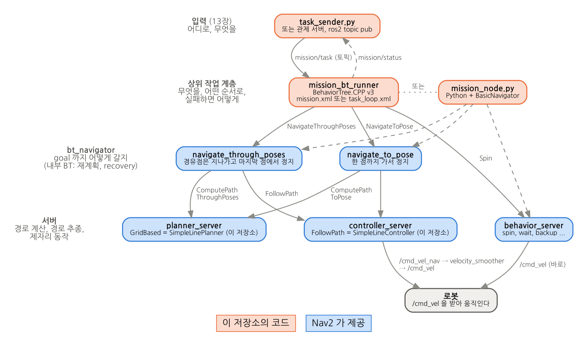
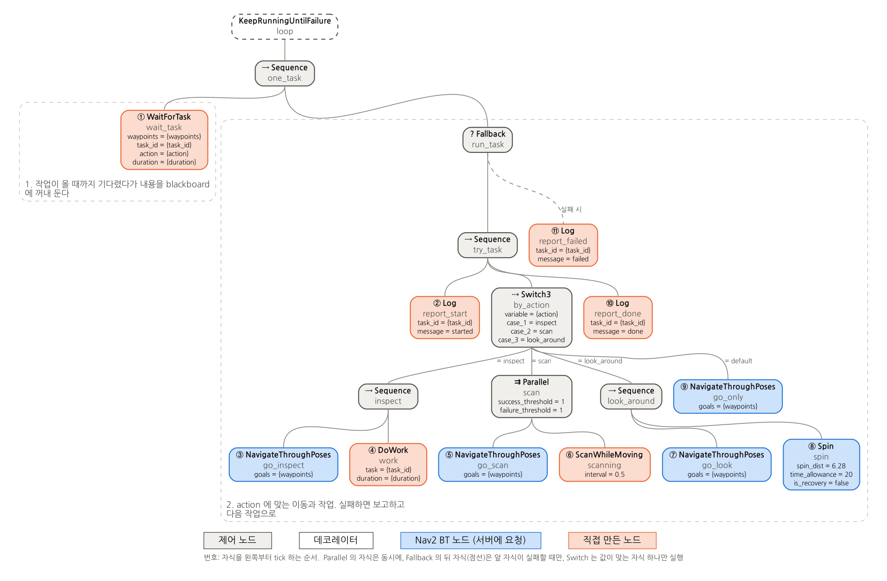

# 여러 goal 경유와 작업 미션

`simple_line` 의 planner / controller 위에서 여러 지점을 도는 방법을 정리한다. 장애물은 고려하지 않는다.

- **1부**: Nav2 명령 하나로 여러 goal 을 도는 방법.
- **2부**: 그 명령들을 조합해서 작업이 섞인 미션을 만드는 방법. 좌표를 XML 에 적어 두는 방식(6~12장)과, 실행 중에 토픽으로 받는 방식(13장)이 있다.

| 하고 싶은 것 | 쓰는 Nav2 기능 | 실행 | 장 |
|---|---|---|---|
| 경유점은 멈추지 않고 지나 최종 goal 까지 | `NavigateThroughPoses` (bt_navigator) | `send_waypoints.py` | 1~4 |
| goal 마다 멈추고 방향까지 맞추며 차례로 | `FollowWaypoints` (waypoint_follower) | `follow_waypoints.py` | 5 |
| 경유, 정지 작업, 주행 중 작업, 실패 처리를 섞은 미션 | 위 명령들과 `Spin` 을 상위 계층에서 조합 | `mission_bt_runner` (BT)<br>`mission_node.py` (Python) | 6~12 |
| 위와 같되, 좌표와 작업을 실행 중에 토픽으로 받기 | 같음 | `mission_bt_runner` (`task_loop.xml`)<br>+ `task_sender.py` | 13 |

목차

- [0. 빌드와 시뮬레이션 실행](#0-빌드와-시뮬레이션-실행)
- **1부. 명령 하나로 여러 goal 경유하기**
  - [1. 경유 경로: NavigateThroughPoses 가 처리되는 흐름](#1-경유-경로-navigatethroughposes-가-처리되는-흐름)
  - [2. send_waypoints.py: 터미널에서 경유 경로 보내기](#2-send_waypointspy-터미널에서-경유-경로-보내기)
  - [3. 꺾은선을 따라가기 위한 컨트롤러 동작](#3-꺾은선을-따라가기-위한-컨트롤러-동작)
  - [4. 경유 경로의 동작 특성과 한계](#4-경유-경로의-동작-특성과-한계)
  - [5. 멈춰 가며 경유하기: waypoint_follower](#5-멈춰-가며-경유하기-waypoint_follower)
- **2부. 명령을 조합해 미션 만들기**
  - [6. 미션](#6-미션)
  - [7. 구조: 미션 BT 는 Nav2 위에 한 층 더 올라간다](#7-구조-미션-bt-는-nav2-위에-한-층-더-올라간다)
  - [8. BT 기초: 이 예제를 읽는 데 필요한 만큼](#8-bt-기초-이-예제를-읽는-데-필요한-만큼)
  - [9. mission.xml 읽기](#9-missionxml-읽기)
  - [10. 코드로 구현하기 (C++)](#10-코드로-구현하기-c)
  - [11. Python 작업 노드](#11-python-작업-노드)
  - [12. 미션 실행](#12-미션-실행)
  - [13. 좌표를 토픽으로 받기 (task_loop.xml)](#13-좌표를-토픽으로-받기-task_loopxml)
- [14. 확인한 것](#14-확인한-것)
- [15. 어떤 방법을 쓸까](#15-어떤-방법을-쓸까)
- [16. 주의할 점 (Humble)](#16-주의할-점-humble)
- [17. 파일](#17-파일)

---

## 0. 빌드와 시뮬레이션 실행

```bash
cd ~/nav2_ws/src/nav2_dwb && git pull
cd ~/nav2_ws
rosdep install --from-paths src --ignore-src -y      # nav2_simple_commander 등
colcon build --symlink-install --packages-select \
  simple_line_planner simple_line_controller simple_line_bringup \
  simple_line_mission_msgs simple_line_mission
source install/setup.bash
```

```bash
# 터미널 1: Gazebo + Nav2 + RViz (로봇은 (-2,-1) 에서 +x 를 보고 시작)
export TURTLEBOT3_MODEL=waffle
export GAZEBO_MODEL_PATH=$GAZEBO_MODEL_PATH:/opt/ros/humble/share/turtlebot3_gazebo/models
ros2 launch simple_line_bringup simple_line.launch.py
```

이후 장의 명령은 모두 **터미널 2** 에서 실행한다.

- 좌표는 모두 빈 방(6m x 6m, 벽은 ±3m) map frame 기준이다.
- waypoint_follower 와 behavior_server 는 이 launch 로 같이 뜬다.

---

# 1부. 명령 하나로 여러 goal 경유하기

## 1. 경유 경로: NavigateThroughPoses 가 처리되는 흐름

Nav2 에는 "pose 여러 개를 한 번에 받아 그 사이를 이어 가는" 액션이 이미 있다. bt_navigator 의 **`NavigateThroughPoses`** 다.
그래서 새 서버를 만들지 않고, 이 액션에 맞춰 각 요소가 제 역할을 하도록 구성했다.

```
send_waypoints.py ──(NavigateThroughPoses: poses[])──▶ bt_navigator
                                                         │  기본 BT: navigate_through_poses_w_replanning_and_recovery.xml
                                                         │   ├ 3초마다 (RateController 0.333Hz)
                                                         │   │   ├ RemovePassedGoals: 로봇 0.7m 안의 앞쪽 goal 삭제 (마지막 goal 은 남김)
                                                         │   │   └ ComputePathThroughPoses(남은 goals) ──▶ planner_server
                                                         │   └ FollowPath(path) ─────────────────────▶ controller_server
                                                         │
planner_server ── [로봇→g1], [g1→g2], ... 구간마다 GridBased(SimpleLinePlanner)::createPlan() 호출 후 이어 붙임
controller_server ── FollowPath(SimpleLineController) 가 꺾은선 경로를 추종, 끝점(최종 goal)에서만 도착 판정
```

| 단계 | 담당 | 이 저장소에서 |
|---|---|---|
| goal 여러 개를 한 번에 보내기 | `send_waypoints.py` (2장) 또는 미션의 한 단계 (2부) | 새로 작성 |
| 지나간 goal 지우기, 주기적 재계획 | Nav2 기본 BT (1-1) | 그대로 사용 |
| 구간별 직선 → 하나의 꺾은선 | planner_server + `SimpleLinePlanner` (1-2) | 그대로 사용 (코드 변경 없음) |
| 꺾은선 따라가기 | `SimpleLineController` | 두 가지 동작을 넣었다 (3장) |

### 1-1. 재계획 주기(0.333Hz)와 지난 goal 반경(0.7m)은 어디에 있나

이 저장소의 코드에는 없다. **Nav2 를 설치할 때 같이 깔리는 기본 BT 파일**에 들어 있다.

bt_navigator 는 `default_nav_through_poses_bt_xml` 파라미터로 BT 파일을 고른다. `simple_line_params.yaml` 은 이 값을
정하지 않으므로, bt_navigator 가 기본값을 쓴다 (`nav2_bt_navigator/src/navigators/navigate_through_poses.cpp`):

```cpp
if (!node->has_parameter("default_nav_through_poses_bt_xml")) {
  node->declare_parameter<std::string>("default_nav_through_poses_bt_xml",
    pkg_share_dir + "/behavior_trees/navigate_through_poses_w_replanning_and_recovery.xml");
}
```

그 파일이 `/opt/ros/humble/share/nav2_bt_navigator/behavior_trees/navigate_through_poses_w_replanning_and_recovery.xml` 이고,
여기에 주기와 반경이 적혀 있다:

```xml
<RateController hz="0.333">                     <!-- 3초에 한 번만 아래를 실행 = 재계획 주기 -->
  ...
  <RemovePassedGoals input_goals="{goals}" output_goals="{goals}" radius="0.7"/>
  <ComputePathThroughPoses goals="{goals}" path="{path}" planner_id="GridBased"/>
```

```bash
cat /opt/ros/humble/share/nav2_bt_navigator/behavior_trees/navigate_through_poses_w_replanning_and_recovery.xml
```

goal 하나짜리 `NavigateToPose` 는 `navigate_to_pose_w_replanning_and_recovery.xml` 을 쓴다. 그 안의 주기는 `<RateController hz="1.0">` (1초) 이다. 5장의 waypoint_follower 도 내부에서 `NavigateToPose` 를 쓴다.

바꾸고 싶으면 이 XML 을 패키지로 복사해 수정한 뒤, `simple_line_params.yaml` 에 경로를 지정한다.

```yaml
bt_navigator:
  ros__parameters:
    default_nav_through_poses_bt_xml: "/절대/경로/my_through_poses.xml"
```

### 1-2. planner 는 왜 그대로 쓸 수 있나

Humble 의 `planner_server::computePlanThroughPoses()` 는 goal 목록을 돌면서 이렇게 한다.

```cpp
for (i = 0; i < goals.size(); ++i) {
  curr_start = (i == 0) ? 로봇 위치 : concat_path.poses.back();   // 앞 구간의 끝 = 이번 구간의 시작
  curr_goal  = goals[i];
  curr_path  = getPlan(curr_start, curr_goal, planner_id);        // = SimpleLinePlanner::createPlan()
  concat_path.poses.insert(end, curr_path.poses.begin(), curr_path.poses.end());
}
```

구간마다 플러그인의 `createPlan(start, goal)` 을 불러 이어 붙인다. 그래서 직선 하나만 그릴 줄 아는 `SimpleLinePlanner` 로도
경로 전체가 **꺾은선**이 된다. 구간 경계에는 같은 점이 두 번 들어가지만, 길이 0 인 구간이라 추종에는 영향이 없다.

---

## 2. send_waypoints.py: 터미널에서 경유 경로 보내기

`simple_line_bringup/scripts/send_waypoints.py`. 터미널 인자로 경유 경로를 바로 시험할 때 쓴다.

```bash
# 경유 goal 2개 + 최종 goal 1개 (map frame, x,y[,yaw_deg])
ros2 run simple_line_bringup send_waypoints.py 1.0,-1.0 1.0,1.5 -1.5,1.5,180
```

```
start (-2.00, -1.00)
  1. via   (1.00, -1.00, 90 deg)
  2. via   (1.00, 1.50, 180 deg)
  3. final (-1.50, 1.50, 180 deg)
  passed waypoint 1/3  (distance remaining 4.80 m)
  passed waypoint 2/3  (distance remaining 2.30 m)
result: SUCCEEDED, final xy error 0.24 m
```

| 기능 | 내용 |
|---|---|
| 입력 | `x,y` 또는 `x,y,yaw_deg` 를 순서대로 나열. 마지막이 최종 goal. `-1.5,0.5` 처럼 `-` 로 시작하는 좌표도 그대로 받는다 |
| yaw 자동 채움 | 중간 goal: **다음 goal 을 향하는 방향**, 최종 goal: **마지막 구간의 진행 방향** |
| 사전 검사 | 최종 goal 이 출발점이나 앞 구간과 goal 허용오차(+0.1m) 안으로 겹치면 거부 (4장, `--force` 로 무시) |
| 전송 | `NavigateThroughPoses` 한 번 |
| 진행 표시 | 피드백의 `number_of_poses_remaining` 이 줄어들 때마다 `passed waypoint k/n` |
| 결과 | `SUCCEEDED / ABORTED / CANCELED` 와 최종 위치 오차. Ctrl+C 로 취소 |

> 중간 goal 의 yaw 는 사실 주행에 쓰이지 않는다. 컨트롤러는 경로 점의 위치만 쓰고, 방향은 **최종 goal** 의 것만 쓴다.
> 그래도 RViz 에 자연스럽게 표시되도록 다음 goal 방향으로 채운다.

RViz 로도 할 수 있다.

1. Navigation 2 패널의 **Waypoint / Nav Through Poses Mode** 를 누른다.
2. Nav2 Goal 로 점을 여러 개 찍는다.
3. **Start Nav Through Poses** 를 누른다.

그러면 같은 `NavigateThroughPoses` 액션이 나간다. 다만 이 경우 위의 사전 검사는 없다.

---

## 3. 꺾은선을 따라가기 위한 컨트롤러 동작

`SimpleLineController` (`simple_line_controller/src/simple_line_controller.cpp`) 에는 꺾은선을 위한 동작이 두 가지 들어 있다.
직선 하나일 때는 필요 없지만, 여러 goal 을 이은 꺾은선에서는 이것이 없으면 문제가 생긴다.
아래 "없을 때" 는 이 두 동작을 넣기 전 컨트롤러로 잰 값이다. 직선 하나짜리 경로에서는 동작이 바뀌지 않는다 (14-1).

### 3-1. 가장 가까운 경로 점을 앞쪽 일정 거리 안에서만 찾기

컨트롤러는 매 주기 로봇에 가장 가까운 경로 점을 찾고, 그 앞부분(지나온 부분)을 잘라낸다.

**경로 전체에서 찾을 때의 문제**: 경로가 자기 자신과 교차하면, 교차점에 도착했을 때 **나중 구간**의 점이 더 가깝게 잡힌다. 그러면 그 사이 구간을 통째로 잘라 버린다.

```
 (-0.5,1.5) ◀──────── (1.5,1.5)
     │                    ▲
     │                    │
 ────┼────────────────────┘   ← 첫 구간 (y=-1) 을 달리다 x=-0.5 에서
 start                          마지막 구간 (x=-0.5) 의 점을 잡아버림
     │
     ▼ final (-0.5,-2.2)
```

이 동작이 없을 때 (교차 경로 실측): 로봇이 교차점에서 남쪽으로 **0.47m** 꺾였다. 3초 뒤 BT 재계획으로 경로가 다시 그려지고 나서야 돌아왔다.

**동작**: 남은 경로의 앞에서부터, 경로 길이로 `max_robot_pose_search_dist` 까지만 찾는다 (기본값: local costmap 반폭 1.5m).
RPP 의 같은 이름 파라미터와 같은 방식이다.

```cpp
double travelled = 0.0;
for (size_t i = 0; i < plan_.size(); ++i) {
  if (i > 0) {
    travelled += 거리(plan_[i-1], plan_[i]);
    if (travelled > search_dist) break;      // 경로를 따라 이만큼만 앞을 본다
  }
  ... 가장 가까운 점 갱신 ...
}
```

결과: 같은 경로에서 첫 구간 이탈이 **0.47m → 0.08m**, 소요 시간은 50.7s → 46.9s 가 됐다.

### 3-2. goal 까지 거리 = 남은 경로 길이

컨트롤러는 "goal 까지 거리" 를 두 곳에 쓴다.

- 이 거리가 goal 허용오차(0.25m) 이하이면 → 도착한 것으로 보고 제자리에서 goal yaw 로 회전
- 이 거리가 `approach_dist`(0.6m) 이하이면 → 감속

**직선 거리로 잴 때의 문제**: 꺾은선에서는 최종 goal 이 **가까이 보여도 아직 돌아야 할 구간이 남아 있을 수 있다.**

- 출발점으로 돌아오는 경로: 출발하자마자 "도착" 으로 보고 goal yaw 로 회전한다. 방향까지 맞으니 Nav2 가 도착 처리한다.
  결과적으로 **로봇이 움직이지도 않고 6.5초 만에 SUCCEEDED** 가 됐다 (실측).
- 최종 goal 근처를 중간에 지나가는 경로: 그 근처에서 괜히 감속한다 (실측 최저 속도 0.188 m/s).

**동작**: 로봇 → 남은 경로의 첫 점 → … → 마지막 점까지의 **경로 길이**로 잰다.

```cpp
double goal_dist = 거리(로봇, plan_.front());
for (size_t i = 1; i < plan_.size(); ++i) goal_dist += 거리(plan_[i-1], plan_[i]);
```

직선 하나에서는 로봇이 경로 위에 있으므로 직선 거리와 같다. 꺾은선에서는 돌아야 할 구간이 모두 더해진다.

결과: 출발점으로 돌아오는 경로를 끝까지 돌고 도착했다 (33.9s). 최종 goal 근처를 지날 때도 감속하지 않았다 (0.250 m/s).

---

## 4. 경유 경로의 동작 특성과 한계

### 모서리에서

다음 구간이 꺾이면 lookahead(0.6m) 지점의 carrot 이 다음 구간으로 넘어간다.

- carrot 방향이 45°(`rotate_to_heading_min_angle`) 이하 → 호를 그리며 모서리를 돈다
- 45° 초과 (예: 90° 모서리) → 모서리 근처에서 멈추고 제자리 회전 후 출발한다. 경유 goal 이라서 멈추는 것이 아니라 컨트롤러 동작이다 (14-3 타임라인에서 0.4초)

### 경유 goal 을 정확히 밟지는 않는다

BT 의 `RemovePassedGoals` 는 로봇이 goal **0.7m 안**에 들어오면 그 goal 을 지운다. 지운 뒤 다음 재계획(최대 3초 뒤)에서는
**그 순간의 로봇 위치 → 다음 goal** 직선이 새로 그려지므로, 모서리를 가로질러 간다.

- 실측으로 경유 goal 을 0.23~0.61m 거리로 지나갔다 (재계획 타이밍에 따라 달라짐).
- 더 가깝게 지나가야 하면 `RemovePassedGoals` 의 `radius` 를 줄인 BT 를 만들어 `default_nav_through_poses_bt_xml` 로 지정한다 (1-1).

### 최종 goal 이 앞 구간과 겹치면 일찍 끝날 수 있다 (Humble)

controller_server 의 도착 판정(`SimpleGoalChecker`)은 남은 경로와 상관없이 **로봇과 경로 끝점(= 최종 goal)의 위치·방향 차이**만 본다.

- 최종 goal 이 출발점이나 앞 구간과 0.25m 안으로 겹친다.
- 그 지점에서 로봇의 **방향까지** 최종 goal 과 맞는다.

두 조건이 맞으면 중간 goal 을 다 돌기 전에 SUCCEEDED 가 된다. 컨트롤러 쪽에서는 막을 수 없는 Nav2 Humble 의 동작이다.

| 경로 (출발점 = 최종 goal 위치) | 최종 goal yaw | 결과 |
|---|---|---|
| (1,-1) → (1,1) → (-2,-1) | -146° (출발 방향 0° 와 다름) | 끝까지 돌고 SUCCEEDED (33.9s) |
| (1,-1) → (1,1) → (-2,-1) | 0° (출발 방향과 같음) | **움직이지 않고 1.9초 만에 SUCCEEDED** |

`send_waypoints.py` 는 위치가 겹치기만 해도 미리 거부한다 (방향은 실행 중에 정해지므로). 피하는 방법은 셋이다.

- 최종 goal 을 조금 옮긴다.
- 경로를 두 번에 나눠 보낸다. 2부의 미션이 이 방식이다.
- 위험을 알고 `--force` 로 보낸다.

각 goal 에서 멈추고 방향까지 맞춘 뒤 다음 goal 로 가는 방식(5장)은 goal 마다 따로 판정하므로 이 문제가 없다.

---

## 5. 멈춰 가며 경유하기: waypoint_follower

`simple_line_bringup/scripts/follow_waypoints.py`. 목표 위치를 **파이썬 코드 안에서** 정하고 실행한다.
`FollowWaypoints` 액션(waypoint_follower)을 쓰며, goal 마다 멈추고 방향까지 맞춘 뒤 다음 goal 로 간다.

### 사용법

1. 파일 위쪽의 `WAYPOINTS` 를 고친다.

   ```python
   WAYPOINTS = [
       (1.0, -1.0, None),     # (x [m], y [m], yaw [deg]), map frame
       (1.0, 1.5, None),
       (-1.5, 1.5, None),
       (-2.0, -1.0, 0.0),     # 출발점으로 돌아와 +x 방향으로 정렬
   ]
   ```

   yaw 를 `None` 으로 두면 중간 goal 은 **다음 goal 을 향하는 방향**, 마지막 goal 은 **직전 지점에서 온 방향**으로 채운다.
   waypoint_follower 는 goal 마다 yaw 까지 맞추므로, 이렇게 채워 두면 도착 후 제자리 회전이 줄어든다.

2. 실행한다.

   ```bash
   # WAYPOINTS 를 고친 뒤 빌드 없이 바로 실행
   python3 ~/nav2_ws/src/nav2_dwb/simple_line/simple_line_bringup/scripts/follow_waypoints.py

   # 또는 설치된 것으로 실행 (colcon build --symlink-install 이면 원본을 고친 게 바로 반영된다)
   ros2 run simple_line_bringup follow_waypoints.py
   ```

```
start (-2.00, -1.00), 4 waypoints
  [1/4] heading to (1.00, -1.00, 90 deg)
  [1/4] done in 14.9 s
  [2/4] heading to (1.00, 1.50, 180 deg)
  [2/4] done in 12.9 s
  [3/4] heading to (-1.50, 1.50, -101 deg)
  [3/4] done in 12.7 s
  [4/4] heading to (-2.00, -1.00, 0 deg)
  [4/4] done in 13.5 s
result: SUCCEEDED in 54.0 s, missed waypoints: none
final error: xy 0.21 m, yaw 1.8 deg
```

### 명령이 C++ planner / controller 까지 가는 길

```
follow_waypoints.py ──(FollowWaypoints: poses[4])──▶ waypoint_follower
   waypoint_follower 가 goal 을 하나씩 꺼내 순서대로
   ──(NavigateToPose: pose[i])──▶ bt_navigator   (기본 BT: navigate_to_pose_w_replanning_and_recovery.xml, 1초마다 재계획)
        ├ ComputePathToPose ──▶ planner_server    → SimpleLinePlanner::createPlan(로봇, goal[i])  : 직선 한 개
        └ FollowPath        ──▶ controller_server → SimpleLineController::computeVelocityCommands : 20Hz 로 cmd_vel
   goal[i] 도착 (위치 0.25m + yaw 0.25rad) → WaitAtWaypoint 0.2초 → goal[i+1] 로
```

실측 로그(헤드리스 테스트)도 이 순서 그대로다:

```
[waypoint_follower]: Received follow waypoint request with 4 waypoints.
[bt_navigator]: Begin navigating from current location (-2.00, -1.00) to (1.00, -1.00)
[controller_server]: Reached the goal!
[bt_navigator]: Goal succeeded
[waypoint_follower]: Arrived at 0'th waypoint, sleeping for 200 milliseconds
[waypoint_follower]: Handled task execution on waypoint 0, moving to next.
[bt_navigator]: Begin navigating from current location (0.79, -1.00) to (1.00, 1.50)
...
```

goal 하나하나는 `simple_line` 의 단일 goal 과 똑같이 처리된다. 그래서 이 방법을 위해 planner / controller 를 바꿀 필요가 없다.

### 스크립트가 하는 일

| 단계 | 코드 |
|---|---|
| 로봇 현재 위치 읽기 (TF `map → base_link`) | `robot_pose()` |
| `WAYPOINTS` 의 빈 yaw 채우기 | `fill_yaws()` |
| `FollowWaypoints` goal 만들기 (`PoseStamped` 목록, frame `map`) | `make_goal()` |
| 액션 전송 / 결과 기다리기 / Ctrl+C 시 취소 | `run()` |
| 진행 표시: feedback 의 `current_waypoint` 가 바뀔 때마다 출력 | `on_feedback()` |
| 결과: 상태, 실패한 goal 목록(`missed_waypoints`), 최종 위치 오차 | `run()` |

### waypoint_follower 설정 (`simple_line_params.yaml`)

```yaml
waypoint_follower:
  ros__parameters:
    loop_rate: 20                  # 진행 상태 확인 주기 [Hz]
    stop_on_failure: false         # goal 하나가 실패해도 다음 goal 로 계속 (실패한 index 는 missed_waypoints 로)
    waypoint_task_executor_plugin: "wait_at_waypoint"
    wait_at_waypoint:
      plugin: "nav2_waypoint_follower::WaitAtWaypoint"
      enabled: true
      waypoint_pause_duration: 200 # 각 goal 에 도착한 뒤 기다리는 시간 [ms]
```

값은 Humble 기본값과 같다. 바꿀 곳이 보이도록 명시해 두었다.
`enabled: false` 는 대기만 없앤다. goal 마다 멈추는 것은 그대로다 (같은 직선 위 goal 4개로 확인: 매 goal 에서 약 0.8초 정지).

### NavigateThroughPoses 와 비교

| | NavigateThroughPoses (1~4장) | FollowWaypoints (5장) |
|---|---|---|
| 경로 | 전체 goal 을 이은 꺾은선 하나 | goal 마다 직선 하나씩 |
| 중간 goal 에서 | 멈추지 않고 통과 (0.7m 안이면 지난 것으로 처리) | 멈추고 위치·yaw 를 맞춘 뒤 0.2초 대기 |
| 중간 goal 의 yaw | 쓰이지 않음 | 쓰임 |
| 재계획 주기 (기본 BT) | 3초 (0.333Hz) | 1초 (1Hz) |
| 최종 goal 이 출발점·앞 구간과 겹칠 때 | 일찍 끝날 수 있음 (4장) | 문제없음 |
| 중간 goal 하나가 실패하면 | 전체 실패 | 건너뛰고 계속 (`stop_on_failure: false`) |
| 같은 사각형 경로 소요 시간 | 32.0 s (경유 2 + 최종 1) | 54.0 s (goal 4개, 출발점 복귀 포함) |

---

# 2부. 명령을 조합해 미션 만들기

1부의 방법은 각각 "경유만" 또는 "goal 마다 정지" 중 하나다. 실제 작업은 이것들이 섞인다.

- **경유점**: 멈추지 않고 지나간다.
- **작업 지점**: 멈춰서 작업한다.
- **주행 중 작업**: 움직이는 동안 한다.

이런 미션은 Nav2 위에 **상위 작업 계층**을 두고, 1부의 명령들을 단계마다 골라 보낸다.
같은 미션을 두 가지 방법으로 만들었다. 좌표를 실행 중에 토픽으로 받는 BT 는 13장에 따로 정리했다.

| | 실행 | 미션을 정하는 곳 |
|---|---|---|
| **BT 버전** | `ros2 run simple_line_mission mission_bt_runner` | `simple_line_mission/behavior_trees/mission.xml` |
| **Python 버전** | `ros2 run simple_line_mission mission_node.py` | `simple_line_mission/scripts/mission_node.py` 맨 위의 `ROUTE_A`, `ROUTE_B`, `HOME` |

두 버전이 부르는 Nav2 기능은 같다.

- **이동**: bt_navigator 의 `NavigateThroughPoses` (1장) / `NavigateToPose`
- **제자리 회전**: behavior_server 의 `Spin`
- **경로 생성과 추종**: `SimpleLinePlanner` / `SimpleLineController` (3장의 동작 포함)

## 6. 미션

로봇은 (-2.0, -1.0) 에서 +x 를 보고 출발한다.

```
  y
 1.5 ┤  B(-1, 1.5) ◀━━━━━━━━━━━━━━━━━━━━━━ (1.5, 1.5)
     │                                      ┃   A → B: 주행 중 0.5m 마다 스캔
     │                                      ┃
 -1  ┤  S(-2, -1) ━━━━━▶ (0, -1) ━━━━━━━▶ A(1.5, -1)
     └──────────────────────────────────────────────── x

  S: 출발점.  (0,-1), (1.5,1.5): 경유점 (멈추지 않음).  A, B: 작업 지점 (정지)
```

| 단계 | 이동 | 이동에 쓰는 Nav2 액션 | 작업 | 실패하면 |
|---|---|---|---|---|
| A | 출발 → (0,-1) 경유 → **A** (1.5,-1, 90°) | `NavigateThroughPoses` | 정지 상태: 점검 3초 | A 를 건너뛰고 B 로 |
| B | A → (1.5,1.5) 경유 → **B** (-1,1.5, 180°) | `NavigateThroughPoses` | 주행 중: 0.5m 마다 스캔<br>정지 상태: 360° 회전 + 보고 2초 | B 를 건너뛰고 복귀 |
| 복귀 | B → 출발점 (-2,-1, 0°) | `NavigateToPose` | - | 한 번 더 시도 |

**경유점과 작업 지점을 한 번에 보낸다.** `NavigateThroughPoses` 는 앞의 점들을 멈추지 않고 지나가고 **마지막 점에서 멈춘다**. 그래서 "경유점 몇 개 + 작업 지점" 을 하나의 명령으로 보내고, 도착하면 작업한다. 경유점이 없는 이동(복귀)은 `NavigateToPose` 로 보낸다.

경로를 작업 지점마다 끊어 보내므로, 4장의 "최종 goal 이 앞 구간과 겹치면 일찍 끝남" 도 구간마다만 따지면 된다.

---

## 7. 구조: 미션 BT 는 Nav2 위에 한 층 더 올라간다



| 계층 | 하는 일 | 이 예제에서 |
|---|---|---|
| **입력** (13장) | 어디로 가서 무엇을 할지 보냄 | `task_sender.py` → `mission/task` 토픽 (`mission.xml` 은 입력 없이 XML 안의 좌표를 씀) |
| **상위 작업 계층** | 무엇을, 어떤 순서로, 실패하면 어떻게 | `mission_bt_runner` (BT) 또는 `mission_node.py` (Python) |
| **bt_navigator** | goal 까지 **어떻게 갈지** (재계획, recovery) | Nav2 기본 BT 그대로 (1-1) |
| **서버** | 실제 경로 계산, 경로 추종, 제자리 동작 | planner_server (SimpleLinePlanner), controller_server (SimpleLineController), behavior_server (Spin) |

BT 가 두 개다.

- 이 예제의 **미션 BT** (`mission.xml`): 작업 순서를 정한다.
- bt_navigator 안의 **navigation BT** (`navigate_through_poses_w_replanning_and_recovery.xml` 등, 1-1): goal 하나까지 가는 방법을 정한다. goal 이 올 때마다 새로 실행된다.

미션 BT 의 `NavigateThroughPoses` 노드가 bt_navigator 에 액션을 보내면, bt_navigator 가 navigation BT 를 돌린다. 작업 로직을 navigation BT 에 섞지 않으니, 이동 실패 처리(재계획, recovery)와 작업 실패 처리(건너뛰기, 재시도)가 서로 엉키지 않는다.

---

## 8. BT 기초: 이 예제를 읽는 데 필요한 만큼

### tick 과 상태

BT 는 루트부터 **tick** 을 한다. 실행 노드가 tick 을 주기적으로 반복하고(여기서는 100Hz), 매 tick 마다 루트에서 지금 실행할 노드까지 내려간다. tick 을 받은 노드는 셋 중 하나를 돌려준다.

| 상태 | 뜻 |
|---|---|
| `SUCCESS` | 끝났고 성공 |
| `FAILURE` | 끝났고 실패 |
| `RUNNING` | 아직 하는 중. 다음 tick 에 다시 물어봐 달라 |

예를 들어 `go_a` 가 주행하는 약 16초 동안에도 BT 는 100Hz 로 tick 한다.

1. 매 tick: `mission → station_a → visit_a → go_a` 로 내려가고, `go_a` 는 `RUNNING` 을 돌려준다.
2. 주행이 끝나면 `go_a` 가 `SUCCESS` 를 돌려준다.
3. 같은 tick 안에서 `visit_a` 가 다음 자식 `inspect_a` 를 시작한다.

### 노드 종류

| 종류 | 노드 | 동작 |
|---|---|---|
| 제어 | **Sequence** (→) | 자식을 왼쪽부터 차례로. 하나라도 FAILURE 면 바로 FAILURE. 모두 SUCCESS 면 SUCCESS |
| 제어 | **Fallback** (?) | 자식을 왼쪽부터 차례로. 하나라도 SUCCESS 면 바로 SUCCESS. 앞 자식이 실패해야 다음 자식을 실행 |
| 제어 | **Parallel** (⇉) | 자식을 매 tick 모두 실행. `success_threshold` 개가 SUCCESS 면 SUCCESS. 나머지 RUNNING 자식은 **halt** (중단) |
| 데코레이터 | **RetryUntilSuccessful** | 자식이 FAILURE 면 `num_attempts` 번까지 다시 |
| 액션 | **Nav2 BT 노드** | `NavigateThroughPoses`, `NavigateToPose`, `Spin`. Nav2 서버에 액션을 보내고, 끝날 때까지 RUNNING |
| 액션 | **직접 만든 노드** | `MakePose(s)`, `DoWork`, `ScanWhileMoving`, `Log` (10장) |

### blackboard 와 포트

노드끼리 값을 주고받는 공용 저장소가 **blackboard** 다. XML 에서 `{이름}` 은 blackboard 변수를 뜻한다.

```xml
<MakePoses poses="0.0,-1.0; 1.5,-1.0,90" output="{route_a}"/>   <!-- route_a 에 쓰고 -->
<NavigateThroughPoses goals="{route_a}"/>                      <!-- route_a 를 읽는다 -->
```

`poses`, `output`, `goals` 같은 이름이 **포트**다. 각 노드 클래스가 어떤 포트를 갖는지 `providedPorts()` 로 선언한다. `{}` 없이 쓴 값(`"0.0,-1.0; ..."`)은 문자열 그대로 들어간다.

---

## 9. mission.xml 읽기

`tools/draw_bt.py` 가 `mission.xml` 을 읽어 그린 그림이다. 원 안의 번호는 자식을 왼쪽부터 tick 하는 순서다. 점선 상자의 제목은 XML 주석이다.


위에서부터 읽으면 이렇다.

```xml
<Sequence name="mission">           <!-- 아래 다섯 묶음을 차례로. 하나라도 실패하면 미션 실패 -->
```

**0. setup**: 목표 위치를 만들어 blackboard 에 넣는다.

```xml
<MakePoses name="make_route_a" poses="0.0,-1.0; 1.5,-1.0,90" output="{route_a}"/>
<MakePoses name="make_route_b" poses="1.5,1.5; -1.0,1.5,180" output="{route_b}"/>
<MakePose name="make_home" pose="-2.0,-1.0,0" output="{home}"/>
```

- 형식은 `"x,y[,yaw_deg]; ..."` 이다.
- 경유점의 yaw 는 생략하면 다음 점 방향으로 채운다.
- 위치를 바꾸려면 여기만 고치면 된다.

**1. station_a**: 경유 → 정지 작업. 못 가면 건너뛴다.

```xml
<Fallback name="station_a">
  <Sequence name="visit_a">
    <NavigateThroughPoses name="go_a" goals="{route_a}"/>       <!-- (0,-1) 은 지나가고 A 에서 정지 -->
    <DoWork name="inspect_a" task="inspect A" duration="3.0"/>  <!-- 정지 상태 작업 -->
  </Sequence>
  <Log name="skip_a" message="station A failed, skipping it"/> <!-- visit_a 가 실패했을 때만 -->
</Fallback>
```

- `go_a` 나 `inspect_a` 가 실패하면 `visit_a` 가 FAILURE 다.
- 그러면 Fallback 이 `skip_a` 를 실행한다. `skip_a` 는 SUCCESS 이므로 `station_a` 전체는 SUCCESS 가 되고, 미션은 B 로 넘어간다.

**2. station_b**: 주행 중 작업 → 정지 작업.

```xml
<Parallel name="go_b_scanning" success_threshold="1" failure_threshold="1">
  <NavigateThroughPoses name="go_b" goals="{route_b}"/>   <!-- 주행 -->
  <ScanWhileMoving name="scan" interval="0.5"/>            <!-- 주행하는 동안 같이 -->
</Parallel>
<Spin name="look_around" spin_dist="6.28" time_allowance="20" is_recovery="false"/>
<DoWork name="report_b" task="report B" duration="2.0"/>
```

`ScanWhileMoving` 은 스스로 끝나지 않는다(항상 RUNNING). 그래서 `go_b` 가 결과를 내야 Parallel 이 끝난다.

| `go_b` 결과 | Parallel | `scan` |
|---|---|---|
| SUCCESS (`success_threshold="1"`) | SUCCESS | halt (중단) |
| FAILURE (`failure_threshold="1"`) | FAILURE | halt (중단) |

**3. 복귀**: 경유점이 없으니 `NavigateToPose` 를 쓴다. 실패하면 한 번 더 시도한다.

```xml
<RetryUntilSuccessful name="retry_home" num_attempts="2">
  <NavigateToPose name="go_home" goal="{home}"/>
</RetryUntilSuccessful>
<Log name="done" message="mission complete"/>
```

복귀가 두 번 다 실패하면 `mission` Sequence 가 FAILURE 로 끝난다.

---

## 10. 코드로 구현하기 (C++)

BT 를 코드로 쓰는 일은 세 가지다.

1. 필요한 **노드 종류를 만든다**. 직접 만들 노드만.
2. 실행 노드에서 노드 종류를 **factory 에 등록**하고, **blackboard** 를 채운다.
3. XML 로 **트리를 만들고 tick** 한다.

### 10-1. BT 노드 만들기 (`include/simple_line_mission/mission_nodes.hpp`, `src/mission_nodes.cpp`)
**결과 node 구조.**
```
ROS 노드 /mission_bt   (실행 파일 mission_bt_runner)
 └ 미션 BT
    ├ Sequence, Fallback, Parallel, Retry          흐름만 정함. 밖으로 아무것도 안 보냄
    ├ MakePose(s), DoWork, ScanWhileMoving, Log    이 ROS 노드 안에서 직접 처리
    └ NavigateThroughPoses, NavigateToPose, Spin   다른 ROS 노드에 액션 goal 을 보내고 결과를 기다림
              │ 액션                         │ 액션 (spin)
              ▼                              ▼
ROS 노드 /bt_navigator                   ROS 노드 /behavior_server
 └ navigation BT (또 하나의 트리)
    ├ PipelineSequence, RecoveryNode, RateController   흐름
    └ ComputePathThroughPoses, FollowPath              다른 ROS 노드에 액션 goal
              │ 액션                  │ 액션
              ▼                       ▼
ROS 노드 /planner_server           ROS 노드 /controller_server
 └ 플러그인 SimpleLinePlanner         └ 플러그인 SimpleLineController
   (ROS 노드 아님, 서버가 부르는 클래스)  (20Hz 로 불려서 /cmd_vel_nav 토픽 발행)
```


아래 코드는 발췌다 (선언과 정의를 한곳에 모으고 일부 줄을 뺐다).

**한 번에 끝나는 노드** (`BT::SyncActionNode`): `tick()` 이 SUCCESS / FAILURE 를 바로 돌려준다.

```cpp
class Log : public BT::SyncActionNode
{
public:
  Log(const std::string & name, const BT::NodeConfiguration & config);

  static BT::PortsList providedPorts()                     // XML 에서 쓸 수 있는 속성
  {
    return {BT::InputPort<std::string>("message")};
  }

  BT::NodeStatus tick() override
  {
    std::string message;
    getInput("message", message);                          // XML 의 message="..." 를 읽는다
    RCLCPP_INFO(node_->get_logger(), "[log] %s", message.c_str());
    return BT::NodeStatus::SUCCESS;
  }
};
```

**여러 tick 에 걸쳐 실행되는 노드** (`BT::StatefulActionNode`):

| 함수 | 언제 불리나 |
|---|---|
| `onStart()` | 처음 tick 될 때 |
| `onRunning()` | RUNNING 인 동안 매 tick |
| `onHalted()` | 실행 중에 부모가 중단시킬 때 |

```cpp
// DoWork: 정지 상태 작업 자리. 지금은 duration 초 동안 RUNNING
BT::NodeStatus DoWork::onStart()
{
  getInput("task", task_);
  getInput("duration", duration_);
  start_ = std::chrono::steady_clock::now();
  return BT::NodeStatus::RUNNING;                           // 다음 tick 부터 onRunning()
}

BT::NodeStatus DoWork::onRunning()
{
  const std::chrono::duration<double> elapsed = std::chrono::steady_clock::now() - start_;
  return elapsed.count() < duration_ ? BT::NodeStatus::RUNNING : BT::NodeStatus::SUCCESS;
}
```

- `tick()` 안에서 `sleep` 하면 안 된다. 그러면 그동안 트리 전체가 멈추고, Parallel 의 다른 자식도 tick 을 못 받는다. 오래 걸리는 일은 RUNNING 을 돌려주고 다음 tick 에 이어서 확인한다.
- 실제 작업(촬영, 집기, IO)은 `DoWork` 자리에서 서비스나 액션을 비동기로 부르고, 응답이 올 때까지 RUNNING 을 돌려주면 된다. Nav2 의 `nav2_behavior_tree::BtActionNode<ActionT>` / `BtServiceNode<ServiceT>` 템플릿을 상속하면 액션·서비스 호출 노드를 짧게 만들 수 있다. Nav2 BT 노드들이 그렇게 만들어져 있다.

**주행 중 작업 노드** (`ScanWhileMoving`):

- `onRunning()` 에서 TF 로 로봇 위치를 읽는다.
- `interval` 만큼 움직였으면 위치를 기록하고 `mission/scan_points` (`geometry_msgs/PoseArray`) 로 발행한다.
- 언제나 RUNNING 을 돌려준다. 끝내는 것은 Parallel 의 몫이다.

노드가 쓰는 ROS 노드와 TF 버퍼는 생성자에서 blackboard 로 받는다.

```cpp
ScanWhileMoving::ScanWhileMoving(const std::string & name, const BT::NodeConfiguration & config)
: BT::StatefulActionNode(name, config),
  node_(config.blackboard->get<rclcpp::Node::SharedPtr>("node")),
  tf_(config.blackboard->get<std::shared_ptr<tf2_ros::Buffer>>("tf_buffer"))
```

**등록**: XML 태그 이름과 클래스를 묶는다.

```cpp
void registerNodes(BT::BehaviorTreeFactory & factory)
{
  factory.registerNodeType<MakePose>("MakePose");
  factory.registerNodeType<MakePoses>("MakePoses");
  factory.registerNodeType<DoWork>("DoWork");
  factory.registerNodeType<ScanWhileMoving>("ScanWhileMoving");
  factory.registerNodeType<Log>("Log");
}
```

### 10-2. 실행 노드 (`src/mission_bt_runner.cpp`)

발췌다 (예외 처리, 로그는 뺐다).

```cpp
// 1. BT 노드 종류 등록
BT::BehaviorTreeFactory factory;
BT::SharedLibrary loader;
for (const char * lib : {"nav2_navigate_to_pose_action_bt_node",          // Nav2 가 제공하는 노드:
    "nav2_navigate_through_poses_action_bt_node",                         //   플러그인 .so 를 이름으로
    "nav2_spin_action_bt_node", "nav2_wait_action_bt_node"})               //   (bt_navigator 와 같은 방식)
{
  factory.registerFromPlugin(loader.getOSName(lib));
}
simple_line_mission::registerNodes(factory);                              // 직접 만든 노드

// 2. blackboard: Nav2 BT 노드는 생성될 때 이 키들을 꼭 찾는다
auto blackboard = BT::Blackboard::create();
blackboard->set<rclcpp::Node::SharedPtr>("node", node);
blackboard->set<std::shared_ptr<tf2_ros::Buffer>>("tf_buffer", tf_buffer);
blackboard->set<std::chrono::milliseconds>("server_timeout", 1000ms);
blackboard->set<std::chrono::milliseconds>("bt_loop_duration", 10ms);      // 1000 / tick_hz
blackboard->set<std::chrono::milliseconds>("wait_for_service_timeout", 5000ms);

// 3. 트리 생성 (bt_navigator 가 active 가 된 뒤에)
BT::Tree tree = factory.createTreeFromFile(bt_xml, blackboard);

// 4. tick 루프
rclcpp::WallRate rate(tick_hz);                                            // 기본 100Hz
BT::NodeStatus status = BT::NodeStatus::RUNNING;
while (status == BT::NodeStatus::RUNNING) {
  if (g_stop) { tree.haltTree(); break; }                                  // Ctrl-C: 실행 중인 goal 취소
  status = tree.tickRoot();
  rate.sleep();
}
```

나머지 부분은 이렇다.

- **bt_navigator 대기 (`waitForActive`)**: Nav2 BT 노드는 트리를 만들 때 액션 서버를 찾는다. 또 bt_navigator 가 active 가 되기 전에 보낸 goal 은 거절되어, station 을 바로 건너뛰게 된다. 그래서 트리를 만들기 전에 `bt_navigator/get_state` 로 active 인지 확인한다.
- **Ctrl-C**: `rclcpp::init(..., SignalHandlerOptions::None)` 으로 rclcpp 의 기본 처리를 끄고 직접 받는다. rclcpp 가 먼저 종료되면 `haltTree()` 가 Nav2 에 취소 요청을 보낼 수 없기 때문이다.
- **TransitionLogger**: 노드 상태가 바뀔 때마다 `[bt] 이름 종류 이전 -> 다음` 을 출력한다. `BT::StatusChangeLogger` 를 상속한 10줄짜리 클래스다.

| 파라미터 | 기본값 | 설명 |
|---|---|---|
| `bt_xml` | `share/simple_line_mission/behavior_trees/mission.xml` | 실행할 XML |
| `tick_hz` | 100.0 | tick 주기 [Hz] |
| `log_transitions` | true | 노드 상태 변화 출력 |

### 10-3. Nav2 BT 노드를 쓸 때 알아둘 것

| XML 태그 | 플러그인 라이브러리 | 보내는 액션 | 주요 포트 |
|---|---|---|---|
| `NavigateThroughPoses` | `nav2_navigate_through_poses_action_bt_node` | `navigate_through_poses` | `goals` |
| `NavigateToPose` | `nav2_navigate_to_pose_action_bt_node` | `navigate_to_pose` | `goal` |
| `Spin` | `nav2_spin_action_bt_node` | `spin` | `spin_dist`, `time_allowance`, `is_recovery` |
| `Wait` | `nav2_wait_action_bt_node` | `wait` | `wait_duration` |

- **tick 은 100Hz 정도로.**
  - tick 을 10Hz 로 돌렸을 때, 로봇이 멈춘 뒤 BT 가 SUCCESS 를 받기까지 매번 0.9~1.1초가 걸렸다. 100Hz 에서는 이 지연이 사라졌다. 미션 시간은 63.7~65.5초에서 60.1~61.5초가 됐다.
  - 원인은 이렇게 보인다. Nav2 BT 노드는 tick 마다 액션 메시지를 조금씩(대개 하나)만 처리한다. bt_navigator 가 feedback 을 빠르게 보내서, 결과 메시지가 그 뒤에 밀렸다.
  - bt_navigator 자신도 기본 10ms(100Hz) 로 tick 한다.
- **`MakePoses` 의 출력 포트는 타입을 적지 않았다.**
  - Nav2 Humble 1.1.18 이하의 `NavigateThroughPoses` BT 노드는 `goals` 포트 타입을 `PoseStamped` 로 잘못 선언하고 있다 (1.1.19 부터 `std::vector<PoseStamped>`).
  - 그래서 `MakePoses` 쪽을 `std::vector<PoseStamped>` 로 선언하면 트리를 만들 때 타입이 다르다는 오류가 난다.
  - 같은 이유로, 1.1.18 에서는 XML 에서 `MakePoses` 가 그 변수를 쓰는 `NavigateThroughPoses` 보다 **앞에** 있어야 한다. 앞에 나온 노드의 포트 타입으로 변수가 정해지기 때문이다. 순서를 바꾸면 실행 중에 `Blackboard::set() failed: once declared, the type of a port shall not change` 가 난다 (확인함).

---

## 11. Python 작업 노드

`scripts/mission_node.py` 는 같은 미션을 BT 없이 위에서 아래로 실행한다. Nav2 와는 `nav2_simple_commander` 의 `BasicNavigator` 로 주고받는다.

```python
ROUTE_A = [(0.0, -1.0, None), (1.5, -1.0, 90.0)]     # (0,-1) 경유 → 작업 지점 A
ROUTE_B = [(1.5, 1.5, None), (-1.0, 1.5, 180.0)]     # (1.5,1.5) 경유 → 작업 지점 B
HOME = [(-2.0, -1.0, 0.0)]


def run_mission(nav):
    # 1. 작업 지점 A ------------------------------------------- BT: Fallback "station_a"
    if drive(nav, ROUTE_A):                                    # NavigateThroughPoses "go_a"
        do_work('inspect A', 3.0)                              # DoWork "inspect_a"
    else:
        print('[log] station A failed, skipping it')           # Log "skip_a"

    # 2. 작업 지점 B ------------------------------------------- BT: Fallback "station_b"
    scanner = Scanner(SCAN_INTERVAL)
    if (drive(nav, ROUTE_B, while_running=scanner)             # Parallel(go_b, scan)
            and spin(nav, 2 * math.pi)):                       # Spin "look_around"
        do_work('report B', 2.0)                               # DoWork "report_b"
    else:
        print('[log] station B failed, skipping it')           # Log "skip_b"

    # 3. 복귀 ------------------------------------------------- BT: RetryUntilSuccessful
    for _ in range(2):
        if drive(nav, HOME):                                   # NavigateToPose "go_home"
            print('[log] mission complete')                    # Log "done"
            return True
    return False
```

| BT | Python |
|---|---|
| Sequence | 위에서 아래로 실행되는 코드 |
| Fallback | `if 성공: ... else: 대신 할 일` |
| RetryUntilSuccessful | `for` 로 다시 시도 |
| Parallel (주행 + 스캔) | 주행이 끝날 때까지 도는 `while not nav.isTaskComplete()` 안에서 feedback 을 보고 스캔 |
| blackboard | 파이썬 변수 |

```python
def drive(nav, points, while_running=None):
    """점이 둘 이상이면 NavigateThroughPoses, 하나면 NavigateToPose."""
    poses = make_poses(nav, points)
    sent = nav.goThroughPoses(poses) if len(poses) > 1 else nav.goToPose(poses[0])
    return sent and wait_until_done(nav, while_running)


def wait_until_done(nav, while_running=None):
    while not nav.isTaskComplete():                    # 0.1 초마다 돌아온다
        feedback = nav.getFeedback()
        if while_running and feedback is not None:
            while_running(feedback)                    # 주행 중 작업 (스캔)
    return nav.getResult() == TaskResult.SUCCEEDED
```

두 군데를 일부러 바꿨다.

- **`nav.waitUntilNav2Active(localizer='controller_server')`**
  - 기본값(`localizer='amcl'`)이면 `amcl_pose` 를 받기 전에 initial pose 로 (0,0) 을 보낸다. 그러면 AMCL 위치가 바뀔 수 있다.
  - 그래서 AMCL 대신 다른 lifecycle 노드가 active 인지만 보게 했다.
- **`rclpy.init(..., signal_handler_options=SignalHandlerOptions.NO)`**
  - rclpy 의 기본 Ctrl-C 처리는 ROS 를 먼저 종료한다. 그러면 `except KeyboardInterrupt:` 의 `nav.cancelTask()` 가 Nav2 에 닿지 못할 수 있다.
  - 이 옵션을 주면 Ctrl-C 는 `KeyboardInterrupt` 로만 오고, 취소가 정상적으로 간다 (확인함).

---

## 12. 미션 실행

0장의 launch 를 띄운 뒤:

```bash
# 둘 중 하나
ros2 run simple_line_mission mission_bt_runner
ros2 run simple_line_mission mission_node.py
```

BT 버전 출력 (가짜 로봇으로 실행한 실제 로그. 타임스탬프는 뺐다):

```
[bt] go_a            NavigateThroughPoses IDLE -> RUNNING
[bt] go_a            NavigateThroughPoses RUNNING -> SUCCESS
[work] inspect A: start (3.0 s)
[bt] inspect_a       DoWork               IDLE -> RUNNING
[work] inspect A: done
[bt] inspect_a       DoWork               RUNNING -> SUCCESS
[bt] visit_a         Sequence             RUNNING -> SUCCESS
[bt] station_a       Fallback             RUNNING -> SUCCESS
[bt] station_b       Fallback             IDLE -> RUNNING
[bt] visit_b         Sequence             IDLE -> RUNNING
[bt] go_b            NavigateThroughPoses IDLE -> RUNNING
[scan] start (every 0.50 m)
[scan] #1 at (1.27, -1.00)
[bt] scan            ScanWhileMoving      IDLE -> RUNNING
[bt] go_b_scanning   Parallel             IDLE -> RUNNING
[scan] #2 at (1.31, -0.50)
...
[scan] #9 at (-0.42, 1.47)
[bt] go_b            NavigateThroughPoses RUNNING -> SUCCESS
[scan] stop: 9 scans
[bt] scan            ScanWhileMoving      RUNNING -> HALTED
[bt] go_b_scanning   Parallel             RUNNING -> SUCCESS
[bt] look_around     Spin                 IDLE -> RUNNING
...
[bt] mission         Sequence             RUNNING -> SUCCESS
mission SUCCESS in 60.9 s
```

`go_b` 가 SUCCESS 가 되자, 같은 tick 에서 Parallel 이 `scan` 을 halt 하는 것이 보인다.

**자주 하는 일**

- **미션 바꾸기**
  - BT 버전: `mission.xml` 을 고친다. `--symlink-install` 로 빌드했다면 다시 빌드하지 않아도 된다. 다른 파일을 쓰려면 `--ros-args -p bt_xml:=/path/to/my_mission.xml`.
  - Python 버전: `mission_node.py` 맨 위의 `ROUTE_A`, `ROUTE_B`, `HOME` 을 고친다.
  - 좌표를 고치지 않고 실행 중에 보내려면: 13장 (`task_loop.xml` + `task_sender.py`).
  - 어느 쪽이든 각 `NavigateThroughPoses` 의 마지막 점이 그 구간의 출발점이나 앞 구간과 겹치지 않게 한다 (4장).
- **RViz 에서 스캔 위치 보기**: `Add → By topic → /mission/scan_points (PoseArray)`
- **XML 을 고친 뒤 그림 다시 그리기**:

  ```bash
  sudo apt install graphviz fonts-nanum
  cd ~/nav2_ws/src/nav2_dwb/simple_line/simple_line_mission
  python3 tools/draw_bt.py behavior_trees/mission.xml doc/mission_bt.png
  ```

- **중단**: Ctrl-C. 두 버전 모두 실행 중인 Nav2 goal 을 취소하고 끝난다.

---

## 13. 좌표를 토픽으로 받기 (`task_loop.xml`)

`mission.xml` 은 좌표와 순서가 XML 에 박혀 있다. 실제로는 사람이나 관제 서버가 실행 중에 "어디로 가서 무엇을 하라" 를 보낸다. `task_loop.xml` 은 그 방식이다.

```
[입력 노드]  task_sender.py (터미널 입력)  /  관제 서버  /  ros2 topic pub
                │  mission/task    simple_line_mission_msgs/Task   어디로(waypoints), 무엇을(action)
                ▼
[미션 BT]    mission_bt_runner  (bt_xml:=task_loop.xml)
                WaitForTask ─▶ Switch(action) ─▶ NavigateThroughPoses + DoWork / ScanWhileMoving / Spin
                │  mission/status  std_msgs/String   "t1 accepted: ...", "t1 started", "t1 done" ...
                ▼
[입력 노드]  진행 상황 출력
```

| 누가 | 무엇을 정하나 |
|---|---|
| 입력 노드 | **데이터**: 어디로(waypoints), 무엇을(action) |
| 미션 BT | **정책**: action 별로 어떻게 움직이고 무엇을 할지, 실패하면 어떻게 할지 |
| 아래층 (bt_navigator, planner, controller) | 그대로. `mission.xml` 과 같은 Nav2 액션을 부른다 |

### 13-1. Task 메시지 (`simple_line_mission_msgs/msg/Task.msg`)

```
string id                                 # 작업 이름 (로그와 mission/status 에 씀). 비우면 BT 가 붙인다
geometry_msgs/PoseStamped[] waypoints     # 경유점들 + 마지막이 작업 지점. 1개 이상
string action                             # go | inspect | scan | look_around. 그 외 값이면 이동만
float64 duration                          # inspect 의 작업 시간 [s]
```

ROS 2 에서는 새 메시지 형식을 별도 패키지에 정의하는 것이 관례라서, 메시지만 담은 `simple_line_mission_msgs` 패키지를 따로 두었다.

### 13-2. task_loop.xml



1. **`KeepRunningUntilFailure`**: 자식이 SUCCESS 를 내면 처음부터 다시 실행한다. 작업 하나가 한 바퀴다.
2. **`WaitForTask`**: 작업이 올 때까지 RUNNING. 오면 `waypoints`, `task_id`, `action`, `duration` 을 blackboard 에 쓰고 SUCCESS.
3. **`Switch3`**: `{action}` 값으로 가지 하나를 고른다.

   | action | 가지 |
   |---|---|
   | `inspect` | 이동 → `DoWork` (duration 초) |
   | `scan` | `Parallel` (이동, `ScanWhileMoving`) |
   | `look_around` | 이동 → `Spin` 한 바퀴 |
   | 그 외 (`go` 등) | 이동만 |

4. **`Fallback run_task`**: 가지가 실패하면 `report_failed` 가 "failed" 를 보고하고 SUCCESS 를 낸다. 루프는 다음 작업을 기다린다.

이동은 경유점 수와 상관없이 `NavigateThroughPoses` 하나로 보낸다. 점이 하나면 `NavigateToPose` 와 같게 동작한다.

| | `mission.xml` | `task_loop.xml` |
|---|---|---|
| 좌표 | XML 안 (`MakePoses`) | Task 메시지 (`WaitForTask`) |
| 작업 순서 | XML 에 고정 | 받은 순서 |
| 작업 종류 | 지점마다 XML 에 적음 | `action` 값을 보고 `Switch3` 가 고름 |
| 실패 처리 | 지점별 Fallback, 복귀 재시도 | 작업마다 보고하고 다음 작업으로 |
| 끝 | 마지막 단계가 끝나면 | 끝나지 않음 (Ctrl-C) |

### 13-3. WaitForTask 노드 (`src/mission_nodes.cpp`)

발췌다.

```cpp
WaitForTask::WaitForTask(const std::string & name, const BT::NodeConfiguration & config)
: BT::StatefulActionNode(name, config),
  node_(config.blackboard->get<rclcpp::Node::SharedPtr>("node"))
{
  // 구독 콜백은 이 노드만의 callback group 에 넣고, tick 할 때 직접 처리한다
  callback_group_ = node_->create_callback_group(
    rclcpp::CallbackGroupType::MutuallyExclusive, false);
  executor_.add_callback_group(callback_group_, node_->get_node_base_interface());
  rclcpp::SubscriptionOptions options;
  options.callback_group = callback_group_;
  task_sub_ = node_->create_subscription<simple_line_mission_msgs::msg::Task>(
    "mission/task", rclcpp::QoS(10),
    [this](simple_line_mission_msgs::msg::Task::ConstSharedPtr msg) {queue_.push_back(*msg);},
    options);
}

BT::NodeStatus WaitForTask::takeTask()        // onStart(), onRunning() 에서 부른다
{
  executor_.spin_some();                      // 도착한 Task 메시지를 queue_ 로
  while (!queue_.empty()) {
    auto task = queue_.front();
    queue_.pop_front();
    if (task.waypoints.empty()) { report(task.id + " rejected: no waypoints"); continue; }
    setOutput("waypoints", task.waypoints);   // → NavigateThroughPoses goals="{waypoints}"
    setOutput("task_id", task.id);
    setOutput("action", task.action);         // → Switch3 variable="{action}"
    setOutput("duration", task.duration);     // → DoWork duration="{duration}"
    return BT::NodeStatus::SUCCESS;
  }
  return BT::NodeStatus::RUNNING;             // 작업이 없으면 다음 tick 에 다시 확인
}
```

- **누가 구독 콜백을 처리하나**: `/mission_bt` ROS 노드는 tick 루프만 돌고 따로 spin 하지 않는다. 그래서 `WaitForTask` 가 자기 callback group 과 executor 를 만들고, tick 될 때 `spin_some()` 으로 도착한 메시지를 꺼낸다. Nav2 BT 노드들도 액션 결과를 이렇게 받는다.
- **실행 중에 들어온 작업**: 다른 작업을 실행하는 동안 `WaitForTask` 는 tick 되지 않는다. 그동안 온 메시지는 구독 큐(QoS depth 10)에 쌓여 있다가 다음 차례에 하나씩 꺼내진다.
- **상태 보고**: `Log` 노드에 `task_id` 포트를 더해, 로그와 함께 `mission/status` 로 `"<id> <message>"` 를 발행한다.
- **출력 포트 `waypoints`**: `MakePoses` 와 같은 이유로 타입을 적지 않았다 (10-3).

### 13-4. 입력 노드 (`scripts/task_sender.py`)

```bash
# 대화형: 한 줄에 작업 하나. 보낸 작업은 BT 가 받은 순서대로 하나씩 실행한다
ros2 run simple_line_mission task_sender.py
task> inspect 0,-1 1.5,-1,90       # (0,-1) 경유 → (1.5,-1) 에서 정지 → 3초 점검
task> scan 1.5,1.5 -1,1.5,180      # 가는 동안 스캔
task> look_around -1,1.5,180       # 도착 후 한 바퀴
task> go -2,-1,0                   # 이동만
task> inspect:5 1,0,0              # 작업 시간 5초

# 작업 하나만 보내고, 끝날 때까지 기다렸다가 종료 (종료 코드 0 = done)
ros2 run simple_line_mission task_sender.py inspect 0,-1 1.5,-1,90

# 파일이나 다른 프로그램에서 줄 단위로 넘겨도 된다 (모두 끝날 때까지 기다림)
printf 'inspect 0,-1 1.5,-1,90\ngo -2,-1,0\n' | ros2 run simple_line_mission task_sender.py
```

- **한 줄 형식**: `<action>[:duration] x,y[,yaw_deg] [x,y[,yaw_deg] ...]` (map frame). 마지막 점이 작업 지점이고, 앞의 점은 경유점이다.
- **yaw 생략**: 중간 점은 다음 점 쪽, 마지막 점은 직전 점에서 온 방향으로 채운다. 작업의 첫 점은 직전 작업의 마지막 점(첫 작업이면 TF 로 읽은 로봇 위치)에서 온 것으로 본다.
- **보내기 전에** BT 쪽 구독이 연결될 때까지 기다린다 (최대 10초). 토픽은 연결 전에 보낸 메시지를 버리기 때문이다.
- **입력을 기다리는 동안에도** 상태 토픽을 받아 `<- t1 done` 처럼 출력한다. 스레드 없이 `select` 로 키보드 입력을 기다리면서 `rclpy.spin_once` 를 돌린다.

입력 노드 없이 직접 보낼 수도 있다. 다른 노드(관제 서버 브리지, GUI)도 같은 토픽에 Task 를 발행하면 된다.

```bash
ros2 topic pub -w 1 --once /mission/task simple_line_mission_msgs/msg/Task \
  "{id: t9, action: go, waypoints: [{header: {frame_id: map}, pose: {position: {x: 1.0, y: 0.0}, orientation: {w: 1.0}}}]}"
ros2 topic echo /mission/status
```

### 13-5. 실행

```bash
# 터미널 1: 0장의 launch

# 터미널 2: 작업을 기다리는 미션 BT
ros2 run simple_line_mission mission_bt_runner --ros-args -p bt_xml:=task_loop.xml

# 터미널 3: 작업 보내기
ros2 run simple_line_mission task_sender.py
```

`bt_xml` 에 파일 이름만 주면 패키지의 `behavior_trees/` 에서 찾는다. 다른 위치의 파일은 전체 경로를 준다.

입력 노드 출력 (가짜 로봇으로 실행한 실제 출력. 작업 4개를 한 번에 넣은 경우):

```
task>   -> t1: inspect (0,-1,0°) -> (1.5,-1,90°), 3 s
task>   -> t2: scan (1.5,1.5,180°) -> (-1,1.5,180°)
task>   -> t3: look_around (-1,1.5,180°)
task>   -> t4: go (-2,-1,0°)
  <- t1 accepted: inspect, 2 poses
  <- t1 started
  <- t1 done
  <- t2 accepted: scan, 2 poses
  <- t2 started
  <- t2 done
  <- t3 accepted: look_around, 1 poses
  <- t3 started
  <- t3 done
  <- t4 accepted: go, 1 poses
  <- t4 started
  <- t4 done
```

### 13-6. 한계와 다음 단계

- **토픽은 보내고 끝이다.** 결과는 상태 토픽으로만 안다. 입력 노드를 꺼도 BT 는 받은 작업을 계속한다. 멈추려면 `mission_bt_runner` 를 Ctrl-C 한다 (실행 중인 Nav2 goal 이 취소된다).
- **받은 순서대로만 실행한다.** 취소, 끼어들기(우선순위), 대기 중인 작업 비우기는 없다.
- **상태가 문자열이다.** 사람이 읽기는 쉽지만 다른 프로그램이 해석하기에는 약하다.
- 이런 기능이 필요해지면 Task 를 **액션 서버**로 받는 것이 보통이다. 액션에는 결과, 진행 상황, 취소가 표준으로 있다. Nav2 가 `navigate_to_pose` 를 토픽이 아니라 액션으로 받는 것과 같은 이유다.
- 각 Task 안에서도 마지막 점이 앞 구간과 겹치지 않게 한다 (4장).

---

## 14. 확인한 것

모두 같은 환경에서 확인했다.

- **서버**: 실제 Nav2 Humble 서버(map_server, planner_server, controller_server, behavior_server, bt_navigator, velocity_smoother, waypoint_follower). Nav2 기본 BT, 빈 방 맵.
- **로봇**: Gazebo 대신 `cmd_vel` 을 적분하는 가짜 로봇. AMCL 은 쓰지 않았다.
- **출발점**: 모두 (-2.0, -1.0, 0°).

Gazebo 자체(월드, 스폰, AMCL)에서는 돌려 보지 못했다.

### 14-1. 경유 경로 (NavigateThroughPoses, `send_waypoints.py`)

"없을 때" 는 3장의 두 동작이 없는 컨트롤러다.

| 경로 (경유 → … → 최종) | 3장 동작 있음 | 없을 때 |
|---|---|---|
| 사각형: (1,-1) → (1,1.5) → (-1.5,1.5,180°) | SUCCEEDED 32.0s | 32.1s |
| 교차: (1.5,-1) → (1.5,1.5) → (-0.5,1.5) → (-0.5,-2.2,-90°) | SUCCEEDED 46.9s, 교차점 이탈 0.08m | 50.7s, 교차점 이탈 0.47m |
| 지그재그: (-1,0) → (0,-1.5) → (1,0) → (2,-1.5) | SUCCEEDED 24.5s | |
| 헤어핀: (1.5,-1) → (1.5,-0.5) → (-1.5,-0.5,180°) | SUCCEEDED 26.7s | |
| 최종 goal 근처 통과: (1,-1) → (1,0) → (-1,-0.55,180°) | SUCCEEDED 24.8s, 근처 통과 속도 0.250 m/s | 26.2s, 0.188 m/s |
| 출발점 복귀, yaw 다름: (1,-1) → (1,1) → (-2,-1) (`--force`) | 끝까지 돌고 SUCCEEDED 33.9s | **움직이지 않고 6.5s 만에 SUCCEEDED** |
| 출발점 복귀, yaw 같음: 위와 같고 최종 yaw 0° (`--force`) | 움직이지 않고 1.9s 만에 SUCCEEDED (Humble 한계, 4장) | |

단일 goal 7개(정면, 등 뒤, 대각선, yaw 90° 차이, 0.15m, 제자리 회전, 스폰 복귀)도 3장 동작을 넣은 뒤 다시 돌렸다. 모두 SUCCEEDED, 소요 시간 차이는 1초 이내였다.

### 14-2. waypoint_follower (`follow_waypoints.py`)

기본 `WAYPOINTS` (goal 4개, 출발점으로 같은 yaw 로 복귀)를 `ros2 run` 과 `python3` 직접 실행으로 한 번씩 돌렸다.

- 둘 다 SUCCEEDED, missed waypoint 없음.
- 54.0 s / 53.2 s, 최종 오차 xy 0.21 / 0.23 m, yaw 1.8 / 5.9°.
- NavigateThroughPoses 에서 1.9초 만에 끝나 버리던 "출발점 복귀 + 같은 yaw" 경우도 끝까지 돈다.

### 14-3. 미션 (`mission_bt_runner`, `mission_node.py`)

**단위 테스트** (`test/test_mission.cpp`, gtest 6개 통과): 실제 `mission.xml` 로 테스트한다. Nav2 노드 3개만 3 tick 뒤 정해 둔 결과를 내는 가짜로 바꿨다.

| 테스트 | 확인 내용 |
|---|---|
| `ParsePoses.*` (2개) | `"x,y[,yaw]; ..."` 해석, yaw 자동 채우기, 잘못된 입력 거부 |
| `AllStationsVisited` | 모든 노드가 순서대로 SUCCESS. `scan` 은 RUNNING → HALTED. MakePoses → blackboard → NavigateThroughPoses 로 위치가 전달됨 |
| `FailedStationIsSkipped` | `go_a` 실패 → `inspect_a` 는 실행 안 됨, `skip_a` 실행, B 로 진행 |
| `ReturnHomeIsRetriedOnce` | `go_home` 한 번 실패 → 다시 시도해서 성공 |
| `MissionFailsWhenHomeIsUnreachable` | `go_home` 두 번 실패 → 미션 FAILURE |

**Nav2 서버로 실행**

| 항목 | BT 버전 | Python 버전 |
|---|---|---|
| 결과 | SUCCESS | SUCCESS |
| 미션 시간 | 60.1~61.5 s (4회) | 59.8 s, 60.4 s (2회) |
| 경유점 (0,-1) 통과 속도 | 0.25 m/s (감속 없음) | 0.25 m/s |
| 스캔 | 9개 (0.5 m 간격) | 9개 |
| B 에서 회전 | 363° | (같은 Spin) |
| 정지 위치 오차 (A / B / 출발점) | 0.22 / 0.24 / 0.24 m | 출발점 0.24 m |
| Ctrl-C | goal 취소, 로봇 정지 | goal 취소, 로봇 정지 |

BT 버전 실행 중 노드별 RUNNING 구간과 로봇 속도:


- **경유점 (0,-1)**: 0.25 m/s 그대로 지나간다. `go_a` 하나가 경유점과 A 를 함께 처리한다.
- **경유점 (1.5,1.5)**: 90° 꺾이는 곳이다. carrot 이 45° 넘게 틀어지면서 0.4초 제자리 회전했다. 컨트롤러 동작이고, 경유점이라서 멈춘 것은 아니다 (4장).
- **`scan`**: `go_b` 와 같은 구간에 RUNNING 이고, `go_b` 가 끝나는 순간 halt 된다.
- **작업 지점 정지 위치**: A, B 모두 goal 에서 0.22~0.24 m 앞에서 멈췄다. goal checker 의 `xy_goal_tolerance` 0.25 m 안에 들어오면 도착으로 보기 때문이다. 더 정확히 서야 하면 이 값을 줄인다.

### 14-4. 토픽으로 받은 작업 (`task_loop.xml`, `task_sender.py`)

**단위 테스트** (`test/test_task_loop.cpp`, gtest 4개 통과): 실제 `task_loop.xml` 에 `mission/task` 토픽으로 Task 를 보내고, `mission/status` 와 노드 상태 변화를 본다. Nav2 노드만 가짜다.

| 테스트 | 확인 내용 |
|---|---|
| `ActionChoosesTheBehavior` | 작업 5개(inspect, scan, look_around, 빈 action, 모르는 action). action 별로 맞는 가지가 실행되고(`scan` 은 주행이 끝나면 halt), 받은 순서대로 started → done. Task 의 waypoints 가 그대로 `goals` 로 전달됨 |
| `FailedTaskIsReportedAndTheLoopGoesOn` | 이동 실패 → `"t1 failed"` 보고, 다음 작업은 그대로 실행 |
| `TaskWithoutWaypointsIsRejected` | 점이 없는 작업 → `"t1 rejected: no waypoints"`. id 가 없는 작업 → BT 가 `task2` 로 이름 붙임 |
| `WaitsWhileThereIsNoTask` | 작업이 없으면 RUNNING 을 유지하고 `"waiting for a task"` 보고 |

**Nav2 서버로 실행**: `mission_bt_runner` 를 `bt_xml:=task_loop.xml` 로 띄우고 `task_sender.py` 로 보냈다.

| 항목 | 결과 |
|---|---|
| `mission.xml` 과 같은 작업 4개를 한 번에 입력 | 모두 done. 입력 노드 실행부터 마지막 done 까지 약 59초 (`mission.xml` 버전 60~61초) |
| t1 경유점 (0,-1) 통과 속도 | 0.25 m/s (감속 없음) |
| t2 스캔 | 9개 (0.5 m 간격), 주행이 끝나며 halt |
| t3 `look_around` | 이동 후 `Spin` SUCCESS |
| 한 번만 보내기 (`inspect:1 -1,-1,0`) | done 을 받고 종료 코드 0 |
| 작업 중 `mission_bt_runner` Ctrl-C | Nav2 goal 취소, 로봇 정지 |
| 입력 노드 Ctrl-C | 오류 없이 종료 (BT 는 받은 작업을 계속) |

---

## 15. 어떤 방법을 쓸까

| 상황 | 방법 |
|---|---|
| 경유점을 멈추지 않고 지나 최종 goal 에서만 서면 된다 | `NavigateThroughPoses` (2장 스크립트, 또는 미션의 한 단계) |
| 지점마다 멈춰서 같은 작업을 하고, 순서가 고정이다 | `waypoint_follower` (5장). 작업은 task executor 플러그인으로 |
| 경유, 정지 작업, 주행 중 작업, 실패 처리가 섞인다 | 상위 작업 계층 (2부) |
| 위와 같고, 어디로 가서 무엇을 할지는 실행 중에 사람이나 서버가 정한다 | `task_loop.xml` + Task 토픽 (13장). 취소·우선순위가 필요해지면 액션 서버로 |

상위 작업 계층은 Python 으로 시작해서, 복잡해지면 BT 로 옮기는 것을 권한다.

| | BT (`mission_bt_runner` + XML) | Python (`mission_node.py`) |
|---|---|---|
| 처음 만들기 | 노드 클래스, 등록, 실행 노드가 필요 | 함수 몇 개면 된다 |
| 흐름 읽기 | XML / 그림으로 구조가 보인다 | 코드를 따라 읽어야 한다 |
| 미션 바꾸기 | XML 만 고치면 된다 (빌드 불필요) | 코드를 고친다 |
| 주행 중 작업, 동시에 여러 일 | `Parallel` 로 선언 | 대기 루프 안에 직접 끼워 넣어야 한다 |
| 실패 처리, 재시도 | `Fallback`, `RetryUntilSuccessful` 등 조합 | if / for 가 늘어난다 |
| 중단 | `haltTree()` 한 번에 실행 중인 노드 모두 정리 | 상황마다 직접 취소 |
| 테스트 | 가짜 노드로 로봇 없이 흐름 테스트 (14-3) | 따로 구조를 만들어야 한다 |
| 재사용 | 만든 노드를 다른 미션 XML 에서도 쓴다 | 함수 재사용 |

- **단계가 몇 개 안 되고 순서가 고정이면 Python 이 빠르다.** 프로토타입, 시연, 외부 서버가 순서를 정해 주는 경우가 여기에 해당한다.
- **조건 분기, 실패 처리, 주행 중 작업이 늘어나면 BT 가 낫다.** if / for 가 쌓이기 시작하는 시점이 옮길 때다.
- 두 버전 모두 아래층(Nav2, planner, controller)은 그대로다. 그래서 Python 으로 시작했다가 BT 로 옮겨도 바뀌는 것은 상위 계층뿐이다.

---

## 16. 주의할 점 (Humble)

- **최종 goal 이 앞 구간과 겹치면 안 된다.** `NavigateThroughPoses` 는 마지막 점 근처를 같은 방향으로 지나가면, 경유점이 남아 있어도 도착 처리할 수 있다 ([4장](#최종-goal-이-앞-구간과-겹치면-일찍-끝날-수-있다-humble)).
  - `send_waypoints.py` 는 이것을 미리 검사한다.
  - 미션의 `route_a`, `route_b` 는 마지막 점이 출발점이나 앞 구간과 겹치지 않게 골랐다.
- **`NavigateThroughPoses` 를 재시도하면 지나온 경유점으로 되돌아갈 수 있다.** 다시 보내면 목록 전체가 다시 가므로, 이미 지나간 경유점도 다시 간다. 그래서 미션은 재시도를 `NavigateToPose` (복귀)에만 걸었다. 경유 구간을 재시도하려면 남은 점만 다시 보내야 한다.
- **도착 직후 회전 감속이 조금 남는다.** goal checker 가 도착을 판정한 직후에도 velocity_smoother 가 감속하는 0.2초 정도 각속도가 남았다 (최대 0.68 rad/s). 작업이 완전한 정지를 요구하면, 작업 노드 앞에 "속도가 0 인지" 확인하는 조건 노드를 두면 된다.
- **토픽으로 받은 작업은 취소할 수 없다.** 받은 순서대로 끝까지 실행한다 (13-6).
- **goals 포트 타입, tick 주기**: 10-3 을 본다.

---

## 17. 파일

```
simple_line/
├── simple_line_controller/
│   └── src/simple_line_controller.cpp       3장의 두 동작 (max_robot_pose_search_dist, 남은 경로 길이)
├── simple_line_bringup/
│   ├── params/simple_line_params.yaml       max_robot_pose_search_dist, waypoint_follower 설정 (5장)
│   └── scripts/
│       ├── send_waypoints.py                2장: NavigateThroughPoses 를 터미널에서
│       └── follow_waypoints.py              5장: FollowWaypoints, 위치는 파일 안의 WAYPOINTS
├── simple_line_mission_msgs/                13장
│   └── msg/Task.msg                         작업 하나 (id, waypoints, action, duration)
└── simple_line_mission/                     2부
    ├── behavior_trees/
    │   ├── mission.xml                      좌표가 XML 에 있는 미션 (6~12장)
    │   └── task_loop.xml                    토픽으로 받은 작업을 하나씩 실행 (13장)
    ├── include/simple_line_mission/
    │   └── mission_nodes.hpp                직접 만든 BT 노드 선언 (포트 포함)
    ├── src/
    │   ├── mission_nodes.cpp                MakePose(s), DoWork, ScanWhileMoving, Log, WaitForTask
    │   └── mission_bt_runner.cpp            factory, blackboard, 트리 생성, tick 루프
    ├── scripts/
    │   ├── mission_node.py                  mission.xml 과 같은 미션의 Python 버전 (BasicNavigator)
    │   └── task_sender.py                   13장의 입력 노드: Task 보내기, 상태 출력
    ├── test/
    │   ├── test_mission.cpp                 gtest: 위치 문자열 해석 + mission.xml 흐름
    │   ├── test_task_loop.cpp               gtest: Task 토픽 → task_loop.xml 흐름
    │   └── test_fakes.hpp                   두 테스트가 같이 쓰는 가짜 Nav2 노드
    ├── tools/draw_bt.py                     XML → 그림 (graphviz)
    └── doc/
        ├── mission_bt.png, task_loop.png    BT 그림 (draw_bt.py 로 생성)
        ├── layers.dot / layers.png          계층 구조 그림
        └── timeline.png                     실행 타임라인 (14-3 의 실행 기록으로 그림)
```
